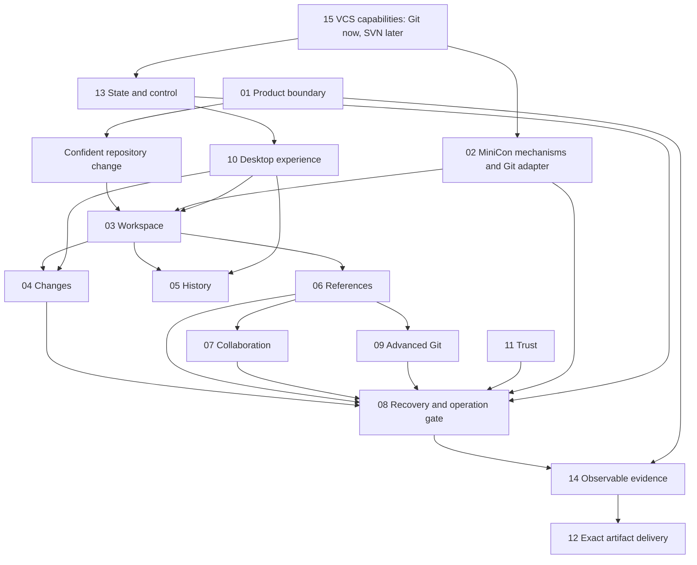

# MiniCon SrcMgr — product requirements index

Baseline: **1.2 · 2026-10-18 · reviewed for M0 implementation handoff; not implemented**. Repository: `partnernetsoftware/minicon-srcmgr`. Product name: MiniCon SrcMgr; executable name: `minicon-srcmgr`.

## Outcome tree DAG

```text
Outcome: understand and change Git repositories confidently through a small native GUI
├── 01 Product — users, scope, milestones and success
├── 02 Shared foundation — MiniCon reuse, Git execution and authority boundaries
├── 03 Workspace — discover, clone, organize and observe repositories
├── 04 Changes — inspect, stage precisely and commit
├── 05 History — graph, search, compare and blame
├── 06 References — branches, tags, switch and integrate
├── 07 Collaboration — fetch, pull, push and authentication interaction
├── 08 Recovery — conflicts, interrupted operations and destructive actions
├── 09 Advanced Git — stash, worktrees, submodules, LFS and patches
├── 10 Desktop experience — MiniCon design language, input and accessibility
├── 11 Trust — credentials, executable content and privacy
├── 12 Delivery — six OS/ISA cells, packages and updates
├── 13 State and control — persistence, command model and automation
├── 14 Verification — traceability, performance, gates and implementation order
└── 15 VCS extension — Git-first capability boundary; future SVN and other backends
```



## Governing invariants

1. The repository, index and refs are authoritative. Cached UI state never overrides Git state.
2. Every mutation binds a repository identity, explicit targets and fresh preconditions; stale previews cannot authorize a changed operation.
3. No automatic destructive cleanup, stash, history rewrite, push or hook bypass. Recovery actions state exactly what can and cannot be restored.
4. Shared MiniCon mechanisms are consumed at immutable revisions. Product state and Git semantics belong here.
5. Cross-architecture means matching native artifacts and independently recorded build/runtime evidence. Compilation alone proves no GUI behavior.
6. No mandatory service account, telemetry or network for local workflows. Repository-controlled code needs explicit trust.
7. One fact has one owning PRD. Links express dependencies; acceptance evidence cannot be inferred from documentation completeness.
8. Git is the initial backend; shared identities, storage and actions preserve a capability boundary for SVN and other VCS without inventing Git semantics for them. The extension contract is owned by 15.
9. Simple, practical, intuitive workflows and low resource use are release criteria. The lazygit functional comparison is owned by 01, interaction rules by 10 and measurable budgets by 14.

## Capability ownership

| Branch | Sole owning document | Requirement IDs |
|---|---|---|
| 01 | [Product and scope](prd/PRD_01_product.md) | PROD-* |
| 02 | [Architecture and MiniCon reuse](prd/PRD_02_architecture_reuse.md) | ARCH-* |
| 03 | [Repository workspace](prd/PRD_03_workspace.md) | REPO-* |
| 04 | [Changes and commits](prd/PRD_04_changes_commits.md) | CHANGE-* |
| 05 | [History and inspection](prd/PRD_05_history.md) | HIST-* |
| 06 | [Branches and integration](prd/PRD_06_references.md) | REF-* |
| 07 | [Remotes and collaboration](prd/PRD_07_remotes.md) | REMOTE-* |
| 08 | [Conflicts and recovery](prd/PRD_08_recovery.md) | REC-* |
| 09 | [Advanced workflows](prd/PRD_09_advanced_git.md) | ADV-* |
| 10 | [Desktop interaction and design](prd/PRD_10_desktop_ux.md) | UX-* |
| 11 | [Security and privacy](prd/PRD_11_security.md) | SEC-* |
| 12 | [Platform and release](prd/PRD_12_platform_delivery.md) | SHIP-* |
| 13 | [Persistence and control](prd/PRD_13_state_control.md) | STATE-* |
| 14 | [Verification and roadmap](prd/PRD_14_verification_roadmap.md) | QA-* |
| 15 | [VCS backend extension](prd/PRD_15_vcs_backends.md) | VCS-* |

## Reading and change protocol

Read 01 → 02 → 10 for intent and composition; read a behavior owner plus 08/11/13 before implementing a mutation; use 14 for implementation sequence and evidence. Requirement tables use invariant / observable evidence / safe failure / dependency / explicit exclusion as delivery contracts. Detailed acceptance clauses in the same owner refine those contracts.

Implementation entry: [M0 handoff and work sequence](plan/implementation-handoff.md). Review findings/disposition are owned by [14](prd/PRD_14_verification_roadmap.md); pending mechanism proofs remain owned by 02. The handoff permits beginning implementation, not declaring all risks resolved or publishing binaries.

`M0`, `M1`, `M2` and `M3` denote cumulative delivery milestones, defined only in [01](prd/PRD_01_product.md). All application requirements start `[_]`. `PASS`, `FAIL`, `BLOCKED` and `NOT-RUN` are evidence verdicts; no verdict currently certifies application behavior.

## Current frontier

- [v] Requirements baseline: this index and 15 linked owner modules; documentation checks are reproducible through `python scripts/check_docs.py`.
- [_] M0 architecture and native capability proofs, especially pixel UI accessibility, subprocess cancellation and fork resolution.
- [_] M1 local Git vertical slice; M2 team workflow beta; M3 full baseline and six-cell release qualification.

The documentation checker validates structure and local links, not semantic correctness or implementation. Source research and unresolved feasibility gates are owned by 02; requirement-to-evidence mapping is owned by 14.
