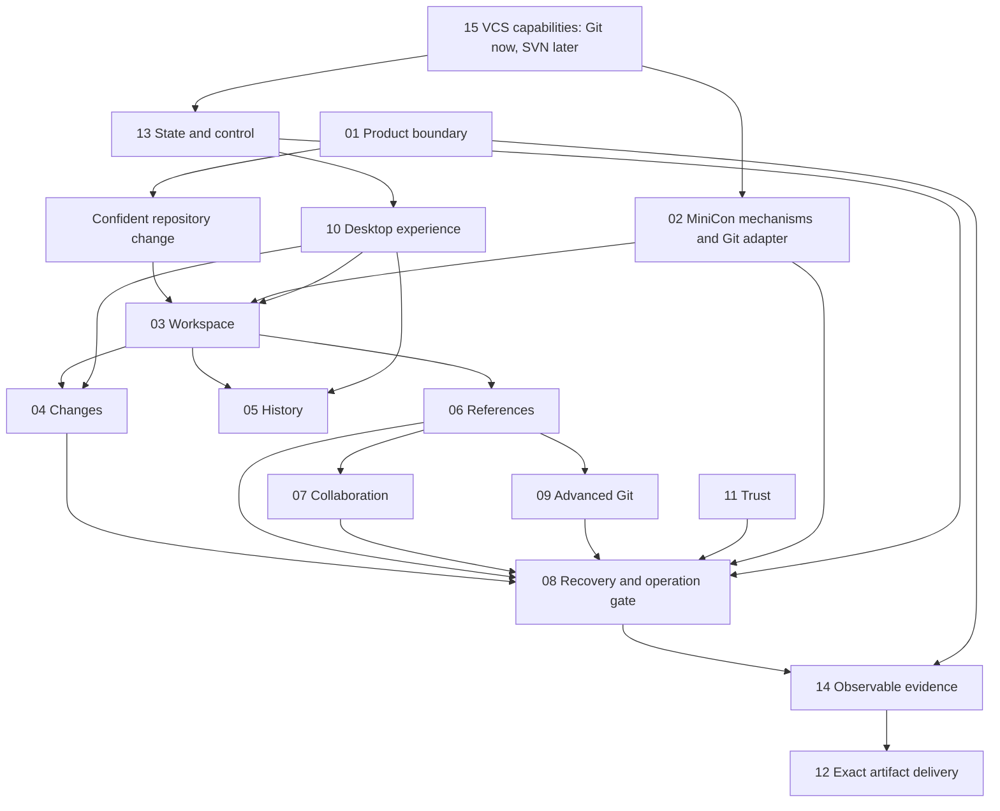

# MiniCon SrcMgr — product requirements index

Requirements baseline: **1.6 · 2026-10-24 · defines the first-user 0.1.0 feature tree, workspace journeys and 0.0.x delivery allocation**. This is a documentation baseline number, not the application version. Repository: `partnernetsoftware/minicon-srcmgr`. Product name: MiniCon SrcMgr; executable name: `minicon-srcmgr`.

## Outcome tree DAG

```text
Outcome: understand and change Git repositories confidently through a small native GUI
├── 01 Product — users, scope, milestones and success
├── 02 Shared foundation — MiniCon reuse, Git execution and authority boundaries
├── 03 Workspace — discover, clone, organize and observe repositories
├── 04 Changes — inspect, stage precisely and commit
├── 05 History — graph, search, compare and blame
├── 06 References — branches, tags, switch and integrate
├── 07 Collaboration — fetch, pull, push and authentication interaction
├── 08 Recovery — conflicts, interrupted operations and destructive actions
├── 09 Advanced Git — stash, worktrees, submodules, LFS and patches
├── 10 Desktop experience — MiniCon design language, input and accessibility
├── 11 Trust — credentials, executable content and privacy
├── 12 Delivery — six OS/ISA cells, packages and updates
├── 13 State and control — persistence, command model and automation
├── 14 Verification — traceability, performance, gates and implementation order
└── 15 VCS extension — Git-first capability boundary; future SVN and other backends
```



## Governing invariants

1. The repository, index and refs are authoritative. Cached UI state never overrides Git state.
2. Every mutation binds a repository identity, explicit targets and fresh preconditions; stale previews cannot authorize a changed operation.
3. No automatic destructive cleanup, stash, history rewrite, push or hook bypass. Recovery actions state exactly what can and cannot be restored.
4. Shared MiniCon mechanisms are consumed at immutable revisions. Product state and Git semantics belong here.
5. Cross-architecture means matching native artifacts and independently recorded build/runtime evidence. Compilation alone proves no GUI behavior.
6. No mandatory service account, telemetry or network for local workflows. Repository-controlled code needs explicit trust.
7. One fact has one owning PRD. Links express dependencies; acceptance evidence cannot be inferred from documentation completeness.
8. Git is the initial backend; shared identities, storage and actions preserve a capability boundary for SVN and other VCS without inventing Git semantics for them. The extension contract is owned by 15. Git remote transports/storage, including a candidate S3 helper, remain within the Git backend and follow 07/11.
9. Simple, practical, intuitive workflows and low resource use are release criteria. The lazygit functional comparison is owned by 01, interaction rules by 10 and measurable budgets by 14.
10. SrcMgr is a MiniCon productivity-suite component whose core promise is a small memory footprint, fast UI/UX response and stable operation. Product priority is owned by 01; all three pillars must qualify together under 14 before an affected milestone can pass.

## Capability ownership

| Branch | Sole owning document | Requirement IDs |
|---|---|---|
| 01 | [Product and scope](prd/PRD_01_product.md) | PROD-* |
| 02 | [Architecture and MiniCon reuse](prd/PRD_02_architecture_reuse.md) | ARCH-* |
| 03 | [Repository workspace](prd/PRD_03_workspace.md) | REPO-* |
| 04 | [Changes and commits](prd/PRD_04_changes_commits.md) | CHANGE-* |
| 05 | [History and inspection](prd/PRD_05_history.md) | HIST-* |
| 06 | [Branches and integration](prd/PRD_06_references.md) | REF-* |
| 07 | [Remotes and collaboration](prd/PRD_07_remotes.md) | REMOTE-* |
| 08 | [Conflicts and recovery](prd/PRD_08_recovery.md) | REC-* |
| 09 | [Advanced workflows](prd/PRD_09_advanced_git.md) | ADV-* |
| 10 | [Desktop interaction and design](prd/PRD_10_desktop_ux.md) | UX-* |
| 11 | [Security and privacy](prd/PRD_11_security.md) | SEC-* |
| 12 | [Platform and release](prd/PRD_12_platform_delivery.md) | SHIP-* |
| 13 | [Persistence and control](prd/PRD_13_state_control.md) | STATE-* |
| 14 | [Verification and roadmap](prd/PRD_14_verification_roadmap.md) | QA-* |
| 15 | [VCS backend extension](prd/PRD_15_vcs_backends.md) | VCS-* |

## Reading and change protocol

Read 01 → 02 → 10 for intent and composition; read a behavior owner plus 08/11/13 before implementing a mutation; use 14 for implementation sequence and evidence. Requirement tables use invariant / observable evidence / safe failure / dependency / explicit exclusion as delivery contracts. Detailed acceptance clauses in the same owner refine those contracts.

Implementation entry: [M0 work order and evidence](prd/PRD_14_verification_roadmap.md#implementation-work-order-and-evidence). Review findings/disposition are owned by [14](prd/PRD_14_verification_roadmap.md); pending mechanism proofs remain owned by 02. The work order permits beginning implementation, not declaring all risks resolved or publishing binaries.

`M0`, `M1`, `M2` and `M3` denote cumulative delivery milestones, defined only in [01](prd/PRD_01_product.md); they are not application version numbers. Requirement text describes intended behavior, not completion. `PASS`, `FAIL`, `BLOCKED` and `NOT-RUN` apply to named scoped evidence. Passing one implemented slice does not qualify a whole journey, milestone or platform matrix. Historical release evidence remains labeled with its original version and artifact.

## Product layers and near-term sequence

| Layer | Product question | Owner and current boundary |
|---|---|---|
| Daily local work | Can I find, inspect and commit the intended change? | 03–06/09/10; version plans select bounded slices rather than the entire feature catalogue |
| Trust and state | Do I know the target, effect, freshness and recovery limit? | 08/11/13; shared prerequisites for every delivered operation |
| Collaboration | Which remote receives which refs, and what actually happened? | 07; ordinary remote workflows precede candidate provider-specific integrations |
| VCS semantics | Is this Git or a future system such as SVN? | 15; S3 storage does not create another VCS kind |
| Shared mechanisms | Can MiniCon supply the platform/input/rendering/process capability? | 02; immutable reuse, no product state in shared crates |
| Quality and delivery | Is the declared slice small, responsive, stable and actually qualified? | 14/12; applicable gates follow each slice; six-cell product qualification remains cumulative |

The owner-directed near-term goal is [a usable 0.1.0 Git client](prd/PRD_01_product.md#010-first-user-feature-tree), sequenced in [the 0.0.x → 0.1.0 roadmap](plan/roadmap-0.1.0.md). Preserve the [0.0.5 checkpoint](plan/plan-0.0.5.md); the revised [0.0.6 plan](plan/plan-0.0.6.md) brings local entry, repository context and commit review into one coherent client, with quick filtering as a supporting feature. UI/UX task surfaces and return/failure states are owned by [10](prd/PRD_10_desktop_ux.md#first-user-workspace-and-journeys). Standard remote collaboration and conflict recovery are allocated before 0.1.0; S3 and future VCS adapters remain separate candidates. A roadmap neither bumps application versions nor authorizes helper installation/network access or publication.

## Current frontier

- [v] Requirements baseline: this index and 15 linked owner modules; documentation checks are reproducible through `python scripts/check_docs.py`.
- [-] M0 foundation and Windows local Git/UI slices have implementation and scoped evidence. Native accessibility, remaining capability proofs and full milestone qualification stay open; see 02/14.
- [-] M1 local workflows are partially delivered; paged graph, workspace/control and other cumulative clauses remain open. M2/M3 are not complete because selected later behaviors shipped early.
- [-] Current development target 0.0.5 is under qualification; 0.0.6 and the route to 0.1.0 are planned, not implemented. Exact source-release status is owned by [12](prd/PRD_12_platform_delivery.md), current execution evidence by the version plans linked from 14.

The documentation checker validates structure and local links, not semantic correctness or implementation. Source research and unresolved feasibility gates are owned by 02; requirement-to-evidence mapping is owned by 14.
