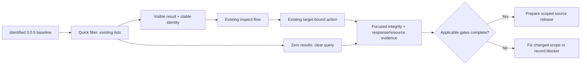

# 0.0.6 product and delivery plan

Status: `[_]` proposed next-version design; no implementation or acceptance claimed. Current development version remains **0.0.5**, whose [qualification plan](plan-0.0.5.md) remains authoritative for its delivery. This document does not bump package versions, publish a release or move unfinished 0.0.5 gates into a later version.

This plan selects and sequences a small product increment. The [PRD series](../PRD.md) owns behavior; the links below identify its owners. Planning is permitted while 0.0.5 is blocked. Implementation starts after its release baseline is established, or after an explicit decision to develop against an identified unreleased checkpoint without claiming that checkpoint shipped.

## Product decision

**Find the right item quickly, inspect it, then act on that exact item.**

0.0.5 strengthens operation truth and recovery. The next useful increment reduces the daily cost of finding a changed file, a branch or a recent commit in the existing workspace. Deliver one consistent quick-filter interaction across those three lists. Keep the window familiar; add neither another workspace nor a full search subsystem.

The core promise remains small memory footprint, fast UI/UX response and stable operation. A fast-looking filter that launches Git for every character, retains duplicate snapshots, or makes hidden files eligible for accidental bulk operations fails this version.

```text
0.0.6: find → inspect → act on the intended item
├── Find a changed file by its displayed repository-relative path
├── Find a branch by its name
├── Find a recent loaded commit by subject or OID prefix
├── Recognize the query, scope, result count and empty state
├── Clear/cancel without losing orientation
└── Preserve raw identities, action scope and existing quality budgets
```



## Users and concrete journeys

| Situation | Intended journey | Successful outcome |
|---|---|---|
| Many changed paths; review one configuration file | Files → Filter → type a path fragment → choose a result → inspect → stage that file/hunk | Less scrolling; the real selected path is the only target |
| Many local branches; return to a known task | Branches → Filter → type a branch fragment → inspect the result → use the existing switch action | The name remains visible and existing dirty-worktree protections still apply |
| Recall a recent change by its subject or copied OID | Commits → Filter → choose a result → files → diff → back | Explicit loaded-history scope; read-only detail and selection return remain intact |

A first-time user must be able to find the Filter affordance with a pointer. A keyboard user can reach it with `/` from the supported list. Neither needs to learn a query language.

## Scope and deliberate omissions

| Priority | Deliverable | Owning behavior |
|---|---|---|
| Must | Literal quick filtering for Files, Branches and loaded Commits | [10 · quick-filter interaction](../prd/PRD_10_desktop_ux.md#quick-filter-interaction), [05 · loaded-history filtering](../prd/PRD_05_history.md#loaded-history-quick-filter) |
| Must | Visible query, matched/loaded counts, clear control and actionable zero state | 10 |
| Must | Keyboard/text/pointer parity, selection restoration and stale-detail protection | 10, [13 · state/control](../prd/PRD_13_state_control.md) |
| Must | Safe selected-item actions and explicit prevention of hidden bulk scope | [04 · filtered change lists](../prd/PRD_04_changes_commits.md#filtered-change-lists), [08 · recovery](../prd/PRD_08_recovery.md) |
| Must | Bounded memory and no character-triggered Git/database/network work | [02 · reuse](../prd/PRD_02_architecture_reuse.md), [14 · verification](../prd/PRD_14_verification_roadmap.md) |
| Deferred | Search beyond loaded history, author/date/path/ref query forms, regex and fuzzy matching | Separate HIST-02 delivery; never imply this version completes it |
| Deferred | Diff text search, stash filtering, graph lanes, repository-wide content indexing and multi-repository search | Separate product decisions |
| Deferred | Fetch/pull/push, merge/rebase/reset/revert, extra VCS, new OS/ISA support, binary distribution | No scope added by this plan |

There is no optional feature bucket to fill if work finishes early. Resolve defects and complete evidence for this slice instead.

## Experience specification and examples

The interaction contract is owned by 10. The following sketch illustrates its visible hierarchy; it does not introduce a new layout system.

```text
Files                 3 / 200 loaded     [Filter /]
Filter: config                         [Clear ×]
  M  app/config.rs
  M  config/default.toml
  ?  docs/config-notes.md

Commits               2 / 200 loaded     [Filter /]
Filter: timeout                        [Clear ×]
Loaded history only · HEAD · 200 commits
  8b42d1a  Handle timeout after completed write
  c91a6f0  Explain timeout status
```

Counts above are examples, not a new hardcoded list limit. Always describe the actual loaded set and any existing truncation. An empty result says `No matches in loaded items` with Clear available; it does not say the repository contains no matching commit or has no changes.

| Moment | Required user-visible result |
|---|---|
| Open Filter | A focused text field shows the existing query; list remains visible |
| Type or paste | Loaded results update; text never invokes application shortcuts; no new Git job |
| Press Enter in the field | Apply the query and leave editing; no stage, switch, checkout or commit |
| Navigate after applying | Existing navigation/inspection behavior, using visible stable identities |
| Escape while editing | Restore the query/selection from before editing where still valid |
| Escape with applied filter in its list | Clear that filter and consume the key; do not also exit the view |
| Clear with pointer | Restore the unfiltered list and logical position without another panel opening |
| Refresh or external change | Re-evaluate the same query against the new snapshot; no row-number retargeting |

## Safety and quality decisions

1. Filtering is a view, never a new mutation target selector. Existing confirmation, trust and fresh-state checks remain mandatory. A hidden or removed selection cannot remain an invisible action target.
2. While Files has a nonempty query, disable all-files stage/unstage, stash creation and commit submission, even if focus moved elsewhere. Explain `Clear Files filter to review the full operation scope` and offer Clear. Single visible file/hunk/line actions remain available through existing rules. This deliberately avoids adding a second meaning of “all” or a new confirmation flow in a patch increment.
3. Filtering commits is not repository-wide history search. Display the current reachability scope and loaded count. Do not increase history loading, walk the object database or fetch objects to make a query look complete.
4. Reuse loaded rows; retain query text, visible indices and stable selection anchors rather than copied repositories/diffs/search caches. Query length is bounded at 256 Unicode scalar values, with a visible limit indication. No persisted search history, telemetry, timer or new dependency is required.
5. Input-to-visible results inherit 14's response budgets, including while an owned Git read is active. Filter editing must remain usable without waiting for that read. No lower budget or acceptance waiver is introduced by this plan.

## Work packages and evidence

All packages start `[_]`. Implementation may revise engineering order after inspecting the actual baseline, but a scope/behavior change first updates its PRD owner. Version numbers change only when 0.0.6 implementation is explicitly started.

| Package | Work | Minimum evidence and stop condition |
|---|---|---|
| P0 · baseline | Identify source/artifact, existing list bounds, input routing and reusable 0.0.5 evidence; list inherited blockers separately | A short scoped baseline record; no routine rebuild or long replay just to start planning |
| P1 · matching and identities | Project the existing three lists to bounded visible indices; raw paths/full OIDs remain action identities | Focused model cases distinguish duplicate labels, zero matches, refresh/removal, clear/cancel restoration and query isolation |
| P2 · interaction | Existing MiniCon text input; Filter/Clear hit targets; editing state; counts/scope; details entered only after deliberate result activation | One real keyboard and pointer journey across the three lists, including pasted Unicode/IME committed text and an empty result; keys typed in the field dispatch no mutation |
| P3 · action integration | Route selected visible identities through existing actions; guard global Files operations; reject stale details | One disposable real-Git mixed-index fixture proves selected stage changes only the intended entry and hidden files remain unchanged; focused dispatch checks prove blocked whole-scope actions issue no write jobs |
| P4 · scoped qualification | Measure changed filter paths and inspect retained state; reconcile result truth and current release prerequisites | Changed-path timing/resource receipt plus integrity outcomes; every applicable gate is PASS/FAIL/BLOCKED, with no numeric PASS inferred from callback timing alone |

Do not write tests merely mirroring matching code or replay every prior stash/recovery test. One fixture can cover several meaningful boundaries. Add a negative control only for a materially changed loss guard or uncertain discriminating test. Expand checks only when a failure or changed dependency justifies it.

## Acceptance ledger

These are version acceptance scenarios, not new PRD requirement IDs or evidence of completion.

| Case | Outcome to establish | Status |
|---|---|---|
| F1 · find and clear | Query/count/zero state truthful; prior selected identity restored when present | `[_]` |
| F2 · input isolation | `q`, `c`, `d`, `s`, spaces and pasted text remain text while editing; Enter applies only; Escape cancels only | `[_]` |
| F3 · correct target | Duplicate/truncated display labels and list refresh cannot change the raw path/full OID acted upon | `[_]` |
| F4 · hidden scope | Filtered Files prevents whole-scope operations, including from another pane; clearing re-enables existing behavior | `[_]` |
| F5 · history truth | Loaded-history scope stays visible through filter → commit files → diff → back; no all-history claim or eager traversal | `[_]` |
| F6 · response | On the qualified reference host, filter feedback meets 14's actual presentation and dispatch limits; busy-read input remains responsive | `[_]` |
| F7 · footprint/stability | No Git/DB/network launches attributable to query edits; no idle filter wakeups; repeated query/clear/view operations release retained state and stay within 14's memory budgets | `[_]` |

Use the existing standard fixture and measurement tools only where they measure the changed behavior. A focus-border observer does not establish filtered-result presentation. If a necessary observer or reference host is unavailable, keep that row BLOCKED and continue independent work. Do not repeatedly calibrate unchanged remote display prerequisites. Inherited 0.0.5 environment and measurement blockers must be resolved, not renamed away.

For F7, select one bounded repeated query/clear/detail journey against the existing 100-cycle/+8 MiB criterion; do not launch another 30-minute journey solely because this plan is new. Reuse unaffected sustained-use evidence with original source/artifact identities. Accessibility/DPI claims remain limited to actual evidence under 10/14; custom controls must expose name, query value, result count and clear action through the existing semantic boundary rather than relying on color.

## Release decision and handoff

Release only the declared Windows local-workflow source slice after applicable inherited and changed-scope gates pass. No claim of full M1/M2, full HIST-02, cross-platform qualification or complete lazygit parity follows. Release wording should explain the everyday benefit and the loaded-history limit in plain language. Preserve the latest actual published version until publication is verified.

Implementation handoff must contain source/artifact identity, package and acceptance status, the selected checks and stopping conditions, reused evidence, remaining blockers and a short filter → inspect → selected action demonstration. If prerequisites remain open, hand back an implementation checkpoint. Publication follows the owner's applicable authorization and [12](../prd/PRD_12_platform_delivery.md); this design task itself performs no publication.
