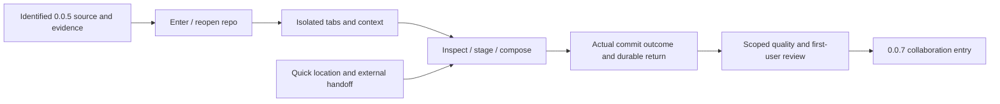

# 0.0.6 product and delivery plan

Status: `[-]` implementation started against source checkpoint `ccfae99`; current package version is **0.0.6**. No release or complete acceptance is claimed. This revision follows the owner's direction to reach a usable client at 0.1.0, superseding the earlier filter-only proposal. The [0.1.0 roadmap](roadmap-0.1.0.md) owns version allocation, [01](../prd/PRD_01_product.md#010-first-user-feature-tree) owns product admission, and [10](../prd/PRD_10_desktop_ux.md#first-user-workspace-and-journeys) owns UI/UX. This is not release notes or an instruction to publish.

## Product outcome

**Open a project, understand its changes, prepare the intended commit and resume work without losing context.**

0.0.6 turns the existing local Git operations into a coherent local client. Quick filters remain useful supporting tools; they no longer define the entire release. Clone and authenticated collaboration are allocated to 0.0.7. Preserve 0.0.5's completed work and exact evidence rather than reimplement it.

```text
0.0.6 · usable local client foundation
├── A. Enter a repository
│   ├── Welcome: Open / Create / recent entries
│   ├── Git and identity guidance; bounded trust decision
│   └── Distinct local init, existing repository and missing-path states
├── B. Stay oriented across projects
│   ├── Repository tabs with path, branch and operation state
│   ├── Independent drafts, queries, selections and scroll
│   └── Reopen recent project; close without losing acknowledged input
├── C. Prepare a commit
│   ├── Coherent unstaged/staged/untracked display and selected Diff
│   ├── Existing file/hunk/line stage/unstage and truthful result
│   ├── Discoverable existing ignore/discard with their safety guards
│   ├── Full-index review beside durable message composition
│   └── Commit → actual OID → refreshed history; preserve failed draft
├── D. Find and hand off
│   ├── Literal quick filter: changed files, branches, loaded commits
│   ├── Explicit limited history scope and clear/cancel/return behavior
│   └── User-selected editor/terminal at the intended file/repository
└── E. Keep the product small, responsive and dependable
    ├── Same typed actions across pointer/keyboard/help
    ├── Existing trust/recovery/stale-result and queue boundaries
    └── Targeted integrity, interaction and changed-path resource evidence
```



## Task and interaction contracts

| Task | Visible path and finish | Owning behavior |
|---|---|---|
| First launch without Git | Welcome remains usable; select installed Git or read setup guidance; no auto-install/account | 02/03/10/11 |
| Open/init | Choose explicit path → trust/setup → Changes; init never stages/commits existing files automatically | 03/11 |
| Reopen/switch | Recent entry or tab → named repo/branch → preserved draft/selection; unavailable path offers Locate/Remove | 03/10/13 |
| Review/stage | Select raw-identity file → staged or unstaged diff → named action → observed index effect | 04/08/10 |
| Commit | Review the full staged index → edit message → deliberate submit → actual OID or actionable failure; never stage implicitly | 04/13 |
| Filter | `/` or visible Filter → literal query → inspect result; full-index commit review stays unfiltered | 04/05/10 |
| Hand off | Open file/editor/terminal → reviewed configured tool and exact destination; return without resetting context | 10/11 |
| Settings/diagnostics | Distinct app preferences versus repository identity/settings; show actual Git and unavailable capabilities | 02/03/10/11/13 |

Changes is the first complete task surface. Existing numbered-pane shortcuts remain valid aliases; users also get named pointer actions and a visible focus path. Reuse MiniCon's shell/input/rendering capabilities; do not build a second UI toolkit or a new general docking system. Semantic names, IME-safe text routing and localization keys are part of new controls from the start.

A Files filter does not change commit scope. The revised rule permits commit from a filtered worktree list **only through the complete, unfiltered staged-index review** specified in 04. If that review is unavailable or stale, submission is disabled with a reason. Whole-file-list stage/unstage and stash creation still require clearing the Files filter; no hidden filtered-all mode is added. This replaces the earlier blanket clear-before-commit rule, avoiding a disruptive extra step while keeping the complete commit target visible.

## Boundaries

Must: A–E above and repairs necessary for their truthful results, retained context and measured quality. No new repository-writing engine, background service, search index or per-tab polling. Existing safe refusals remain visible.

Deferred to their allocated increments: clone/fetch/pull/push/auth (0.0.7), merge/rebase/conflict center and stash extensions (0.0.8), graph/history expansion and other assigned corrections (0.0.9). Existing commit detail and branch/stash actions remain available; this plan does not remove delivered behavior. Interactive rebase, S3, other VCS, full LFS/submodule/worktree administration and broader platform releases are outside this increment.

A Clone affordance may explain that it is unavailable in this checkpoint, but must not appear functional before its slice lands. Do not expose a toolbar of misleading inactive commands solely to resemble the final mockup. Signing/package/native-host feasibility is investigated early under 12; public binary promotion is not performed by a design task.

## Work packages and evidence

P0 source review is complete for the initial entry slice; P1/P3 have recents storage, Welcome/Open/Create, installed-Git selection, local identity setup and bounded graphical trust approval. P2 has complete staged-index review and durable message composition with scoped evidence below. P3 has repository tabs, explicit close/reopen, durable selection/scroll, local queries and the current commit/files/Diff return path. Invalid saved-view metadata has explicit bounded archive/cancel recovery. Files/Branches/loaded-Commits filtering and its full-index commit integration have scoped evidence below. Optional external-tool settings/review/launch now have actual child and native editor/terminal evidence below. Missing-path Locate/Remove and named Changes/ignore/partial-review controls now have scoped model/Git/native evidence below; applicable integrated P5 acceptance remains open. Inspect actual code before assigning missing work. P0 is a source review, not an automatic full test pass. Implement A → C as the first vertical slice, then B/D; carry E throughout. Change the package version only when implementation is explicitly started.

| Package | Change and user risk | Minimum evidence / stopping condition |
|---|---|---|
| P0 · baseline and reuse | Identify actual 0.0.5 source/artifacts, current worker/actions, existing native controls and inherited blockers | Record reusable evidence and true gaps; do not rebuild unaffected operations or replay long tests |
| P1 · entry and setup | Wrong destination/trust, accidental initialization or lost recent path | Disposable existing/nonempty/new target checks; first-run missing Git, trust deny/grant and failed Locate/Open shown once in real UI |
| P2 · local commit surface | Staged/unstaged confusion, hidden staged content or lost message | Actual mixed-index fixture; filtered file view with unrelated staged entry remains visible in full-index review; successful commit tree matches review, failure keeps draft |
| P3 · context and handoff | Cross-repository draft/action routing, stale reply after tab switch, unsafe tool destination | Two disposable repos with distinct edits/drafts; switch/reopen verifies isolation and stale rejection; one reviewed editor/terminal launch checks destination |
| P4 · quick location | Text shortcuts accidentally mutate; matching display label changes action target | Focused model/input/identity tests plus one combined keyboard/pointer journey across three lists; no per-character Git/DB/network job |
| P5 · integration and feasibility | Coherent flow fails on a clean profile or retained state grows | One native entry→stage→draft→commit→switch→reopen journey with actual Git-state/draft oracles; changed-path response/memory/CPU evidence; explicit package/accessibility/reference-host feasibility record |

Use the existing disposable fixtures and owned-process tools where their measurement boundary fits the new path. Do not count a focus border as evidence of staged-list/filter-result presentation. Expand checking only for demonstrated failures, new writer scope or changed dependencies. The 0.0.5 long-session receipt is not relabeled as a new binary; unchanged contracts can reuse it with original identity. No new 30-minute/eight-hour/six-cell campaign is triggered merely by this plan.

Suite feedback follows [14's failure disposition loop](../prd/PRD_14_verification_roadmap.md#continuous-suite-feedback). For each failure, the execution record retains its case/source/run, observed mismatch, product/harness/environment classification (or unresolved cause), repair and selected follow-up verdict. Product fixes leave a meaningful regression; deterministic cases enter the relevant CI lane. Close the affected loop before proceeding with dependent work, reuse unaffected evidence and keep missing required qualification explicit. This is the test approach for P1–P5, not a claim that those packages have passed.

## Acceptance and exit ledger

| Case | Required outcome | State |
|---|---|---|
| L1 · entry | Fresh profile opens or creates a local repository with clear Git/trust/identity guidance; existing content preserved | `[-]` · Open/Create/Git/local-identity/trust and Locate/Remove evidence below; applicable integrated entry/P5 qualification stays open |
| L2 · commit | Pointer and keyboard can inspect/stage/compose/commit; visible full-index review matches actual committed content | `[-]` · full-index composer, filtered scope and named Changes/ignore/partial-review evidence below; applicable integrated P5 acceptance remains open |
| L3 · continuity | Two repositories keep independent drafts, selection, filter and scroll; close/reopen preserves acknowledged state | `[-]` · native tabs/drafts/queries/selection/scroll, current historical return/recovery and external handoff evidence below; applicable P5 acceptance remains open |
| L4 · find | Query/count/empty/reset are truthful; loaded history limit visible; text/IME input invokes no shortcuts | `[-]` · local model/Git/native filtering evidence below; broad native IME/clipboard/accessibility and P5 remain open |
| L5 · action truth | Filtered/stale/removed items cannot retarget a write; true success, refusal and uncertain result remain distinct | `[-]` · real filtered-index commit, stale refusal and discriminating guards below; complete affected journey qualification remains open |
| L6 · quality | Applicable changed-path resource/response/integrity gates pass; inherited missing prerequisites remain explicit | `[_]` |
| L7 · readiness | First-user package/native-host/accessibility dependencies have concrete owners and next steps; no fake delivery claim | `[_]` |

The handoff records source/artifact, cases, actual state oracles, reused evidence and blockers. An unmet applicable release gate remains BLOCKED, while independent work can proceed against a clearly identified source checkpoint. Release status stays under 12 and named publication authority. This plan changes neither current version metadata nor any past release claim.

## Execution record · recent navigation storage

The owner now authorizes development and sequential public releases of 0.0.6, 0.0.7, 0.0.8 and 0.0.9. Publication remains subject to each declared slice's applicable gates; no version is qualified by this authority alone. Remote inspection at start showed source main `31942f8`, latest release `v0.0.4`, and no 0.0.6–0.0.9 tags. 0.0.5 remains an unpublished source checkpoint, not a release invented to fill the sequence.

Initial implementation adds passive, backend-tagged MRU repository metadata through the existing transactional profile settings store, with lossless platform-tagged paths and bounded decoding. Explicit GUI open records its canonical trusted worktree once; refresh does not rewrite recents. Reading/removing an entry performs no repository scan, trust grant or file/draft deletion. The Welcome/recent controls and multi-repository window are not yet implemented. Existing schema/drafts remain compatible; no database migration or new third-party dependency was introduced.

Selected verification: corrupt or lossy recents could misdirect navigation or erase metadata → real SQLite reopen/reorder/forget/content/draft checks and native-path boundaries, plus affected domain/state tests and CLI/state/domain all-target Clippy. The local Windows run passed 20 selected tests and Clippy with warnings denied. Three newly added store cases cover durable recents/removal, bounds/backend isolation/corrupt retention, and native/foreign paths. No graphical, resource or release PASS follows. A path-triggered Windows/Linux CI workflow is configured for this suite; configure/run/observed-pass states must remain distinct. No full workspace/long-session replay was selected.

## Execution record · guarded Open and suite feedback

Development branch: `work/0.0.6-local-client`. Storage checkpoint `3949372` passed both native-path/profile CI lanes (Windows and Ubuntu) in run `39991564013`, and documentation run `39991563711` passed. These are actual completed CI verdicts, not configured-only status or Linux GUI qualification.

The window now has a named Open affordance, Ctrl+O and a path input. Backend target changes only after trusted discovery/snapshot succeeds; refusal retains the old target and entered path. Open submission is refused while old work is active/queued, and its submitted modal blocks new old-target actions. Successful entry loads the target draft and increases the detail generation. This is single-window replacement, not tabs or a completed first-run flow. Untrusted repositories are refused; graphical trust grant is still missing.

Selected local checks passed: two UI routing/queue tests and one two-repository actual-Git case using supported Git 2.56.0, plus affected UI/CLI all-target Clippy. The Git case verifies trust refusal keeps the old target, success loads the other draft, and staging changes only the new index while preserving the old draft. The queue guard has a discriminating negative control: temporarily removing it makes `open_repository_cannot_retarget_queued_work` fail at its queue-state assertion; exact source bytes were restored and the selected test passed. No test-only production switch was added. The new local-client CI lane exercises shared input/model regressions and this selected Git entry case; its remote outcome must be observed separately.

`target/qualification/006-entry-native-v1` is retained as a failed driver attempt on artifact `ccb614439a14b47bb69ddab75d595bda629c05edafb88f8dafb29a7812ce88f1`. Native staging actually succeeded: its index matched the fixture worktree bytes. The driver had assumed LF although Python wrote CRLF on Windows. The repaired oracle compares exact fixture bytes, without normalizing away content. Its failure capture also exposed a real stale native-window title after switching repositories. The product now updates title through the pinned MiniCon facade and identifies the actual worktree; no sibling checkout changed.

`target/qualification/006-entry-native-v2/receipt.json` completed on optimized artifact `ba84060e23694245942dfd7eac2e60f419a76c42816869d14574308333da941f`, with its source-input hashes retained beside the frozen binary. Actual native Ctrl+O/path input opened the other owned trusted repository; its selected file was staged, its draft edited/saved, and return to the source retained independent drafts and unchanged source HEAD/index/worktree. Native title acknowledgement and target/return captures were reviewed. Owned descendant coverage is COMPLETE (143 processes, zero active at exit); exit was 0. This does not prove pointer interaction, first-run trust, tabs, init or reference latency/resources. Latency was explicitly NOT-RUN; one-second idle diagnostics are not budget qualification. No unaffected sustained journey or full workspace suite was replayed.

At that checkpoint, next work was the complete entry task: Welcome/Open/Create/recent controls and bounded graphical trust/setup, then retained tab state and the full staged-index composer; later records below supersede those implementation gaps. Header compactness and path presentation need refinement as the shell evolves; do not mistake the basic Open slice for the full 0.0.6 UI/UX or publish it as complete.


## Execution record · Welcome and explicit trust

The repository-independent worker now provides Welcome, passive recent selection/removal and metadata-only trust review for plain `.git` repositories. Approval binds canonical paths and a fingerprint through an expiring one-use ticket; cancellation writes no grant. Native title follows the target. Three selected backend tests and two Welcome UI tests passed, together with affected UI/CLI all-target Clippy and an optimized build. The existing 54 UI regressions passed during structural integration; these results do not qualify init, setup or tabs. The local-client CI definition now includes the new entry cases; a remote verdict is still required.

A targeted negative control removed only the metadata-fingerprint freshness condition. `entry::tests::entry_cancel_and_changed_metadata_never_create_a_trust_grant` then failed on the unwanted grant; exact source bytes were restored and the case passed. Local logs and receipt are retained under `target/qualification/006-trust-freshness-negative`; no production fault switch was introduced.

Native attempt `006-welcome-native-v1` on artifact `2dcaf05229b3c2eb0c5cb9b6c38421727b0d01ee05cb351ef17ffb65043b4f6d` was refused by the input-ownership guard because another application's window occluded the intended control. It retained no grant and launched zero Git processes. This is an environment/input-isolation failure, not a passing pointer test. The harness was changed to raise only its owned product window during functional tests; latency measurements are forbidden in that mode. No other application's process or window was modified.

`006-welcome-native-v2` completed on the same product bytes with owned-window isolation. Reconciled process evidence reports zero Git before approval. Actual pointer Cancel preserved the path and no-grant state; actual pointer Trust and open entered the selected repository. Subsequent keyboard Open used a space/Unicode target, staging affected only its index, and independent durable drafts survived the return. Owned descendant coverage is COMPLETE (143 processes, zero active at exit); the product exited normally. Welcome, trust-review and target captures were visually reviewed: the review presents location, metadata, execution warning and distinct approval/cancel controls. Welcome's right pane still has an inappropriate Diff caption, retained as a UI correction for the next entry change. Unicode path routing is proven; broad font/IME coverage is not.

Latency was explicitly NOT-RUN. Short idle diagnostics do not qualify resource budgets; this host/display does not satisfy the reference-environment requirements. Raw receipts retain their original review-status field; this execution record records the later manual capture review without rewriting them. Init, graphical Git/identity setup, tabs, full staged-index composition, filters, handoff and complete P5 qualification remain open. No 0.0.6 release is claimed.


## Execution record · reviewed local initialization

Welcome/trust source `30c2c89` passed local-client CI `40000271908` and documentation CI `40000271781`. Its frozen `2dcaf052...` artifact has a local commit binding: all 54 captured source-input hashes match committed blob bytes or their CRLF checkout representation. These are completed scoped verdicts, not new release qualification.

Create now offers path and initial branch, a bounded filesystem-only review, deliberate one-use initialization approval and a separate post-init trust review. It uses the existing contained Git runner and MiniCon filesystem identity/entropy facilities, with no dependency or sibling-source change. It never reinitializes a present `.git`, copies user templates, stages content or makes an initial commit. Failed creation preserves input and warns about partial metadata; existing files are never automatically removed. Selected Git is checked outside the target before its version probe. Full-ref validation precedes directory creation.

Three new actual-Git backend tests passed: cancel/expiry/missing Git/invalid branch write nothing; new and nonempty Unicode/space targets preserve existing binary/nested contents and open as unborn only after separate trust; preexisting/racing metadata and a replaced directory are refused. Three selected UI tests passed for two-field input, review/held Enter, cancellation, preserved failed input, independent trust and queue exclusion. Affected CLI/UI/Git all-target Clippy and optimized build passed. The local-client CI now tracks the Git adapter dependency and retains the new cases through `entry::tests`; its next remote result must be observed separately.

The `.git` reservation has a discriminating negative control retained under `target/qualification/006-init-reservation-negative`: removing only that atomic creation lets a competing repository be reinitialized and fails the named stale/racing-metadata case. Exact source bytes were restored and that case passed. No repeated broad fault catalogue was selected.

`006-create-native-v1` on optimized artifact `4588ed54924f9e72a2b5fe6a20e82acc5cb47d2856a6ba18d6eaa47d07aa0118` stopped before initialization: the existing button locator mistook the form's full-width focus border for its default-Cancel button. It exited normally, with COMPLETE two-process coverage. The corrected harness selects a contiguous button-width border; input/foreground/point-ownership guards and repository-state assertions remain intact. The failed receipt is retained, not converted to a pass.

`006-create-native-v2` passed on the same product bytes. Actual Unicode input and pointer Review/Back/Create preserved the entered path/branch and preexisting binary/nested files. Before explicit creation approval, reconciled owned-process evidence shows zero Git and no `.git`. Enter could approve neither initialization nor trust. Initialization used the requested `feature/start`, SHA-1/files format and an empty template despite conflicting disposable user defaults and template canaries. No index or initial commit appeared. Separate trust Cancel retained the created repository without saving a grant; subsequent pointer approval opened it with two untracked rows and no commits. Actual Git symbolic-ref/index/HEAD oracles and final file bytes agreed. Descendant coverage is COMPLETE (35 processes, zero active at exit), exit 0. Form, creation review, trust and opened captures were reviewed; the form capture from the first attempt uses the same bytes. The Welcome Diff caption was corrected to Welcome. Raw receipts keep their original manual-review field; this record carries the later visual verdict.

The native run used isolation of its owned window only; latency and resource qualification were explicitly NOT-RUN. No long/session/workspace replay or native matrix was selected. Git selection/identity UI, retained tabs/close durability, full staged-index composer, filters, handoff and P5/readiness remain required before completing 0.0.6. Version metadata remains 0.0.6; no release or later-version advancement is claimed.


Integration follow-up: source `1ad62c9` passed Windows local-client CI `40002819445` (shared UI regressions, actual-Git Open/entry cases and affected static checks) and documentation CI `40002819359`. All 55 captured product source inputs for optimized artifact `4588ed54924f9e72a2b5fe6a20e82acc5cb47d2856a6ba18d6eaa47d07aa0118` match that commit's blobs or CRLF checkout representation; the local binding is retained beside the frozen binary. A read-only follow-up on the retained native fixture separately confirmed SHA-1 objects and files refs, without replaying the GUI. These scoped passes do not close the remaining L1–L7 contracts or authorize claiming 0.0.6 complete.


## Execution record · installed Git and repository identity

Git/G now provides passive selection/setup guidance, explicit Test and save, tested version/path diagnostics and lossless durable executable preference. Startup selection is `--git`, then saved preference, then absolute PATH entries; an explicit GUI save can replace the session selection. Empty/relative PATH entries are never implicit execution authority. Failed tests or storage leave the previous preference and worker executable intact. Successful selection invalidates pending execution plans; existing worker work cannot be overtaken by Configure. The active repository worker pins its selected path instead of reading SQLite on every Git operation.

Identity/I reads source scopes/origins and Git-resolved author/committer under repository trust. Its one-use, expiring preview binds the active worktree and original config. Save local edits both identity values in an exclusively created config lock using the installed Git, rechecks source identity/bytes and publishes once. Existing locks, invalid input, stale config and failed temp edits do not partially publish. Other settings/comments, source files, index and refs are preserved. Publication is acknowledged before any subsequent durability/opening warning; changed config requires explicit fresh trust. Global/system identity is displayed as inherited, not edited. Input survives refusal and preview reload. Pending reads are dismissible; a submitted save cannot be falsely cancelled. No new dependency, migration, service, polling or sibling-source change was introduced.

Selected local evidence passed: two executable-preference/backend cases (passive viewing, durable restart/launch override, missing executable and failed persistence), two identity actual-Git cases (scoped publication/regrant and stale/locked/failed edits), one executable-canary case, two UI input/refusal/read-cancel cases, and 22 domain/state checks including shared native-path/recents regression coverage. Affected CLI/UI/Git/state all-target Clippy and optimized build passed. Shared UI/input and source integration are delegated to the existing path-triggered local-client CI; profile/native-path CI already covers both Windows and Linux. Remote verdicts must be observed, not inferred from configuration.

Failure feedback was actionable. The profile-lock case first exposed a diagnostic that failed to distinguish tested from saved/applied; mapping profile-open and transaction errors consistently fixed it without relaxing the unchanged-state assertions. Identity publication then exposed Git for Windows rejecting verbatim absolute lock-file paths; the adapter now uses a fixed literal filename under the already-identified metadata directory. The named actual-Git test passes after repair, retaining the config/source/trust oracles.

Two discriminating negative controls are retained locally: `006-identity-freshness-negative` removed config-source rechecks and caught an external edit being overwritten; `006-git-before-probe-negative` removed the pre-probe repository-local executable refusal and caught a real canary program being executed. Exact source was restored and each selected case passed. The executable case includes a positive execution control, not only an error-message assertion. These experiments are not rerun for unrelated edits.

`006-settings-native-v1` on artifact `f1f7d9c3a654c32a31d1a95703ec139f0965605a943e993e7b2c06391775ccb8` completed Git selection and creation, then the driver entered identity text before its asynchronous read was ready. No identity was published. The loading fields looked editable; the product now renders them read-only and exposes Working/Ready status. The driver waits for real Ready before input. One missing descendant notification separately blocked complete process evidence in that run; that absence is retained and not called repaired. Its raw aggregate verdict is BLOCKED; the driver has since been fixed to retain the primary functional failure alongside a coverage blocker rather than overwrite it.

`006-settings-native-v2` passed on optimized artifact `59bfb59e5a870af671958324a9d8d9d7d69db37801eb31ae50ba45bbde6c9446`, with captured source inputs beside the frozen binary. With no Git on PATH and no `--git`, settings display launched zero Git; actual pointer Test and save selected the explicit installed Git. Pointer creation/back/trust, Unicode text, local identity Save and separate changed-config trust all completed. Global config and preexisting binary/nested contents stayed exact; init/identity setup never staged or committed implicitly. Deliberate native staging and first commit produced the exact selected tree and configured Unicode author/committer. A second native launch, still without PATH Git or `--git`, reopened through the saved preference. Both exits were 0. Owned descendant coverage is COMPLETE (203 processes, zero active at exit). This is entry/setup/identity and an existing commit-path observation, not the missing full-index composer acceptance.

Git settings, missing-identity, post-save review, first-commit and restart captures were reviewed; raw receipts retain their original manual-review field. A perceived header-label discrepancy was resolved with a narrow same-artifact diagnostic: native client pixels and saved PNGs agree, and Open/Git header regions are byte-identical in initial/settings-ready/idle/restarted captures. No rendering change was warranted. The first diagnostic sent input before startup Open completed; a second retained valid comparison captures but failed its final restoration predicate because it matched the word settings inside the fixture path. Neither failed driver is relabeled a full PASS. The scoped pixel-comparison result is retained separately; no further replay was selected.

All native observations used isolation of owned test windows only. Latency/resources are explicitly NOT-RUN, and the reference-host/accessibility/package gaps are unchanged. Complete tab/close context, full staged-index composer, quick filters, external handoff, repair affordances and P5/readiness remain required. Version stays 0.0.6; no release or later-version qualification follows from these checks.


Integration follow-up: source `78205e0` passed local-client CI `40009462483`, profile/native-path CI `40009462494` on both Windows and Ubuntu, and documentation CI `40009462490`. All 57 captured product inputs of optimized artifact `59bfb59e5a870af671958324a9d8d9d7d69db37801eb31ae50ba45bbde6c9446` match that commit's blobs or their CRLF checkout bytes; the local binding is retained beside the frozen binary. These integration results qualify the named contracts only. P2's full staged-index review/composer, P3 context/handoff, P4 filters and P5/readiness remain open; no version advancement or public release is claimed.

## Execution record · complete staged review and suite feedback

P2 now provides a named Commit entry, complete unfiltered staged paths/counts (binary unknown markers), selected read-only staged Diff, ordinary/merge context, HEAD/reference and a shared MiniCon multiline composer. Selected diff readiness and whole-review freshness gate submission. The existing immutable MiniCon revision supplies caret, selection, movement, cell geometry, clipboard and typed IME facilities; no sibling checkout, dependency revision or schema is changed. Clipboard I/O is asynchronous and context-fenced. Dirty text schedules a checkpoint during continuous typing; close waits for the exact latest save acknowledgement. Failure retains copyable text and stops automatic retries. Native clipboard/IME/accessibility remain unqualified.

The adapter binds the complete index delta, HEAD, reference and merge parents, refuses stale or conflicted state, and invokes ordinary live-index Git commit with hooks intact. It observes HEAD even after a nonzero exit and reports actual OID/tree/parent/destination discrepancies without resetting. Exact submitted draft plus pending attempt is durable before launch; interrupted/unknown attempts require explicit read-only reconciliation before another submission. Profile cleanup failure acknowledges the known commit and preserves the draft. Discovery now rejects an unapproved redirected worktree before mutation, and profile lock release preserves a replacement owner's contents.

Selected local checks passed: 11 actual-Git `commit_review` cases, 65 UI library regressions, 13 store tests (including transactional attempt/draft restart and foreign lock preservation), affected all-target Clippy with warnings denied, and an optimized build. Actual Git cases include binary/native paths, untouched unstaged bytes, extra staged content, unborn/empty/conflicted index, changed merge parents, actual two-parent commit, hook tree changes, nonzero hook after a real ref write, interrupted attempt, saved executable selection and post-commit storage failure. The path-triggered local-client CI now selects these Git cases in addition to its existing UI/entry contracts; remote results must be observed separately. No unrelated remote, full workspace or long-session replay was selected.

Feedback dispositions:

- Product defect: saved executable lookup recursively acquired the already-held profile lock during CLI commit. Resolve the executable before acquiring that writer; the actual saved-preference commit regression now passes.
- Product safety gap: discovery could accept the reviewed metadata directory with `core.worktree` redirected elsewhere. Bind canonical worktree too; the regression verifies the refused mutation leaves the index unchanged.
- Compatibility assertion: a legacy empty-index case expected the former exact diagnostic. Preserve its actual draft/reload oracles and accept the new explicit saved-message explanation; no mutation/durability assertion was relaxed.
- Static integration: Clippy rejected post-default field assignment in the read-only Diff result. Use the equivalent struct initializer; the selected static gate passes.
- Negative-control harness: the first foreign-lock mutation removed type inference and failed compilation, so it does not count as a discriminating test result. The repaired mutation removes only owner-content comparison, then the test fails on actual lock deletion. Exact source is restored and the same test passes. Retain `006-commit-negative-v1` and `006-commit-lock-negative-v2` locally.

The other two discriminating controls removed only the commit preflight freshness guard or the discovered-worktree binding. Their selected actual-Git cases failed, then passed after exact restoration. These established controls are not replayed on unrelated changes.

Native `006-commit-native-v1` on frozen optimized artifact `7efd6e720619462671fc68dcad7f5569c1be4f12bf9a3b7ff138be78881bb873` passed stale refusal and refreshed four-path pointer commit, then failed its close oracle: it posted Close immediately after SendInput, before the complete injected message was delivered. The durable prefix and normal exit are retained; this is not a passing close/restart case. Repair the driver to observe rendered input before issuing a close message from another message source, preserving all product assertions and candidate bytes.

`006-commit-native-v2` passes on the same frozen artifact, whose 58 product source inputs are captured beside it. Native entry displays all staged paths; multiline Unicode draft checkpoints durably; an external additional staged path causes refusal with unchanged HEAD and intact draft; explicit Refresh displays four paths; pointer Commit produces the exact four-path tree/message and preserves unstaged bytes. Close and a second native process preserve/recover the draft and save the next edit; both exits are 0. Owned descendant coverage is COMPLETE (329 processes, zero active at exit). Complete-index, stale refusal, refreshed review, observed result and recovered-draft captures were reviewed; raw receipts retain their original manual-review field. Owned-window isolation is functional only; latency/resources are explicitly NOT-RUN. This does not qualify the still-missing real filtered-Files journey, tabs, external handoff, clipboard/IME, reference-host budgets, accessibility, packaging or full 0.0.6 readiness. Continue P2/P3/P4/P5 without a version bump or release claim.

Integration follow-up: source `d6dfc0c9cb749d29a16fe72f0d45168eeda9715b` passed local-client CI `40020046837`, profile/native-path CI `40020046747` on Windows and Ubuntu, and documentation CI `40020046739`. All 58 captured product inputs of optimized artifact `7efd6e720619462671fc68dcad7f5569c1be4f12bf9a3b7ff138be78881bb873` match that commit's blob bytes or CRLF checkout representation; the binding is retained beside the frozen candidate. These are observed integration results for the named contracts, not completion of P2/P3/P4/P5 or authorization to relabel unexecuted qualification as passing.

## Execution record · repository tabs and navigation checkpoints

P3 now keeps up to 16 canonical repository tabs with a bounded visible strip, previous/next controls, Ctrl+Tab/Ctrl+Shift+Tab and Close/Ctrl+W. Inactive HEAD labels explicitly say last observed. A single existing worker still owns the active repository; background tabs retain only path/summary metadata, without snapshots, Diff caches or polling. Opened aliases deduplicate by the canonical returned worktree. Switching/closing first saves an exact dirty draft, then a bounded native-path-keyed navigation record before requesting activation. Destination snapshot/context must succeed before backend/UI target publication. Last-tab close returns Welcome; explicit reopen restores the durable context. Graceful app close checkpoints navigation too. No dependency, migration, sibling-source change or new service was introduced.

The current checkpoint includes pane/source, raw selected file/branch/commit/stash identities, stash mode, read-only detail request and cursor/scroll. It uses existing schema 1 settings and the existing native-path codec, bound by SHA-256 with a Git-specific namespace. SQLite checks the 256 KiB limit before materializing data. It does not need the old worktree to remain mounted merely to save context. Fresh reads replace content before restored positions become actionable. This is not automatic session-tab restoration, query retention, full historical Back-stack recovery or corrupt-record repair UI; those remain required context integration work. Stored malformed/foreign/unknown records currently refuse activation and are retained; a usable repair affordance is still needed.

Selected local evidence: the 67 UI regressions passed after adapting four legacy routing expectations to the new save-before-entry/quit contract, with existing raw-target and unchanged-state assertions retained. Two new model cases cover two-tab identity/scroll restoration, stale detail rejection, exact draft acknowledgement, failed saves and explicit close to Welcome. One actual-Git entry case checks independent durable navigation/drafts across a new backend instance, source mismatch/missing target/profile-lock refusal, and that staging changes only the current repository's actual index. One actual SQLite restart case checks per-native-path records, bounds and draft independence. These selected backend/store cases passed. After the native-discovered busy-refusal fix below, all three affected tab model/window cases passed, together with affected all-target Clippy and optimized build. The existing local-client `entry::tests` and UI lanes and Windows/Linux profile lane select these regressions automatically; remote verdicts require observation.

The entry queue boundary has a discriminating control for the new `EnterRepository` job: remove only that job from the busy-entry guard and `open_repository_cannot_retarget_queued_work` fails on the unwanted queued activation. Exact source restoration passes the same case. Receipt/logs stay under `006-tabs-queue-negative-v1`. No unrelated mutation suite or resource/long-session matrix was replayed.

Failure dispositions:

- Static integration: the added navigation value made the job/effect enum unnecessarily large. Box the infrequent context payload rather than enlarge every queued task; affected all-target Clippy passes. Transient test-only mechanical edits failed compilation, were corrected and are not test verdicts.
- `006-tabs-native-v1`, artifact `7b11f29538a2506b06195a5a4ee328a0a2968f52f7d67de1fdbaa83a6cd45d3b`: the driver paged before the selected Diff read completed. The fresh reply correctly reset the cursor to its initial line; stored cursor 5/scroll 0 and the capture explain the failed scrolled-state oracle. Add observed selection/capture plus work-settle before paging; retain this FAIL.
- `006-tabs-native-v2`, same artifact: pointer tab switch and durable scrolled state passed, then Ctrl+W raced the stage-result refresh. The busy gate correctly refused target change, but the product left a tab-close request as an editable Open dialog. Preserve actual Open input on refusal; restore the ordinary workspace for refused tab actions. Add `repository_tab_busy_refusal_keeps_the_tab_and_does_not_leave_an_open_dialog`, which passes and allows an explicit later retry. The driver now waits for completed UI refresh after observing the real index write. Retain primary FAIL and its forced cleanup; it is not a close/reopen pass.

`006-tabs-native-v3` passed on optimized artifact `0cf20263f641aec9428de9c3c5a139782b2220c09a86058e1464100df65714d1`, with 59 product source-input hashes beside the frozen binary. Native pointer departure from the right draft flushes the correct text, activates left and restores selected `b.txt` plus a long Diff cursor/scroll. Independent SQLite records contain both drafts and navigation positions. A subsequent explicit stage changes only left `b.txt`; left `a.txt`, right's index, both HEADs and all source bytes retain their expected states. Ctrl+W activates the other tab, closing the last returns Welcome, and explicit reopening retains context/draft. Exit is 0; descendant coverage is COMPLETE (257 processes, zero active at exit). Captures were reviewed for the restored viewport, separate tabs and Welcome/reopen states; raw receipts retain the original review-required field. This owned-window functional run explicitly leaves latency/resources NOT-RUN, and proves no clipboard/IME/accessibility, reference-host or release readiness. P3 remains partial and version stays 0.0.6.

Integration follow-up: source `189f47cdac411ad71d5a3dd2829ef448b465f309` passed local-client CI `40023309486`, Windows/Ubuntu profile/native-path CI `40023309612`, and documentation CI `40023309505`. The local candidate binding confirms all 59 captured product inputs of artifact `0cf20263f641aec9428de9c3c5a139782b2220c09a86058e1464100df65714d1` against that commit's blobs or CRLF checkout representation. These observed verdicts close this selected integration loop, while query/Back-stack/repair/handoff and applicable P5 qualification remain open.

## Execution record · local quick filters and complete commit scope

P4 provides visible Filter/Clear controls and `/` for Files, Branches and the already loaded HEAD commits. Literal case-insensitive matching retains spaces; commit subjects also match, with ASCII hexadecimal full-OID prefix matching as an alternative. Pre-normalized labels and reusable visible-index buffers operate on loaded rows only; typing/deleting/clearing/cancelling launches no Git, profile or network job. Render only visible projected rows rather than preparing another formatted full list every frame. Scope/count/zero-result states and the actual configured history maximum remain visible. Native title identifies the edited list and live match count; editor hints replace repository shortcuts while typing.

The shared MiniCon composer supplies caret/selection/movement/paste/IME routing, with a visible 256-Unicode-scalar single-line limit and no silent truncation. Enter applies without activating an item; preview arrows do not request details; click/apply can request one selected detail. Escape cancels edits or clears an applied list query, with detail Back taking precedence. Clearing restores a raw pre-filter identity/position where still present. New snapshots recompute projections and retire old generations; zero matches has no selected write target. Files all-stage/unstage and stash creation refuse while its query is nonempty; single visible file operations keep raw target identity. Commit continues through the complete unfiltered staged-index review even when only one worktree row is visible.

Navigation body version 2 adds independent worktree/list queries and raw pre-filter anchors, preserving body version 1 reads with empty queries. Source departure/graceful close uses the existing worker/profile checkpoint. This reconciles the former PRD 10 clear-on-repository-change proposal with the approved L3 continuity requirement. No profile schema, dependency, shared revision, sibling source or service was changed. Full Back-stack context, repair affordances and the combined context/P5 campaign remain open.

Selected evidence passed: the 70 UI regressions at initial integration, then all three targeted quick-filter cases after a discovered pending-read cancellation repair. Cases cover raw/visible index separation, literal/Unicode/OID rules, zero-result mutation refusal, limit/IME routing, snapshot arrival during editing, query/anchor navigation round-trip and body-version compatibility. One actual-Git GUI-model/worker fixture verifies filtered all/stash leave the actual tree/index/worktree unchanged, native-path single-file unstage/restage targets only that file, and filtered commit still creates the exact complete three-path staged tree while preserving unstaged bytes. Affected all-target Clippy and optimized builds pass. The new Git case uses the existing `commit_review` CI selection and the UI lane selects the model cases; remote results must be observed separately. Unchanged profile/native-path evidence is reused without inventing a new profile CI run.

`006-filter-negative-v1` removes only the all-files guard, then only the stash guard. In each experiment the actual-Git fixture fails on the unexpected real index tree, rather than an error string or a compile failure. Exact source restoration passes the same fixture after each experiment. Preserve the local logs/receipts; do not repeat these established controls for unrelated changes.

Failure dispositions:

- The first local UI integration had two old fixture assumptions: file-row coordinates omitted the new filter strip, and a scroll fixture injected an unsolicited detail before any request. Update the coordinates and supply the real request generation, retaining the row-target and visible-text assertions; the 70-test integration passes.
- Product defect: starting a filter while the selected detail is still pending, then cancelling, could restore a Loading placeholder whose request had been invalidated. `quick_filter_cancel_during_a_pending_detail_keeps_an_explicit_reload_path` reproduced the missing Enter/reload path before repair. Retain completed-view readiness, restore only a completed same-source view, and otherwise leave a neutral explicit inspection route. All three quick-filter cases pass afterward.
- Native `006-filter-native-v1`, artifact `13b556240d901996ffc22de9bc611b635160c99384d581763809db6c74e8bf4e`, failed at pointer Clear: the driver picked the blue focus frame instead of Clear text. The capture retains the unchanged query and failed expected count. Refine the pixel target to exclude a continuous frame run, keeping native match-count and Git oracles unchanged. This attempt remains FAIL with normal exit, not a Clear/commit acceptance.
- Visual review initially mistook `max20` for a clipped `max200`. Source confirms default 20, configurable ceiling 200; actual backend snapshots carry the selected value. The shorter Loaded commits title and editor-specific footer are clarity changes, not evidence of repairing a missing digit or certifying all DPI sizes.

`006-filter-native-v2` passes on optimized artifact `6bba0a8044a5675ecff21f8665c1af0a99a3a490ba15c0d6a1f5f03e0cd46312`, with 60 product source-input hashes beside the frozen candidate. Keyboard edits isolate one Files row, a literal parenthesized branch and a full-OID prefix in loaded commits; independent queries persist across panes. Pointer Clear exposes all three loaded files, verified by native match count, then a reapplied Files query still opens a full three-path staged review. Filtered all/stash leave actual index/worktree state intact. An externally added staged path refuses the old review with unchanged HEAD/draft; explicit refresh and pointer Commit produce the exact four-path tree/message and preserve unstaged bytes. A graceful close saves all three queries and the draft; the next native process recovers the draft and saves the next edit. Both exits are 0; descendant coverage is COMPLETE (374 processes, zero active). Files/loaded-history scope, complete staged review and recovered-draft captures were reviewed; raw receipts retain the original review-required field. Latency/resources are explicitly NOT-RUN under owned-window isolation. This does not prove native clipboard/IME/accessibility, high-DPI/reference-host budgets, complete L3/P5 or release readiness. Keep version 0.0.6 and continue the remaining declared work.

Supplementary `006-filter-restart-diagnostic-v1` inspected restored queries on the same product bytes using a cloned isolated profile. Native list/editor captures show `a.txt`, `(x)` and the prior OID prefix, with one match in each corresponding loaded set. Its original aggregate receipt remains FAIL: an overbroad postcondition compared the entire navigation record, although inspecting the fresh staged Diff legitimately changed field 10. Post-run `query-evaluation.json` compares the intended query fields 11–13 against the unchanged original profile and passes; only field 10 differs. Independent HEAD, staged-delta/index content and all four worktree-file oracles match the established fixture. The native process exited 0 with COMPLETE coverage (50 processes, zero active). This is a scoped evaluation of retained native evidence, not a relabeled aggregate pass or a replayed commit journey. The regular filtered harness now captures the restored list before opening the composer on future restarts.

Integration follow-up: source `806c192567fd3305c40c9236dbc9452fca9c9e70` passed local-client CI `40027534733` (shared UI regressions, actual-Git entry, reviewed-commit contracts and affected static checks) and documentation CI `40027534840`. All 60 captured product inputs of artifact `6bba0a8044a5675ecff21f8665c1af0a99a3a490ba15c0d6a1f5f03e0cd46312` match that commit's blobs or CRLF checkout representation. Unchanged state/native-path contracts reuse `40023309612`; there was no new profile-store CI run for this UI-owned format change. The remaining Back-stack/repair/handoff/discoverability/P5 work and version/release boundary are unchanged.

## Execution record · durable historical return and saved-view recovery

P3 now checkpoints the current commit → files → file Diff return path, with full OID, raw selected committed-file path, query and each level's cursor/scroll. At most two metadata frames replace the former single cached-view return slot; no historical Diff cache is kept for background tabs. Pointer Back and Escape issue fresh generation-bound reads before restoring positions. Back precedes filter clear. Body version 3 reads versions 1/2 with their documented position limits; schema, dependency set and immutable MiniCon revision are unchanged.

P1/P3 invalid saved views now have a named recovery review. Enter cannot approve; Cancel retains the raw row and entered Open path. Deliberate Archive view and open consumes a random sixty-second ticket and atomically renames only the exact reviewed navigation value to a separate archive namespace, then repeats ordinary trust/discovery/open. A changed row or archive collision refuses without deleting it. Archives retain exact data, drafts and Git state remain untouched, and failed entry after a known archive is acknowledged separately while preserving the source workspace. Normal navigation stays bounded at 256 KiB; recovery review is bounded at 1 MiB, with larger rows retained for manual recovery. This does not deliver missing-path Locate, general profile recovery or automatic session-tab restoration.

Selection: changed return/entry/persistence behavior → wrong historical target, lost position, stale archive approval or accidental retarget → model codec/generation/input cases, real SQLite/Git boundaries and one combined native journey → stop after these and their affected integration lanes pass. Reuse unaffected staged-commit/filter/security evidence; no unrelated mutation catalog, long run or native matrix was selected.

Local checks passed: 73 UI library cases at initial integration; subsequent targeted historical codec/source-pane, recovery and normalized Ctrl+Tab cases passed (the last adds a 74th library case for CI). Three navigation store cases cover durable bounds, exact archive data including NUL, stale values, collisions and draft preservation. Two actual-Git entry cases cover cancel/replay/stale approval, known archive followed by success/failure, and historical context across departure/new backend; real HEAD/index/source and draft oracles remain intact. Affected CLI/UI/state all-target Clippy with warnings denied and optimized build passed. Existing local-client UI/entry selection and Windows/Ubuntu profile selection include these deterministic regressions; remote outcomes are pending observation at this record's creation.

`006-navigation-archive-negative-v1` removed only the exact expected-value SQL predicate. The archive test failed on the actual changed source record disappearing, rather than an error string or compilation. Exact source restoration passes the same case. Logs/receipt remain local; this established control is not repeated for unrelated edits.

Failure dispositions:

- Initial UI integration passed 69 of 71 legacy cases. Two historical Back fixtures assumed cached synchronous return. Supply the actual fresh-read reply/generation, retaining viewport, raw-target, read-only and stale-reply assertions; the integrated 73-case run then passed. This is harness adaptation to the declared fresh-read contract.
- `006-navigation-native-v1`, artifact `5e3ed1069d908fc18cc349f5e1697a910573f7e522d7416fe3e46559544edc93`, remains FAIL. The driver's open predicate matched the destination inside a Saved view recovery / Working title before activation; it sent Ctrl+Tab while the submitted modal correctly blocked departure. The capture independently shows that readiness error. A bounded pinned-platform key diagnostic confirmed normalized Ctrl+Tab, and `006-navigation-tab-diagnostic-v1` confirmed ordinary tab routing only. Tighten readiness to the ordinary repository title plus canonical target; do not weaken viewport/Git oracles or call those diagnostics recovery acceptance. A stale Cancel notice was also cleared on a fresh product recovery review; the final candidate has a distinct artifact identity.

`006-navigation-native-v2` passes on frozen optimized artifact `2521a8c951f42aee79f62179adc5212211ef870c217fee9c2eccc1c60946806e`, with 60 captured product inputs. Actual Enter/Cancel preserve invalid metadata; explicit pointer archive retains its exact value and independent draft and opens defaults. Ctrl+Tab returns to the source's same committed Diff viewport; graceful exit and a new native process restore it again. Pointer Back restores the raw committed-file selection/viewport; keyboard Back restores commit details and the original query. Both repository HEADs, complete index trees and all source-file hashes remain exact. All three native processes exit 0; descendant coverage is COMPLETE (252 processes, zero active). Recovery, restarted Diff, returned files and retained-query captures were reviewed; raw receipts retain the original review-required field. Captures also retain compact-button label truncation at this size; general size/accessibility qualification is not inferred.

Owned-window isolation is functional only; latency and resources are explicitly NOT-RUN. Native clipboard/IME/accessibility, reference-host budgets, packaging, missing-path repair, external handoff, remaining Changes affordances and applicable P5 acceptance remain open. Version remains 0.0.6; no complete acceptance, tag, release or move to 0.0.7 is claimed. Product source binding and actual remote integration verdicts are recorded in the follow-up after commit.

Integration follow-up: source `e06b057bdc666eccf9bcafaac9afadc14e2f2870` passed local-client CI `40033090692` (shared UI library, actual-Git entry and reviewed-commit cases, affected static checks), profile/native-path CI `40033091124` on Windows and Ubuntu, and documentation CI `40033090987`. All 60 captured product inputs of artifact `2521a8c951f42aee79f62179adc5212211ef870c217fee9c2eccc1c60946806e` match that commit's blob bytes or CRLF checkout representation; the local binding is retained beside the frozen binary. These are observed scoped passes, not complete L1/L3/P5 or release qualification. Close this feedback loop and continue external handoff, remaining Changes/entry affordances and applicable quality/readiness work without replaying unaffected suites.

## Execution record · optional editor and terminal handoff

P3 now exposes Tools/T with independent app-level Editor and Terminal definitions, a native executable path and discrete arguments entered one per line. MiniCon composer/clipboard/IME routing is reused; field/form epochs fence late clipboard completions. Save/Clear runs nothing, failures retain input, and unsaved edits must be saved before launch review or mode switching. Editor names the selected raw working-tree file; historical content is not silently made editable. Whole `{file}`/`{repo}` arguments preserve native target identity without shell interpolation. Bare shell interpreters and Windows command/script definitions are refused with terminal-application guidance; this handoff supplies no console/PTY.

Explicit review names the executable, current repository, submitted working directory, resolved file and each argument. Cancel is the default and Enter cannot launch. A random one-use sixty-second ticket binds the saved definition, current trusted repository and file/executable stamps. Approval rechecks settings/trust and canonical path/size/mtime, then starts the user-owned application through the pinned MiniCon visible-spawn capability. Known startup and host lifetime/exit-observation limitations are reported separately; tool exit proves no Git result. Null streams and removal of inherited Git/script-routing overrides avoid leaking this job's repository routing. No new dependency, schema migration, service, polling worker or sibling source change was introduced; only the existing pinned `process-spawn` feature is explicitly selected.

Verification selection: changed external execution/context → wrong executable, argument splitting, stale approval, wrong cwd or lost source state → one real reporting-child case, bounded store/model contracts and one combined native editor/terminal journey → stop after their affected integration lanes pass. Existing commit/mutation/navigation qualification remains scoped reusable evidence. The 75 UI library cases, one real SQLite preference restart/bounds/isolation case, and actual reporting-child case passed. The latter checks passive save, literal Unicode/metacharacter argv, exact cwd, inherited-environment removal, cancel/expiry/replay, changed settings/file/executable/trust, missing/traversal targets, repo-local executable refusal, failed profile save and unchanged actual HEAD/index/source/draft. A second Windows case verifies ordinary Unicode path compatibility while retaining trailing-dot/space and reserved-device names exactly. Affected all-target Clippy with warnings denied and optimized build pass. Local-client CI now explicitly selects `tools::tests` with harmless `GIT_CONFIG_COUNT=0`; profile/native-path CI continues to select the new store contract. Remote outcomes require observation.

`006-tools-negative-v1` removes only the saved-definition freshness condition, then only the selected-file freshness condition. Each experiment fails on an actual forbidden child execution report, not a compile failure or error string. Exact source restoration passes the same case. These established controls are reused after the separate path-spelling repair; their guard logic did not change.

Failure dispositions:

- Static integration initially rejected the new test module before production items; move the module after those items. Compilation setup errors are not functional verdicts. The selected static check then passes.
- `006-tools-native-v1`, artifact `5a73b570afd6cb327c0a4ab1c64dfd25f702390c870633cf95fe33522bcabe78`, remains FAIL: the actual editor content matched, but an unrelated topmost window occluded the required capture. Extend functional isolation only to the newly identified owned external-tool window; retain capture guards. This does not qualify resource/response behavior.
- `006-tools-native-v2`, same artifact, remains FAIL: actual Terminal cwd was the Windows directory. The reviewed directory argument carried a Windows verbatim disk prefix; the hosted cmd did not use that requested directory. A new actual-child argv expectation fails on the original bytes, with the log retained beside this run. Preserve canonical identities but offer a short DOS path only after component-safety and same-target resolution checks. Trailing-dot/space, reserved-device and long/UNC paths retain their native spelling with an external-application compatibility warning. The new actual-child regression and Windows identity-boundary case pass after repair, and the final native terminal cwd matches the repository.
- `006-tools-native-v3`, artifact `e3f0b267023e994200408bcebd52da01a074bd5e796dbfd996388cfa56aa8ebc`, remains FAIL: the driver decoded redirected cmd output as UTF-8, although this controlled host emitted CP936. `cwd-evaluation.json` compares the retained bytes under that observed encoding and passes only the cwd scope. The fixture now selects cmd Unicode output explicitly and reads UTF-16LE; no product assertion is weakened and no aggregate failure is relabeled.
- `006-tools-native-v4`, same final artifact, remains FAIL with forced cleanup of the second product process: the restart driver retained the first process's dead window handle and attempted isolation before finding the new window. Reset the handle and require actual ownership on every launch. Also use a modifier-only foreground activation, so the driver cannot clear a restored filter with Escape; add durable query-field and native restart-editor observations. These are harness repairs, not a product relaunch defect.

`006-tools-native-v5` passes on frozen optimized artifact `e3f0b267023e994200408bcebd52da01a074bd5e796dbfd996388cfa56aa8ebc`, with 64 product input hashes and the exact native driver retained locally. Real pointer Save is passive; Enter and pointer Cancel do not launch. Explicit pointer Launch opens the intended Unicode file in Notepad, whose actual edit-control text equals source bytes. A separately configured new Windows Terminal runs at the other repository's actual cwd, observed from inside that owned terminal with explicit Unicode output. Both identified external-tool windows close normally. Returning to the source retains its query and draft; a new product process restores the query and saved editor definition. Both repository HEADs, complete index trees, source hashes and independent durable drafts remain exact. Both product exits are 0; product-owned descendant coverage is COMPLETE (138 processes, zero active). External user-tool trees are separately bounded observations of new window/PID/content/cwd/closure, not claimed complete descendant coverage. Settings, editor/terminal review, actual editor content, terminal cwd and restored-query captures were reviewed; raw receipts retain their original review-required field.

Owned-window isolation leaves latency/resources explicitly NOT-RUN. This is Windows functional handoff acceptance, not native Linux/macOS, clipboard/IME/accessibility, long/UNC external-tool compatibility, reference-host budgets, packaging or full L3/P5 qualification. Continue missing-path Locate/repair, remaining Changes affordances and applicable quality/readiness work. Version remains 0.0.6, with no tag/release or move to 0.0.7. Source binding and observed remote integration results follow after commit.

Integration feedback: source `51a64f96b22f3d3ed46c4cd22811a433b4e3e43c` passed profile/native-path CI `40036591440` on Windows and Ubuntu and documentation CI `40036591422`. Local-client CI `40036591495` passed all 75 UI cases and existing actual-Git entry cases, then failed both new tool cases; later commit/static steps were not run. The runner's temp root used an 8.3 alias while actual resolved arguments correctly used the long DOS spelling of the same target. This is a fixture-oracle assumption, not an incorrect launch destination. Resolve the controlled fixture parent before constructing its exact expected ordinary path, independently of the production handoff helper; retain literal argv/cwd/environment and actual execution assertions. Both selected cases and affected static checks pass locally after that test-only repair. The native driver/candidate remain unchanged; subsequent remote verdicts are still pending at this record's creation.

Integration closure: test-only source follow-up `76b92eb722c1c5697c2585b89ec5dbf446f30307` passed local-client CI `40036999988`, including both tool cases on the actual 8.3-temp-root runner, reviewed-commit cases and affected static checks; documentation CI `40036999970` passed. Unchanged domain/state contracts reuse Windows/Ubuntu `40036591440`; no new profile lane was triggered by the test-only CLI edit. Original artifact `e3f0b267023e994200408bcebd52da01a074bd5e796dbfd996388cfa56aa8ebc` remains bound to all 64 inputs at `51a64f9`. The rebuilt follow-up artifact is `169b0c2ed1c85184e32144bd5ef761342ca9fe717d71735c56cd55ccdbc6ffbf`, with all 64 inputs bound to `76b92eb`; the only changed input file is the test module in `tools.rs`, and its entire production prefix is byte-identical after checkout newline normalization. Do not describe the two binary hashes as identical or relabel the earlier native receipt.

The follow-up candidate passed `006-tools-followup-native-v2`: actual entry, restored query/tool preference, review, Enter refusal, Cancel back to the ordinary workspace, unchanged draft/HEAD/index/source and normal exit. Reviewed query/workspace captures agree; product-owned coverage is COMPLETE (32 processes, zero active). This bounded native smoke reuses the unchanged tool-execution contracts from the original full `006-tools-native-v5` journey instead of repeating both external applications. `006-tools-followup-native-v1` remains FAIL: the driver posted Close before waiting for the ordinary workspace after Escape, timed out, then the later cleanup Close exited normally. Require the observable ordinary repository title before shutdown; the corrected case passes without a product edit. Scope and candidate identities remain explicit; resource/accessibility/readiness gates and the remaining 0.0.6 work stay open.

## Execution record · missing recent location and metadata repair

P1 now exposes named Open selected, Locate/L and Remove/d actions in Welcome. The Open path form provides pointer Open/Back, Working/Ready titles, retained failure input and direct Locate selected recent. Locate uses the shared composer with selection/caret, committed IME/clipboard routing and a visible single-line 32 KiB limit. The raw source record stays separate from escaped display text. Failed input/review/storage preserves the attempted text; late clipboard completions cannot affect a reopened form.

Locate review/save is filesystem/profile metadata only. It requires an absolute existing supported local Git root, a random one-use sixty-second review ticket and fresh source/candidate checks. Save deduplicates an already-bookmarked destination, replaces only the selected record under the cooperative writer, preserves unrelated record order and returns the known saved list directly. It does not open or retarget a worker, run Git, move files or merge drafts/views/trust. Welcome selects the replacement and asks for explicit Open; ordinary new-location trust still applies. Old-path drafts/views/grants stay retained separately. Cancel/held Enter, expired/replayed approval, changed metadata, missing/replaced source and failed profile publication refuse changes. No schema, dependency, MiniCon pin, service, background scan or sibling source changed.

Selected evidence passed: 77 UI library cases, including raw source/input/IME/clipboard/approval/return and pointer/busy-entry regressions; one actual SQLite replacement/reopen/dedup/stale-source/bounds/isolation case; one actual-Git entry case covering cancellation, expiry, config changes, removed source, locked profile, known save and separate later Open/trust. Metadata repair succeeds with a deliberately nonexistent Git executable, never retargets the existing active repository, and preserves actual source/HEAD/index bytes, separate old/new drafts and old navigation/trust. After an Open trust cancellation, only explicit fresh approval opens the new target and loads its own draft. Affected all-target Clippy with warnings denied and optimized build passed. After adding the explicit Open Ready/Working title, the two affected UI cases passed again; shared integration remains selected by existing local-client CI, with new persistence coverage in the existing Windows/Linux profile lane. Remote verdicts are pending observation at this record's creation.

`006-locate-negative-v1` disables candidate metadata freshness, then separately redirects replacement to the first record instead of the selected one. The actual entry and store cases fail on real SQLite contents: unauthorized location publication and changed unrelated records. Exact source restoration passes the same selected cases; logs/receipt stay local. No unrelated commit/network/hook catalog, native matrix or sustained campaign was replayed.

`006-locate-native-v1` passes on frozen artifact `637e962c5f49ce3e6e41b33ef85f2cba11cf1bc28a85aa82dfe04cab11f26e1b`, with 65 captured product inputs and the exact native driver retained. A genuine GUI-opened recent repository and draft are checkpointed, then the owned fixture is moved. Pointer Open shows the missing-path error without dropping input; pointer Locate, Unicode editing, review, held Enter and pointer Back leave the old record intact. Explicit pointer Save changes only the bookmark and returns to Welcome. Subsequent explicit Open requires new-location trust; Enter/Cancel cannot grant it. Only fresh pointer trust approval starts Git and opens the actual repository. Ctrl+W returns Welcome; pointer Remove and a new native process retain files, both staged tree/HEAD, old drafts/views and independent trust metadata while removing only the bookmark. Three native processes exit 0; product-owned descendant coverage is COMPLETE (66 processes, zero active). The collector records zero Git between Welcome launch and explicit new trust approval, with actual Git afterward as a positive control.

Missing Open, Locate review and saved-Welcome captures were reviewed. The action review wraps both full paths correctly, but selected recent details still truncate a long path on one line; a focused presentation repair follows before claiming the entry surface finished. Raw receipts keep their original review-required field. Owned-window isolation explicitly leaves response/resources NOT-RUN. Native clipboard/IME/accessibility, full entry/Changes/P5, reference-host budgets and release readiness remain open. Version stays 0.0.6; no tag, release or move to 0.0.7 is claimed. The native functional evidence remains tied to this exact original artifact; follow-ups name their own source/candidate and reused scope.

The selected-recent presentation follow-up wraps the full path and explanation above fixed actions, with bounded detail scroll via Page keys/wheel and offset reset on selection. `welcome_selected_recent_wraps_the_path_end_into_visible_content` first fails on the original renderer because its distinguishing suffix is absent from actual draw commands; after repair that case passes, with affected UI all-target Clippy and optimized build. This adds a 78th library case for integration. `006-locate-wrap-native-v1` passes on candidate `f87aa1a4b95b79016a0e6977f861ebf26f1489bcee66a082fe1bd67ffcc6866e`: actual trusted entry, tab close, selected wrapped path, Page input and normal exit preserve source/HEAD/index/drafts/trust. The reviewed capture shows the full distinguishing location end. Coverage is COMPLETE (32 processes, zero active); resource/response remain NOT-RUN. Reuse metadata/review/trust/Remove behavior from the original `637e962c...` artifact, whose 65 inputs are bound to source `00a194aba6d3369bd97eed9994283ceea8e1b446`; do not replay that unchanged workflow or relabel its receipt. The follow-up source binding and observed integration verdicts follow after commit/push.

Integration closure: source `c2421d6f4eaa58566a753f20b3df83ed26433087` passed local-client CI `40039921300` (78 UI regressions, actual-Git entry/tool/reviewed-commit contracts and affected static checks), profile/native-path CI `40039921299` on Windows and Ubuntu, and documentation CI `40039921315`. All 65 inputs of the final presentation candidate `f87aa1a4b95b79016a0e6977f861ebf26f1489bcee66a082fe1bd67ffcc6866e` bind to that source's blobs or CRLF checkout representation. The original full Locate workflow remains bound to `00a194a` / `637e962c...`, with the focused wrap smoke at the final candidate. These are observed scoped passes, not full L1/P5 or release readiness.

Next P2 source fact: the existing CLI `ignore` command calls `ignore_match` to explain a matching rule; it is not an ignore-rule writer. Completing Changes discoverability therefore needs the actual supported literal ignore edit/review path as well as named file/hunk/line staging and discard affordances through existing safety gates. Do not present rule inspection alone as completed ignore editing. Finish that local work and applicable P5 response/resource/integrity/native/package/accessibility readiness before declaring 0.0.6 complete or advancing its release sequence.


## Execution record · coherent Changes actions and reviewed ignore editing

P2 now provides named Stage/Unstage/Discard/Ignore file controls and explicit Unstaged/Staged Diff, hunk/line/range controls. Draw/hit geometry shares content reservations; disabled/loading/zero-filter states cannot supply a partial operation. Tracked Discard uses the existing recovery preview with fixed pointer Confirm/Cancel and scrollable explanation; untracked trash remains unavailable. Ignore reviews one literal escaped anchored path and project/local destination, with a new ticket for each scope. Existing comments/bytes/permissions and unrelated paths remain intact; tracked files are never implicitly untracked, staged or committed. Known publication is acknowledged even if later UI refresh fails. New destinations use no-clobber publication, existing ones use the pinned atomic replace; foreign locks and changed files/parents are refused. Git matching and rule origin remain actual installed-Git results, including overriding negations.

Review found a preexisting partial-stage hazard: the worker re-read a diff and selected its current line/hunk number without binding it to the displayed bytes. It now holds only a selected identity/side and SHA-256 digest, checks a fresh diff and selects the patch from that same checked buffer. Stale worktree/index content refuses rather than retargeting the old selection; invalid UTF-8 has no partial patch authority and whole-file Stage still retains exact bytes. The Git adapter consumes the already locked workspace SHA-256 dependency; no new package version, MiniCon pin, schema, service, polling worker or sibling change was introduced. Byte-safe ignore stdin reuses the pinned contained pipe and existing runner supervision.

Verification selection: changed selected-path/index and ignore-file publication → wrong file/side/line, glob widening, overwritten concurrent rules or false retry after a known write → real Git byte/tree oracles, affected model/geometry checks, three discriminating negative controls and one combined native Changes journey → stop when those and their affected integration lanes pass. Existing unrelated entry/commit/tool/navigation evidence remains scoped reusable evidence; no unrelated network/signing/soak campaign is selected.

Local evidence: four `file_review` cases pass for precise hunk stage/unstage, selected-line scope, stale worktree/index rejection and undecodable-partial refusal with byte-exact whole-file staging. One `ignore_review` backend case passes for passive review/cancel/replay, already-modified destination freshness, publication despite a foreign profile lock, retained draft/source/HEAD/index and known completion acknowledgement. The actual-Git ignore case passes for literal bracket/Unicode paths and siblings, anchoring, preserved CRLF comments, duplicate no-op, same-file external edit, foreign lock, project/local scopes, tracked-file retention and negation precedence. Four runner supervision cases pass. The shared UI integration passes 80 cases, including new named-action/raw-filter/scope-generation/Enter and pointer geometry boundaries; affected all-target Clippy and optimized build pass. The final small untracked-view adjustment associates its explanatory view with its actual selected target, so it cannot remain a permanent loading placeholder. Native checks use the resulting candidate. Windows/Linux raw-path/filesystem evidence requires observing the new ignore-publication CI lane, not inferring it from local Windows execution.

`006-changes-negative-v1` separately removes original-rule byte freshness, bracket escaping and the diff-digest comparison. Each experiment fails on the real rule bytes, incorrectly ignored sibling, or incorrectly changed index tree respectively. Exact source restoration passes the same selected case. The experiments and scoped logs remain local; no production fault switch is added.

Failure dispositions retained:

- Initial actual-Git Ignore execution failed with Git exit 128: `check-ignore -z` was supplied a command-line path instead of stdin. Repair to NUL-delimited stdin/output through MiniCon's existing owned writable pipe; the literal/scopes case then passes. An intermediate Rust type mismatch while wiring bytes to the old text-only runner signature is setup evidence, not a runtime verdict; the byte-safe entry now preserves the text callers and supervision.
- Initial shared UI integration failed the hunk-header Space diagnostic: a generic unavailable message replaced the useful changed-line guidance. Keep that guidance for a ready Diff without selected changed lines; the original selected case and subsequent 80-case integration pass. A new geometry fixture initially used the wrong integer type; correct it without weakening its action-hit/content assertions.
- `006-changes-native-v1`, artifact `85a3c3861f35a2a2a1775083e83f7028f3ce668c8b9b811ff1b26d4e8676b502`, remains FAIL: the driver accepted an old Ready Diff while the stale-line worker reply was still pending. The next discard preview was safely invalidated by that refresh. The retained capture shows the working marker; wait for actual owned Git work to settle as well as current content before subsequent input. This is a driver sequencing defect, not evidence that discard succeeded.
- `006-changes-native-v2`, same artifact, remains FAIL: the native oracle compared default Git display-quoted Unicode output with a literal path string. A retained NUL-delimited evaluation independently confirms the exact selected path is ignored and original/external rule bytes are preserved. Switch the oracle to NUL-delimited input/output, keep the literal sibling assertion and retain the failed attempt; do not relabel that whole journey as passed.

The frozen optimized candidate has 66 captured product inputs; native completion, source binding and observed integration verdicts are recorded in the follow-up. Response/resources, native accessibility/IME/clipboard, reference host and remaining P5/platform/package acceptance remain open. Version remains 0.0.6, with no tag/release or move to 0.0.7 claimed.


Native follow-up: `006-changes-native-v3`, same artifact, remains FAIL. Its scope-button search included the repository tab controls; it selected Close instead of Local exclude and the application correctly refused a tab change inside the review. The retained viewport remains Project ignore. Restrict that search to the content area below the tabs, preserving actual rendered-button targeting. Failure cleanup then posted Close before cancellation settled, so that attempt records forced cleanup/exit 1; cleanup now observes ordinary content readiness first. No product bytes or acceptance assertions changed between these driver repairs.

`006-changes-native-v4` passes on frozen optimized artifact `85a3c3861f35a2a2a1775083e83f7028f3ce668c8b9b811ff1b26d4e8676b502`, with 66 captured product inputs. Actual pointer Stage/Unstage file, Stage lines, explicit Staged Diff and hunk stage/unstage preserve worktree bytes and produce the independently expected index contents. An external worktree edit after reading the Diff is refused without staging the new bytes. Discard Enter/Cancel preserves content; explicit pointer Confirm restores the file and retains the exact reviewed foreign bytes in the recovery copy. Project Ignore Enter/Cancel and a stale destination preserve existing rules; fresh Save adds the escaped Unicode/bracket path while its glob-like sibling stays included. Pointer Local exclude gets a separate ready review and writes only local rules. Source files, unchanged HEAD/index and durable draft are checked independently at normal exit 0. Product-owned process coverage is COMPLETE (671 processes, zero active); collected CPU totals are diagnostics, not an efficiency budget result.

Changes buttons, staged side, project/local review, stale refusals, discard and final-state captures were reviewed. Full wrapped paths and selected scopes are visible. The footer can retain the previous completed action notice while a new review is open; this presentation limitation is not a data-integrity pass or an accessibility/size qualification. The raw receipt retains its original visual-review-required field. Owned-window isolation leaves latency/resources explicitly NOT-RUN; native clipboard/IME/accessibility, reference-host/resource/stability/package and applicable P5 gates remain open. CI configuration is not a remote pass: source binding and observed integration outcomes follow after commit/push. Continue the remaining 0.0.6 gates before release or any 0.0.7 development allocation.
