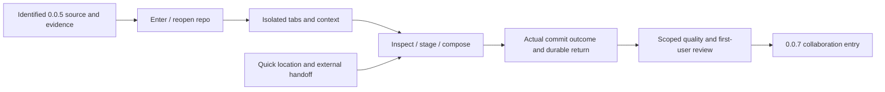

# 0.0.6 product and delivery plan

Status: `[-]` implementation started against source checkpoint `ccfae99`; current package version is **0.0.6**. No release or complete acceptance is claimed. This revision follows the owner's direction to reach a usable client at 0.1.0, superseding the earlier filter-only proposal. The [0.1.0 roadmap](roadmap-0.1.0.md) owns version allocation, [01](../prd/PRD_01_product.md#010-first-user-feature-tree) owns product admission, and [10](../prd/PRD_10_desktop_ux.md#first-user-workspace-and-journeys) owns UI/UX. This is not release notes or an instruction to publish.

## Product outcome

**Open a project, understand its changes, prepare the intended commit and resume work without losing context.**

0.0.6 turns the existing local Git operations into a coherent local client. Quick filters remain useful supporting tools; they no longer define the entire release. Clone and authenticated collaboration are allocated to 0.0.7. Preserve 0.0.5's completed work and exact evidence rather than reimplement it.

```text
0.0.6 · usable local client foundation
├── A. Enter a repository
│   ├── Welcome: Open / Create / recent entries
│   ├── Git and identity guidance; bounded trust decision
│   └── Distinct local init, existing repository and missing-path states
├── B. Stay oriented across projects
│   ├── Repository tabs with path, branch and operation state
│   ├── Independent drafts, queries, selections and scroll
│   └── Reopen recent project; close without losing acknowledged input
├── C. Prepare a commit
│   ├── Coherent unstaged/staged/untracked display and selected Diff
│   ├── Existing file/hunk/line stage/unstage and truthful result
│   ├── Discoverable existing ignore/discard with their safety guards
│   ├── Full-index review beside durable message composition
│   └── Commit → actual OID → refreshed history; preserve failed draft
├── D. Find and hand off
│   ├── Literal quick filter: changed files, branches, loaded commits
│   ├── Explicit limited history scope and clear/cancel/return behavior
│   └── User-selected editor/terminal at the intended file/repository
└── E. Keep the product small, responsive and dependable
    ├── Same typed actions across pointer/keyboard/help
    ├── Existing trust/recovery/stale-result and queue boundaries
    └── Targeted integrity, interaction and changed-path resource evidence
```



## Task and interaction contracts

| Task | Visible path and finish | Owning behavior |
|---|---|---|
| First launch without Git | Welcome remains usable; select installed Git or read setup guidance; no auto-install/account | 02/03/10/11 |
| Open/init | Choose explicit path → trust/setup → Changes; init never stages/commits existing files automatically | 03/11 |
| Reopen/switch | Recent entry or tab → named repo/branch → preserved draft/selection; unavailable path offers Locate/Remove | 03/10/13 |
| Review/stage | Select raw-identity file → staged or unstaged diff → named action → observed index effect | 04/08/10 |
| Commit | Review the full staged index → edit message → deliberate submit → actual OID or actionable failure; never stage implicitly | 04/13 |
| Filter | `/` or visible Filter → literal query → inspect result; full-index commit review stays unfiltered | 04/05/10 |
| Hand off | Open file/editor/terminal → reviewed configured tool and exact destination; return without resetting context | 10/11 |
| Settings/diagnostics | Distinct app preferences versus repository identity/settings; show actual Git and unavailable capabilities | 02/03/10/11/13 |

Changes is the first complete task surface. Existing numbered-pane shortcuts remain valid aliases; users also get named pointer actions and a visible focus path. Reuse MiniCon's shell/input/rendering capabilities; do not build a second UI toolkit or a new general docking system. Semantic names, IME-safe text routing and localization keys are part of new controls from the start.

A Files filter does not change commit scope. The revised rule permits commit from a filtered worktree list **only through the complete, unfiltered staged-index review** specified in 04. If that review is unavailable or stale, submission is disabled with a reason. Whole-file-list stage/unstage and stash creation still require clearing the Files filter; no hidden filtered-all mode is added. This replaces the earlier blanket clear-before-commit rule, avoiding a disruptive extra step while keeping the complete commit target visible.

## Boundaries

Must: A–E above and repairs necessary for their truthful results, retained context and measured quality. No new repository-writing engine, background service, search index or per-tab polling. Existing safe refusals remain visible.

Deferred to their allocated increments: clone/fetch/pull/push/auth (0.0.7), merge/rebase/conflict center and stash extensions (0.0.8), graph/history expansion and other assigned corrections (0.0.9). Existing commit detail and branch/stash actions remain available; this plan does not remove delivered behavior. Interactive rebase, S3, other VCS, full LFS/submodule/worktree administration and broader platform releases are outside this increment.

A Clone affordance may explain that it is unavailable in this checkpoint, but must not appear functional before its slice lands. Do not expose a toolbar of misleading inactive commands solely to resemble the final mockup. Signing/package/native-host feasibility is investigated early under 12; public binary promotion is not performed by a design task.

## Work packages and evidence

P0 source review is complete for the initial storage slice; P1/P3 have partial storage implementation, while their GUI work and acceptance remain open. Other packages remain not started. Inspect actual code before assigning missing work. P0 is a source review, not an automatic full test pass. Implement A → C as the first vertical slice, then B/D; carry E throughout. Change the package version only when implementation is explicitly started.

| Package | Change and user risk | Minimum evidence / stopping condition |
|---|---|---|
| P0 · baseline and reuse | Identify actual 0.0.5 source/artifacts, current worker/actions, existing native controls and inherited blockers | Record reusable evidence and true gaps; do not rebuild unaffected operations or replay long tests |
| P1 · entry and setup | Wrong destination/trust, accidental initialization or lost recent path | Disposable existing/nonempty/new target checks; first-run missing Git, trust deny/grant and failed Locate/Open shown once in real UI |
| P2 · local commit surface | Staged/unstaged confusion, hidden staged content or lost message | Actual mixed-index fixture; filtered file view with unrelated staged entry remains visible in full-index review; successful commit tree matches review, failure keeps draft |
| P3 · context and handoff | Cross-repository draft/action routing, stale reply after tab switch, unsafe tool destination | Two disposable repos with distinct edits/drafts; switch/reopen verifies isolation and stale rejection; one reviewed editor/terminal launch checks destination |
| P4 · quick location | Text shortcuts accidentally mutate; matching display label changes action target | Focused model/input/identity tests plus one combined keyboard/pointer journey across three lists; no per-character Git/DB/network job |
| P5 · integration and feasibility | Coherent flow fails on a clean profile or retained state grows | One native entry→stage→draft→commit→switch→reopen journey with actual Git-state/draft oracles; changed-path response/memory/CPU evidence; explicit package/accessibility/reference-host feasibility record |

Use the existing disposable fixtures and owned-process tools where their measurement boundary fits the new path. Do not count a focus border as evidence of staged-list/filter-result presentation. Expand checking only for demonstrated failures, new writer scope or changed dependencies. The 0.0.5 long-session receipt is not relabeled as a new binary; unchanged contracts can reuse it with original identity. No new 30-minute/eight-hour/six-cell campaign is triggered merely by this plan.

## Acceptance and exit ledger

| Case | Required outcome | State |
|---|---|---|
| L1 · entry | Fresh profile opens or creates a local repository with clear Git/trust/identity guidance; existing content preserved | `[_]` |
| L2 · commit | Pointer and keyboard can inspect/stage/compose/commit; visible full-index review matches actual committed content | `[_]` |
| L3 · continuity | Two repositories keep independent drafts, selection, filter and scroll; close/reopen preserves acknowledged state | `[_]` |
| L4 · find | Query/count/empty/reset are truthful; loaded history limit visible; text/IME input invokes no shortcuts | `[_]` |
| L5 · action truth | Filtered/stale/removed items cannot retarget a write; true success, refusal and uncertain result remain distinct | `[_]` |
| L6 · quality | Applicable changed-path resource/response/integrity gates pass; inherited missing prerequisites remain explicit | `[_]` |
| L7 · readiness | First-user package/native-host/accessibility dependencies have concrete owners and next steps; no fake delivery claim | `[_]` |

The handoff records source/artifact, cases, actual state oracles, reused evidence and blockers. An unmet applicable release gate remains BLOCKED, while independent work can proceed against a clearly identified source checkpoint. Release status stays under 12 and named publication authority. This plan changes neither current version metadata nor any past release claim.

## Execution record · recent navigation storage

The owner now authorizes development and sequential public releases of 0.0.6, 0.0.7, 0.0.8 and 0.0.9. Publication remains subject to each declared slice's applicable gates; no version is qualified by this authority alone. Remote inspection at start showed source main `31942f8`, latest release `v0.0.4`, and no 0.0.6–0.0.9 tags. 0.0.5 remains an unpublished source checkpoint, not a release invented to fill the sequence.

Initial implementation adds passive, backend-tagged MRU repository metadata through the existing transactional profile settings store, with lossless platform-tagged paths and bounded decoding. Explicit GUI open records its canonical trusted worktree once; refresh does not rewrite recents. Reading/removing an entry performs no repository scan, trust grant or file/draft deletion. The Welcome/recent controls and multi-repository window are not yet implemented. Existing schema/drafts remain compatible; no database migration or new third-party dependency was introduced.

Selected verification: corrupt or lossy recents could misdirect navigation or erase metadata → real SQLite reopen/reorder/forget/content/draft checks and native-path boundaries, plus affected domain/state tests and CLI/state/domain all-target Clippy. The local Windows run passed 20 selected tests and Clippy with warnings denied. Three newly added store cases cover durable recents/removal, bounds/backend isolation/corrupt retention, and native/foreign paths. No graphical, resource or release PASS follows. A path-triggered Windows/Linux CI workflow is configured for this suite; configure/run/observed-pass states must remain distinct. No full workspace/long-session replay was selected.
