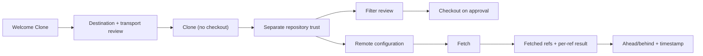

# 0.0.7 remote observation plan

Status: `[-]` implementation started on the Git observation layer and CLI; workspace version remains **0.0.6**. Scope is owned by [07](../prd/PRD_07_remotes.md), entry by [03](../prd/PRD_03_workspace.md), trust by [11](../prd/PRD_11_security.md), interaction by [10](../prd/PRD_10_desktop_ux.md), sequencing by [the roadmap](roadmap-0.1.0.md) and methodology by [14](../prd/PRD_14_verification_roadmap.md).

Decision record 2026-10-28: the product wedge is the **low-specification/restricted-environment native client** (measured 30.2 MiB settled, 36.6 MiB peak), not a multi-repository cockpit. Remote exchange is the only remaining hard gap before a first-user beta, so 0.0.7 delivers observation and configuration; pull and push follow in 0.0.8. The earlier remote-plus-cockpit draft of this file is withdrawn, not amended.

## Product outcome

**Bring someone else's repository here, and know exactly how it differs from the remote and how old that knowledge is.**

```text
0.0.7 · remote observation
├── A. Enter by clone
│   ├── Welcome Clone: URL, destination, branch, depth
│   ├── Destination/transport review; partial target stays inspectable
│   └── No checkout until filter execution is approved
├── B. See and configure remotes
│   ├── Named remotes, redacted fetch/push URL labels
│   ├── Add / set URL / rename / remove with local-effect preview
│   └── Explicit refspecs shown, never rewritten silently
└── C. Observe the other side
    ├── Fetch selected/all with progress and cancel
    ├── Ahead/behind against fetched tracking refs, with fetch timestamp
    └── Per-ref actual result; cancelled or failed fetch stays visibly stale
```



## Boundaries

Must: clone from a reviewed URL into a reviewed destination; local remote CRUD with preview; explicit fetch of one or all remotes with progress and cancel; ahead/behind against fetched refs with the fetch time; remote-tracking branch listing; stale marking after failure or cancellation.

Not in 0.0.7: pull, push, upstream writes, tracking-branch creation, merge/rebase, conflict center, background auto-fetch, credential storage, cockpit overview, any authenticated-path success claim.

## Review of the starting point

| Area | Actual state | Consequence |
|---|---|---|
| Remote code | None; `Capability::Push` is `Unsupported` (`crates/srcmgr-git/src/lib.rs:76`) | Everything here is new product code |
| Runner | Pinned `GIT_TERMINAL_PROMPT=0`, fixed 300 s mutation budget, no progress stream (`crates/srcmgr-git/src/runner.rs`) | A network class with bounded progress and cancellation is a prerequisite |
| Snapshot | No remote, upstream, ahead/behind or fetch time (`crates/srcmgr-ui/src/model.rs:101`) | Observation model grows first |
| Trust | Path/fingerprint grant with one-use ticket | Reusable for the repository, not for a network endpoint |
| Entry | Welcome Open/Create only | Clone form and partial-target repair are new |
| Inherited gaps | Files p95 47.7–49.2 ms against 33 ms; reference host, CJK/clipboard and signing absent | Reuse 0.0.6 evidence; no target is re-declared as met |

## Work packages

| Package | Deliverable | Minimum evidence and stop condition |
|---|---|---|
| P0 · contract | 0.0.7 interaction section in [10](../prd/PRD_10_desktop_ux.md); clone/filter policy in [11](../prd/PRD_11_security.md); private-candidate policy in [12](../prd/PRD_12_platform_delivery.md) | Documentation review and `check_docs.py`; no build |
| P1 · observation model | Remote/refspec parsing, tracking refs, ahead/behind, fetch time, redacted URL labels | Actual Git fixture against a local bare remote; redaction table |
| P2 · network execution class | Bounded progress events, cancellation, Succeeded/Refused/Unknown classifier | Slow/failing child fixture; tree kill; no real network |
| P3 · remote CRUD | Add/set-URL/rename/remove under the config lock with preview and trust invalidation | `.git/config` bytes before/after; unknown keys preserved; no server contact |
| P4 · clone | Clone form, destination/transport review, one-use approval, `--no-checkout` then filter review, partial retention | Success; nonempty refusal; interrupted clone retained and inspectable |
| P5 · fetch | Fetch selected/all, progress, cancel, per-ref results, stale marking | Local bare remote plus an advancing remote; refs match after success; facts preserved after refusal |
| P6 · acceptance | Status bar rows and remote panel actions, timestamped ahead/behind, stale labelling | One native journey on the available host; refuse paths captured with the window focused |

## Acceptance ledger

| Case | Required outcome | State |
|---|---|---|
| C1 · clone | Empty destination clones; nonempty target refused unchanged; interrupted clone leaves an inspectable partial target; no checkout before filter approval | `[_]` |
| C2 · remotes | Preview matches the actual local configuration change; labels redact credentials; no server repository is touched | `[_]` |
| C3 · fetch | Selected/all fetch reports per-ref actual results with progress and cancel | `[_]` |
| C4 · divergence facts | Ahead/behind and its timestamp follow fetched refs only; failed or cancelled fetch stays stale | `[_]` |
| C5 · qualification honesty | Authenticated HTTPS/SSH paths are `BLOCKED` with the missing prerequisite; a file-path remote is never counted as auth evidence | `[_]` |

## Selected verification and stopping

Use a local bare remote and two disposable clones as the deterministic oracle: compare refs, `.git/config` bytes and the displayed timestamp, never the product's own report. Run the affected `cargo test --workspace` selection with `SRCMGR_TEST_GIT`, `cargo clippy --workspace --all-targets` and `check_docs.py`; add the local-client CI lane for the changed cases. Stop when the selected checks pass or the case is recorded `BLOCKED` with its prerequisite; do not replay 0.0.6 native/resource campaigns.

Release gate: C1–C4 evidenced, C5 explicit, version and notes updated, private candidate built and started, and no publication beyond [12](../prd/PRD_12_platform_delivery.md) under owner authority. An unsigned binary is not published; the 5-person study uses a private build.

## Execution record

### Remote observation and explicit fetch (Git layer and CLI)

Implemented in `srcmgr-git`:

- `remotes.rs`: `git remote -v` parsing with fetch/push URL redaction (password, query and fragment removed), fetch refspecs, upstream and ahead/behind from `rev-list --left-right --count`, and `git fetch --porcelain` with per-ref old/new values.
- Ambient widening is refused: a mirror remote stops before any transfer, and fetch passes `--no-prune --no-recurse-submodules` explicitly.
- `runner.rs`: a network limit class (900 s, 8 MiB stdout, 4 MiB stderr), cooperative cancellation that terminates the owned tree, and an optional stderr progress sink. Only transfer lines are exposed by `progress_line`; remote banners and URLs are filtered out.

CLI (the testing seam, not a compatibility surface):

- `remote <worktree> list [--json]`, `remote <worktree> tracking [--json]`, `fetch <worktree> <remote> [--json]`.

Selected evidence (MinGit 2.56.0 via `SRCMGR_TEST_GIT`):

- `cargo test -p srcmgr-git`: 31 library tests, 4 `remotes_fixture` cases (redaction and refspecs; tracked fetch updating the exact remote OID; unknown remote refused; mirror remote refused) and 10 status cases pass.
- `cargo test -p srcmgr-cli --test remotes_m1`: 2 cases pass. The configured credential never appears in listing output, the fetched tracking ref equals the second copy's HEAD, tracking reports `ahead 0 / behind 1`, and an unknown remote leaves HEAD unchanged.
- `cargo clippy -p srcmgr-git -p srcmgr-cli --all-targets`: zero warnings. `python scripts/check_docs.py`: PASS.

### Window observation and fetch action

The status panel now appends the upstream and its distance (`ahead N behind M`) to the branch line, and the window refreshes remote/tracking data with each snapshot. `f` sends an explicit fetch for the remote named by the upstream, or the first configured remote, and reports the actual result ("N refs updated" or "up to date") in the result line; with no configured remote it explains instead of sending a job.

Selected evidence: 94 `srcmgr-ui` library tests pass, including two new cases (upstream-named remote selection; no-remote explanation), and `cargo clippy -p srcmgr-ui -p srcmgr-cli --all-targets` reports no warnings.

Not delivered yet: the Remotes surface with Add/Set URL/Rename/Remove and per-remote selection, clone, persisted fetch time, live transfer progress inside the window (the CLI streams filtered progress; the window currently shows only the final result), authenticated transport evidence, native journey, version bump and release. Authenticated HTTPS/SSH remains BLOCKED for lack of a controlled fixture host; the file-path remote is used for ref semantics only. No 0.0.7 artifact or release is claimed.
