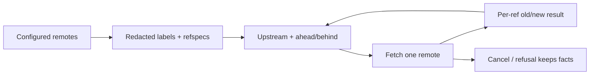

# 0.0.7 remote observation plan

Status: `[v]` 0.0.7 public source checkpoint, scoped to remote observation and explicit fetch; clone and remote configuration writes move to 0.0.8. Scope is owned by [07](../prd/PRD_07_remotes.md), entry by [03](../prd/PRD_03_workspace.md), trust by [11](../prd/PRD_11_security.md), interaction by [10](../prd/PRD_10_desktop_ux.md), sequencing by [the roadmap](roadmap-0.1.0.md) and methodology by [14](../prd/PRD_14_verification_roadmap.md).

Decision record 2026-10-28: the product wedge is the **low-specification/restricted-environment native client** (measured 30.2 MiB settled, 36.6 MiB peak), not a multi-repository cockpit. Remote exchange is the only remaining hard gap before a first-user beta, so 0.0.7 delivers observation and explicit fetch; clone and configuration writes follow in 0.0.8, pull and push in 0.0.9. The earlier remote-plus-cockpit draft of this file is withdrawn, not amended.

## Product outcome

**Know how far the current branch is from the remote, and fetch it deliberately.**

```text
0.0.7 · remote observation
├── A. See the remote
│   ├── Named remotes with redacted fetch/push URL labels
│   ├── Configured refspecs shown, never rewritten silently
│   └── Upstream distance from the fetched tracking ref
└── B. Fetch explicitly
    ├── One named remote per action, with progress and cancel
    ├── Per-ref actual old/new values from Git
    └── Refusals stay visible: mirror widening, unknown remote, cancellation
```



## Boundaries

Must: list configured remotes with redacted labels; show the configured refspecs; fetch the selected remote (all is reserved); report ahead/behind and the fetch facts that produced it; return a per-ref actual result; support cancellation and filtered progress; refuse ambient widening such as a mirror remote before any transfer.

Not in 0.0.7: clone, remote add/set-url/rename/remove, pull, push, upstream writes, merge/rebase, conflict center, background auto-fetch, persistent fetch timestamp, live in-window progress.

## Review of the starting point

| Area | Actual state | Consequence |
|---|---|---|
| Remote code | None; `Capability::Push` is `Unsupported` (`crates/srcmgr-git/src/lib.rs:76`) | Everything here is new product code |
| Runner | Pinned `GIT_TERMINAL_PROMPT=0`, fixed 300 s mutation budget, no progress stream (`crates/srcmgr-git/src/runner.rs`) | A network class with bounded progress and cancellation is a prerequisite |
| Snapshot | No remote, upstream, ahead/behind or fetch time (`crates/srcmgr-ui/src/model.rs:101`) | Observation model grows first |
| Trust | Path/fingerprint grant with one-use ticket | Reusable for the repository, not for a network endpoint |
| Entry | Welcome Open/Create only | Clone form and partial-target repair are new |
| Inherited gaps | Files p95 47.7–49.2 ms against 33 ms; reference host, CJK/clipboard and signing absent | Reuse 0.0.6 evidence; no target is re-declared as met |

## Work packages

| Package | Deliverable | Minimum evidence and stop condition |
|---|---|---|
| P1 · observation model | Remote and refspec parsing, tracking refs, ahead/behind, redacted URL labels | Actual Git fixture against a local bare remote; redaction table; stop when the fixture refs and labels match the oracle |
| P2 · network execution class | Bounded progress events, cancellation, Succeeded/Refused/Unknown classifier | Slow/failing child fixture with tree kill; stop when cancellation ends the owned tree and no real network is contacted |
| P3 · fetch | Fetch one named remote, filtered progress, cancel, per-ref results, mirror refusal | Local bare remote plus an advancing remote; stop when refs match after success and facts survive a refusal |
| P4 · acceptance | Status row ahead/behind and `f` fetch result, refusal explanations | One scripted window check on the available host; stop when the selected UI cases pass and unsupported paths explain instead of acting |

## Acceptance ledger

| Case | Required outcome | State | Evidence |
|---|---|---|
| C1 · remotes/redaction | Configured remotes and refspecs are listed with credentials, query and fragment redacted | `[v]` | 4 `remotes_fixture` cases and the CLI listing case; the configured credential never appears in output |
| C2 · fetch per-ref | A fetch of one named remote reports per-ref old/new values and refuses an unknown remote without moving HEAD | `[v]` | 31 lib + 2 CLI cases; fetched tracking ref equals the second copy's HEAD |
| C3 · tracking facts | Ahead/behind follows fetched tracking refs only and is reported as `ahead N behind M`; a mirror remote is refused before transfer | `[v]` | 10 status cases; 94 UI tests including upstream-remote selection and no-remote explanation |
| C4 · qualification honesty | Authenticated HTTPS/SSH paths are `BLOCKED` with the missing prerequisite; a file-path remote is never counted as auth evidence | `[v]` | Explicit `BLOCKED` note; clippy zero warnings across `srcmgr-git`, `srcmgr-cli` and `srcmgr-ui` |

## Selected verification and stopping

Use a local bare remote and two disposable clones as the deterministic oracle: compare refs, `.git/config` bytes and the displayed distance, never the product's own report. Run the affected `cargo test --workspace` selection with `SRCMGR_TEST_GIT`, `cargo clippy --workspace --all-targets` and `check_docs.py`; add the local-client CI lane for the changed cases. Stop when the selected checks pass or the case is recorded `BLOCKED` with its prerequisite; do not replay 0.0.6 native/resource campaigns.

Release gate: C1–C4 evidenced, version and notes updated, private candidate built and started, and no publication beyond [12](../prd/PRD_12_platform_delivery.md) under owner authority. An unsigned binary is not published; the 5-person study uses a private build.

## Public 0.0.7 publication receipt

Release commit `b3321ee` on `main`, annotated tag `v0.0.7` (`19ca93e`) pushed to `origin`. [GitHub Release](https://github.com/partnernetsoftware/minicon-srcmgr/releases/tag/v0.0.7) is public, non-draft and non-prerelease, with no uploaded binary assets; `gh release view` reports `assets: []`. The tag contains the scoped plan, release notes, version `0.0.7` and the remote-observation source.

Gate at that commit: `cargo test --workspace` passes with MinGit 2.56.0 (`SRCMGR_TEST_GIT`) and `GIT_CONFIG_COUNT=0`; `cargo clippy --workspace --all-targets` reports no warnings; `python scripts/check_docs.py` passes. Two test-only assertions were repaired after the first failing run and that run is retained in the suite-feedback record.

No binary, signature, reference-host, accessibility or authenticated-transport claim follows from this publication. The previous 0.0.6 evidence keeps its original source and artifact identity.

## Execution record

### Remote observation and explicit fetch (Git layer and CLI)

Implemented in `srcmgr-git`:

- `remotes.rs`: `git remote -v` parsing with fetch/push URL redaction (password, query and fragment removed), fetch refspecs, upstream and ahead/behind from `rev-list --left-right --count`, and `git fetch --porcelain` with per-ref old/new values.
- Ambient widening is refused: a mirror remote stops before any transfer, and fetch passes `--no-prune --no-recurse-submodules` explicitly.
- `runner.rs`: a network limit class (900 s, 8 MiB stdout, 4 MiB stderr), cooperative cancellation that terminates the owned tree, and an optional stderr progress sink. Only transfer lines are exposed by `progress_line`; remote banners and URLs are filtered out.

CLI (the testing seam, not a compatibility surface):

- `remote <worktree> list [--json]`, `remote <worktree> tracking [--json]`, `fetch <worktree> <remote> [--json]`.

Selected evidence (MinGit 2.56.0 via `SRCMGR_TEST_GIT`):

- `cargo test -p srcmgr-git`: 31 library tests, 4 `remotes_fixture` cases (redaction and refspecs; tracked fetch updating the exact remote OID; unknown remote refused; mirror remote refused) and 10 status cases pass.
- `cargo test -p srcmgr-cli --test remotes_m1`: 2 cases pass. The configured credential never appears in listing output, the fetched tracking ref equals the second copy's HEAD, tracking reports `ahead 0 / behind 1`, and an unknown remote leaves HEAD unchanged.
- `cargo clippy -p srcmgr-git -p srcmgr-cli --all-targets`: zero warnings. `python scripts/check_docs.py`: PASS.

### Window observation and fetch action

The status panel now appends the upstream and its distance (`ahead N behind M`) to the branch line, and the window refreshes remote/tracking data with each snapshot. `f` sends an explicit fetch for the remote named by the upstream, or the first configured remote, and reports the actual result ("N refs updated" or "up to date") in the result line; with no configured remote it explains instead of sending a job.

Selected evidence: 94 `srcmgr-ui` library tests pass, including two new cases (upstream-named remote selection; no-remote explanation), and `cargo clippy -p srcmgr-ui -p srcmgr-cli --all-targets` reports no warnings.

Not delivered yet: the Remotes surface with Add/Set URL/Rename/Remove and per-remote selection, clone, persisted fetch time, live transfer progress inside the window (the CLI streams filtered progress; the window currently shows only the final result), authenticated transport evidence, native journey, version bump and release. Authenticated HTTPS/SSH remains BLOCKED for lack of a controlled fixture host; the file-path remote is used for ref semantics only. No 0.0.7 artifact or release is claimed.

### Suite feedback

The first release-gate run failed for three reasons and none was a product regression:

- `tools::tests::tools_actual_launch...` documents that it needs `GIT_CONFIG_COUNT=0` in the parent to prove environment sanitization. It passes with that documented prerequisite; the gate now sets it.
- `draft.rs` and `slice.rs` asserted the lowercase substring "nothing is staged" while the product message has been "Nothing is staged to commit" since the staged-index review change. The cases are the defect: both now compare case-insensitively, and the product message is unchanged. No production code was altered to make a test pass.

After the two test-only repairs the whole workspace suite passes with the network fixtures. The earlier failing runs remain recorded here rather than being rerun into green without explanation.

### Version closure

0.0.7 closes on what actually shipped: remote observation and explicit fetch. The Git layer lists configured remotes with redacted fetch/push labels and their refspecs, derives tracking ahead/behind from `rev-list --left-right --count`, runs `git fetch --porcelain` for one named remote and keeps per-ref old/new values, cancels through the owned process tree and filters progress down to transfer lines. Mirror remotes are refused before any transfer, and fetch pins `--no-prune --no-recurse-submodules`. The window shows `ahead N behind M` on the branch line, `f` fetches the upstream's remote (or the first configured one) and the result line reports the actual outcome. The CLI exposes `remote list`, `remote tracking` and `fetch` as a testing seam only.

Reuse bound: the snapshot/model extension, the runner limit class and the existing path/fingerprint trust grant carry the slice; no platform mechanism was duplicated and the sibling MiniCon checkout was not touched.

Limits recorded, not waived: there is no native GUI remote journey (no Remotes panel, no per-remote selection), no authenticated transport fixture, so HTTPS/SSH exchange stays `BLOCKED`; `file://` remotes exercise ref semantics only and are never auth evidence. Fetch time is not persisted, live in-window progress is not delivered, and clone plus remote configuration writes belong to 0.0.8.

No binary was produced for this checkpoint, no reference-host run was performed and no signing conclusion is implied. Nothing here constitutes a public release.
