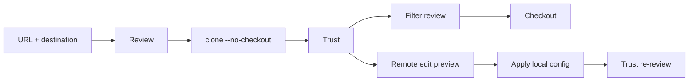

# 0.0.8 clone and remote configuration plan

Status: `[v]` 0.0.8 source checkpoint: clone with deferred checkout and reviewed remote configuration writes, delivered through the Git layer and CLI. Window surfaces move to 0.0.9. Workspace version is **0.0.7**; no 0.0.8 source, version or artifact exists. Scope is owned by [07](../prd/PRD_07_remotes.md), targets by [03](../prd/PRD_03_workspace.md), execution policy by [11](../prd/PRD_11_security.md), interaction by [10](../prd/PRD_10_desktop_ux.md) and sequencing by [the roadmap](roadmap-0.1.0.md).

## Product outcome

**Bring a repository here from a reviewed URL, and fix its remote configuration without editing files by hand.**

```text
0.0.8 · enter by clone and configure remotes
├── A. Clone
│   ├── URL, destination, branch, depth
│   ├── Reviewed destination and transport; refusal writes nothing
│   └── No checkout until filter execution is approved
└── B. Configure
    ├── Add / set URL / rename / remove with a local preview
    ├── Remote names and URLs validated before Git runs
    └── No server contact from a configuration write
```



## Boundaries

Must: clone with an explicit URL and destination; refuse a nonempty destination unchanged; keep an interrupted clone inspectable; validate remote names and URLs before Git runs; add, set URL, rename and remove a remote with the exact local effect shown first; never contact the server for a configuration write.

Not in 0.0.8: pull, push, upstream writes, merge/rebase, conflict center, background auto-fetch, credential storage, tag push, remote-branch deletion.

## Work packages

| Package | Deliverable | Minimum evidence and stop condition |
|---|---|---|
| P1 · validation | Remote-name and transport rules; unknown protocols and control characters refused | Table-driven cases with no Git process for refused input |
| P2 · clone | `--no-checkout` clone, destination preflight, partial-target retention, cancellation | Bare-remote fixture: success, nonempty refusal, interrupted target retained |
| P3 · remote edit | Add / set URL / rename / remove with before/after config preview | `.git/config` bytes before and after match the preview; unknown keys preserved |
| P4 · CLI surface | `clone` with review output, and `remote add\|set-url\|rename\|remove` that previews first and applies only with `--yes` | Actual config bytes and destination metadata; window surfaces move to 0.0.9 |

## Acceptance ledger

| Case | Required outcome | State |
|---|---|---|
| C1 · clone | Empty destination clones without checkout; nonempty target refused unchanged; partial target inspectable | `[v]` · 3 Git fixtures and 2 CLI cases |
| C2 · validation | Invalid names, unknown transports and control characters are refused before Git runs | `[v]` · Git ref rules plus the transport allow-list |
| C3 · remote edit | Preview equals the applied configuration change; unrelated keys untouched; no network | `[v]` · actual config bytes and preserved key |
| C4 · policy | Trust is re-reviewed after a configuration write; authenticated paths stay BLOCKED without a fixture host | `[v]` · the CLI reports the changed fingerprint after a write |

## Selected verification and stopping

Local bare remote plus two disposable copies; compare refs, worktree emptiness after clone and `.git/config` bytes. Run the affected workspace selection with `SRCMGR_TEST_GIT`, Clippy and `check_docs.py`; stop when the selected cases pass or are recorded `BLOCKED`.

## Public 0.0.8 publication receipt

Release commit `926e63a` on `main`, annotated tag `v0.0.8` pushed to `origin`. [GitHub Release](https://github.com/partnernetsoftware/minicon-srcmgr/releases/tag/v0.0.8) is public, non-draft and non-prerelease with no uploaded binary assets. Gate at that commit: `cargo test --workspace` passes with MinGit 2.56.0 and `GIT_CONFIG_COUNT=0`; `cargo clippy --workspace --all-targets` is clean; `check_docs.py` passes.

No binary, signature, reference-host or authenticated-transport claim follows. Window Clone/Remotes surfaces remain 0.0.9 scope.

## Execution record

### Clone and CLI measurement

`clone.rs` validates the transport, an absolute destination, an empty or absent target, the branch name through Git's rules and the depth before any transfer. It clones with `--no-checkout --no-recurse-submodules --progress`, refuses HTTP, `ext::` and unknown schemes, and leaves a failed transfer's destination in place for inspection. The CLI `clone <url> <destination> [--branch] [--depth]` prints the reviewed effect first and states that checkout is deferred.

Remote writes now have a CLI path: `remote <worktree> add|set-url|rename|remove ...` prints the credential-free preview and changes nothing unless `--yes` is present; after a write it reports that the trust fingerprint changed.

Selected evidence: `cargo test -p srcmgr-git` passes 33 library cases and 3 clone fixtures (unchecked-out worktree and resolved branch; nonempty target preserved; refused transport and options create nothing), plus 3 remote-edit fixtures. `cargo test -p srcmgr-cli --test clone_m1` passes 2 cases: clone output and destination state, and preview-without-apply followed by an applied add. No window surface exists yet.

### Remote configuration writes (Git layer)

`remote_edit.rs` validates a change before Git runs, builds a preview of the local effect with credentials removed, and applies add / set-URL / rename / remove through argument vectors. Names go through Git's own `check-ref-format` on a probe tracking ref; URLs accept HTTPS, SSH, git+ssh, file, scp-like and local paths, while HTTP, `ext::`, unknown schemes, spaces and control characters are refused. A configuration write changes the trusted fingerprint, so the next repository action asks for a fresh review; the preview states that no server repository or ref is touched.

Selected evidence: `cargo test -p srcmgr-git` passes 33 library cases including two URL-policy cases, and 3 `remote_edit_fixture` cases. The fixture proves add/set-URL/rename/remove leave exactly the reviewed values, preserve an unrelated `remote.origin.keepme` key, and that every refused input leaves `.git/config` byte-identical. `cargo clippy -p srcmgr-git --all-targets` reports no warnings.

Not delivered yet: clone, the one-use confirmation ticket for a configuration write, CLI/UI surfaces, native journey, version bump and release.
