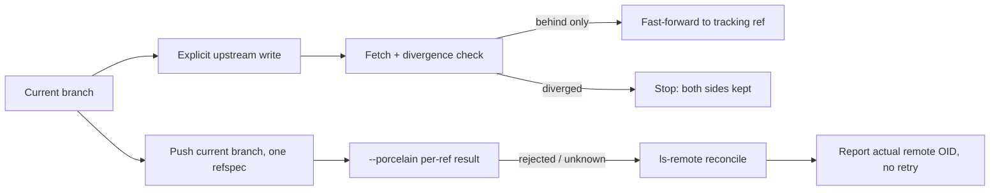

# 0.0.9 upstream, fast-forward pull and current-branch push plan

Status: `[v]` 0.0.9 source checkpoint. Scope is owned by [07](../prd/PRD_07_remotes.md), trust and credential policy by [11](../prd/PRD_11_security.md), interaction by [10](../prd/PRD_10_desktop_ux.md), outcome classification by [13](../prd/PRD_13_state_control.md) and sequencing by [the roadmap](roadmap-0.1.0.md). Upstream writes, fetch-then-fast-forward pull, current-branch push with per-ref results, unknown reconciliation and the window `p`/`P` actions are implemented and evidenced below; the window Clone/Remotes panels and authenticated transport qualification remain open.

## Product outcome

**Move commits between this branch and one named remote without guessing, merging or rewriting.**

```text
0.0.9 · exchange commits on the current branch
├── A. Bind the branch
│   ├── Set or clear the explicit upstream of the current branch
│   ├── Show the effective remote and remote-tracking ref before writing
│   └── Refuse an ambiguous or missing target instead of inferring one
├── B. Take commits in (pull)
│   ├── Fetch, then report the exact divergence
│   ├── Fast-forward only; a diverged branch stops with both sides intact
│   └── No merge, no rebase, no conflict resolution in this version
└── C. Send commits out (push)
    ├── Current branch to one explicit destination ref
    ├── Per-ref result from --porcelain, including rejection
    └── Unknown after cancel or timeout reconciled by ls-remote, never retried
```



## Boundaries

Must: write and clear the upstream of the current branch explicitly, showing the effective remote and tracking ref before the write; pull as fetch plus a fast-forward-only integration that stops on divergence with local and remote commits intact; push only the current branch to one explicitly reviewed destination ref with an explicit single-ref refspec and `--porcelain` per-ref results; treat a cancelled or timed-out exchange as `Unknown` and reconcile it with `ls-remote` instead of retrying; surface `p` (pull), `P` (push) and their result line in the window; expose the same three operations through the CLI testing seam.

Not in 0.0.9: merge, rebase and the conflict center; force or lease-based rewrites; tag push; remote-branch deletion; background or scheduled auto-fetch; credential storage or prompting; the Remotes and Clone window panels, which stay with 0.1.0.

## Authentication policy

Transports that need credentials run only through `credential.helper`, `GIT_ASKPASS` and the platform agent, only after the repository has passed the trust review that already governs this product, and only with `GIT_TERMINAL_PROMPT=0` pinned the way the runner already pins it. The product never reads, prints, stores or forwards a secret, and a helper refusal is reported as an authentication failure rather than retried. Where a controlled HTTPS or SSH fixture host is missing, the authenticated case is recorded `BLOCKED` with its prerequisite; a `file://` or local-path remote exercises ref semantics only and is never counted as transport or authentication evidence.

## Work packages

| Package | Deliverable | Minimum evidence and stop condition |
|---|---|---|
| P1 · upstream write | Model read and write of the current branch's upstream: set to one named remote plus tracking ref, or clear; effective mapping shown before the write | Local bare remote plus two disposable clones: `.git/config` bytes before and after match the preview, and a cleared upstream reads back as absent. Stop when both directions reproduce exactly and no other config key changed |
| P2 · fast-forward pull | Fetch, classify `behind` / `ahead` / `diverged` / `equal`, then advance the branch only on the behind-only path; divergence ends with no index or worktree change | Two clones with a competing commit: behind-only advances to the remote OID, diverged leaves `HEAD`, index and worktree untouched. Stop when both classifications are proven from Git's own refs and no merge or rebase process is spawned |
| P3 · current-branch push | One explicit single-ref refspec derived from the reviewed source and destination, `--porcelain` parsing into per-ref outcomes, non-fast-forward rejection preserved, `Unknown` reconciled through `ls-remote` with no automatic retry | Bare remote with a stale competing tip for the rejection case, and a child killed after dispatch for the unknown case: pushed ref equals the local OID, rejection leaves the remote ref unchanged and explained, reconciliation reports the actual remote OID. Stop when all three outcomes are distinguishable from the recorded refs alone |
| P4 · CLI and window surface | `upstream [--set <remote>/<branch> | --clear]`, `pull`, `push` CLI verbs with JSON and result lines; window `p` / `P` actions, previewed effect and actual result in the result line | CLI cases against the same fixtures plus one scripted window check on the available host: the result line states the outcome and the moved ref. Stop when the selected UI and CLI cases pass, and an unavailable target explains instead of acting |

## Acceptance ledger

| Case | Required outcome | State |
|---|---|---|
| C1 · upstream | Set and clear change only the current branch's upstream; the displayed remote and tracking ref equal the written configuration | `[v]` · 4 sync fixtures and CLI verbs |
| C2 · fast-forward pull | A behind-only branch advances to the fetched tracking ref; a diverged branch stops with local and remote commits intact and no merge or rebase performed | `[v]` · fetch-then-merge fixtures, diverged HEAD unchanged, CLI exchange case |
| C3 · push success and rejection | The current branch reaches the reviewed destination ref under an explicit single-ref refspec; a non-fast-forward rejection leaves the remote ref unchanged and reports the per-ref reason | `[v]` · updated/up-to-date/rejected/detached fixtures |
| C4 · unknown reconciliation | A cancelled or timed-out exchange is classified `Unknown`, reconciled by `ls-remote`, reported as the actual remote OID and never retried automatically | `[-]` · implemented for cancel/timeout and never retried; no killed-transfer execution receipt yet |
| C5 · window result | `p` and `P` show the reviewed effect first and the actual result afterwards, including a refusal explanation and an `Unknown` reconciliation line | `[-]` · keys and result lines pass model tests; no pre-action preview and no native window run |

## Execution record

Implemented in `srcmgr-git`: `sync.rs` (`set_upstream`, `clear_upstream`, fetch-then-`merge --ff-only` pull with before/after OIDs) and `push.rs` (current branch, explicit `refs/heads/B:refs/heads/B`, `--porcelain --no-follow-tags`, Updated/UpToDate/Rejected/Unknown, one `ls-remote` reconciliation on cancel or timeout, no automatic retry). Push rejection is separated from transport/auth failure by the captured error line. CLI adds `upstream set|clear`, `pull` and `push`; the window binds `p`/`P` and reports the final outcome in the result line.

Evidence with MinGit 2.56.0: 4 `sync_fixture` and 4 `push_fixture` cases (upstream set/clear and invalid names; fast-forward advances; diverged refuses without moving HEAD; missing upstream; new-branch push equals the local OID and repeats as up to date; remote-ahead rejection keeps the remote commit; detached HEAD and unknown remote refused before transfer); 1 CLI `sync_m1` case pushes a commit and fast-forwards a second clone, then reports up to date; 96 UI cases pass including the new `p`/`P` bindings. Clippy and `check_docs.py` are part of the release gate.

Not delivered: authenticated HTTPS/SSH qualification, a controlled unknown-outcome receipt, JSON output for the three new CLI verbs, a pre-action review line in the window, Clone/Remotes window panels, native journey, binary and signing.

## Public 0.0.9 publication receipt

Release commit `f5e4e3d` on `main`, annotated tag `v0.0.9` (`fe8713e`) pushed to `origin`. [GitHub Release](https://github.com/partnernetsoftware/minicon-srcmgr/releases/tag/v0.0.9) is public, non-draft and non-prerelease with no uploaded binary assets. The first release-create call returned a GitHub 503; the retry succeeded and the failed attempt is recorded rather than hidden.

Gate at that commit: `cargo test --workspace` passes with MinGit 2.56.0 and `GIT_CONFIG_COUNT=0`; `cargo clippy --workspace --all-targets` is clean; `check_docs.py` passes. No binary, signature, authenticated-transport or reference-host claim follows.

## Selected verification and stopping

Local bare remote plus two disposable clones as the deterministic oracle: compare refs, `.git/config` bytes, `HEAD` and worktree state, never the product's own report. Run the affected workspace selection with `SRCMGR_TEST_GIT`, Clippy and `check_docs.py`; stop when the selected cases pass or the case is recorded `BLOCKED` with its missing prerequisite. Authenticated HTTPS and SSH remain `BLOCKED` without a controlled fixture host. Do not replay earlier native or resource campaigns, and do not treat a later green run as evidence for an unexecuted case.
