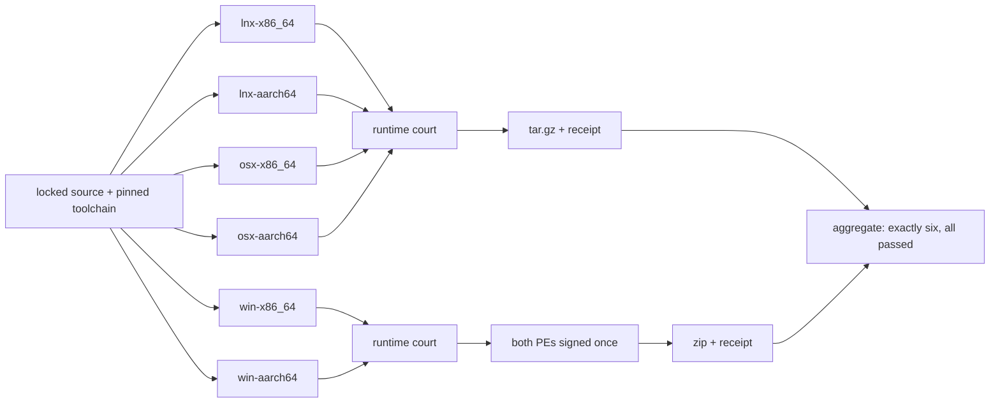

# 0.1.2 six native cells plan

Status: `[-]` implementation landed, qualification pending. Workspace version is **0.1.0**; no 0.1.2 source, version or artifact exists. Delivery is owned by [12](../prd/PRD_12_platform_delivery.md#support-matrix), reuse by [02](../prd/PRD_02_architecture_reuse.md), verification by [14](../prd/PRD_14_verification_roadmap.md), and sequencing by [the roadmap](roadmap-0.1.0.md).

0.1.0 published one cell. [PRD 12](../prd/PRD_12_platform_delivery.md#support-matrix) declares six. This version closes the gap between what the product claims to support and what it actually builds, runs and packages.

## Product outcome

**Every developer on the six supported cells downloads an archive that was built on that cell and demonstrated to work there, not a Windows binary with a compatibility hope.**

```text
0.1.2 · six native cells
├── A. Each cell builds itself
│   ├── lnx-x86_64 · lnx-aarch64 · win-x86_64 · win-aarch64 · osx-x86_64 · osx-aarch64
│   ├── One native runner per cell; nothing cross-compiled
│   └── Same locked source, same pinned toolchain
├── B. Each cell proves itself
│   ├── --version equals the package version
│   ├── Trust grant, status --json, remote list and tracking on a real fixture
│   └── Independent oracle: the fixture's own Git output, not the product's report
├── C. Each cell ships itself
│   ├── zip for Windows, tar.gz for macOS and Linux
│   ├── README, SHA256SUMS and a per-cell receipt in the archive
│   └── Aggregate court refuses a partial set
└── D. Windows keeps its signature
    ├── Both Windows cells signed in one provider call
    ├── Per-file inspection with the canonical inspector
    └── Two-asset receipt audited fail-closed
```



## Review of the starting point (2026-11-08)

| Area | Actual state before this slice | Consequence |
|---|---|---|
| Window host | `srcmgr-ui` depended on `minicon-platform` with `native-pixel-window` unconditionally, which only exists on Windows | The other five cells could not compile at all |
| Build recipe | `scripts/build_windows_candidate.py` hardcoded `x86_64-pc-windows-msvc` and asserted an x64 host | The ARM64 Windows cell had no bound build path |
| Signing | One file per run, one asset per receipt | Two Windows cells needed two files and a two-asset receipt |
| CI | Only Windows and local-client lanes | No cell was built, run or packaged outside Windows |
| Packaging | Ad-hoc zip made by hand for 0.1.0 | Six archives with different shapes needed one recipe |
| Runtime evidence | Native journeys on one host | Nothing proved the other five executables start |
| Platform code | `srcmgr-platform-ext` already gates its UIA publisher on `cfg(windows)` and reports `Unsupported` elsewhere | No source change was needed below the UI crate |

## What changed

| Change | File | Why |
|---|---|---|
| Window host selected per target family | `crates/srcmgr-ui/Cargo.toml` | `native-pixel-window` on Windows, `portable-pixel-window` on unix, matching MiniCon's own split |
| Per-cell build target | `scripts/build_windows_candidate.py` | `--target` selects the ISA and the host assertion follows it |
| Per-cell runtime court | `scripts/cell_runtime_court.py` | Proves start plus real Git reads on the cell's own machine |
| Per-cell packaging | `scripts/package_cell.py` | One recipe, correct archive shape, receipt with asset digests |
| Six-cell aggregation | `scripts/six_cell_aggregate.py` | A missing cell or a failed court is a failure, never a partial pass |
| Six-cell workflow | `.github/workflows/six-cell.yml` | Six native runners, runtime court, package, aggregate |
| Multi-asset signing | `.github/workflows/windows-signing-qualification.yml`, `scripts/signing_receipt.py` | Both Windows PEs signed in one provider call, one audited receipt |
| `--version` | `crates/srcmgr-cli/src/main.rs` | The court needs the artifact to state its own version |

## Local evidence

- `cargo check` for `srcmgr-ui` succeeded for `x86_64-unknown-linux-gnu`, `aarch64-unknown-linux-gnu` and `aarch64-pc-windows-msvc` on this host.
- `x86_64-apple-darwin` and `aarch64-apple-darwin` fail here with `failed to find tool "cc"`: this host has no Apple SDK. That is the machine, not the code; the macOS cells compile on `macos-15` and `macos-15-intel` runners, which is why the matrix uses native runners instead of cross-building.
- `scripts/package_cell.py` produced all six archive shapes from one binary stand-in, and `scripts/six_cell_aggregate.py` accepted the six receipts and wrote the aggregate.
- A two-asset manifest went through `scripts/signing_receipt.py` and the fail-closed auditor: compose and audit both returned 0.

## Boundaries

Must: every cell compiles from the same locked source on its own native runner; every cell's executable starts and completes real Git reads on a fixture; every cell produces one archive with a README, a checksum list and a receipt; the aggregate requires exactly six passing cells; both Windows cells carry an Authenticode signature from the company publisher when `signing.mode=required`.

Not in 0.1.2: a GUI journey on any non-Windows cell (needs a display and compositor; that is the next slice), macOS Developer ID signing and notarization, Windows on non-24H2 images, Linux musl, 32-bit or additional ISAs, distribution repositories (`apt`, `brew`, `winget`), and any localization.

Excluded: cross-compiling a cell from another cell and calling it qualified; publishing an archive whose runtime court did not pass; publishing a Windows archive whose signature is missing or invalid; treating a partial matrix as a release.

## Work packages

| Package | Deliverable | Minimum evidence and stop condition |
|---|---|---|
| P1 · build matrix | Six native runners, one per cell, from locked source | Six `cargo build --release` successes on the right `RUNNER_OS`/`RUNNER_ARCH`; a wrong machine fails the job |
| P2 · runtime court | `--version`, trust, status, remote list, tracking on a fixture | Six `runtime-receipt.json` with status `passed`; the status assertion compares against the fixture's own `rev-parse` |
| P3 · packaging | Six archives plus per-cell receipts | Six archives with the expected names and a 64-hex digest for each asset |
| P4 · aggregate | Exactly-six court | A deliberately missing cell fails; a full set writes `six-cell-receipt.json` |
| P5 · Windows signing | Both PEs signed in one run, two-asset receipt | Canonical inspector `Valid` for both, company `O=`, timestamp, auditor accepts |

## Acceptance ledger

| Case | Required outcome | State |
|---|---|---|
| C1 · six builds | Every cell compiles on its own runner from the same commit | `[_]` |
| C2 · six runtime courts | Every executable starts and reads Git on its own cell | `[_]` |
| C3 · six archives | Each archive contains the binary, README, checksums and a receipt matching its digest | `[-]` · recipe proven locally, six-cell run pending |
| C4 · aggregate | A partial or failed set is refused | `[-]` · local six-of-six and missing-cell behaviour to be exercised in CI |
| C5 · Windows signature | Both Windows PEs are `Valid` with the company publisher | `[_]` |
| C6 · honesty | Anything not run is named in the release notes; no cell is implied qualified by compilation alone | `[_]` |

## Selected verification and stopping

Run the six-cell workflow once. Stop when six cells report `build`, `runtime court` and `package` success and the aggregate writes a receipt naming all six with the exact source SHA. Then run the signing qualification twice: once non-promotable, and once release-eligible at a version that is not yet published.

Release gate: the six-cell receipt exists for the signing source SHA, the Windows receipt covers both cells, and the release notes list the cells that were not qualified for a GUI journey, macOS signing or a non-24H2 image.

## Execution record

### Implementation (2026-11-08)

Landed: per-family window host, `--target` build selection, `--version`, `cell_runtime_court.py`, `package_cell.py`, `six_cell_aggregate.py`, `six-cell.yml`, and multi-asset signing. Local evidence is the compile matrix, the six packaging shapes, the aggregate, and a two-asset receipt that composed and audited clean.

Not yet run: the six-cell workflow itself, and the two-cell signing run. Until those exist this slice is implementation, not delivery, and no cell beyond Windows x86_64 is claimed.
