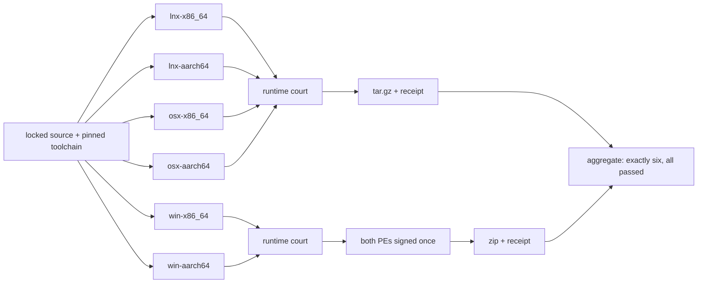

# 0.1.2 six native cells plan

Status: `[v]` published as **0.1.2** on 2026-11-09. Six cells built, ran and packaged on their own runners; both Windows cells are signed `Valid` with the company publisher and a timestamp, and the release carries a `release_eligible=true` receipt. No cell is qualified beyond start and Git reads, and the release notes say so. Delivery is owned by [12](../prd/PRD_12_platform_delivery.md#support-matrix), reuse by [02](../prd/PRD_02_architecture_reuse.md), verification by [14](../prd/PRD_14_verification_roadmap.md), and sequencing by [the roadmap](roadmap-0.1.0.md).

0.1.0 published one cell. [PRD 12](../prd/PRD_12_platform_delivery.md#support-matrix) declares six. This version closes the gap between what the product claims to support and what it actually builds, runs and packages.

## Product outcome

**Every developer on the six supported cells downloads an archive that was built on that cell and demonstrated to work there, not a Windows binary with a compatibility hope.**

```text
0.1.2 · six native cells
├── A. Each cell builds itself
│   ├── lnx-x86_64 · lnx-aarch64 · win-x86_64 · win-aarch64 · osx-x86_64 · osx-aarch64
│   ├── One native runner per cell; nothing cross-compiled
│   └── Same locked source, same pinned toolchain
├── B. Each cell proves itself
│   ├── --version equals the package version
│   ├── Trust grant, status --json, remote list and tracking on a real fixture
│   └── Independent oracle: the fixture's own Git output, not the product's report
├── C. Each cell ships itself
│   ├── zip for Windows, tar.gz for macOS and Linux
│   ├── README, SHA256SUMS and a per-cell receipt in the archive
│   └── Aggregate court refuses a partial set
└── D. Windows keeps its signature
    ├── Both Windows cells signed in one provider call
    ├── Per-file inspection with the canonical inspector
    └── Two-asset receipt audited fail-closed
```



## Review of the starting point (2026-11-08)

| Area | Actual state before this slice | Consequence |
|---|---|---|
| Window host | `srcmgr-ui` depended on `minicon-platform` with `native-pixel-window` unconditionally, which only exists on Windows | The other five cells could not compile at all |
| Build recipe | `scripts/build_windows_candidate.py` hardcoded `x86_64-pc-windows-msvc` and asserted an x64 host | The ARM64 Windows cell had no bound build path |
| Signing | One file per run, one asset per receipt | Two Windows cells needed two files and a two-asset receipt |
| CI | Only Windows and local-client lanes | No cell was built, run or packaged outside Windows |
| Packaging | Ad-hoc zip made by hand for 0.1.0 | Six archives with different shapes needed one recipe |
| Runtime evidence | Native journeys on one host | Nothing proved the other five executables start |
| Platform code | `srcmgr-platform-ext` already gates its UIA publisher on `cfg(windows)` and reports `Unsupported` elsewhere | No source change was needed below the UI crate |

## What changed

| Change | File | Why |
|---|---|---|
| Window host selected per target family | `crates/srcmgr-ui/Cargo.toml` | `native-pixel-window` on Windows, `portable-pixel-window` on unix, matching MiniCon's own split |
| Per-cell build target | `scripts/build_windows_candidate.py` | `--target` selects the ISA and the host assertion follows it |
| Per-cell runtime court | `scripts/cell_runtime_court.py` | Proves start plus real Git reads on the cell's own machine |
| Per-cell packaging | `scripts/package_cell.py` | One recipe, correct archive shape, receipt with asset digests |
| Six-cell aggregation | `scripts/six_cell_aggregate.py` | A missing cell or a failed court is a failure, never a partial pass |
| Six-cell workflow | `.github/workflows/six-cell.yml` | Six native runners, runtime court, package, aggregate |
| Multi-asset signing | `.github/workflows/windows-signing-qualification.yml`, `scripts/signing_receipt.py` | Both Windows PEs signed in one provider call, one audited receipt |
| `--version` | `crates/srcmgr-cli/src/main.rs` | The court needs the artifact to state its own version |

## Local evidence

- `cargo check` for `srcmgr-ui` succeeded for `x86_64-unknown-linux-gnu`, `aarch64-unknown-linux-gnu` and `aarch64-pc-windows-msvc` on this host.
- `x86_64-apple-darwin` and `aarch64-apple-darwin` fail here with `failed to find tool "cc"`: this host has no Apple SDK. That is the machine, not the code; the macOS cells compile on `macos-15` and `macos-15-intel` runners, which is why the matrix uses native runners instead of cross-building.
- `scripts/package_cell.py` produced all six archive shapes from one binary stand-in, and `scripts/six_cell_aggregate.py` accepted the six receipts and wrote the aggregate.
- A two-asset manifest went through `scripts/signing_receipt.py` and the fail-closed auditor: compose and audit both returned 0.

## Boundaries

Must: every cell compiles from the same locked source on its own native runner; every cell's executable starts and completes real Git reads on a fixture; every cell produces one archive with a README, a checksum list and a receipt; the aggregate requires exactly six passing cells; both Windows cells carry an Authenticode signature from the company publisher when `signing.mode=required`.

Not in 0.1.2: a GUI journey on any non-Windows cell (needs a display and compositor; that is the next slice), macOS Developer ID signing and notarization, Windows on non-24H2 images, Linux musl, 32-bit or additional ISAs, distribution repositories (`apt`, `brew`, `winget`), and any localization.

Excluded: cross-compiling a cell from another cell and calling it qualified; publishing an archive whose runtime court did not pass; publishing a Windows archive whose signature is missing or invalid; treating a partial matrix as a release.

## Work packages

| Package | Deliverable | Minimum evidence and stop condition |
|---|---|---|
| P1 · build matrix | Six native runners, one per cell, from locked source | Six `cargo build --release` successes on the right `RUNNER_OS`/`RUNNER_ARCH`; a wrong machine fails the job |
| P2 · runtime court | `--version`, trust, status, remote list, tracking on a fixture | Six `runtime-receipt.json` with status `passed`; the status assertion compares against the fixture's own `rev-parse` |
| P3 · packaging | Six archives plus per-cell receipts | Six archives with the expected names and a 64-hex digest for each asset |
| P4 · aggregate | Exactly-six court | A deliberately missing cell fails; a full set writes `six-cell-receipt.json` |
| P5 · Windows signing | Both PEs signed in one run, two-asset receipt | Canonical inspector `Valid` for both, company `O=`, timestamp, auditor accepts |

## Acceptance ledger

| Case | Required outcome | State |
|---|---|---|
| C1 · six builds | Every cell compiles on its own runner from the same commit | `[v]` run 42476631093: six `success` at source `687f93b` |
| C2 · six runtime courts | Every executable starts and reads Git on its own cell | `[v]` same run: six `runtime-receipt.json` status `passed` |
| C3 · six archives | Each archive contains the binary, README, checksums and a receipt matching its digest | `[v]` same run: six archives with 64-hex digests, table below |
| C4 · aggregate | A partial or failed set is refused | `[v]` same run: aggregate `success` with `cell_count: 6`; a locally removed cell is refused with `expected one cell receipt, found 0` |
| C5 · Windows signature | Both Windows PEs are `Valid` with the company publisher | `[v]` run 42561659574: both cells `Valid`, `O=PARTNERNET SOFTWARE PTY LTD`, timestamp present, receipt `release_eligible=true` |
| C6 · honesty | Anything not run is named in the release notes; no cell is implied qualified by compilation alone | `[v]` [0.1.2 notes](../releases/0.1.2.md) name the GUI-journey gap on five cells, macOS signing, the untested macOS 14 floor and the unqualified clean-image and user courts |

## Selected verification and stopping

Run the six-cell workflow once. Stop when six cells report `build`, `runtime court` and `package` success and the aggregate writes a receipt naming all six with the exact source SHA. Then run the signing qualification twice: once non-promotable, and once release-eligible at a version that is not yet published.

Release gate: the six-cell receipt exists for the signing source SHA, the Windows receipt covers both cells, and the release notes list the cells that were not qualified for a GUI journey, macOS signing or a non-24H2 image.

## Execution record

### Implementation (2026-11-08)

Landed: per-family window host, `--target` build selection, `--version`, `cell_runtime_court.py`, `package_cell.py`, `six_cell_aggregate.py`, `six-cell.yml`, and multi-asset signing. Local evidence is the compile matrix, the six packaging shapes, the aggregate, and a two-asset receipt that composed and audited clean.

Not yet run: the two-cell signing run. The signing path itself is already proven: 0.1.0 was signed release-eligible by run 42453987936, the `release-signing` environment holds its credentials and `release-policy.json` reads `signing.mode = required`. What is missing is only the dispatch of the rewritten two-asset workflow at a version that is not yet published, so no signature exists for either Windows cell here and neither archive is release-eligible.

### First real six-cell run (2026-11-08)

Run [42476631093](https://github.com/partnernetsoftware/minicon-srcmgr/actions/runs/42476631093) at source `687f93bf8fd1`. All six cells built, passed their runtime court and packaged; the aggregate wrote `six-cell-receipt.json` with `cell_count: 6` and `windows_signing: blocked`.

| Cell | Archive bytes | Archive sha256 (first 16) | Signing |
|---|---|---|---|
| lnx-x86_64 | 3 498 392 | `66cf4505e1263b01` | unsigned |
| lnx-aarch64 | 3 470 274 | `97f66f701c0d599f` | unsigned |
| osx-x86_64 | 2 241 794 | `88e703dac1fed32b` | unsigned |
| osx-aarch64 | 2 116 024 | `ec74a47b6a3b1346` | unsigned |
| win-x86_64 | 1 831 945 | `ef88ae6dd4cb6e62` | blocked |
| win-aarch64 | 1 651 774 | `8c80d8c314b4d234` | blocked |

The first four runs failed, and every failure was a real platform defect rather than a flaky runner. Each is fixed and re-verified by the green run above:

1. **The runtime court handed the product a bare `git`.** The product resolves the executable and refuses a name it cannot find, so every read on a cell that ran fine reported failure. The court now resolves the path itself.
2. **An unexecutable hook fixture.** The positive control wrote `pre-commit` without the mode bit; Git skips such a hook silently on unix, so the test asserted against a hook that never ran. The fixture now sets `0o755` where the mode exists.
3. **`fsync` on a directory is EINVAL on macOS.** Every stash removal failed there with a supervision error although the rename had already published the entry. One helper now keeps the flush binding on Linux and Windows and advisory on macOS.
4. **macOS reaches its temp directory through the `/var` symlink**, and private recovery storage refuses a symlinked ancestry by design. Two fixture roots now resolve the temp root on unix only; Windows keeps the plain path because its canonical form is verbatim and Git rejects it.
5. **The artifact layout differed by runner platform.** The same upload paths kept a `package/<cell>/` prefix on Windows and flattened on unix, so the aggregate saw five receipts and refused a set that had passed. Each cell now uploads one directory with its runtime receipt inside, and the court finds the receipts inside that directory rather than assuming a depth.

A sixth defect was a real product bug found earlier by the same matrix: `srcmgr-ui` depended on the Win32 window host unconditionally, so the five non-Windows cells could not compile at all. It is recorded under "What changed" above.

What this run still does not prove: a GUI journey on any cell, macOS Developer ID signing and notarization, a non-24H2 Windows image, or upstream `glibc` older than the runner. No cell is claimed beyond "builds, starts and reads Git".

### Release candidate (2026-11-08)

The workspace moved to 0.1.2 and `release-policy.json` follows it, so a signing run at this version is eligible by construction: the version has never been published and the policy demands a signature. Two pipeline runs at this commit produce the release set — the six-cell matrix for the non-Windows archives and both Windows cells, and the two-asset signing run for the Windows bytes. `scripts/assemble_release.py` then takes those two outputs and refuses to emit an asset set unless every cell receipt matches the archive it ships, every Windows inspection names the signed bytes and calls them `Valid` with a timestamp, and the assembled digests are the digests in `SHA256SUMS.txt`. The Windows cells are repackaged from the signed executables, because the six-cell job necessarily finishes before signing exists.

### Publication (2026-11-09)

Two runs at source `e8988579379f434b89353ca63b89784132523c7f` produced the release set: six-cell matrix [42561652417](https://github.com/partnernetsoftware/minicon-srcmgr/actions/runs/42561652417) and two-asset signing [42561659574](https://github.com/partnernetsoftware/minicon-srcmgr/actions/runs/42561659574). `scripts/assemble_release.py` rebuilt the two Windows archives from the signed executables, refused nothing, and wrote the digests that `SHA256SUMS.txt` publishes:

| Cell | Asset | Bytes | SHA-256 |
|---|---|---|---|
| win-x86_64 | `minicon-srcmgr-0.1.2-win-x86_64.zip` | 1 842 134 | `883febf5352ca4944f9cd540001c27eae4d96fc25ca91a9b6cdc66f1d77bc4d8` |
| win-aarch64 | `minicon-srcmgr-0.1.2-win-aarch64.zip` | 1 662 238 | `1e7480c83990c35587826877282dba7cbebf9eb15947f581b7200d5107cd8ec0` |
| osx-x86_64 | `minicon-srcmgr-0.1.2-osx-x86_64.tar.gz` | 2 242 083 | `0be8a3411202545ef346f0e9bd5b48ca201d7bc4cf1819ccd15c53cde950a7c5` |
| osx-aarch64 | `minicon-srcmgr-0.1.2-osx-aarch64.tar.gz` | 2 116 279 | `06fafcdab164619061e0d736f48e91ffb22b30893425a4cd4eb77cf2c624d027` |
| lnx-x86_64 | `minicon-srcmgr-0.1.2-lnx-x86_64.tar.gz` | 3 498 546 | `aba7372186bc30f37d276c66257d9f15f743c087982420258fae7436884e9fbf` |
| lnx-aarch64 | `minicon-srcmgr-0.1.2-lnx-aarch64.tar.gz` | 3 470 614 | `b096c44f3b0007e178e81b053e5f6d5357b40ba08c769878899aee8c5d7cac7e` |

Verified after assembly, on the published bytes rather than on build output: `sha256sum -c SHA256SUMS.txt` for all six; `Get-AuthenticodeSignature` returned `Valid` for the executable extracted from the published `win-x86_64` zip, with the company subject, the Microsoft issuer and the RFC 3161 timestamp; that extracted executable started from a fresh profile, reported `minicon-srcmgr 0.1.2`, and passed a runtime court on itself (`version`, `git_present`, `trust_grant`, `status_json`, `remote_list`, `tracking_honest`).

One defect surfaced during this release and is fixed here rather than worked around: the signing manifest converted `GITHUB_RUN_ID` to `Int32`, so the workflow threw before signing a single file. Run identifiers already exceed that range. It now reads them as `Int64`.

The macOS and Linux archives are unsigned by design of this slice: no Developer ID certificate exists for macOS and no package-manager distribution for Linux. The release notes state both, and the macOS extraction step that clears the quarantine flag.
