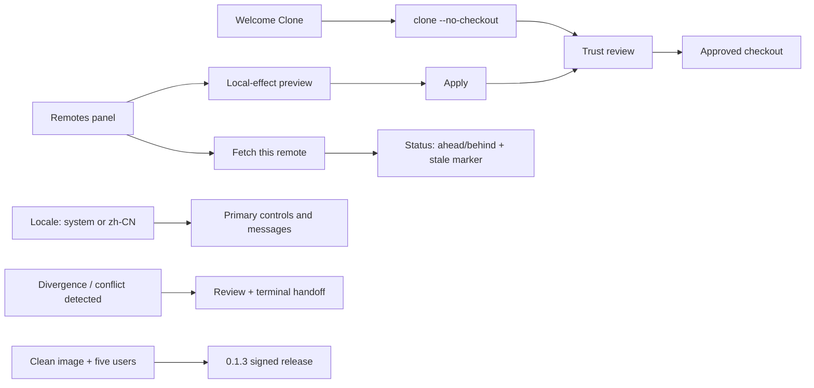

# 0.1.3 window surfaces, Chinese and qualification plan

Status: `[-]` in progress. Workspace version is 0.1.2, the published six-cell release; 0.1.3 is the next increment and has no source, version or artifact yet. This plan closed the gaps the 0.1.0 notes named; it adds no reach beyond them. Product admission is owned by [01](../prd/PRD_01_product.md#010-first-user-feature-tree), interaction by [10](../prd/PRD_10_desktop_ux.md), language and accessibility by [10](../prd/PRD_10_desktop_ux.md#input-language-and-accessibility), remotes by [07](../prd/PRD_07_remotes.md), recovery by [08](../prd/PRD_08_recovery.md), packaging by [12](../prd/PRD_12_platform_delivery.md), and sequencing by [the roadmap](roadmap-0.1.0.md).

0.1.0 published a signed, runnable Windows beta and named six gaps in its release notes. This version exists to close them, not to add reach. Every package below finishes a journey 0.1.0 already promised; nothing here widens the product.

## Product outcome

**A Chinese-speaking developer who has never typed a Git command clones, commits, pulls and pushes entirely inside the window, and the installer behaves on a machine that has never run the product.**

```text
0.1.3 · close the published gaps
├── A. Everything remote happens in the window
│   ├── Welcome Clone: URL, destination, branch, depth → reviewed effect
│   ├── Remotes panel: list, add, set URL, rename, remove, fetch this one
│   └── Same previews and refusals the CLI already enforces; no second code path
├── B. The product speaks the user's language
│   ├── zh-CN for every primary control, status and refusal
│   ├── Visible language choice; system default; explicit override persists
│   └── Paths, OIDs and Git output stay literal
└── C. It is honest about what it cannot do
    ├── Divergence review before any integration, with the two sides named
    ├── Conflict detection, path list, write blocking and terminal handoff
    └── Installer and first-run behave on a clean image; five users confirm it
```



## Review of the starting point (2026-11-08)

Baseline: public `v0.1.0` at `f6ab36e`, workspace version `0.1.0`, working branch `main`.

| Area | Actual state | Consequence for 0.1.3 |
|---|---|---|
| Clone contract | `preview_clone` / `clone_repository` are implemented and fixture-tested in `crates/srcmgr-git/src/clone.rs`; the CLI verbs work | The panel is a binding exercise, not new Git work |
| Remote write contract | `preview_remote_change` / `apply_remote_change` are implemented with config-byte fixtures in `crates/srcmgr-git/src/remote_edit.rs` | The panel must call these; a second write path is the main regression risk |
| Snapshot | `Snapshot` carries `upstream`, `ahead`, `behind` and redacted `remotes`; `srcmgr-ui/src/window.rs` has no Remotes surface | Model is ready; only paint and input are missing |
| Jobs | `Job::Fetch`, `Job::Pull`, `Job::Push` exist and are handled in `window_backend.rs`; there is no clone job | Clone needs a job plus progress and cancel wiring, which `run_network` already supports |
| Language | `srcmgr-ui::messages` is a typed key catalogue with English text only; there is no locale value, selector or second table | Adding a table is cheap; adding a *mutable* locale in the render path is the risk |
| Divergence | `pull_ff` refuses a non-fast-forward and returns Git's reason; the window shows the error text | 0.1.3 needs the reviewed two-sided view, not a new integration |
| Conflict | Nothing detects `MERGE_HEAD`, `rebase-merge`, `CHERRY_PICK_HEAD` or unmerged paths | Detection and handoff are new, small and read-only |
| Quality gates | 0.1.0 shipped without clean-image launch, accessibility, CJK/clipboard or a five-user study; all six are named in its release notes | These are the release-blocking gates of 0.1.3 |
| Inherited | Files-desktop p95 47.7–49.2 ms against a 33 ms target; reference Windows 11 host absent | Reuse 0.0.6/0.1.0 evidence only in its recorded scope; do not re-declare the target met |

## Boundaries

Must: clone from Welcome with a reviewed destination; manage remotes from a panel through the existing preview/apply contracts; fetch one named remote from the panel; show divergence with both sides named before any integration; detect an in-progress operation and unmerged paths, block the write actions and hand off to a terminal; zh-CN for every primary control, status and refusal with a persistent explicit locale choice; a clean-image launch court and a five-participant study.

Not in 0.1.3: merge, rebase, in-app conflict resolution or a conflict center ([08](../prd/PRD_08_recovery.md) after 0.1.x); tag push, remote branch deletion, multi-ref or atomic push, `--force-with-lease`; graph/history/blame expansion; reset, cherry-pick, interactive rebase; LFS administration; credentials storage or a vault; background auto-fetch. All six cells now build and package (0.1.2), so this increment adds no platform work: it closes the gaps named above on the contracts those cells already carry, and any cell-specific qualification stays with 12.

Excluded: any panel action that bypasses the reviewed preview; any locale value that changes Git parsing, paths or OIDs; retrying an unknown push; deleting a partial clone without the user's explicit choice; calling an unsigned build the beta.

## Dependency graph

```text
P0 contract (PRD 10 section + admission alignment)
  ├── P1 Clone panel ─────┐
  ├── P2 Remotes panel ───┤  (same files: window.rs / workspace.rs; serialize these two)
  ├── P3 Language ────────┤  (messages.rs only; parallel with P1/P2)
  └── P4 Divergence/conflict ─┘  (git layer + model; parallel with P3)
                                  ↓
                     P5 clean image + five-user study
                                  ↓
                     P6 version, sign, publish
```

Merge points: `window.rs` and `workspace.rs` take P1 and P2 in that order from one writer; `model.rs` takes P4's conflict state before P5 starts.

## Work packages

| Package | Deliverable | Minimum evidence and stop condition |
|---|---|---|
| P0 · contract | 0.1.3 interaction section in [10](../prd/PRD_10_desktop_ux.md); admission-matrix status aligned with what 0.1.0 actually shipped | Documentation review and `check_docs.py`; no build |
| P1 · Clone panel | Welcome Clone form (URL, destination, branch, depth) → reviewed effect → one-use approval → `Job::Clone` with progress and cancel; partial target offers Inspect and Remove | Workspace cases for empty/nonempty/relative/bad-transport input; one native clone; a nonempty target keeps every file |
| P2 · Remotes panel | Panel listing redacted remotes and refspecs; add / set URL / rename / remove through `preview_remote_change` then `apply_remote_change` with an explicit confirmation; fetch this remote | Model cases; refusal leaves `.git/config` byte-identical; no server contact from a configuration write |
| P3 · Language | zh-CN table for the primary catalogue, locale value (system / English / zh-CN), visible selector, persisted override | Key-coverage check proving no primary key lacks a zh-CN entry; a test that path and OID text is unmodified; English fallback intact |
| P4 · Divergence and conflict | Reviewed divergence view naming local and remote commits; detection of `MERGE_HEAD` / `rebase-merge` / `CHERRY_PICK_HEAD` / unmerged paths; write actions blocked with reasons; terminal handoff for the exact repository | Fixture with a diverged branch and one with a real conflict; stage/commit/pull refused while unresolved; handoff path equals the trusted root |
| P5 · Qualification | Clean-image launch, accessibility and CJK/clipboard checks, long-session resource read, five-participant study | Launch and first-run recorded on the clean image; 4/5 users complete clone → stage/commit → pull → push unaided; every failure changes UX before release, not the study |
| P6 · Release | Version 0.1.3, notes with the actual remaining limits, release-eligible signing, published assets | Affected suites + Clippy + docs at the tagged commit; signature `Valid` with the company `O=` and timestamp; downloaded bytes re-hashed and started |

## Invariants this increment must not weaken

- A panel action routes through the same `preview_*` then `apply_*` function the CLI uses. A panel that calls Git directly is a defect even when it works.
- Clone keeps `--no-checkout`; checkout stays a separate, reviewed decision. No global filter runs before the repository is trusted.
- The locale value affects only display strings. Paths, OIDs, refspecs, Git error text and config bytes are not translated or case-folded.
- Divergence is shown from fetched refs with the fetch time; it is never presented as live server truth.
- A conflicted or in-progress repository refuses stage/commit/pull/push rather than producing a partial result.
- No credential, token or credential-bearing URL enters a label, log, journal, receipt or the clipboard.
- Every gate that stays unqualified is named in the release notes. A green local suite is not a qualification.

## Acceptance ledger

| Case | Required outcome | State |
|---|---|---|
| C1 · clone panel | A reviewed clone lands in an empty destination without checkout; a nonempty destination is refused with its contents intact; a partial target can be inspected and removed | `[-]` form, review and one-use approval delivered with 7 workspace cases; a local clone is verified end to end (destination holds only `.git`, `a.txt` absent); in-panel Inspect/Remove of a partial target is not built yet |
| C2 · remotes panel | Each panel action shows the local effect first and changes only what it showed; a refusal leaves the configuration byte-identical; no server is contacted | `[_]` |
| C3 · language | Every primary control, status and refusal has a zh-CN string; the override survives restart; paths and OIDs are untouched | `[-]` catalog, selector and persistence delivered; 63 controls translated, and 57 remaining hard-coded strings (43 notices, 9 main views, 4 hint lines, 1 welcome view) still need moving into the catalog |
| C4 · divergence | A diverged branch shows both sides and a fetch timestamp, and no integration happens without an explicit choice | `[_]` |
| C5 · conflict handoff | An unresolved operation blocks the write actions with reasons and hands off the exact repository path | `[-]` detection and blocking delivered with three fixture tests (clean, merge conflict, cherry-pick conflict); the reason names the operation, the unmerged count and the repository path, and the status line shows the same state. A dedicated handoff control that launches the terminal is not built yet |
| C6 · clean image | The signed archive launches and completes first-run on an image that never had the product or the Rust toolchain | `[_]` |
| C7 · users | 4 of 5 participants complete clone → stage/commit → pull → push unaided; observed failures are fixed before release | `[_]` |

## Selected verification and stopping

Start with the cheapest oracle per package: actual `.git` refs and config bytes for P1/P2, the key-coverage table for P1/P3, fixture repositories with a divergence and a real conflict for P4, and the clean image for P5. Run the affected `cargo test --workspace` selection with `SRCMGR_TEST_GIT`, `cargo clippy --workspace --all-targets` and `python scripts/check_docs.py`. Stop when the selected cases pass or are recorded `BLOCKED` with the missing prerequisite.

Release gate: C1–C7 either pass with named evidence or are `BLOCKED` with a precise missing item; the version is unpublished before signing; the signed archive is downloaded again, re-hashed and started; the notes list what is still unqualified.

## Execution record

### 2026-11-13 · language and clone

Workspace version stays 0.1.2 (the published six-cell release); this increment has no source, version or artifact of its own yet.

- **Language (C3, partial).** The catalogue now holds both locales in one table, so a key without a translation cannot compile, and three tests fail if a translation is left as English, loses its Han characters, or if the two catalogues drift apart. Every control, status and refusal renders through the active locale; paths, object ids, branch names and Git output stay literal, which a frame test asserts both ways. The Welcome surface names the current language and cycles System, English and Simplified 中文 with one key; the value is validated, persisted under `ui.locale` and reloaded without a restart. `setting set ui.locale` accepts the same three values and refuses anything else. 57 hard-coded strings remain (43 notices, 9 main views, 4 hint lines, 1 Welcome view), which is why C3 is `[-]` and not `[v]`.
- **Clone (C1, partial).** A Welcome form takes URL, absolute destination, branch and depth and walks them with Tab. Enter asks for a preview that validates transport and target without contacting the server or creating anything; approving sends only the one-use ticket, so the reviewed values are the values that run. Clone keeps `--no-checkout`. Verified on a local bare remote: the command reported the reviewed effect, cloned, and left the destination holding only `.git` with no `a.txt`; the branch was `main`. The panel cannot yet inspect or remove a partial target, so C1 stays `[-]`.

### 2026-11-13 · unfinished integrations

- **Conflict handoff (C5, partial).** `srcmgr-git` now reports what Git says is in progress — merge, rebase, cherry-pick, revert or am — plus the index's unmerged paths, from Git's own metadata. Stage, commit, pull and push refuse with the operation named, the unmerged count and the exact repository path, and the status line shows the same state, so a merge started in a terminal is visible and enforced in the window. An unreadable marker is reported as unknown rather than clean. Three fixture tests cover a clean repository, a real merge conflict and a real cherry-pick conflict. Launching the terminal from the reason is not built yet.
- **Divergence (C4).** Not built. Pull already stops on divergence through Git's own refusal (0.0.9), but the two sides and the fetch time are not shown before the attempt.

Not built yet: the Remotes panel (C2), divergence review (C4), the terminal handoff control (C5), the clean-image and five-participant courts (C6, C7).
