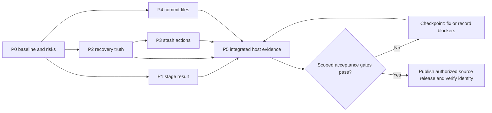

# 0.1.5 implementation plan

Status: `[-]` qualification in progress; P0 and the declared P1–P4 functional slices have named evidence for the current host candidate. P5 has completed its first sustained journey; remaining measurement and reference-environment gates are open. Original source baseline: 0.0.4. Target version: **0.1.5**, as directed by the owner. The version jump is intentional, not evidence that intermediate versions shipped. The recorded owner authorization covers implementation through public release of this source-only version; it does not waive acceptance gates.

This file owns version scope, sequencing, task status and execution evidence. [PRD.md](../PRD.md) and its modules own product behavior and acceptance criteria. Link to those owners; update them first if an implementation decision changes accepted behavior. Completing this plan qualifies only its declared slice, not all of M1/M2 or the full six-cell product baseline.

Canonical path: `plan/plan-0.1.5.md`. This is an implementation plan, not release notes. Keep one version plan; do not create a parallel `release-0.1.5.md` or copy its task ledger into the PRDs. Release notes describe the accepted result after qualification.

## Current handoff

P1–P4 have implementation and matching functional evidence for the Round 4 frozen artifact on the declared Windows slice. P5's first sustained journey is complete, with the scoped results in Round 6; complete release qualification remains open. Resume the remaining gates rather than recreate features or replay unaffected checks.

1. Preserve the Round 8 completed-write acknowledgement repair and its new candidate identity. Finish the source/documentation checkpoint commit using explicit reviewed paths; preserve other contributors' work. Keep recovery, prompt acknowledgement, selection identity and historical read-only limits explicit in release wording.
2. Reuse the completed 100-cycle/30-minute journey and changed-path checks for unchanged relevant inputs. Preserve earlier stopped attempts; do not relabel them or guess their root causes. A required repair invalidates only justified scopes, not every previously completed check.
3. Reuse the completed actual-command CPU comparison in Round 7. Desktop-frame diagnostics ran but did not pass; the active remote display is 32 Hz, not the required 60 Hz reference. Obtain the matching environment before reference response qualification rather than repeat timings on this session. Retain source/dirty-input, artifact and harness identity with each receipt.
4. Close each acceptance row with PASS/FAIL/BLOCKED and a scoped receipt. Resolve the reference-environment prerequisites before claiming their budgets passed. Publish only after the declared gates pass and source/release identity is verified.

Stop adding features while these conditions remain open. Historical rounds below explain earlier decisions; this section and the tracking table are the current handoff.

## Outcome and scope

Deliver a more understandable local Git workflow while obtaining the first trustworthy evidence for SrcMgr's core promise: **small footprint, fast UI/UX response and stable operation**.

```text
0.1.5 local workflow and quality slice
├── P0 Baseline the existing host build and identify quality blockers
├── P1 Show the observed index effect after stage/unstage
├── P2 Make destructive prompts truthful about actual recovery
├── P3 Select and act on the intended stash safely
├── P4 Review a selected commit's files and their changes
└── P5 Qualify the integrated host candidate and record limits
```



In scope: the packages below and fixes necessary to make their affected paths safe, responsive and measurable. P0/P5 are required work, not optional polish after feature parity.

All mutation tests and live demonstrations use disposable repositories and an isolated profile. Preserve user work, other agents' changes and the sibling MiniCon checkout. Do not exercise discard/pop/drop against a user's working repository to obtain evidence.

Excluded: line discard, merge/rebase, fetch/pull/push, reset/revert, multi-repository triage, a new backup framework, new VCS implementations, new platform support, signing and binary distribution. Earlier delivery of a selected M2 behavior does not admit all M2 features. Quick filter is deferred beyond this plan; opening another feature is not a reward for finishing early.

## Work packages and completion evidence

Package status is tracked in the evidence table below. `[-]` means work exists, not that its checks pass. The paths below are starting points, not an exhaustive file list or permission to spread product meaning into shared MiniCon crates. Git/state work stays on the existing worker path; input handlers do not wait for a subprocess, scan or database operation.

### P0 · establish the host baseline and triage blockers

Owner: [performance, stability and test selection in 14](../prd/PRD_14_verification_roadmap.md). Inspect the existing worker, snapshot and rendering paths before adding instrumentation.

- Record source SHA/dirty input, local optimized artifact hash, Git version, fixture, display scale and host capabilities. Check whether applicable existing receipts can be reused. A local measurement build is allowed; it is not a distributed binary.
- Measure a short idle/interaction baseline on the current Windows-native slice: product and owned-helper memory, idle CPU, input-to-visible-feedback and any obvious retained-state growth. Record timing/measurement uncertainty explicitly; instrumentation must not create a permanent product timer or diagnostic payload stream.
- Identify affected blocking work, stale-result races or missing recovery safeguards. Fix dependencies that would invalidate P1–P4 or the core quality gate before calling those packages complete. Keep the work bounded to demonstrated faults; do not redesign unrelated infrastructure.

Completion: a scoped baseline receipt and a short blocker list tied to PRD gates. This initial probe is not a long-session or six-cell qualification. If a measurement is unavailable, record the missing prerequisite and continue independent work without claiming that quality property passed.

### P1 · show the observed stage/unstage result

Owners: [CHANGE-01/02 in 04](../prd/PRD_04_changes_commits.md), [generation/freshness in 13](../prd/PRD_13_state_control.md). Likely changes: `crates/srcmgr-git/src/repository.rs`, `crates/srcmgr-ui/src/model.rs`, `workspace.rs` and `window.rs`.

- After a successful file/hunk/line stage or unstage, reconcile and show the affected path scope's index-to-HEAD file count and added/deleted line counts. For an all-files action, name that whole-index scope explicitly. No optional scope toggle in this version.
- Use actual index data and raw path identities; the numbers are not the size of the clicked patch. Handle unborn HEAD, fully unstaged/deleted entries and binary/undecodable entries without reporting unknown line counts as zero. Preserve any concurrent worktree changes.
- Say what SrcMgr actually did: the staging action updated the index and did not itself write worktree content. Do not claim trusted filters or external writers could not change files. Failure/partial/uncertain outcome shows the actual status and freshness, not a success line with guessed counters.
- Bind the result to job/repository/generation so an older completion cannot overwrite a newer selection. Recompute on relevant completion, not continuously while idle.

Minimum evidence: an actual Git fixture comparing the displayed scope/counts and index contents, with working-tree bytes checked; a relevant result-routing test for a stale reply. Cover one partial-staged text case and binary/unborn handling within those focused fixtures. One real visibility/input/exit smoke is required for the new result line; do not screenshot every count combination. Stop when the observed result and targeted boundaries agree.

### P2 · bind recovery labels to real capability

Owners: [REC-01/04 in 08](../prd/PRD_08_recovery.md), [ref impact in 06](../prd/PRD_06_references.md). Likely changes: the `Confirm` model in `crates/srcmgr-ui/src/workspace.rs`, prompt rendering and the relevant backend preflight.

- Cover current file/hunk discard, branch deletion, detached checkout and the stash actions introduced in P3. Determine the risk/effect of the actual command; detached checkout must not imply that commits were deleted.
- Render the recovery class from the selected target and actual recovery state: a verified available record, recovery with named limits, or no guaranteed recovery. A fixed operation-to-label table alone is not proof a backup exists.
- Never label unstored worktree bytes recoverable from a ref/reflog. A promised safety copy/ref must be created and validated under 08 before the destructive write; an absent, stale or failed record cannot justify proceeding under that promise.
- This package does not build a general recovery subsystem. Where existing code lacks required safeguards, implement the narrow required guard or disable that action with a reason. An irreversible path requires 08's explicit scope/confirmation behavior; a warning label does not replace it. Generic untracked deletion must not silently substitute permanent removal for trash.

Minimum evidence: injected available/missing/stale recovery states produce truthful prompts, cancel leaves actual target state unchanged, and the chosen destructive path either satisfies its relevant safeguards or is refused. For a materially changed loss guard, establish one discriminating negative control. A rendered-prompt smoke checks that consequence and recovery limit are readable; do not add a test that only repeats strings from the implementation table.

### P3 · inspect and act on a selected stash

Owners: [ADV-01 in 09](../prd/PRD_09_advanced_git.md), [operation safety in 08](../prd/PRD_08_recovery.md). Likely changes: `repository.rs`, the worker `Job`/result types in `model.rs`, and stash selection/prompt state in `workspace.rs`.

- Add a bounded, keyboard-reachable stash list through existing navigation. Show a display selector, short OID and subject; keep the full OID and an observed list identity for operations. Short OIDs and `stash@{n}` positions are labels, not durable authorization targets.
- Apply keeps the source stash. Pop removes the exact selected entry only after confirmed successful apply; conflicts, cancellation and unknown outcome retain it. Drop names the selected target and recovery limits and requires explicit confirmation. `n`/Escape preserves selection and performs no mutation.
- Revalidate selection immediately before execution. External list changes or ambiguous duplicate entries invalidate the preview. Never apply/drop the item that merely moved into the old row number. If apply succeeds but exact-source removal cannot be established safely, keep the stash and report Applied; source retained rather than retrying the entire operation.
- Treat the gap between validation and removal as a safety question, not proof of atomicity. If the backend cannot establish safe exact-entry removal under concurrent external writers, refuse removal and retain the source; a preflight list comparison alone does not qualify Pop/Drop. Document a refused capability rather than mark an unsafe implementation complete.
- Refresh from actual post-state. Re-entering the list preserves the selected full identity if still resolvable, otherwise reports its removal. Do not add stash message editing, ignored/untracked capture options or background polling in this slice.

Minimum evidence: real Git fixtures for successful apply/pop, conflicting apply retaining the stash, and list movement before drop refusing or resolving the intended entry without deleting another. Compare worktree/index and stash identities. One focused workspace test covers selected-target dispatch and cancel; reuse the existing worker/trust evidence where contracts are unchanged. Smoke the new list/select/action/return path once, including a refused action.

### P4 · navigate commit → files → diff

Owner: [HIST-03 in 05](../prd/PRD_05_history.md). Likely changes: `repository.rs`, `model.rs` and the Commits/main-panel state in `workspace.rs` and `window.rs`.

- Enter on a commit opens its changed-file list; Enter on a file opens that file's committed diff. Escape returns one level and restores selection/scroll. Show the selected commit and comparison base at both detail levels.
- Ordinary commits compare to the first parent; a root compares to the empty tree, never a nonexistent parent. Merge detail identifies the first-parent comparison and its limitation. Do not add combined or arbitrary-parent UI in this slice.
- Preserve raw rename old/new paths and Git status/mode information, including deletions and binary/gitlink entries. Parse machine-safe path records without splitting display text. Metadata-only/unsupported content remains explicit and never launches external diff/textconv automatically.
- Keep historical detail read-only: stage/discard keys cannot act on a committed diff as though it were the current worktree. A stale or failed detail load must leave the selected commit/base clear and allow a safe return.
- Keep worker results bound to commit/path/repository/generation; switching selection before a result arrives must not display it as belonging to the new target. Respect current paging/diff bounds and report truncation.

Minimum evidence: actual object/tree oracles for a root commit and a rename/deletion, plus a merge showing its selected first parent. A focused navigation/result-routing test covers Enter/Enter/Escape and stale replies. One live drill-down/return smoke checks labels, focus and readability. No full branch/stash/network suite for this read-only feature.

### P5 · qualify the integrated host candidate

Owner: [existing resource/latency budgets and stability scope in 14](../prd/PRD_14_verification_roadmap.md). Those budgets already exist; distinguish unmeasured results from absent requirements.

- Measure the integrated optimized host artifact after P1–P4 and any required quality fixes. Record product idle/active/peak memory, owned-child contribution, idle CPU and input-to-present feedback for Files, Commits and the main panel during actual Git work. Use 14's sampling/trial definitions where claiming the corresponding budget passed.
- Compare results against applicable existing budgets. A smaller diagnostic fixture can establish a labeled baseline, not qualify the standard-repository budget. Keep measured handler time separate from real visible feedback. Include minimum/typical/p95 or the available sample distribution; do not claim p95 from one press.
- Reuse the P0 measurements only for unchanged relevant inputs. Run the integrated candidate's changed-path smoke and the focused stability/resource checks justified by new behavior. A ten-minute exploratory session cannot replace 14's declared M1 stability qualification; reuse valid qualification evidence or run its required scope before claiming that gate complete.
- Record PASS/FAIL/BLOCKED/NOT-RUN per applicable property. A failing core quality gate needs a bounded fix and affected recheck; missing evidence does not become a pass merely because this is source-only. Other native targets remain explicitly unqualified unless actual matching receipts exist.

Completion: the candidate's numbers, comparison, method and limitations in the evidence table below. No new production telemetry, benchmark service or general test framework. Do not replay an eight-hour/six-cell campaign unless the risk policy or a first-time claim requires that scope.

## Sequence, dependencies and hot files

1. P0 establishes quality risks and the measurement method before feature growth.
2. P1 and P2 stabilize result/prompt contracts; P3 depends on P2's truthful confirmation/identity rules.
3. P4 follows the settled navigation/job-result contracts. These packages share `workspace.rs`, `model.rs`, `window.rs` and `repository.rs`; integrate them serially in small reviewable commits.
4. P5 uses the integrated candidate. If P5 finds a regression, fix only its cause and rerun affected checks, then refresh artifact identity.

Do not start another feature while a selected safety/quality blocker remains unexplained. There is no stretch package or arbitrary follow-on version commitment in this plan.

## Assessment at each implementation round

Before choosing the next change, compare the current diff and available receipts with P0–P5. Record only a material scope, dependency, risk or evidence change; do not rewrite the plan after every successful command.

1. Identify the next incomplete acceptance condition and the smallest change that addresses it. Reconcile package status with actual code and evidence, including other agents' work.
2. State the affected user risk, selected checks and stopping condition before running them. Reuse evidence whose inputs remain valid; escalate only for a demonstrated dependency or failure.
3. On a safety, memory, response or stability regression, pause dependent feature work and identify the bounded repair. On an unavailable prerequisite, record BLOCKED and continue independent work.
4. Update this plan's status, next action and receipt references. Change accepted product behavior in its owning PRD before implementing a different contract; a plan edit cannot silently lower a budget or waive a guard.

Follow the current handoff above. P3 exact-entry removal and P4 metadata/read-only navigation retain their explicit completion conditions; existing evidence is reusable only for unchanged relevant contracts. Integrate serially because their model, workspace and backend changes overlap.

## Focused validation and stop rules

For each package record change → user risk → affected contract → minimum check → stop condition. Use [14's risk policy](../prd/PRD_14_verification_roadmap.md#risk-based-test-selection-and-stopping). Existing command forms are `cargo test -p <affected-crate> <selected-filter>`, relevant Clippy/build checks, and `python scripts/check_docs.py`; choose concrete filters after implementing the tests, without advertising invented drivers.

- During iteration, run only the selected rules/integration path and necessary UI smoke. A failed test triggers diagnosis, not a full-suite restart.
- At integration, run the fast workspace quality/ordinary tests once if product code changed: `cargo test --workspace`, `cargo clippy --workspace --all-targets` with no unexplained warnings, and the documentation check. Fixtures use a verified supported `SRCMGR_TEST_GIT`; 164 prior tests is context, not a test-count target.
- Live key/pointer runs use the intended isolated fixture/profile and verify foreground before input. Dropped input is inconclusive until diagnosed; do not automatically classify it as a harness flake or a product defect. Record the failed attempt and only the scope the successful rerun proves.
- Keep raw logs/captures in ignored local output, summarize relevant evidence once, and stop after selected checks pass without unresolved concerns. Do not copy full logs or create redundant test layers for simple text changes.
- This plan-only review requires the documentation check and a local diff/link review. It does not trigger product builds, GUI automation, performance runs or workspace tests, and it adds no runtime qualification evidence.

## Candidate acceptance decisions

Use the exact thresholds and sampling rules in [14](../prd/PRD_14_verification_roadmap.md#performance-and-resource-budgets); the rows below select evidence, not replacement requirements.

| Gate | Required decision for this slice | Blocks acceptance when |
|---|---|---|
| Workflow and integrity | P1–P4 actual Git-state oracles, selected negative cases and live changed-path smoke agree | Wrong target, misleading result/recovery promise, unsafe mutation or unexplained failure remains |
| Small footprint and low CPU | P5 compares applicable app/process-tree idle, active, peak and repeated-use results with 14 | An applicable ceiling fails or required accounting is unavailable |
| Fast response | P5 measures visible feedback during actual work, separately from handler and Git completion timing | Applicable latency/stall gate fails; focus-only timing is offered as workflow evidence |
| Stability | Applicable first qualification or explicitly reusable evidence covers delivered paths and integrity | Required duration, growth, cancellation/recovery or integrity evidence is missing |
| Release identity and claims | Reviewed source/version, candidate identity and public source tag/release match; limits remain explicit | A core gate above is open, identity differs, or release wording claims unqualified platforms/binaries |

An unsupported action may be explicitly refused under its PRD's safe-failure contract. That refusal is not evidence that the action works. Record it as a version limitation and adjust its package claim; do not silently remove a required safeguard or substitute a warning. Other OS/ISA support, signing, full M1/M2 completion and suite-wide qualification remain separate claims with their own evidence.

## Tracking and evidence

| Package | Status | Evidence to attach | Remaining issue |
|---|---|---|---|
| P0 baseline | `[v]` scoped baseline | Optimized 0.0.4 artifact SHA-256 `341e784489302a314091c262ff20948a323efa20d3d0f1987f542354787db3b8`; receipt `target/qualification/p0-activation/receipt.json` (local/ignored) | Small fixture only; integrated standard/stability evidence belongs to P5 |
| P1 result line | `[v]` declared functional slice | Parser and actual text/partial/binary/unborn index oracles; stale routing checks; result line and Git-state smoke on the current artifact in `p5-integrated-short` | Overall release still requires P5; no broader VCS/platform claim |
| P2 recovery truth | `[v]` declared functional slice | Prepared content/copy/replay and refusal cases; established negative controls; current-artifact prompt/copy/ACL evidence in Round 4 | Untracked deletion remains explicitly refused; manual recovery limits remain release limitations; P5 gates remain |
| P3 stash list | `[v]` declared functional slice | Actual apply/conflict/stale/duplicate/untracked cases, locked exact removal/last-entry/partial publication checks and negative control; current-artifact select/apply/pop/drop/refusal smoke | Removal scope remains bounded ordinary unpacked files storage; P5 gates remain |
| P4 commit files | `[v]` declared functional slice | Actual root/rename/deletion/merge/binary/gitlink/mode oracles; read-only/navigation/stale/error routing; current-artifact files/diff/return smoke | First-parent/bounded-list limitations remain; P5 gates remain |
| P5 host quality | `[-]` qualification incomplete | Completed standard sustained journey/resource/idle evidence in Round 6; actual-command CPU comparison passed in Round 7 | Reference desktop/dispatch and other applicable evidence remain open; current display is a 32 Hz remote session and SSD backing is unconfirmed |

Receipts name package/journey subcase, source/artifact, selected Git, fixture/environment, direct observed result and limits. Existing 0.0.4 evidence remains historical; no row is complete merely because the plan or tests were written. Update requirement implementation status in its PRD owner and keep version execution detail here.

### Round 1 assessment and evidence

The package sequence remains appropriate. Publication authority is now supplied by the active owner goal. P0 used the pre-feature optimized source baseline (`f55c9c1` product code, pending documentation only), Windows native x86_64, Git 2.56.0, 1024×641 client pixels at 100% scale, 50 tracked/changed files, 20 commits and 200 refs. Observed idle working set: 29,810,688 bytes (28.43 MiB); process high-water working set 32,620,544 bytes (31.11 MiB). No additional process CPU time was recorded in the 10.05-second idle diagnostic interval. This does not qualify the 60-second CPU budget.

The opt-in `scripts/probe_workspace.py` used verified-foreground native SendInput and client-DC focus-border sampling, with 1 ms polling/GDI overhead included. After 5 warmups, 30 samples per panel gave p95 6.658 ms (Files), 5.571 ms (Commits), 6.975 ms (main panel). These measure client-surface focus feedback only; they do not establish desktop presentation, backend completion latency, standard-repository budgets or a long-session claim. An initial probe could not activate the window and sent no input; activation was corrected in the probe and the successful run is the scoped receipt.

P2 discovered that 0.0.4 permanently removed untracked files without a qualified trash capability. Under the already specified P2 refusal route, this path now refuses with an explanation; tracked file/hunk discard retains an exact, flushed and read-back-verified local worktree copy, and branch deletion first retains its OID. There is no automatic undo promise or new general backup framework. Direct risky worker jobs require a prepared, expiring, target-bound confirmation; cancelled preparations release their retained data. Recovery copies are bounded at 16 MiB per file and by the existing profile recovery budget; unsupported links/storage errors refuse the action. These limits must be explicit in the 0.1.5 release notes.

Targeted evidence so far: UI state/render suite (40 cases, before the latest stale-error refinement), the new confirmation guard case, branch deletion case, file/hunk discard cases, and the index-summary parser passed. No full workspace gate or integrated runtime qualification is claimed yet. Preserved the owner's requirement to keep the desktop benchmark unnamed in public PRD text.

### Plan review · 2026-10-21

Kept P0–P5 and the 0.1.5 source-only scope. Reconciled the diagram with recorded publication authority, corrected P3/P4 from not-started to unqualified work in progress, and made round assessment and candidate decisions explicit. Added review points for concurrent stash removal and historical read-only detail. Earlier execution notes above remain scoped historical evidence; this documentation review neither reran nor newly qualified those results. Next: the implementation agent validates the existing changes against the outstanding conditions before starting P5.

### Round 2 assessment and evidence

Validated existing work before adding scope. `cargo test -p srcmgr-ui --lib` passed 43 cases after correcting stale fixtures and adding stash selection/cancel/removal reporting, committed-detail read-only/return/stale routing, and slow-worker queue coverage. The real Git `committed_files_use_actual_root_rename_deletion_modes_and_merge_parent` case passed with binary and gitlink metadata; `selected_stash_apply_conflict_and_stale_list_use_real_git_state` passed. Historical detail now carries actual modes and the resolved comparison base, not a generic parent label. Removed the blind newest-stash worker route.

The new discard content-guard negative control deliberately disabled only content revalidation: `confirmation_rejects_changed_content_failed_copy_and_replay` failed; restoring the guard made it pass. This control is established and need not be replayed for unrelated edits.

Native smoke exposed obsolete read-job buildup. Added one active job, coalescing of queued detail reads without crossing mutation ordering, a bounded input queue and a header busy marker that remains readable when footer hints truncate. Initial `p1-p4-smoke` timed out waiting for unstage. The coalesced attempt's Git oracles passed, but screen review showed capture pacing had not waited for prepared replies, so those captures do not qualify the named journeys. The probe now waits for the actual visible busy marker to clear.

Receipt `target/qualification/p1-p4-visible-smoke/receipt.json` (local/ignored), optimized artifact SHA-256 `46bc11cd4fbf43a74c8aef7a7d78328aad2abb4957b205c3801136fab8287e15`, establishes the changed-path Git oracles plus reviewed readable discard/apply prompts, stale-action refusal, and root commit files/diff/selection return. Same scoped host/display/fixture as Round 1. Idle RSS was 30,408,704 bytes over a 10.03-second diagnostic; focus feedback p95 Files/Commits/Main was 6.544/7.880/6.302 ms. These remain small-fixture diagnostics, not P5 qualification. This artifact predates the new stash-removal publication path.

P3 review found that validating an ordinal before `git stash drop` did not protect the gap before Git acquired its ref lock. The implementation now stages the removal with installed Git in an isolated store while holding the original files-backend ref/reflog/packed-ref locks, and publishes only Git-generated bytes. It retains original metadata if final publication is partial; it does not promise atomicity across both file replacements or automatic repair. Ordinary unpacked files storage is the initial supported removal capability; unsupported storage refuses rather than weakening identity checks. Actual success/last-entry/foreign-lock, concurrent external Git and injected partial-publication cases passed. Deliberately locking the wrong ref file let the external writer shift the list and made its test fail; the restored lock passed. That discriminating control is now established.

Receipt `target/qualification/p1-p4-removal-smoke/receipt.json` (local/ignored), optimized artifact SHA-256 `4b11342d9ac470c30a22cb0fe480f2ea2ddf02157be0dcff8072fc0c8904b113`, adds actual foreground Pop/Drop oracles and reviewed target/recovery/result captures. Refused authorization now refreshes the real stash list. The workspace ordinary-test integration gate passed; Clippy passed without warnings after the three reported style issues were corrected. Later path-argument preservation, formatting, target-version metadata and prompt wording require only affected checks and the applicable candidate identity/native smoke, not another automatic workspace replay.

The optimized 0.1.5 candidate now enters P5. The owned-process meter was calibrated against a real 50 MiB allocating child and OS job totals, retaining exited-process high-water counters and including the console helper. The current host reports 4 cores/8 logical CPUs and 64 GiB memory; its virtual disks report unspecified media and display adapters report 1024×768 / 1360×768. Requested confirmation of a matching reference environment while continuing independent validation. These prerequisites remain unconfirmed, not silently waived. No public release gate is complete yet.

### Round 3 assessment and evidence

Standard-fixture diagnostic receipt `target/qualification/p5-standard-tree-baseline/receipt.json` used optimized artifact `dbb0121a15f421c41027a0d27a11622a3b086c5382e2251e59c68ad974fa61d6`, 100k commits/20k files/200 refs/200 changed paths, a 1024×641 client at 100%, and an actual 1680×1050 desktop. The driver-reported display resolutions above were not the active session size. After 30-second settling, visible idle RSS was 28.81 MiB, process lifetime high-water 31.40 MiB. Complete accounting covered 41 processes; the overlapping-lifetime RSS upper bound was 136.91 MiB, with simultaneous sampled peak 107.65 MiB. Visible/minimized 60-second process-tree CPU increments were both zero. Focus feedback p95 Files/Commits/Main was 9.848/9.805/5.261 ms. The sampler had a 109 ms maximum scheduling gap; retain that limitation rather than claim an uninterrupted ≤100 ms trace. OS lifetime counters independently cover peak/CPU accounting. These are scoped host diagnostics, not a completed P5/reference-environment qualification.

The frozen intermediate candidate `411fef687404fcd36c0d1d766c7ad27c7d9fcb9290f9208a69813978a07854ca` completed `p5-candidate-journey-smoke`: real P1–P4 flow, 10 inspect/stage/commit/switch cycles, five failure/cancel injections, actual Git integrity oracles and acknowledged draft preservation across controlled restart. Tree coverage was complete for 2380 processes, with zero active descendants at exit; the trace maximum gap was 79 ms. This short run does not substitute for the 30-minute qualification. An earlier driver attempt stopped at its ACL injection because Windows PowerShell could not load its security module; using the available PowerShell 7 was calibrated against an actual denied read and exact ACL restoration before the successful run. No product defect or passing long-session claim is inferred from that harness failure.

On the unchanged standard fixture, 30 timed public CLI trials after five warmups gave end-to-end p95 752.34 ms for status and 579.74 ms for a 200-row history list (`public-command-latency.json` beside the baseline receipt). This includes startup/trust/identity overhead; it is a flat-history-list result, not graph-lane or GUI-first-usable-view evidence. Raw trial distributions remain in the local receipt.

Result-routing review found two reproducible data-loss/liveness cases: an unrelated Full reply acknowledged a pending commit, and Escape removed draft text before persistence could fail. Both new cases failed against the prior implementation. Added action-specific prompt completion/failure, kept draft text until durable acknowledgement, stopped unrelated errors from enabling duplicate submission, and retained editable text when the worker channel stops. Draft saving no longer refreshes unrelated Git state. A separate full-refresh case now invalidates and releases an outstanding confirmation instead of leaving its late preparation stuck. The UI suite and focused stopped-worker case passed; the affected backend cases passed (one old plural-wording expectation was corrected and its stage check rerun), as did the new durable-draft/foreign-lock and actual branch-ack cases. Current Clippy is clean. These established failing-before/passing-after cases are the negative controls for the changed message-loss guards; no unrelated matrix replay is required.

The next action recorded at the end of this round was to freeze the revised optimized artifact and attempt 30-minute/100-cycle host qualification. The subsequent stopped attempts and revised action are recorded below. The prior successful measurements remain scoped to their recorded bytes; do not relabel them as runs of the revised candidate. Publication remains gated.

### Plan review · qualification handoff

Retained P0–P5 with no additional feature scope. Corrected stale wording that a probe was still running and separated current actions from the historical round log. The intermediate native feedback figures in Rounds 2 and 3 also came from client-DC sampling; they are surface-feedback diagnostics, not proof of real input-to-present latency. Desktop observation and event-handler timing need separate, qualified methods before their corresponding gates can pass.

Both `target/qualification/p5-standard-sustained/receipt.json` and `target/qualification/p5-standard-sustained-v2/receipt.json` are stopped attempts, not stability passes. The first stopped at the draft-clear assertion: the CLI's documented empty state is `no draft`, while the old driver expected blank output. The second did not establish the first expected commit. Keep that unexplained input/workflow failure open until a short run identifies the cause; do not classify it as an IME issue, a driver flake or a product defect without evidence.

Newer source/probe changes include recovery privacy/quota guards, selected-identity/error handling and opt-in local timing receipts. Their presence is not qualification. Review their affected contracts and check bounded instrumentation: default off, no periodic rendering/wake timer, no repository content in timing output, and measurement overhead/coverage reported. Freeze a new artifact before making claims for those bytes. A product timing receipt alone does not prove desktop presentation, and a desktop focus change alone does not prove completion of a Git operation.

Verification for this plan-only review is the documentation checker plus local diff/link review. It adds no product, runtime or resource PASS and does not require a build, workspace test replay or GUI run.

### Round 4 assessment and evidence

The revised optimized artifact SHA-256 is `d8b119087adb6e59a6a1011317b8df6726d6bf407512477dc4c81fd53329d715`. Its local `source-inputs.json` records HEAD and all 51 product-source/manifest hashes; dirty product input digest is `1dfe9812db8d33c57391f8e83aede3997bd2d698b32f20f267f19877a78bf1cb`. `cargo check -p srcmgr-cli`, the 51 UI library cases and affected-crate all-target Clippy with warnings denied passed. Three selected CLI confirmation/quota cases passed using supported Git 2.56.0. The prior ordinary workspace integration result remains historical; no automatic replay was needed for these affected checks.

Receipt `target/qualification/p5-integrated-short/receipt.json` records this artifact on a five-file/two-commit starting fixture: changed-path P1–P4 Git oracles, 12 cycles/3 commits, all six failure/cancel injections, preserved acknowledged draft across controlled restart, and clean `git fsck`. Reviewed captures establish the result line, discard/recovery and Pop target wording, root commit files/diff and selection return. Recovery directory ACL verification reports protected inheritance and zero allow entries for other identities. The same check deliberately failed on the older `4c562794…` artifact in `p2-private-copy-control`; it passed with the private-directory guard in the revised artifact. This establishes the changed privacy guard's negative control; do not replay it for unrelated edits.

The short journey lasted 95.27 seconds, with complete accounting for 2829 processes and no active descendants at exit. App sampled peak was 32.67 MiB; complete overlapping-lifetime tree RSS upper bound was 84.88 MiB. The sampler maximum gap was 94 ms. These are small-fixture diagnostics, not standard-fixture or sustained acceptance. Opt-in callback p95 upper bounds were 0.24 ms for keyboard, 0.20 ms for composer text and 1.12 ms for rendering; render maximum was 12.08 ms. Callback timing excludes OS dispatch/queueing and presentation.

Desktop feedback p95 Files/Commits/Main was 35.898/43.761/34.122 ms including the observer overhead; these values do not pass the presentation gate. A read-only calibration found desktop `GetPixel` p95 about 36.26 ms without any product input; a 1×1 desktop BitBlt/DIB alternative was also about 34.88 ms (`target/qualification/desktop-sampling-calibration.json`). Thus this observer cannot establish the required presentation budget. Keep that gate BLOCKED pending a calibrated lower-overhead method or matching host; do not subtract the calibration or treat the client-surface figures as presentation. No product slowdown or successful presentation qualification is inferred from these diagnostics.

The short driver passed before starting `target/qualification/p5-standard-sustained-v3` with this same frozen artifact: standard fixture, 100 cycles over at least 1800 seconds, six selected failures, 30-second settling and 65-second visible/minimized idle windows. The probe process was confirmed live after launch; inspect its actual process/session state before any restart. Idle receipts now include UTC interval boundaries for alignment with bounded application activity counters. This is an in-progress run, not a PASS. Other applicable open evidence, including active CPU versus the same direct Git sequence and reference SSD/display prerequisites, remains required. Continue independent qualification while the presentation-method prerequisite is unresolved; publication remains gated.

### Round 5 assessment · measurement prerequisites

The existing sustained session was polled and remained live, reporting 30 cycles and six commits after 528.3 seconds; no completion claim follows. Its original harness bytes are retained under its local `harness/` folder. Product bytes remain the Round 4 frozen artifact. No second GUI/input probe is started while that session owns the foreground workflow.

Prepared `scripts/measure_cycle_cpu.py` to compare one standard-fixture GUI inspect/edit/refresh/stage/commit/detail/switch cycle with the actual root Git argv run directly. Both arms require complete owned-tree counters and matching deterministic HEAD, index and worktree effects; missing command capture blocks the comparison. The comparison restores only its own generated disposable fixture in place and pins the commit clock. It does not reset a caller's working repository. Native command capture is opt-in and read-only, following [Microsoft's process-command reader](https://github.com/microsoft/vscode-windows-process-tree/blob/main/src/process_commandline.cc); it does not inject product/Git tracing. `target/qualification/command-capture-calibration/calibration.json` verifies all six owned Git processes and the expected three root commands of a real CLI status operation, with complete accounting and no missing command parameters. Earlier Trace2 discovery exposed the separate Git launcher/worker processes; its tracing overhead makes it unsuitable as the default-workload CPU comparison. No CPU efficiency PASS is claimed before the actual paired run.

The current desktop supports DXGI output duplication. Added optional `--desktop-frames` through `scripts/windows_desktop_probe.py`: it reads the actual acquired desktop pixel and corresponding OS update QPC, keeping readback completion separate. Static calibration in `target/qualification/desktop-frame-calibration.json` matched an independent GDI pixel, confirmed the QPC clock, and exposed an initial zero-time empty frame that the observer now excludes. These local calibrations provide a path around slow GDI readback; they do not yet qualify dynamic input or establish a latency PASS. Next, after the live sustained run terminates, run the paired CPU/desktop observation and investigate any actual failing metric. Reference hardware/display prerequisites and dispatch-inclusive evidence remain open. No acceptance budget, supported platform or release boundary changed this round.

### Round 6 assessment · first sustained journey complete

`target/qualification/p5-standard-sustained-v3/receipt.json` completed normally with exit code 0 on the unchanged Round 4 artifact. The standard 100k-commit/20k-file/200-ref/200-change fixture completed 100 cycles, 20 commits and all six selected failure/cancel cases in 1803.70 seconds. Actual committed bytes/index and branch return were checked, final `git fsck` was clean, and the acknowledged draft survived controlled close/relaunch. This closes the first host-slice sustained journey; it does not qualify other native cells, power loss or all P5 properties.

After 30-second settling, RSS grew from 29.13 to 32.46 MiB, a 3.33 MiB increase. OS lifetime app peak was 35.44 MiB. Complete accounting covered 14996 processes with no missing notifications/counters and no active descendants at exit; the overlapping-lifetime whole-tree RSS upper bound was 192.01 MiB. These values are within the corresponding numeric ceilings on this host. The 25 ms target sampler collected 79833 records but had a 140 ms maximum scheduling gap; retain that limitation. Lifetime counters and complete high-water bounds independently cover CPU/peak accounting; do not describe the trace as continuously sampled within 100 ms.

Visible and minimized idle intervals lasted 65.00 and 65.05 seconds, with owned-tree CPU increments of 0.000% and 0.024% of one core. UTC-aligned activity counters cover 64 complete one-second bins in each interval, all zero for application renders, worker wakes, native wait callbacks, input and other application events (`scoped-summary.json` beside the receipt). This establishes the observed application idle activity, without claiming physical display scanout counts. Keyboard callback p95 upper bound was 0.26 ms, composer text 0.08 ms, render 1.36 ms; maxima were 10.14 ms for keyboard and 11.59 ms for render. Their measurement boundary remains application callbacks, excluding OS queueing/presentation. Reference SSD/display prerequisites are still unconfirmed, so this is scoped host evidence, not reference-environment certification.

P1–P4 now have their declared functional evidence on the current artifact; P5 remains incomplete and blocks publication. The chained launcher stopped on its external-process exit-code guard even though the original tool and final receipt establish normal completion; it launched no second GUI. After reconciling those authoritative results, the short CPU/desktop probe was started explicitly. Its first attempt refused foreground activation before sending input, preserved in `p5-cycle-cpu-desktop`; the product exited normally and owned-tree coverage was complete. A no-input activation calibration then verified both foreground-queue and target-queue activation on the owned window. The earlier refusal's cause remains unisolated. A new short attempt in `p5-cycle-cpu-desktop-v2` is in progress; neither the refusal nor the calibration is a latency or CPU-efficiency PASS. Do not repeat the sustained journey for this probe-only work.

Public-state inspection confirms the repository is PUBLIC, latest published release remains `v0.0.4`, remote main matches source baseline `f55c9c1`, and no `v0.1.5` tag exists. No publication occurred during qualification.

### Round 7 assessment · CPU comparison complete; reference display blocked

Two CPU/desktop attempts stopped at the foreground guard. Additional no-input calibration did not isolate the refusal; initialization with the desktop observer did not itself reproduce a foreground change. Added failure details and trial progress so later refusals identify their exact phase; earlier receipts did not record that phase, so do not infer that no earlier trial had run. An input batch rejected by the guard sends no keys, but this is not proof the entire preceding attempt sent none.

`target/qualification/p5-desktop-diagnostic/receipt.json` completed 105 desktop-frame trials on a small fixture, with five warmups and 30 retained samples per panel. Files/Commits/Main p95 upper bounds were 62.661/61.363/62.091 ms, using acquired desktop pixels plus OS update QPC. These values do not pass the 33 ms gate. The experiment proves the observer completed dynamic input; it does not certify standard-fixture response or attribute the delay solely to product code. The candidate's measured application callbacks remain separate evidence. Inspection of the pinned Windows host found a blocking message-driven loop rather than a periodic product polling loop; no product repair is justified solely by the remote desktop numbers.

`target/qualification/active-display-environment.json` identifies the actual active mode as 1680×1050 at a reported **32 Hz**, with `SM_REMOTESESSION` true. This is a concrete mismatch with 14's 1920×1080/60 Hz reference environment; local SSD backing also remains unconfirmed. Requested a matching local Windows environment and SSD information. Reference response/resource certification remains BLOCKED pending that prerequisite; the successful host-slice journey remains valid within its stated scope. Do not lower a threshold or turn an upper bound above the limit into a PASS.

Separated the CPU comparison from optional latency trials. `--skip-latency` explicitly records latency as NOT-RUN for resource/workflow-only runs and cannot be combined with `--desktop-frames`. This obtains an independent required metric without substituting CPU success for response qualification.

`target/qualification/p5-cycle-cpu-only/cpu-comparison.json` records the unchanged candidate on the standard fixture: combined GUI-cycle tree CPU **14.640625 s**, versus **12.812500 s** for its actual 79 root Git commands run directly, below the allowed **16.515625 s**. Both owned trees had complete counter coverage. Replay produced identical deterministic HEAD, index tree and worktree status. Git/product tracing was disabled; the read-only command observer's CPU belongs to the separately reported harness. The direct arm reuses already written objects after resetting only its own generated fixture, a conservative advantage to direct Git. This closes the selected active-CPU comparison; no repeat is needed without changed relevant inputs. It is one scripted standard-fixture cycle, not a claim about custom hooks or every possible workload.

All native probes in this round are terminal. Next: complete the source/documentation publication review and resolve the reference-environment prerequisite. Do not rerun the 30-minute journey or repeat the failed display experiment on unchanged inputs.

### Round 8 assessment · completed Git writes must not become false refusals

Publication review reproduced a bounded state-reporting defect: a real post-commit hook created the owned test profile lock after Git wrote the commit. HEAD advanced, the index was committed and the durable draft remained, but the prior backend returned `PromptFailed(Commit)` when draft cleanup failed. The new `a_created_commit_is_acknowledged_when_post_commit_profile_storage_is_locked` test failed against that behavior. This is a demonstrated stability/operation-truth risk, not new feature scope.

The repair acknowledges known completed commit/branch writes separately from later cleanup/snapshot availability. A completed write identifies its actual OID/name, closes only its own submitted prompt, warns that lists may be stale, and tells the user to refresh rather than resubmit. Cleanup failure preserves the durable draft. An older detail reply cannot erase that guidance. The owning contract in [13](../prd/PRD_13_state_control.md) is explicit; genuine pre-write refusals retain editable input as before.

Selected checks passed: both real Git post-commit/post-checkout profile-lock oracles, the 52-case UI library suite including matching/unrelated acknowledgement and stale-detail guidance, and affected UI/CLI all-target Clippy with warnings denied. The established failing-before commit case is the discriminating control; do not replay it for unrelated changes. No ordinary-workspace or platform matrix replay was selected.

New optimized artifact SHA-256: `3542d046c75cafb5260be399cfb5f6c1126490d3dc5affca913c55f61af2da94`; dirty product input digest `11a13e24e7c7893b944355f9ef5f94d9ddc7f08e2366a0c3a0a60b8f57145ec5` is recorded with its 51 source/manifest hashes. `target/qualification/p5-postcommit-profile-smoke/receipt.json` covers this exact artifact: actual GUI commit, preserved injected lock and saved draft, readable completed-write/stale-list/no-resubmission guidance (capture reviewed), recovery after removing only the owned obstruction, branch round trip, clean `git fsck` and acknowledged draft across controlled restart. It exited normally with complete accounting for 307 processes and no active descendants. This short targeted run is not a new sustained or reference-environment qualification. The receipt's inherited no-custom-hooks scope sentence predates a probe wording correction; this case intentionally used only the documented owned post-commit lock hook, as its fault record states.

Reuse decision: the recovery/index/stash/committed-object contracts, normal worker scheduling and rendering remain unchanged. The normal-success backend issues the same Git sequence; the repair adds a completed-OID value and handles post-write failure, without a new timer, worker or retained cache. Reuse the earlier scoped long-session/CPU evidence for those unchanged contracts, keeping their original artifact identity. Do not relabel those measurements as execution of this new binary. The targeted failure, UI routing and exact-candidate native checks close the changed scope; another 30-minute run is not justified. Reference-environment response/resource certification is still blocked by the 32 Hz remote display and unconfirmed SSD backing. No release was published.

## Handback and publication boundary

Hand back: implemented package status, reproducible host commands, a short real local-workflow demonstration, measured footprint/CPU/latency, relevant integrity results, known limits and exact blockers. If any core gate remains open, call this an implementation checkpoint rather than a qualified 0.1.5 release.

Channel remains source-only; local optimized builds support validation. The owner's active goal explicitly authorizes a public **0.1.5** source release after the scoped package/quality gates pass, including pushing reviewed commits, the named tag and a GitHub Release. Binary distribution remains excluded. Align workspace version and release notes at release preparation, inspect what the push would publish, and verify the public tag/source identity and release status under [12](../prd/PRD_12_platform_delivery.md).
