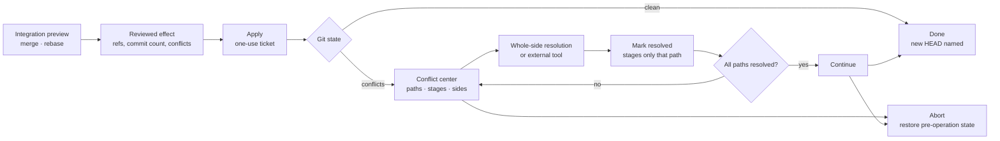

# 0.2.0 integration inside the window

Status: `[_]` planned, not started. Workspace version stays **0.1.3** (published as
`v0.1.3-beta` on 2026-11-14). This plan starts the first capability class the
0.1.x series never admitted: authoring an integration. Product admission is owned
by [01](../prd/PRD_01_product.md#first-user-admission-matrix), the mutation gate
and conflict semantics by [08](../prd/PRD_08_recovery.md#conflict-center),
interaction by [10](../prd/PRD_10_desktop_ux.md), refs by
[06](../prd/PRD_06_references.md), packaging by
[12](../prd/PRD_12_platform_delivery.md), and sequencing by
[the roadmap](roadmap-0.1.0.md). Every case below maps to a requirement those
modules already own; this plan adds no requirement.

## Why this is 0.2.0 and not 0.1.4

0.1.0 through 0.1.3 closed gaps the product had already promised: a panel, a
language, a review, a handoff. Each added reach inside the same promise, which is
why they carried the same minor number. Merge and rebase are not a gap closure.
Until now the product has never written an integration commit, never advanced a
branch by anything but fast-forward, and never resolved one conflicted path — it
detected the state and handed the repository to a terminal. That is a new
capability class, and a version that starts writing it is a minor version.

The consequence is deliberate: 0.1.3 stays the last version whose promise was
"the same client, finished". 0.2.0 is the first version that may leave a
repository in a state the window itself can continue.

## Product outcome

**A developer starts a merge or a rebase from a reviewed decision, resolves the
paths Git stopped on without leaving the window, and is never told an operation
finished when it did not.**

```text
0.2.0 · finish an integration in the window
├── A. Start it from a decision, not a keystroke
│   ├── Merge preview: up to date / fast-forward / real merge / conflicts, named
│   ├── Rebase preview: commits to replay, onto which commit, what moves
│   └── Refusal when the worktree, index or an unfinished operation forbids it
├── B. Resolve what Git stopped on
│   ├── Unmerged paths with their index stages, one row each
│   ├── Base / current / incoming content per path, labelled by stage role
│   ├── Whole-side resolution with a preview of the resulting path
│   └── External merge tool for the cases whole-side cannot settle
├── C. Continue, skip or abort truthfully
│   ├── Continue enabled only when the Git state allows it
│   ├── Skip names the commit it will omit
│   └── Abort restores the pre-operation branch and HEAD, or says what is left
└── D. Survive a restart
    ├── The operation is re-read from Git's own metadata, not remembered
    └── An interrupted action reads as needs-reconciliation, never as success
```



## Review of the starting point (2026-11-14, at `cf11db3`)

| Area | Actual state | Consequence for 0.2.0 |
|---|---|---|
| Pull | `pull_ff` in `crates/srcmgr-git/src/sync.rs` is fast-forward only and refuses a diverged branch | The refusal is the right contract; 0.2.0 adds the reviewed integration beside it, it does not relax it |
| Merge authoring | Nothing. `git merge` appears only in test fixtures | Every merge path is new, but the preview/apply shape already exists three times |
| Rebase authoring | Nothing | New; the sequencer states it produces are already read by `operation_state.rs` |
| Operation state | `operation_state.rs` reads `MERGE_HEAD`, `rebase-merge`/`rebase-apply`, `CHERRY_PICK_HEAD`, `REVERT_HEAD` and unmerged paths | Detection and the write block exist; 0.2.0 consumes the same reads instead of adding a second detector |
| Conflict data | `status` reports unmerged entries as a kind, without index stages or side content | Stages, side blobs and per-path resolution are new |
| Continuation | No continue, skip or abort; the window hands off to a terminal (`t`) | Handoff stays as the fallback, not as the only path |
| Jobs and cancel | Jobs run through `run_network` with progress and cancel for fetch/pull/push | A merge is local and fast; rebase can be long. Cancel truth belongs to [08](../prd/PRD_08_recovery.md#cancellation-crash-and-locks), not to this plan alone |
| Language | Catalogue of 226 keys; a key without a translation cannot compile | Every new control, status and refusal needs both entries; a surface with English-only text is a defect |
| Routing | `Workspace::key_inner` dispatches per open surface; clone was drawn but unreachable for a whole round | A new surface is not delivered until a `Workspace::key` test drives it |
| Qualification | C6 clean image and C7 five users are `NOT-RUN` from 0.1.3 | They stay the gate; 0.2.0 inherits them rather than replacing them |

## Boundaries

**Must.** A reviewed merge and a reviewed rebase, each naming its exact effect
before anything changes; a conflict center that lists unmerged paths with their
stages and shows base, current and incoming content with the stage role named;
whole-side resolution that previews the resulting path and stages only the path
the user marked; external merge tool handoff for what whole-side cannot settle;
continue, skip and abort gated by Git's actual state; restart that re-reads the
operation from Git and reports an interrupted action as needs-reconciliation; a
terminal handoff that still works for every case this version cannot settle.

**Not in 0.2.0.** The in-app text result editor (base/current/incoming/result
panes with search, IME, encoding and newline preservation) — it is a surface of
its own, scheduled as 0.2.1, and until it exists the plan claims whole-side and
external-tool resolution only. Also out: interactive rebase, ordered multi-commit
editing, squash merge, combined merge review, cherry-pick and revert, reset,
tags, and any automatic or semantic conflict resolution.

**Excluded.** Any integration that runs without a reviewed preview; any commit
created while unmerged entries remain; aborting by deleting a marker file; a
resolution that writes a path the review did not show; treating a zero exit code
from an external merge tool as proof of resolution; a second detector beside
`operation_state.rs`; English text on the new surface; reaching a new surface
that `Workspace::key` cannot route.

## Dependency graph

```text
P0 contract (PRD 10 interaction section + PRD 01 status alignment)
  ├── P1 integration preview + apply (merge, rebase)  ── srcmgr-git + model
  ├── P2 conflict read model (stages, sides, roles)   ── srcmgr-git      (parallel with P1)
  └── P3 conflict center surface                      ── window/workspace (after P1+P2)
                                  ↓
                     P4 continue / skip / abort + restart truth
                                  ↓
                     P5 qualification (keyboard path, both locales, courts)
                                  ↓
                     P6 version, sign, publish
```

Merge points: `crates/srcmgr-git/src/integrate.rs` is one writer; `model.rs` takes
P1 and P2 before P3 starts; `workspace.rs` and `window.rs` take P3 in one commit
because a surface that is drawn and not routed is the defect 0.1.3 already paid for.

## Work packages

| Package | Deliverable | Minimum evidence and stop condition |
|---|---|---|
| P0 · contract | 0.2.0 interaction section in [10](../prd/PRD_10_desktop_ux.md) for the integration and conflict surfaces; admission-matrix status in [01](../prd/PRD_01_product.md#first-user-admission-matrix) aligned with what 0.1.3 actually shipped | `check_docs.py` passes; no build |
| P1 · integration engine | `preview_integration` / `apply_integration` for merge and rebase: up-to-date, fast-forward, real merge with its commit count, rebase with the commits it replays; refusal when the worktree is dirty, the index holds unmerged entries, or another operation is unfinished | Fixtures for each outcome; a preview that leaves refs and index byte-identical; a refusal that leaves them so; one applied fast-forward and one real merge, each verified by `rev-list` |
| P2 · conflict model | Unmerged entries with index stages and side content: text, binary, symlink, gitlink; add/add, delete/modify, rename/rename classified from Git's own data and named, never guessed | Fixture repository per conflict class; a test that reads stages 1/2/3 and fails if a class is silently folded into another |
| P3 · conflict center | Surface listing paths, showing the three sides with the stage role named, offering whole-side resolution with a preview, launching a configured merge tool, and marking a path resolved | `Workspace::key` cases for every key on the surface; a resolution that stages exactly one path; an unresolved path still blocking commit; a Chinese frame that contains no English prose from this surface |
| P4 · continuation | Continue, skip and abort each gated by Git's state; skip naming the commit it omits; abort restoring the pre-operation branch and HEAD; a startup read that re-reports an operation and marks an interrupted action as needs-reconciliation | Merge and rebase fixtures continued to completion; abort compared against the pre-operation `rev-parse`; a simulated restart showing the same operation, not a remembered one |
| P5 · qualification | Keyboard-only path through a conflicted merge; both locales; the 0.1.3 courts rerun if a clean image and five participants exist | Recorded walkthrough with the keys used; key-coverage test; courts delivered with receipts or NOT-RUN with the reason in the notes |
| P6 · release | Version 0.2.0, notes naming every limit, release-eligible signing, published assets | Affected suites + Clippy + docs at the tagged commit; signature Valid with the company O= and timestamp; downloaded bytes re-hashed and started |

## Invariants this increment must not weaken

- An integration is previewed with its exact effect and applied under a one-use ticket, like every other write.
- Fast-forward-only pull stays fast-forward-only. Merge is a separate, reviewed action; it never becomes pull's fallback.
- No commit is created while any unmerged entry exists, and the write block stays worded from Git's state, not from a count the interface guessed.
- A resolution writes only the path the review showed, with the content the review showed.
- Abort runs Git's own abort and then re-reads; a failed abort leaves the conflict visible rather than reporting a rollback.
- The operation is always read from Git's metadata. A restart re-reads it; nothing is remembered across processes as authority.
- No automatic, heuristic or semantic conflict resolution, and no force option of any kind.
- Every gate that stays unqualified is named in the release notes. A green local suite is not a qualification.

## Acceptance ledger

| Case | Required outcome | State |
|---|---|---|
| C1 · merge preview | Up-to-date, fast-forward, real merge and conflict-only outcomes are named before approval; nothing changes before it | `[-]` preview answers all four outcomes from Git in `srcmgr-git::integrate`, with five fixture tests; the window entry, the review text and the apply ticket are not built |
| C2 · merge apply | An approved merge produces exactly the previewed result or stops with the conflicted paths listed | `[-]` `apply_merge` revalidates HEAD and the target, runs one `git merge --no-edit`, and reports a conflict stop from Git's own state; three fixture tests cover fast-forward, conflict stop and a stale preview. The backend now issues a one-use ticket bound to the preview; no window action yet |
| C3 · rebase | The replay count and the new base are named; conflicts stop the replay; abort restores the original branch and HEAD | `[_]` |
| C4 · conflict center | Every unmerged path appears with its stages; the three sides are labelled by role; unsupported classes are refused with a named reason | `[_]` |
| C5 · resolution | Whole-side and external-tool resolutions preview, stage only the marked path, and cannot mark a path resolved without a chosen result | `[_]` |
| C6 · continuation | Continue, skip and abort follow Git's state; a restart shows the same operation; an interrupted action is needs-reconciliation | `[_]` |
| C7 · qualification | Keyboard-only conflicted merge in both locales; clean-image and five-participant courts run or named | `[_]` |

## Selected verification and stopping

Start with the cheapest oracle per package: real repository refs and index entries
for P1/P2/P4, the key-coverage table and a `Workspace::key` test for P3, and the
keys a recorded walkthrough actually used for P5. Run the affected `cargo test`
selection with `SRCMGR_TEST_GIT`, `cargo clippy --workspace --all-targets` and
`python scripts/check_docs.py`. Stop when the selected cases pass or are recorded
as not run or blocked with the missing prerequisite.

Release gate: C1–C7 either pass with named evidence or are NOT-RUN with a fixed
path and an honest mark in the notes; the version is unpublished before signing;
the signed archive is downloaded again, re-hashed and started; the notes list what
is still unqualified.

## Round protocol

Every round of this plan changes three things together, and a round that touches
code without them is incomplete:

1. the acceptance ledger row for each criterion it moved, with the evidence it
   actually has;
2. an execution record entry naming what was built, what was found and what is
   still open — including defects the round itself exposed;
3. [the memory palace](../prd/prd_mempalace.md), where a fact that would otherwise
   have to be re-learned becomes one line, and the version table follows the ledger.

The ledger is not append-only: a row is rewritten when its evidence changes, so a
reader never has to diff history to learn the current state.

Ledger marks: `[v]` delivered and verified; `[-]` partial, with the gap named;
`[_]` not started; `NOT-RUN` the evidence needs something outside this repository
and its path is fixed; `BLOCKED` no path exists yet. A published artifact never
keeps `[_]` or `NOT-RUN` silently: the release notes name it and the row is
rewritten to say so.

## Qualification path and exit criteria

The two courts 0.1.3 could not run are inherited, with their paths unchanged:

- **C6** — [clean-image.md](../docs/qualification/clean-image.md).
- **C7** — [five-users.md](../docs/qualification/five-users.md).

0.2.0 closes in exactly one of three ways, and the choice is recorded here rather
than inferred from silence:

1. **Every case passes and both courts run.** Publish as a normal release; tag
   `v0.2.0`; the ledger rows become `[v]` with the receipts linked.
2. **A court is NOT-RUN at publication.** Publish only as a pre-release,
   `0.2.0-beta`, whose notes name exactly which court did not run and what it
   would have proved. Precedent: 0.1.3 shipped this way.
3. **A case fails.** Do not publish. The failing case becomes the first item of
   the next plan, with its receipt attached.

The in-app text result editor is not one of these cases: it is 0.2.1, and no
0.2.0 note may describe the conflict center as complete without it.

## Execution record

### 2026-11-25 · merge preview at the Git layer

- **Built.** `crates/srcmgr-git/src/integrate.rs`: `MergePreview`, `MergeOutcome` and
  `preview_merge` resolve a target to a commit, compute the merge base, classify
  the outcome as up to date, fast-forward, real merge or conflicts, list the
  conflicting paths and report whether the worktree already holds changes. The
  target is refused before Git runs when it is empty, option-like, padded or
  carries a control character. `GitError::IntegrationTarget` carries that refusal.
- **A runner change the preview forced.** `runner::run` turns any non-zero exit
  into an error and drops stdout, but `merge-tree` exits 1 to report conflicts and
  prints the paths on stdout. `run_allowing_failure` returns the code beside the
  bytes, so a preview reads Git's verdict instead of misreporting it as failure.
  `Output` gained `code`, zero for every ordinary call.
- **A defect the first failing test exposed.** `merge-tree --write-tree --name-only
  -z` appends Git's informational records ("Auto-merging", "CONFLICT (content)")
  to the same NUL-separated stream, so naive parsing returned nine "paths" for one
  conflicted file. `--no-messages` removes them; the first field is the written
  tree OID and is skipped.
- **A limit stated rather than hidden.** Predicting a conflict writes
  unreferenced objects into the object database. Refs, index, worktree and merge
  state are untouched, and the test asserts the last three, but the preview is not
  byte-for-byte read-only and the module says so.
- **Evidence.** Five fixture tests on a real Git: up to date, fast-forward with
  HEAD unmoved and no `MERGE_HEAD`, a real merge on disjoint paths with a clean
  worktree, a conflict naming exactly `a.txt` with no merge started, and four
  refused targets. `cargo test -p srcmgr-git` passes (45 library tests plus the
  integration targets), and clippy is clean.
- **Environment.** The host Git is 2.42, below the 2.43 product floor, so every
  fixture test fails with `UnsupportedVersion` before it reaches the code under
  test. A MinGit 2.47.1 binary was fetched and `SRCMGR_TEST_GIT` pointed at it; the
  product floor was not lowered to get a green run.
- **Open.** Preview only: no apply, no window surface, no review text and no
  ticket. C1 stays `[-]` until a `Workspace::key` case drives a reviewed merge end to
  end.

### 2026-11-25 · merge apply behind a revalidated preview

- **Built.** `apply_merge` consumes a `MergePreview` the caller approved and
  revalidates it immediately before writing: an unfinished operation, a HEAD
  that moved, or a target that no longer resolves to the reviewed commit is
  refused rather than merged. It runs one `git merge --no-edit <oid>` and reports
  `MergeReport { before, after, conflicted, moved }`.
- **A non-zero merge is not always an error.** `git merge` exits 1 when it stops
  on conflicts and also when it refuses for another reason; the difference is
  whether Git left merge state. The function re-reads `operation_state` and only
  reports a conflict stop when a marker or an unmerged path exists, otherwise it
  returns Git's own first error line.
- **Runner detail.** `Output` now carries `detail`, the same sanitised first error
  line `run` already reported, so a tolerated non-zero exit can still show what
  Git said.
- **Evidence.** Three fixture tests: an approved fast-forward moves the branch to
  the reviewed OID, a conflicted merge reports exactly `a.txt` with HEAD unmoved
  and `MERGE_HEAD` present, a second approval while that merge is unfinished is
  refused with `OperationInProgress`, and a commit made after the preview is
  refused with `StaleMergePreview`. `cargo test -p srcmgr-git` passes (48 library
  tests plus the integration targets) and clippy is clean.
- **Open.** Still the Git layer: no ticket, no window action and no review text.
  C2 stays `[-]` until `Workspace::key` drives an approved merge end to end.

### 2026-11-25 · merge behind a ticket and catalogued review lines

- **Built.** `Job::PreviewMerge(target)` asks the Git layer for the effect and
  returns `Reply::MergeReview { ticket, lines }`; `Job::ApplyMerge(ticket)` merges
  the exact preview the ticket was issued for and returns `MergeApplied { lines,
  snapshot }`. The nine review and result lines live in the catalogue in both
  languages, with the branch, the short OIDs, the commit count and the paths
  substituted at the call site.
- **A defect the order of the test exposed.** The first version took the pending
  review out of the backend before comparing the ticket, so one wrong ticket
  destroyed a still-valid review. The handler now reads the pending entry,
  refuses without consuming it, and only takes it once the ticket matches and
  has not expired.
- **The same defect exists in the checkout handler**, which still does
  `self.checkout.take()` before comparing. It is recorded here rather than fixed
  inside a merge round; the fix is one line and belongs to the next touch of that
  code.
- **Evidence.** One backend test drives a real repository: a fast-forward review
  names itself and leaves the worktree untouched, a wrong ticket is refused with
  the expired message and still leaves the file absent, and the right ticket
  merges and reports `Merged` with no operation left behind. `cargo test -p
  srcmgr-ui -p srcmgr-cli` passes (the one tool-launch case needs the harmless
  `GIT_CONFIG_COUNT=0` the case itself names), and workspace clippy is clean.
- **Open.** No window key sends `PreviewMerge` yet, so the review is reachable from
  the backend and from tests only; the merge form, its keys and the approval are
  the next round.
