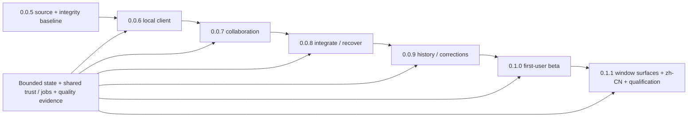

# 0.0.x → 0.1.0 usable-client roadmap

Status: `[-]` first-user roadmap. 0.0.6–0.0.9 shipped as public source checkpoints; **0.1.0 published a signed, runnable Windows x86_64 beta** on 2026-11-07 with a release-eligible receipt, and 0.1.1 is the planned closure of the gaps its release notes name. Rows below 0.1.0 remain target allocation, not shipped status. Actual release status belongs to [12](../prd/PRD_12_platform_delivery.md); this document performs no promotion. Product scope is owned by [01](../prd/PRD_01_product.md#010-first-user-feature-tree), UI/UX by [10](../prd/PRD_10_desktop_ux.md#first-user-workspace-and-journeys). The documentation baseline number is unrelated to application versions.

## Outcome and critical path

Reach a downloadable client that a developer can use for ordinary local and team Git work. A filter, shell screenshot, CLI command catalogue or source-only release is not sufficient evidence of that outcome. Reuse the implemented local operations and MiniCon mechanisms; concentrate new work on missing user journeys.

```text
0.0.5 checkpoint and integrity baseline
└── 0.0.6 · enter repositories and complete local work
    └── 0.0.7 · clone and exchange code with explicit remotes
        └── 0.0.8 · finish integrations, conflicts and parked work
            └── 0.0.9 · review history and manage everyday corrections
                └── 0.1.0 · first-user beta and signed runnable delivery (published)
                    └── 0.1.1 · in-window surfaces, zh-CN and qualification closure
```



Versions are delivery checkpoints, not an obligation to publish every intermediate number or finish every feature before anyone can try it. Make local preview packages available as they qualify; begin real task feedback before the final beta. If a package is too large, split implementation into dependent vertical slices and, where needed, use additional 0.0.x versions. Do not jump to 0.1.0 with an unimplemented Must task. No calendar commitment is inferred.

## Version outcome contracts

| Target | User-visible outcome and work allocation | Exit demonstration | Dependencies / status |
|---|---|---|---|
| 0.0.5 | Retain implemented stage-result, recovery, selected stash and committed-file work; close changed-scope safety/qualification issues | Existing exact-state Git oracles and scoped candidate evidence in its plan | [Existing plan](plan-0.0.5.md); qualification remains open |
| 0.0.6 | Welcome/Open/Create, recent repositories and isolated tabs; coherent Changes/Diff/full-index composer; quick filters; editor/terminal handoff; settings/setup guidance | Fresh profile → open/init → edit externally → stage selected content → save/reopen draft → commit → see OID/history, plus safe tab switch | [Published development source checkpoint](plan-0.0.6.md); qualified runnable first-user delivery remains open |
| 0.0.7 | Remote observation and explicit fetch only: remote list with redacted URLs and refspec, remote-tracking ahead/behind, per-ref fetch results with progress and cancel, window status line and `f` key entry; no clone, pull or push | A local bare remote gains commits; `f` reports each ref separately, and a failed or cancelled fetch stays visibly stale | [Plan](plan-0.0.7.md); implemented observation/fetch slice with named evidence in its plan; authenticated paths remain unqualified |
| 0.0.8 | Clone with checkout deferred until filter approval, plus remote add/set-url/rename/remove with local preview of the resulting URL and refspec; no pull or push | Two clones point at a local bare remote and see the remote before any checkout; a rejected filter leaves no working tree, and each remote edit previews its change before write | 07/11; extends the 0.0.7 observation/fetch flow; no pull, push or auth qualification |
| 0.0.9 | Explicit upstream, fetch-then-fast-forward pull that stops on divergence, current-branch push with an explicit single-ref refspec and per-ref results, unknown reconciliation, and window `p`/`P` result lines | Two working copies exchange a commit through a test remote; a diverged pull stops without force, and an auth failure explains the next step without a lost draft | 06/07/11/13; extends the 0.0.8 clone/remote management; no merge, rebase or conflict center |
| 0.1.1 | Close the gaps 0.1.0 named: in-window Clone and Remotes panels bound to the existing preview/apply contracts, zh-CN primary strings with a persistent locale choice, reviewed divergence with conflict detection and terminal handoff; no merge, rebase or conflict center | A Chinese-speaking user clones, commits, pulls and pushes entirely inside the window; a diverged or conflicted repository is explained and handed off without hidden integration; 4 of 5 study participants finish unaided on a clean image | [Plan](plan-0.1.1.md); depends on the published 0.1.0 contracts; merge/rebase and the conflict center stay unallocated |
| 0.1.0 | **Published**: signed Windows x86_64 package with a runnable executable, first-run instructions, checksum list and public signing receipt. zh-CN primary flows, native text/accessibility/DPI, actionable diagnostics, window Clone/Remotes panels and the five-participant study remain open and are named in the release notes; no merge, rebase or conflict center | A new user obtains the signed package and completes clone/open → branch → stage/commit → pull (fast-forward) → push on a test remote within ten minutes after a one-minute introduction, without the Rust toolchain or routine Git CLI fallback | 10/12/14; must satisfy 01's admission matrix on the declared cell, including the five-participant study |

Basic history is visible from the start, clone belongs in 0.0.8, and available named actions are exposed as their slice lands. Localization structure, text/accessibility semantics, packaging feasibility and representative-host access start in 0.0.6; they are not surprises left for 0.1.0. Correctness does not wait for a final polish release. Sign-off/amend can land earlier with the local composer if their guards are ready; that is earlier completion of an assigned task, not added scope. Basic sign/verify behavior delegates to the configured trusted tools and never silently falls back to unsigned.

## Feature-to-delivery ledger

`[_]` means future allocation; this table does not replace historical evidence or repeat the owning behavior specification. An implementation agent changes status only with named evidence and records its actual baseline.

| Workstream | Allocated target | Ownership | State |
|---|---|---|---|
| Enter, reopen, switch repos; app/Git settings | 0.0.6 | 03/10/13 | `[v]` · delivered in the published source checkpoint with named native/Git evidence in its plan; full first-user platform qualification remains separate |
| Coherent local Changes/Diff/composer and filters | 0.0.6, reusing 0.0.5 | 04/05/10 | `[v]` · published local source paths, corrected refresh navigation and scoped quality evidence in its plan; no full reference-platform certificate |
| Remote list/redaction/refspec, tracking ahead/behind, per-ref fetch | 0.0.7 | 07/11 | `[v]` · published with actual-Git fixtures and CLI evidence in its plan |
| Clone with deferred checkout; remote add/set-url/rename/remove preview | 0.0.8 | 07/11 | `[v]` · published with clone/edit fixtures and CLI evidence in its plan; window panels remain 0.1.0 |
| Explicit upstream, FF-only pull, current-branch push, helper/agent auth | 0.0.9 | 06/07/11 | `[v]` · upstream/pull/push published with Git and CLI evidence; authenticated transports BLOCKED |
| Fetch/pull/push progress, cancel and remote result reconciliation | 0.0.9 | 06/07/13 | `[-]` · cancellation and one-shot `ls-remote` reconciliation implemented; no killed-transfer receipt |
| Divergence review and conflict detection/handoff | 0.1.1 | 06/08 | `[_]` |
| Merge, rebase, conflict center and restart recovery | unallocated after 0.1.0 | 06/08/13 | `[_]` |
| Stash naming/untracked scope; reuse exact-entry actions | after 0.1.1 | 08/09 | `[_]` |
| Graph/history query/compare/file history/blame | after 0.1.1 | 05 | `[_]` |
| Branch rename/tags; pick/revert/reset; amend/sign-off | after 0.1.1 | 04/06/08 | `[_]` |
| LFS/submodule/worktree compatibility floor | As each relevant entry/action lands; review by 0.0.9 | 03/09/11 | `[_]` |
| Semantic controls, IME, localization keys and compact layouts | Primary-flow closure in 0.1.1 | 02/10 | `[-]` · typed catalogue and selected Windows semantics have scoped evidence; zh-CN coverage, locale selection and native accessibility remain 0.1.1 work |
| Packaging and representative environment | Signed package published in 0.1.0; clean-image and user qualification in 0.1.1 | 12/14 | `[-]` · 0.1.0 shipped a signed, runnable Windows package with a receipt and a Defender scan; clean-image launch, accessibility and the five-participant study remain open |

Unscheduled beyond this first usable target: interactive rebase editor, advanced multi-commit editing, full LFS administration, submodule create/update management, worktree create/remove, advanced author/date/ref/path query language, patch exchange, S3 and real non-Git adapters. Their existing cumulative PRD requirements are retained; this roadmap does not erase them or invent parity.

## Dependency and implementation rules

1. **Reuse current work.** Inspect the actual source before assigning a missing feature. Existing stage, draft, stash, branch, confirmation and historical-detail code is not rebuilt under a new name. MiniCon stays pinned unless a demonstrated missing mechanism justifies a separate dependency change.
2. **One action model.** Toolbar, context menu, keyboard and palette invoke the same typed action and capability checks. New views consume existing worker/state boundaries. No arbitrary Git command box, plugin host, cloud account layer or parallel repository-writing engine.
3. **Build complete slices.** Each package includes visible entry, success, refusal, loading/cancel, actual result and preserved return context. Resolve its safety and stale-state routing before moving that action into more screens.
4. **Separate prerequisite types.** A loss guard missing on a path blocks that write. Missing representative hardware blocks performance certification and publication claims, while independent design/read-only/implementation work can proceed against an identified checkpoint. Do not spend repeated probes trying to turn the same unsuitable remote display into a qualified host.
5. **Bound ambition.** FF-only pull is explicit in 0.0.9; divergence offers review, not a hidden merge/rebase. The 0.0.8 increment adds those modes using the same flow. No one-click pull+push, bare force, background prompt or automatic stash.
6. **No needless scaffolding.** Keep only the active version plan and this allocation roadmap until a later version needs detailed implementation planning. Do not create placeholder plans, duplicate feature ledgers in every PRD or require a new framework to move forward.

## First-user qualification and delivery

The first-user target is a scoped beta, not cumulative M3 stable or all six native cells. Windows x86_64 is the first named runtime/package court. 12 owns signed portable delivery and unavailable-cell labeling; the other five cells retain future qualification requirements. A source archive alone does not satisfy 0.1.0's runnable-client outcome. Signing access, native accessibility and correct reference hardware are real prerequisites to track early.

Functional acceptance uses actual Git state: tree/index/worktree, ref destinations, conflicts/sequencer and acknowledged drafts. Use a local bare remote and two disposable clients for deterministic network state, plus controlled HTTPS/SSH fixtures for auth/transport. No live user repository or unrequested cloud/S3 provisioning is needed to prove the core client.

Apply 14's existing memory/CPU/response budgets without weakening them. Select one integrated first-beta sustained journey on the declared native cell, including delivered network/integration/restart paths; its first qualification uses the eight-hour collaboration scope, not a new run per feature or wording change. Reuse unaffected exact-source/artifact evidence and rerun only invalidated scopes. Do not multiply the same long journey across every 0.0.x checkpoint.

Use the existing task-study requirement for first-user readiness: at least five participants, including two not routinely using Git CLI; at least four complete the documented open/clone → inspect → branch/stage/commit → reviewed test-remote push task within ten minutes after a one-minute introduction. Separately require a participant-visible conflict recovery demonstration and correct understanding of discard consequences. These are planned acceptance tasks, not completed research or guaranteed demand. Record blockers and improve the observed flow rather than expanding the command catalogue.

## Checkpoint record and stopping

For each implemented slice, record source/artifact identity, owning requirements, minimum selected checks, actual Git-state results, reused evidence and remaining limitations. Do not treat unit-test counts, callback timing, a screenshot or a source tag as product usability evidence.

This roadmap edit is documentation only. Selected checks: owner/link consistency, version/scope reconciliation and diff review. No build, GUI run or long test is justified by the edit. The current 0.0.5 artifact receipts retain their original labels; no existing binary is renamed 0.1.0.
