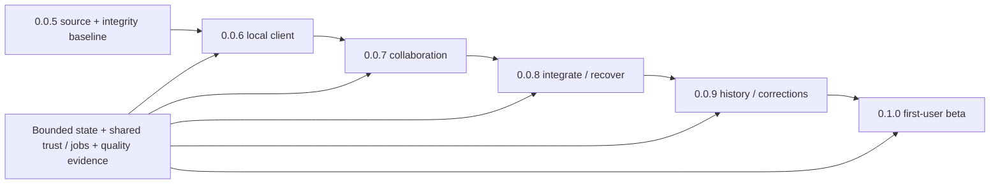

# 0.0.x → 0.1.0 usable-client roadmap

Status: `[-]` first-user roadmap; future version allocation is a target sequence, not shipped status. Current source checkpoint is **0.0.6**, with implemented local-client functions and scoped evidence in its plan; qualified runnable delivery remains open. Actual release status belongs to [12](../prd/PRD_12_platform_delivery.md); this document performs no promotion. Product scope is owned by [01](../prd/PRD_01_product.md#010-first-user-feature-tree), UI/UX by [10](../prd/PRD_10_desktop_ux.md#first-user-workspace-and-journeys). The documentation baseline number is unrelated to application versions.

## Outcome and critical path

Reach a downloadable client that a developer can use for ordinary local and team Git work. A filter, shell screenshot, CLI command catalogue or source-only release is not sufficient evidence of that outcome. Reuse the implemented local operations and MiniCon mechanisms; concentrate new work on missing user journeys.

```text
0.0.5 checkpoint and integrity baseline
└── 0.0.6 · enter repositories and complete local work
    └── 0.0.7 · clone and exchange code with explicit remotes
        └── 0.0.8 · finish integrations, conflicts and parked work
            └── 0.0.9 · review history and manage everyday corrections
                └── 0.1.0 · first-user beta and qualified runnable delivery
```



Versions are delivery checkpoints, not an obligation to publish every intermediate number or finish every feature before anyone can try it. Make local preview packages available as they qualify; begin real task feedback before the final beta. If a package is too large, split implementation into dependent vertical slices and, where needed, use additional 0.0.x versions. Do not jump to 0.1.0 with an unimplemented Must task. No calendar commitment is inferred.

## Version outcome contracts

| Target | User-visible outcome and work allocation | Exit demonstration | Dependencies / status |
|---|---|---|---|
| 0.0.5 | Retain implemented stage-result, recovery, selected stash and committed-file work; close changed-scope safety/qualification issues | Existing exact-state Git oracles and scoped candidate evidence in its plan | [Existing plan](plan-0.0.5.md); qualification remains open |
| 0.0.6 | Welcome/Open/Create, recent repositories and isolated tabs; coherent Changes/Diff/full-index composer; quick filters; editor/terminal handoff; settings/setup guidance | Fresh profile → open/init → edit externally → stage selected content → save/reopen draft → commit → see OID/history, plus safe tab switch | [Published development source checkpoint](plan-0.0.6.md); qualified runnable first-user delivery remains open |
| 0.0.7 | Clone, remote CRUD, explicit fetch, timestamped ahead/behind, tracking branch/upstream, FF-only pull and current-branch push; HTTPS/SSH auth/progress/cancel | Two working copies exchange a commit through a test remote; non-FF and auth failure explain the next step without force or lost draft | Existing 07/11 worker/trust path; no integration on diverged pull yet |
| 0.0.8 | Incoming review, explicit merge and rebase, conflict center, reviewed external merge tool, Continue/Abort/valid Skip and restart reconciliation; named stash and explicit untracked option | Deliberate conflicting edits → fetch/review → merge or rebase → resolve → restart → continue or abort; stash conflict retains source | 06/08/09/13; extend the 0.0.7 pull flow rather than introduce a separate sync implementation |
| 0.0.9 | Incremental truthful graph, history message/OID query, A→B diff, file history/blame; branch rename and tags; normal single-commit cherry-pick/revert; guarded reset modes; sign-off/amend and configured signing status | Find/review an older change, trace a line, apply/revert a chosen commit and inspect actual results; unsafe reset refused unless its scope/recovery is qualified | 04/05/06/08; retain existing graph/semantic boundaries, no interactive rebase editor |
| 0.1.0 | English/zh-CN primary flows, native text/accessibility/DPI and qualified Windows x86_64 package; first-run instructions, actionable diagnostics, usability/quality closure | New user obtains package → clone/open → branch → stage/commit → pull with conflict recovery → push, without needing the Rust toolchain or routine Git CLI fallback | 10/12/14; must satisfy 01's admission matrix on the declared cell |

Basic history is visible from the start, clone belongs in 0.0.7, and available named actions are exposed as their slice lands. Localization structure, text/accessibility semantics, packaging feasibility and representative-host access start in 0.0.6; they are not surprises left for 0.1.0. Correctness does not wait for a final polish release. Sign-off/amend can land earlier with the local composer if their guards are ready; that is earlier completion of an assigned task, not added scope. Basic sign/verify behavior delegates to the configured trusted tools and never silently falls back to unsigned.

## Feature-to-delivery ledger

`[_]` means future allocation; this table does not replace historical evidence or repeat the owning behavior specification. An implementation agent changes status only with named evidence and records its actual baseline.

| Workstream | Allocated target | Ownership | State |
|---|---|---|---|
| Enter, reopen, switch repos; app/Git settings | 0.0.6 | 03/10/13 | `[v]` · delivered in the published source checkpoint with named native/Git evidence in its plan; full first-user platform qualification remains separate |
| Coherent local Changes/Diff/composer and filters | 0.0.6, reusing 0.0.5 | 04/05/10 | `[v]` · published local source paths, corrected refresh navigation and scoped quality evidence in its plan; no full reference-platform certificate |
| Authenticated clone/fetch/FF-pull/reviewed push | 0.0.7 | 07/11 | `[_]` |
| Branch tracking/upstream; remote result reconciliation | 0.0.7 | 06/07/13 | `[_]` |
| Merge/rebase/conflicts and restart | 0.0.8 | 06/08/13 | `[_]` |
| Stash naming/untracked scope; reuse exact-entry actions | 0.0.8 | 08/09 | `[_]` |
| Graph/history query/compare/file history/blame | 0.0.9 | 05 | `[_]` |
| Branch rename/tags; pick/revert/reset; amend/sign-off | 0.0.9 latest | 04/06/08 | `[_]` |
| LFS/submodule/worktree compatibility floor | As each relevant entry/action lands; review by 0.0.9 | 03/09/11 | `[_]` |
| Semantic controls, IME, localization keys and compact layouts | Start 0.0.6; primary-flow closure by 0.1.0 | 02/10 | `[-]` · selected Windows semantics/input and typed control-caption keys have scoped evidence in the active plan; full native/language/layout closure stays open |
| Packaging and representative environment | Feasibility starts 0.0.6; first qualified trial package as available; final 0.1.0 | 12/14 | `[-]` · exact-source private builds/archive/startup and available-host measurements exist; qualified supported-image/reference/signing delivery remains open |

Unscheduled beyond this first usable target: interactive rebase editor, advanced multi-commit editing, full LFS administration, submodule create/update management, worktree create/remove, advanced author/date/ref/path query language, patch exchange, S3 and real non-Git adapters. Their existing cumulative PRD requirements are retained; this roadmap does not erase them or invent parity.

## Dependency and implementation rules

1. **Reuse current work.** Inspect the actual source before assigning a missing feature. Existing stage, draft, stash, branch, confirmation and historical-detail code is not rebuilt under a new name. MiniCon stays pinned unless a demonstrated missing mechanism justifies a separate dependency change.
2. **One action model.** Toolbar, context menu, keyboard and palette invoke the same typed action and capability checks. New views consume existing worker/state boundaries. No arbitrary Git command box, plugin host, cloud account layer or parallel repository-writing engine.
3. **Build complete slices.** Each package includes visible entry, success, refusal, loading/cancel, actual result and preserved return context. Resolve its safety and stale-state routing before moving that action into more screens.
4. **Separate prerequisite types.** A loss guard missing on a path blocks that write. Missing representative hardware blocks performance certification and publication claims, while independent design/read-only/implementation work can proceed against an identified checkpoint. Do not spend repeated probes trying to turn the same unsuitable remote display into a qualified host.
5. **Bound ambition.** FF-only pull is explicit in 0.0.7; divergence offers review, not a hidden merge/rebase. The 0.0.8 increment adds those modes using the same flow. No one-click pull+push, bare force, background prompt or automatic stash.
6. **No needless scaffolding.** Keep only the active version plan and this allocation roadmap until a later version needs detailed implementation planning. Do not create placeholder plans, duplicate feature ledgers in every PRD or require a new framework to move forward.

## First-user qualification and delivery

The first-user target is a scoped beta, not cumulative M3 stable or all six native cells. Windows x86_64 is the first named runtime/package court. 12 owns signed portable delivery and unavailable-cell labeling; the other five cells retain future qualification requirements. A source archive alone does not satisfy 0.1.0's runnable-client outcome. Signing access, native accessibility and correct reference hardware are real prerequisites to track early.

Functional acceptance uses actual Git state: tree/index/worktree, ref destinations, conflicts/sequencer and acknowledged drafts. Use a local bare remote and two disposable clients for deterministic network state, plus controlled HTTPS/SSH fixtures for auth/transport. No live user repository or unrequested cloud/S3 provisioning is needed to prove the core client.

Apply 14's existing memory/CPU/response budgets without weakening them. Select one integrated first-beta sustained journey on the declared native cell, including delivered network/integration/restart paths; its first qualification uses the eight-hour collaboration scope, not a new run per feature or wording change. Reuse unaffected exact-source/artifact evidence and rerun only invalidated scopes. Do not multiply the same long journey across every 0.0.x checkpoint.

Use the existing task-study requirement for first-user readiness: at least five participants, including two not routinely using Git CLI; at least four complete the documented open/clone → inspect → branch/stage/commit → reviewed test-remote push task within ten minutes after a one-minute introduction. Separately require a participant-visible conflict recovery demonstration and correct understanding of discard consequences. These are planned acceptance tasks, not completed research or guaranteed demand. Record blockers and improve the observed flow rather than expanding the command catalogue.

## Checkpoint record and stopping

For each implemented slice, record source/artifact identity, owning requirements, minimum selected checks, actual Git-state results, reused evidence and remaining limitations. Do not treat unit-test counts, callback timing, a screenshot or a source tag as product usability evidence.

This roadmap edit is documentation only. Selected checks: owner/link consistency, version/scope reconciliation and diff review. No build, GUI run or long test is justified by the edit. The current 0.0.5 artifact receipts retain their original labels; no existing binary is renamed 0.1.0.
