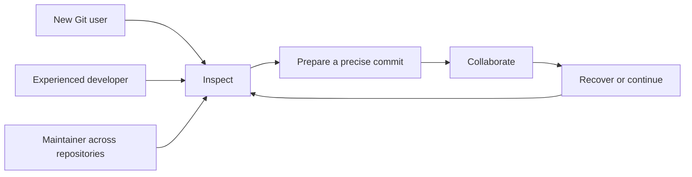

# 01 · Product, users and scope

Parent: [PRD index](../PRD.md). This module owns product intent, milestone membership and scope changes. Status: specified; implementation `[_]`.

## Outcome tree

```text
Outcome: complete daily Git work without losing context or local work
├── Read — understand repository state and why a file changed
├── Prepare — choose exactly what belongs in one commit
├── Collaborate — move changes between branches and remotes deliberately
└── Recover — resolve conflicts and understand the limits of undo
```



## Positioning and users

MiniCon SrcMgr is a lightweight native desktop source-control client, initially focused on Git. It combines a clear repository overview, visual history, precise staging and explicit operation recovery. It shares MiniCon's compact layout, semantic themes, keyboard-oriented input and native rendering mechanisms. Simple, practical, intuitive operation and low memory/CPU use are product constraints, not optional polish. It does not require MiniCon to be running.

Primary users are individual developers working across several local repositories, contributors learning staged changes and branch integration, and maintainers reviewing histories and managing releases. Windows, macOS and Linux users receive the same operation meanings and equivalent input paths. CPU architecture must not change Git outcomes.

Git is the first implemented VCS in M0–M3. Those milestones must also preserve the backend extension contract in [15](PRD_15_vcs_backends.md) for future SVN and other source-control systems. Actual SVN operations are later scope; reserving the boundary is current scope. Hosting services are optional remote endpoints; an online account is not the workspace identity. Local repositories, offline use and externally installed Git are first-class requirements.

## Functional benchmark and simplicity

Use the TUI application [lazygit](https://github.com/jesseduffield/lazygit) as an additional functional benchmark. Its documented workflows include selective staging, interactive rebase, cherry-pick, worktrees, filtering, commit graphs and comparisons (reviewed 2026-10-18). The mappings below are SrcMgr design decisions; they do not claim identical implementation or measured resource superiority.

| Workflow reference | SrcMgr disposition / owner | Practical simplification |
|---|---|---|
| Hunk/line staging | M1 hunks, M3 lines; [04](PRD_04_changes_commits.md) | Select content and see exact index effect |
| Commit/branch navigation and compare | M1 core graph/switch, M3 advanced search; [05](PRD_05_history.md), [06](PRD_06_references.md) | Keep selection/detail context; show source → destination |
| Interactive rebase and cherry-pick | M3; [06](PRD_06_references.md) | Ordered preview with explicit conflicts and continuation |
| Stash and worktrees | M2 core, M3 full; [09](PRD_09_advanced_git.md) | Named intent, clear scope and occupied-worktree navigation |
| Undo/recovery | Scoped recovery; [08](PRD_08_recovery.md) | State what is recoverable; no universal undo promise |
| Bisect, arbitrary custom commands and editing old commits through custom patches | Deferred beyond M3 unless separately specified | Avoid speculative feature accumulation |

The benchmark guides daily workflow coverage and low-friction panel navigation. The deliverable remains a native GUI; a separate TUI edition is not added by this requirement. Do not require lazygit at runtime, copy every command, reproduce destructive shortcuts or add a plugin/shell system for nominal parity. Reference snapshot: [lazygit at `4e1eebe278790f257a875da6633234391a5a85b3`](https://github.com/jesseduffield/lazygit/tree/4e1eebe278790f257a875da6633234391a5a85b3), reviewed 2026-10-18. Compare the listed workflows against that snapshot; future upstream changes do not silently expand release scope.

## Cumulative milestones and scope

| Milestone | Required product scope | Exit meaning |
|---|---|---|
| M0 — feasibility | Shared dependency consumer, native window/input/font/IME/clipboard proof, Git discovery and typed runner, safety/state skeleton, accessibility bridge proof, backend extension proof and resource baseline | Architecture viable in all six build cells; native interaction risks identified with runtime receipts, no public product promise |
| M1 — local alpha | Open/init/organize repositories; scoped settings/ignore; status; whole-file and hunk stage/unstage; commit; paged graph and diff; create/switch branches; local trust and durable settings | Complete local journey including dirty/unborn/detached states; developer artifacts only |
| M2 — collaboration beta | Clone, remotes and auth; fetch/pull/push; merge and rebase with conflict recovery; tags; stash; basic worktrees; signed commit interaction; English and Simplified Chinese; keyboard and accessibility | Offline local work plus two-user collaboration and restart recovery across six cells; scoped prerelease |
| M3 — baseline release | Interactive rebase; cherry-pick/revert/reset; line selection; blame/search; submodules/LFS/patches; full worktree operations; Traditional Chinese; all acceptance, performance, signing and package gates | Entire baseline specified here is qualified; public stable release may be proposed |

Milestone detail: M1 includes ordinary commit/sign-off, single/root commit detail and per-parent diffs, local branch create/switch, basic keyboard operation, conflict/active-operation detection and mutation blocking. M2 adds amend, local branch rename/delete/tracking, lightweight/annotated tags, two-commit comparisons, full text conflict resolution and operation continuation, plus live signer interaction. M3 adds empty commits, squash merge, combined merge review, advanced filters/blame and signed tags. If signing is configured before its interactive support is ready, report the capability limitation and retain the configured policy; never create an unsigned fallback.

Later-milestone concepts must be recognized enough to avoid corruption from the first writer (for example unmerged entries, sparse flags, gitlinks and occupied worktrees). Recognition may show a specific Unsupported/operation-in-progress state; it does not require exposing all later mutation flows early. Each journey is run for delivered subcases at the current milestone, then expanded cumulatively. Requirement IDs spanning milestones are not marked fully complete until every baseline clause is evidenced.

Later roadmap, excluded from M3: other VCS engines, mandatory cloud synchronization, hosting-specific PR review or issue clients, code editing IDE, semantic merge, AI commit agents, arbitrary plugin execution, terminal multiplexer, background auto-commit, repository backup service, 32-bit/RISC-V targets, a single executable for every architecture, managed Git distribution and automatic Git installation. Opening the user's terminal or editor is supported; embedding the entire MiniCon terminal is deferred.

## Delivery contracts

| ID / leaf | Invariant | Observable evidence | Safe failure | Dependencies | Non-goal |
|---|---|---|---|---|---|
| PROD-01 · daily journey | A user can inspect → stage → commit → integrate → push and recover interruption without hidden work loss | QA-J01/J02/J03/J04, fresh-profile journeys | Clear state plus next action; no speculative repair | 03–08, 10–13 | Every Git command exposed |
| PROD-02 · independence | Local use needs neither account nor network | Offline cold-start and commit journey QA-J01 | Git missing yields setup guidance and settings access | 02, 11 | Bundle Git in M3 |
| PROD-03 · scope parity | All six targets implement the same baseline meanings | QA-J12 per supported cell | Unqualified cell blocks baseline release | 12, 14 | Emulation as native proof |
| PROD-04 · usability | Common operations are discoverable with mouse and keyboard | QA-J09 and task study | Focused error keeps selections/drafts | 10 | Training course or IDE |
| PROD-05 · functional benchmark | Accepted lazygit-inspired workflows are explicit, simple and milestone-bounded | QA-J09 task comparison against the pinned reference checklist | Simplify the flow or revise scope explicitly; no parity claim without evidence | 04–10, 14 | Clone every feature or deliver a TUI edition |

## Success criteria and measurement

For M2/M3 usability acceptance, run a documented study with at least five participants, including two who do not routinely use Git CLI. At least four complete open → inspect staged versus unstaged → stage one hunk → commit → push to a test remote without facilitator intervention within ten minutes, after a one-minute product introduction. Every participant must locate the active repository/branch and describe the effect of Discard before confirmation. A failure changes UX or scope before release; it is not averaged away by speed.

Performance budgets and workloads are owned by [14](PRD_14_verification_roadmap.md). Resource and responsiveness gates begin at M0/M1 and continue through release, so expensive architecture cannot be excused as later optimization. Measurements are opt-in local studies/benchmarks, never silent user telemetry. Data integrity is a zero-known-loss release gate, not a percentage target.

## Assumptions and change control

The default is an installed Git executable, native Rust UI over MiniCon crates, no browser runtime and no cloud backend. All are product decisions; feasibility of concrete mechanisms is gated in [02](PRD_02_architecture_reuse.md). A milestone may not quietly omit an accepted requirement. Scope changes update this owner, affected acceptance cases and release labeling in one reviewable change. No delivery date is promised before M0 resolves the principal risks.
