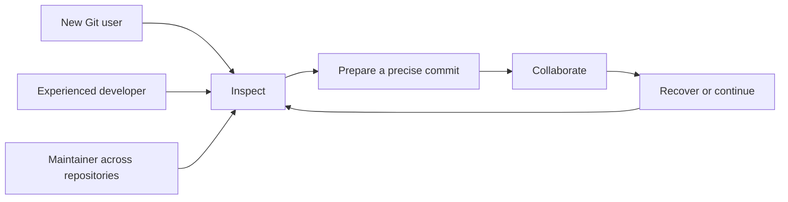

# 01 · Product, users and scope

Parent: [PRD index](../PRD.md). This module owns product intent, milestone membership and scope changes. Status: product baseline specified; Windows local slices are partially implemented and have scoped evidence. This does not complete the cumulative milestones below. Release status is owned by 12 and version execution evidence by the plans linked from 14.

## Outcome tree

```text
Outcome: complete daily Git work without losing context or local work
├── Read — understand repository state and why a file changed
├── Prepare — choose exactly what belongs in one commit
├── Collaborate — move changes between branches and remotes deliberately
└── Recover — resolve conflicts and understand the limits of undo
```



## Positioning and users

MiniCon SrcMgr is an important component of the **MiniCon productivity suite**, initially focused on Git. Its core selling points are **a small memory footprint, fast UI/UX response and stable everyday operation**. It combines a clear repository overview, visual history, precise staging and explicit operation recovery, sharing MiniCon's compact layout, semantic themes, keyboard-oriented input and native rendering mechanisms. Simple, practical, intuitive operation and low CPU use sustain those selling points. It runs independently of MiniCon.

## Product promise and delivery priority

The product promise is: **small memory footprint, immediate interaction, dependable source control**. This governs architecture, daily development, feature admission and milestone acceptance. Every delivered workflow must satisfy all three pillars together; passing functionality tests alone does not qualify it for a release.

| Pillar | User outcome | Delivery consequence |
|---|---|---|
| Small memory footprint | Keep SrcMgr available throughout the workday alongside other productivity tools | Bound resident/transient state and owned helpers; prove idle, active and repeated-use budgets |
| Fast UI/UX response | Selection, scrolling, typing and navigation respond while repository work continues | Keep Git/filesystem work off the UI thread; expose progress/cancel and measure real interaction feedback |
| Stable product | Trust long sessions, failed commands and restarts without unexplained state or lost work | Qualify sustained operation, error recovery, durable acknowledgements and repository integrity |

Quantitative performance and stability gates are owned by [14](PRD_14_verification_roadmap.md). Security and data integrity remain mandatory while optimizing. A feature addition must preserve the existing quality envelope, and a regression in any pillar blocks the affected milestone until fixed or explicitly re-scoped through the existing change protocol. Marketing language remains a target product promise until matching scoped runtime evidence exists.

Suite membership means consistent themes, focus/input conventions, native behavior and quality standards, with distinct product identity and independent lifecycle/state. Users can keep MiniCon and SrcMgr open together without duplicated mandatory runtimes, shared mutable session/config stores or a required companion daemon. Explicit user actions can open the existing terminal/editor integration; suite positioning does not add a launcher, account or cloud synchronization requirement. Shared mechanisms remain governed by 02 and independence by PROD-02.

Primary users are individual developers working across several local repositories, contributors learning staged changes and branch integration, and maintainers reviewing histories and managing releases. Windows, macOS and Linux users receive the same operation meanings and equivalent input paths. CPU architecture must not change Git outcomes.

Git is the first implemented VCS in M0–M3. Those milestones must also preserve the backend extension contract in [15](PRD_15_vcs_backends.md) for future SVN and other source-control systems. Actual SVN operations are later scope; reserving the boundary is current scope. Hosting services are optional remote endpoints; an online account is not the workspace identity. Local repositories, offline use and externally installed Git are first-class requirements.

## Functional benchmark and simplicity

Use the TUI application [lazygit](https://github.com/jesseduffield/lazygit) as an additional functional benchmark. Its documented workflows include selective staging, interactive rebase, cherry-pick, worktrees, filtering, commit graphs and comparisons (reviewed 2026-10-18). The mappings below are SrcMgr design decisions; they do not claim identical implementation or measured resource superiority.

| Workflow reference | SrcMgr disposition / owner | Practical simplification |
|---|---|---|
| Hunk/line staging | M1 hunks, M3 lines; [04](PRD_04_changes_commits.md) | Select content and see exact index effect |
| Commit/branch navigation and compare | M1 core graph/switch, M3 advanced search; [05](PRD_05_history.md), [06](PRD_06_references.md) | Keep selection/detail context; show source → destination |
| Interactive rebase and cherry-pick | M3; [06](PRD_06_references.md) | Ordered preview with explicit conflicts and continuation |
| Stash and worktrees | M2 core, M3 full; [09](PRD_09_advanced_git.md) | Named intent, clear scope and occupied-worktree navigation |
| Undo/recovery | Scoped recovery; [08](PRD_08_recovery.md) | State what is recoverable; no universal undo promise |
| Bisect, arbitrary custom commands and editing old commits through custom patches | Deferred beyond M3 unless separately specified | Avoid speculative feature accumulation |

The benchmark guides daily workflow coverage and low-friction panel navigation. The deliverable remains a native GUI; a separate TUI edition is not added by this requirement. Do not require lazygit at runtime, copy every command, reproduce destructive shortcuts or add a plugin/shell system for nominal parity. Reference snapshot: [lazygit at `4e1eebe278790f257a875da6633234391a5a85b3`](https://github.com/jesseduffield/lazygit/tree/4e1eebe278790f257a875da6633234391a5a85b3), reviewed 2026-10-18. Compare the listed workflows against that snapshot; future upstream changes do not silently expand release scope.

## reference GUI analysis

reference GUI (Atlassian) is the desktop Git client most users compare against. Observed on this Windows host on 2026-10-20:

- Installed build folder `app-3.4.21`. Its localisation resources list the feature vocabulary used below. The live window was not captured: the only visible reference GUI window is a 146 × 28 helper, and the main window was not on screen, so no layout claim here is visual evidence. Feature names come from those resource strings; behavior beyond the names is not verified in this session.
- Historical idle footprint, one snapshot with the main window hidden: working set 762 MB, private memory 667 MB, 43 threads and 2,139 handles in the `reference GUI` process. This unmatched single observation is design context, not a controlled comparative benchmark or evidence for a resource claim. SrcMgr has scoped local measurements in the version plan; reference-environment qualification remains open under [14](PRD_14_verification_roadmap.md).

What reference GUI sets as the baseline for a desktop Git client:

- A sidebar as the navigation spine for branches, remotes, tags, stashes and bookmarks, with one tab per repository.
- A changes view with unstaged, staged and untracked sections, a tree or flat file-list toggle, and stage, unstage and discard for files, hunks and lines.
- A commit panel with a staged-only mode, an amend warning and commit-message text replacement.
- History with a graph, file log, blame, search and file status views.
- Common workflows as menu commands: merge, rebase (including interactive), cherry-pick, revert, reset (mixed, hard and all), tag and stash.
- Git LFS, submodule and subtree tooling, patch create and apply, and Git Flow.
- First-run onboarding that detects or installs Git tooling and offers an account.

## Design decisions: what SrcMgr does not copy

| Not copied | Seen in | SrcMgr disposition | Reason | Owner |
|---|---|---|---|---|
| Bypass commit hooks | reference GUI `BypassCommitHooks` | Not offered | Hooks run under trust; no automatic `--no-verify`; a bypass needs its own trust policy first | [04](PRD_04_changes_commits.md) |
| Custom actions and scripts | reference GUI `CustomActionsWindowFooter`, `CustomActionScriptBlankMsg` | Excluded | Arbitrary plugin or script execution is outside the baseline | 01 (this module) |
| Automatic Git installation during onboarding | reference GUI `OnboardingInstallTools`, `OnboardingToolDownloading` | Excluded | A missing Git shows setup guidance (PROD-02) | 01 (this module) |
| Hosted accounts, pull requests and hosted project browsing | reference GUI `AddAccount`, `CreatePullRequestMenu`, `BrowseHostedProjects` | Excluded | Hosting-specific review clients are outside scope; an account is not the workspace identity | 01 (this module) |
| Usage analytics toggle | reference GUI `EnableAnalytics` | No telemetry | Governing invariant 6 | [11](PRD_11_security.md) |
| Saved passwords | reference GUI `SavedPasswords` | Not stored | No built-in secret store in the baseline | [11](PRD_11_security.md) |
| Ignore by extension as the default | reference GUI `IgnoreAllFilesWithThisExtension` | Exact path is the default | A broad wildcard may be reviewed later as an explicit option | [03](PRD_03_workspace.md) |
| Mercurial shelves | reference GUI `SidebarShelves` | Out of scope | Non-Git backends follow the extension contract | [15](PRD_15_vcs_backends.md) |
| Git Flow | reference GUI `FlowFeatureBranchLogDesc`, `FlowMergeXintoY` | Candidate, not admitted | A branch-naming layer with its own configuration writes; revisit after M3 | 01 (this module) |
| Subtree | reference GUI `AddLinkSubtreeMenu`, `ConfirmPullSubtreeMsg` | Candidate, not admitted | No owner in this PRD; submodules are M3 | [09](PRD_09_advanced_git.md) |
| Graft | reference GUI `GraftMenu` | Not admitted | Creating grafts rewrites ancestry views; history only displays existing replacement effects | [05](PRD_05_history.md) |
| PuTTY SSH client | reference GUI `WelcomeUsePuTTY`, `SSHClientConfiguration` | Not in baseline | The configured Git transport is the only path; PuTTY would be a second one | [07](PRD_07_remotes.md) |
| Silent commit-message replacement | reference GUI commit panel | Not copied | Rewriting the user's draft breaks the draft promise; a draft is user-owned | [04](PRD_04_changes_commits.md) |
| Stage-all or commit-all in one step | Common GUI shortcut | Not copied | Commit submits the live index only and never stages unseen content | [04](PRD_04_changes_commits.md) |
| One-step sync (pull and push together) | Common GUI shortcut | Not copied | Each remote write has its own preview; pull mode is chosen explicitly | [07](PRD_07_remotes.md) |
| Ambient defaults for pull mode, push refspecs and auto-stash | Common GUI defaults | Not copied | A silent default can change history or stash work the user did not choose | [06](PRD_06_references.md), [07](PRD_07_remotes.md) |
| Discard without a safety copy or a recovery label | Common GUI discard | Not copied | Every destructive action states what can and cannot be restored | [08](PRD_08_recovery.md) |
| Universal undo | Common expectation of a GUI undo | Not promised | Only recovery refs, safety copies and reflog-reachable commits are restorable | [08](PRD_08_recovery.md) |
| Idle cost that grows with open repositories | reference GUI idle snapshot: 762 MB working set, 43 threads, window hidden | Not accepted | Repositories not visible hold bounded metadata only; budgets are measured, not asserted | [03](PRD_03_workspace.md), [14](PRD_14_verification_roadmap.md) |
| Periodic remote polling by default | Common GUI background refresh | Not copied | Auto-fetch is opt-in per repository; no continuous polling | [03](PRD_03_workspace.md), [07](PRD_07_remotes.md) |

## Target jobs

SrcMgr is organized around seven jobs where a Git GUI should be most useful to its users. The list follows from the users named in Positioning and the product promise, not from competitor features. No user study yet ranks these jobs (see open questions).

| Job | What the user is trying to do | Why SrcMgr should own it | Owner |
|---|---|---|---|
| 1 Triage many repositories | Find which local repository is dirty, mid-operation or behind | Developers keep several repositories open; the overview must cost little and never show stale state as current | [03](PRD_03_workspace.md) |
| 2 Know what a command changes | Read the exact effect before a write runs | Discard, reset, integrate and push can lose or publish work; a precise preview is the trust signal | [08](PRD_08_recovery.md), [06](PRD_06_references.md), [07](PRD_07_remotes.md) |
| 3 Stage and commit the intent | Commit the chosen content and see what the index now holds | Contributors learning staged changes need the index effect in view | [04](PRD_04_changes_commits.md) |
| 4 Recover with stated limits | Undo a mistake without guessing what survives | Users need the restoring mechanism named before they act | [08](PRD_08_recovery.md), [09](PRD_09_advanced_git.md) |
| 5 Review and integrate | Read the commits and file changes a merge or rebase brings in | Maintainers review histories; a range review before integration prevents surprises | [06](PRD_06_references.md), [05](PRD_05_history.md) |
| 6 Work from the keyboard | Repeat daily actions without pointer travel | Keyboard-first is the differentiator; pointer use keeps the same meaning | [10](PRD_10_desktop_ux.md) |
| 7 Stay light and local | Keep SrcMgr open beside other tools; work offline without an account | This is the product promise: small footprint, no account, no telemetry | [01](PRD_01_product.md), [11](PRD_11_security.md), [14](PRD_14_verification_roadmap.md) |

Design rules that every feature follows:

1. The sidebar and tabs are the navigation spine. Every repository object (branch, tag, remote, stash, worktree, submodule) is reachable from the sidebar.
2. A command sits next to the object it changes, in the sidebar, list or history view, and has one keyboard path.
3. Every mutation shows a preview of its exact targets, and its confirmation names the consequence rather than asking a generic question.
4. Advanced operations stay out of the default path until the selection needs them, for example reset modes and rebase plans.
5. Local work needs no network, account, background daemon or bundled tool.

## Product feature design

Rows are grouped by the job they serve. "Milestone" is the milestone that admits the feature; "Candidate" means not yet admitted; "Excluded" means outside M3. "Shipped" = yes means the feature is in the 0.0.4 source release, per the [README](../README.md); partial means only the part named in the row is shipped; a dash means not shipped or not verified.

Type: **Differentiator** is a stated SrcMgr advantage (trust, footprint, keyboard, honest state). **Core** is needed to finish a job but is not a reason to choose SrcMgr. **Compatibility** must not corrupt or mishandle a repository. **Parity** is kept only because the baseline or a reference client includes it.

| Job | Feature | Why it matters | Type | Milestone | Owner | Shipped |
|---|---|---|---|---|---|---|
| 1 Triage | Repository overview: branch, change count and operation state per repository, from last-known snapshots with their age | Find the repository that needs attention without opening each one | Differentiator | M2 | [03](PRD_03_workspace.md) | — |
| 1 Triage | Groups, favourites and local search of repositories | Keep many repositories findable | Core | M1 | [03](PRD_03_workspace.md) | — |
| 1 Triage | Open by path; recent entries; init and clone from the welcome view | Enter the right repository | Core | M1 open and init, M2 clone | [03](PRD_03_workspace.md), [07](PRD_07_remotes.md) | — |
| 1 Triage | One tab per repository and per linked worktree | Each tab binds one identity; tabs do not share state | Core | M1 tabs, M2 worktree tabs | [03](PRD_03_workspace.md), [10](PRD_10_desktop_ux.md) | — |
| 1 Triage | Repository settings with visible scope | Know which configuration applies and where a write goes | Core | M1 | [03](PRD_03_workspace.md), [13](PRD_13_state_control.md) | — |
| 2 Preview | Mutation preview naming exact paths, refs and OIDs; a stale preview cannot run | The preview is the authorization, not a generic question | Differentiator | M1 | [08](PRD_08_recovery.md) | partial (discard names its file or hunk) |
| 2 Preview | Risk confirmations state the consequence; pointer uses a named confirm action, keyboard `y` confirms and `n`/Esc cancels; opening Enter cannot accidentally confirm | Users read what happens, and Enter cannot confirm by accident | Differentiator | M1 | [08](PRD_08_recovery.md) | partial (discard and detached checkout ask first) |
| 2 Preview | Refusal shows Git's first error line and changes nothing | The reason is visible and state is preserved | Core | M1 | [06](PRD_06_references.md), [08](PRD_08_recovery.md) | yes |
| 3 Stage | Staged and unstaged versions shown independently | A partially staged file is two selections, not one checkbox | Core | M1 | [04](PRD_04_changes_commits.md) | yes |
| 3 Stage | Stage and unstage whole files, hunks and line ranges | Commit exactly the chosen content | Core | M1 files and hunks; M3 lines (delivered early) | [04](PRD_04_changes_commits.md) | yes |
| 3 Stage | Result line after each stage or unstage: index-to-HEAD file and line counts, and the worktree stated unchanged | Shows what the next commit will contain | Differentiator | M1 | [04](PRD_04_changes_commits.md) | — |
| 3 Stage | Commit with a saved draft | The message survives failure and restart | Core | M1 | [04](PRD_04_changes_commits.md), [13](PRD_13_state_control.md) | partial (draft only) |
| 3 Stage | Sign-off and signing status shown before commit | Some projects require them | Core | M1 sign-off; M2 signing interaction | [04](PRD_04_changes_commits.md) | — |
| 3 Stage | Amend with rewrite-risk preview | Fix the last commit knowingly | Core | M2 | [04](PRD_04_changes_commits.md) | — |
| 3 Stage | Empty commit as an explicit action | Used to trigger CI runs | Parity | M3 | [04](PRD_04_changes_commits.md) | — |
| 3 Stage | Git LFS pointers, status, fetch, prune and tracking | LFS repositories must show pointers honestly, never commit an unmaterialized file as content | Compatibility | M3 | [09](PRD_09_advanced_git.md) | — |
| 4 Recover | Recovery label on each destructive action: restorable from a recovery ref or safety copy, restorable with stated limits, or not restorable | Users decide with the limit in view | Differentiator | M2 | [08](PRD_08_recovery.md) | — |
| 4 Recover | Discard a file's unstaged changes (tracked or untracked) or one hunk | Remove unwanted work against a named target | Core | M2 with safeguards | [08](PRD_08_recovery.md) | yes |
| 4 Recover | Discard a line range | The same action at line granularity | Core | M3 | [08](PRD_08_recovery.md) | — |
| 4 Recover | Recovery refs and restore preview | Restores reachable commits; the preview compares current and recovered state | Differentiator | M2 | [08](PRD_08_recovery.md) | — |
| 4 Recover | Stash tracked changes; apply and keep | Park work without losing it | Core | M2 core | [09](PRD_09_advanced_git.md) | yes |
| 4 Recover | Stash list, pop, drop and named messages | Manage parked work | Core | M2 | [09](PRD_09_advanced_git.md) | — |
| 4 Recover | Stash including untracked files, as an explicit option | Include new files deliberately | Core | M2 | [09](PRD_09_advanced_git.md) | — |
| 4 Recover | Reset soft, mixed and hard, each with a preview | Move history deliberately; a hard reset states what it overwrites | Core | M3 | [06](PRD_06_references.md), [08](PRD_08_recovery.md) | — |
| 4 Recover | Operation log of jobs, outcomes and OIDs, bounded and redacted | Explains what happened after an interruption | Core | Candidate for M2 | [13](PRD_13_state_control.md) | — |
| 5 Review | Incoming review before merge or rebase: commits in destination..source and a changed-file summary, bound to the OIDs the operation will use | Know what arrives before it lands | Differentiator | M2 | [06](PRD_06_references.md), [05](PRD_05_history.md) | — |
| 5 Review | Compare two commits | Understand the change between two points | Core | M2 | [05](PRD_05_history.md) | — |
| 5 Review | Quick filter by message or OID | Find a commit quickly | Core | M2 | [05](PRD_05_history.md) | — |
| 5 Review | Signature display with honest trust states | Show verified, unverified and missing signatures without claiming more | Differentiator | M2 | [05](PRD_05_history.md) | — |
| 5 Review | Advanced search by author, date, ref and path | Find changes by who or where | Core | M3 | [05](PRD_05_history.md) | — |
| 5 Review | File history with optional rename following; blame at a selected commit | Maintainers trace how a file or line arrived | Core | M3 | [05](PRD_05_history.md) | — |
| 5 Review | Merge: fast-forward only, normal or no-fast-forward, each explicit | No hidden merge shape | Core | M2 | [06](PRD_06_references.md) | — |
| 5 Review | Rebase onto a base, with source commits previewed | Move a branch deliberately | Core | M2 | [06](PRD_06_references.md) | — |
| 5 Review | Interactive rebase with an ordered preview | Contributors clean a branch before review | Core | M3 | [06](PRD_06_references.md) | — |
| 5 Review | Cherry-pick and revert, ordered | Apply or undo selected commits | Core | M3 | [06](PRD_06_references.md) | — |
| 5 Review | Create, switch and delete (merged-safe) local branches | Work on branches | Core | M1 create and switch; M2 delete | [06](PRD_06_references.md) | yes |
| 5 Review | Detached checkout of a commit | Inspect older code without moving a branch | Core | M2 | [06](PRD_06_references.md) | yes |
| 5 Review | Rename and upstream tracking | Keep branch names and tracking correct | Core | M2 | [06](PRD_06_references.md) | — |
| 5 Review | Lightweight and annotated tags | Mark releases | Core | M2 | [06](PRD_06_references.md) | — |
| 5 Review | Remote configuration, fetch, explicit pull and reviewed push | Exchange exactly the intended refs | Core | M2 | [07](PRD_07_remotes.md) | — |
| 5 Review | Lease-protected rewrite push | Publish an intentional rewrite safely | Core | Candidate for M3 | [07](PRD_07_remotes.md) | — |
| 5 Review | External diff and merge tool chosen by the user | Use a familiar tool when needed | Core | M2 | [11](PRD_11_security.md) | — |
| 6 Keyboard | Numbered panels; keyboard and pointer share one meaning | Repeat actions without pointer travel | Differentiator | M1 | [10](PRD_10_desktop_ux.md) | yes |
| 6 Keyboard | Open the terminal or editor at the repository | Hand off to the user's own tools explicitly | Core | M1 | 01 (this module) | — |
| 6 Keyboard | Themes and fonts in the MiniCon design language | Consistent suite look and legibility | Core | M2 | [10](PRD_10_desktop_ux.md) | — |
| 6 Keyboard | English and Simplified Chinese; Traditional Chinese | Work in the user's language | Core | M2; M3 | [10](PRD_10_desktop_ux.md) | — |
| 7 Stay light | Local open, init, status, stage, commit, history and branch work offline, with no account or telemetry | The tool stays usable on any machine | Differentiator | M1 | [01](PRD_01_product.md), [11](PRD_11_security.md) | yes (Windows local slice) |
| 7 Stay light | Measured idle, active and repeated-use footprint and responsiveness budgets | The footprint claim is proven, not asserted | Differentiator | From M0; gated at each milestone | [14](PRD_14_verification_roadmap.md) | — |
| 7 Stay light | Git executable selection and diagnostics; Git is not bundled, and a missing Git shows setup guidance | Uses the user's own Git and says which one runs | Compatibility | M1 | [02](PRD_02_architecture_reuse.md), [11](PRD_11_security.md) | — |

### Removed and demoted rows

| Previous row | Disposition | Reason |
|---|---|---|
| Tree or flat file list (Candidate, M2) | Removed | A presentation toggle with no job of its own; a flat list with search covers triage. Revisit with usage evidence |
| Commit message templates (Candidate, M2) | Removed | A team convention layer with no owner in 04; the draft model stays simple. Revisit after a contributor study |
| Git Flow; custom actions; hosted accounts and pull-request review | Removed from the table | Already admitted or excluded in the decisions above; one fact has one place |
| Undo for work no recovery ref covers | Moved to decisions | A stated limit owned by 08, not a feature |
| Create and apply patches; empty commit (both M3); LFS | Demoted to Parity or Compatibility | Still in the M3 baseline because 04 and 09 specify them. Removing them changes 01, 04, 09 and the QA-J07/J11 coverage in one scope change (open question) |
| Advanced search, file history and blame (M3) | Kept as Core, lowest priority in Job 5 | Maintainer review needs them; they are not selection reasons |

### Open product questions

These cannot be settled from documents and are not decided here:

- Should patch exchange and empty commits leave the M3 baseline? This needs evidence of who exchanges patches and how often.
- Is the M2 repository overview enough for users managing five or more repositories, or do they need aggregate groups? This needs a task study.
- Does the stage result line change contributor behaviour? This needs a counted metric in the usability study below.
- SrcMgr's reference-environment footprint and responsiveness qualification remains open; [14](PRD_14_verification_roadmap.md) owns the methodology and links the version plan's scoped local evidence.

A candidate row becomes scope only through a change to this module, the owner's acceptance clauses and the release label, as the change-control section requires.

## Near-term product admission

The owner-directed near-term goal is **0.1.0: a usable daily Git client for real users**, reached through focused 0.0.x increments. A quick filter alone is too small a product outcome for 0.0.6. Its revised [plan](../plan/plan-0.0.6.md) delivers local entry, repository switching and a complete inspect/stage/compose/commit loop; quick location supports that loop. The [0.1.0 roadmap](../plan/roadmap-0.1.0.md) sequences collaboration, conflict recovery, everyday history/ref management and first-user delivery. This design does not start implementation or change the current package version.

S3-backed Git remotes are a future collaboration candidate owned by [07](PRD_07_remotes.md#candidate-object-storage-remotes). Admission requires the ordinary remote/trust/result path and provider-specific qualification; no version is assigned. A Git remote helper does not become an SVN-style backend under [15](PRD_15_vcs_backends.md#vcs-versus-remote-transport). Core local work must remain independent of any provider/helper/account, and unused integrations add no process, polling or credential discovery.

## 0.1.0 first-user feature tree

This tree defines the first-user product target. It selects concrete behaviors from the existing owners, including selected later-milestone functions; it neither promises full feature parity nor replaces the cumulative M0–M3 scope. Initial runtime delivery targets the Windows x86_64 cell under 12. The six native cells remain the product baseline; unqualified cells are labeled unavailable, not advertised as supported by 0.1.0.

```text
0.1.0 · complete ordinary Git work in a small, responsive native client
├── Enter and orient
│   ├── Open / Create / Clone; recent repositories; repository tabs
│   ├── Selected Git, identity setup, trust and actionable setup errors
│   └── Active repository / branch / operation / freshness always visible
├── Prepare and commit
│   ├── Distinct unstaged / staged / untracked / conflicted states
│   ├── Exact file / hunk / line stage and unstage; safe discard and ignore
│   ├── Full-index review, durable message draft, commit, sign-off and amend
│   └── Open file/editor/terminal; clear result with actual OID
├── Review and navigate
│   ├── Incremental commit graph, refs, commit → files → diff and A → B compare
│   ├── Quick loaded filters; bounded message/OID history query with continuation
│   └── On-demand file history and committed-text blame
├── Work on branches
│   ├── Create / switch / rename / merged-safe delete; upstream mapping
│   ├── Inspect remote branches; create local tracking branch explicitly
│   └── Lightweight / annotated tags, local deletion and explicit tag push
├── Exchange code
│   ├── Clone / remote config / Fetch / explicit Pull / reviewed Push
│   ├── HTTPS helper and SSH agent, progress, cancellation and useful errors
│   └── Visible divergence and per-ref actual / unknown outcome
├── Integrate and recover
│   ├── Explicit merge / rebase; incoming review and current operation state
│   ├── Conflict sides/result, explicit resolution, Continue / Abort / valid Skip
│   ├── Stash create/list/apply/pop/drop with intended content scope
│   └── Ordinary cherry-pick / revert / soft, mixed, guarded hard reset
└── Use every day
    ├── Keyboard + pointer, readable layouts, English + Simplified Chinese
    ├── Missing LFS/submodule/tool capability explained without content damage
    ├── Small footprint, fast feedback, stable sessions and durable drafts
    └── Runnable package, first-run guidance, bounded diagnostics and feedback
```

### First-user admission matrix

Must means a release-blocking 0.1.0 task, not that it is already implemented. The version allocations and execution status live only in the roadmap/plans. Existing historical Shipped rows above remain scoped to their named source release.

| User task / tier | 0.1.0 completion boundary | Behavior owner |
|---|---|---|
| Enter a project · Must | Open/init/clone, recents, tabs, missing Git/identity guidance, no required hosting account | 03/07/11/13 |
| Make a precise commit · Must | Independent index/worktree inspection, file/hunk/line stage, draft, full-index commit review, sign-off and explicit amend | 04/08/10/13 |
| Understand a change · Must | Bounded graph/ref display, first-parent/root detail, explicit merge parent, two-commit comparison and message/OID history query | 05/10 |
| Trace an ordinary file · Must | Bounded file history and on-demand blame at a selected committed text revision; binary/large/rename limits visible | 05 |
| Manage a task branch/release tag · Must | Local CRUD with dirty/occupied guards, upstream and tracking setup, lightweight/annotated tags; no silent remote deletion | 06/07/09 |
| Exchange work with another developer · Must | HTTPS/SSH clone/fetch/pull/push with actual ref outcomes, credentials delegated to trusted existing providers | 07/11 |
| Finish a conflicted integration · Must | Merge/rebase preview, text resolution and reviewed external tool, special conflict explanation, restart-safe Continue/Abort and applicable Skip | 06/08/11/13 |
| Park or correct work · Must | Stash scope/list/apply/pop/drop; normal single-commit pick/revert; reset modes with actual recovery limits | 06/08/09 |
| Operate comfortably · Must | Named pointer actions and keyboard paths; CJK message input, English/zh-CN primary flows, reachable settings and diagnostics | 10/11/13 |
| Trust daily use and installation · Must | Actual signed native package, clean-user launch, usability and applicable quality evidence, visible known limits | 12/14 |
| Existing submodules/LFS/worktrees · Compatibility floor | Detect and name state; navigate an initialized trusted child/existing worktree; preserve pointer/payload distinction. Unqualified materialization/recursive writes are explicitly unavailable | 03/09/11 |
| Advanced convenience · Next after first usable baseline | Interactive rebase editor; ordered multi-commit editing; full LFS administration/submodule management; worktree create/remove; advanced author/date/ref/path query forms; patch exchange; broader native cells | 05/06/09/12 |
| Separate candidates · Unscheduled | S3 provider, SVN/other VCS, hosting review UI, arbitrary scripts and Git Flow | 01/07/15; existing exclusions still apply |

"Must" cannot be silently changed to "not supported" to hit the version number. A safely refused edge case can satisfy its owner's explicit safe-failure boundary; an entirely missing required user task cannot. If the task needs more work, use additional 0.0.x checkpoints or change scope explicitly with the owner. No release date or implementation-complete claim follows from this tree.

### Benchmark interpretation

Use lazygit for efficient keyboard workflows, the reviewed desktop reference for discoverable repository/history/remote workflows, and Git SCM documentation for actual Git meanings. Git SCM is a documentation/command reference, not a single competing GUI. Review evidence on 2026-10-24 confirms that these references motivate a complete workflow rather than feature-count parity. No reference introduces mandatory accounts, custom script execution, unsafe force, bundled services or a large idle footprint into SrcMgr.

Public sources for the checklist: [lazygit action reference](https://github.com/jesseduffield/lazygit/blob/master/docs/keybindings/Keybindings_en.md), [Git GUI](https://git-scm.com/docs/git-gui), [Git remotes](https://git-scm.com/book/en/v2/Git-Basics-Working-with-Remotes) and [Git merge-tool behavior](https://git-scm.com/docs/git-mergetool). Preserve the existing pinned lazygit reference for reproducible task comparisons; a current documentation review does not silently repin it. Desktop-reference observations remain internal product inputs described generically above.

## Cumulative milestones and scope

| Milestone | Required product scope | Exit meaning |
|---|---|---|
| M0 — feasibility | Shared dependency consumer, native window/input/font/IME/clipboard proof, Git discovery and typed runner, safety/state skeleton, accessibility bridge proof, backend extension proof and resource baseline | Architecture viable in all six build cells; native interaction risks identified with runtime receipts, no public product promise |
| M1 — local alpha | Open/init/organize repositories; scoped settings/ignore; status; whole-file and hunk stage/unstage; commit; paged graph and diff; create/switch branches; local trust and durable settings | Complete local journey including dirty/unborn/detached states; developer artifacts only |
| M2 — collaboration beta | Clone, remotes and auth; fetch/pull/push; merge and rebase with conflict recovery; tags; stash; basic worktrees; signed commit interaction; English and Simplified Chinese; keyboard and accessibility | Offline local work plus two-user collaboration and restart recovery across six cells; scoped prerelease |
| M3 — baseline release | Interactive rebase; cherry-pick/revert/reset; line selection; blame/search; submodules/LFS/patches; full worktree operations; Traditional Chinese; all acceptance, performance, signing and package gates | Entire baseline specified here is qualified; public stable release may be proposed |

Milestone detail: M1 includes ordinary commit/sign-off, single/root commit detail and per-parent diffs, local branch create/switch, basic keyboard operation, conflict/active-operation detection and mutation blocking. M2 adds amend, local branch rename/delete/tracking, lightweight/annotated tags, two-commit comparisons, full text conflict resolution and operation continuation, plus live signer interaction. M3 adds empty commits, squash merge, combined merge review, advanced filters/blame and signed tags. If signing is configured before its interactive support is ready, report the capability limitation and retain the configured policy; never create an unsigned fallback.

Later-milestone concepts must be recognized enough to avoid corruption from the first writer (for example unmerged entries, sparse flags, gitlinks and occupied worktrees). Recognition may show a specific Unsupported/operation-in-progress state; it does not require exposing all later mutation flows early. Each journey is run for delivered subcases at the current milestone, then expanded cumulatively. Requirement IDs spanning milestones are not marked fully complete until every baseline clause is evidenced.

Later roadmap, excluded from M3: other VCS engines, mandatory cloud synchronization, hosting-specific PR review or issue clients, code editing IDE, semantic merge, AI commit agents, arbitrary plugin execution, terminal multiplexer, background auto-commit, repository backup service, 32-bit/RISC-V targets, a single executable for every architecture, managed Git distribution and automatic Git installation. Opening the user's terminal or editor is supported; embedding the entire MiniCon terminal is deferred.

## Delivery contracts

| ID / leaf | Invariant | Observable evidence | Safe failure | Dependencies | Non-goal |
|---|---|---|---|---|---|
| PROD-01 · daily journey | A user can inspect → stage → commit → integrate → push and recover interruption without hidden work loss | QA-J01/J02/J03/J04, fresh-profile journeys | Clear state plus next action; no speculative repair | 03–08, 10–13 | Every Git command exposed |
| PROD-02 · independence | Local use needs neither account nor network | Offline cold-start and commit journey QA-J01 | Git missing yields setup guidance and settings access | 02, 11 | Bundle Git in M3 |
| PROD-03 · scope parity | All six targets implement the same baseline meanings | QA-J12 per supported cell | Unqualified cell blocks baseline release | 12, 14 | Emulation as native proof |
| PROD-04 · usability | Common operations are discoverable with mouse and keyboard | QA-J09 and task study | Focused error keeps selections/drafts | 10 | Training course or IDE |
| PROD-05 · functional benchmark | Accepted lazygit-inspired workflows are explicit, simple and milestone-bounded | QA-J09 task comparison against the pinned reference checklist | Simplify the flow or revise scope explicitly; no parity claim without evidence | 04–10, 14 | Clone every feature or deliver a TUI edition |
| PROD-06 · suite quality promise | Low footprint, fast interaction and stability qualify every delivered workflow, including coexistence with MiniCon | QA-J04/J09/J12 scoped integrity, suite coexistence, responsiveness, resource and sustained-use receipts | Block the affected quality gate; preserve independent startup, drafts and repository state | 02, 08, 10, 12–14 | Claim suite readiness from feature counts or unmeasured prototypes |

## Success criteria and measurement

For M2/M3 usability acceptance, run a documented study with at least five participants, including two who do not routinely use Git CLI. At least four complete open → inspect staged versus unstaged → stage one hunk → commit → push to a test remote without facilitator intervention within ten minutes, after a one-minute product introduction. Every participant must locate the active repository/branch and describe the effect of Discard before confirmation. A failure changes UX or scope before release; it is not averaged away by speed.

Performance budgets and workloads are owned by [14](PRD_14_verification_roadmap.md). Resource and responsiveness gates begin at M0/M1 and continue through release, so expensive architecture cannot be excused as later optimization. Measurements are opt-in local studies/benchmarks, never silent user telemetry. Data integrity is a zero-known-loss release gate, not a percentage target.

## Assumptions and change control

The default is an installed Git executable, native Rust UI over MiniCon crates, no browser runtime and no cloud backend. All are product decisions; feasibility of concrete mechanisms is gated in [02](PRD_02_architecture_reuse.md). A milestone may not quietly omit an accepted requirement. Scope changes update this owner, affected acceptance cases and release labeling in one reviewable change. No delivery date is promised before M0 resolves the principal risks.
