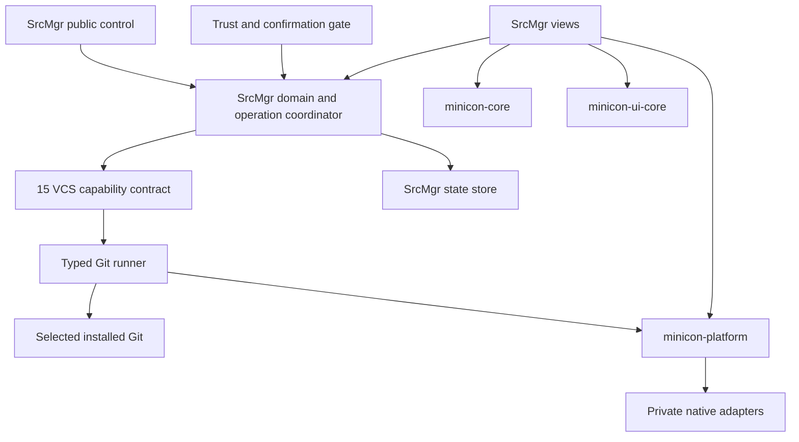

# 02 · Architecture and MiniCon reuse

Parent: [PRD index](../PRD.md). Owns source provenance, reuse boundaries, Git adapter design and architecture decisions. Status: pinned MiniCon core/platform/UI mechanisms support the implemented Windows local slice, including contained process spawning and the selected entropy/filesystem capabilities. Manifests identify actual features; the version plan records consumer evidence. This is not full native/platform qualification; other gates in this owner remain open.

## Outcome tree

```text
Outcome: a Git-first source-control product composed over proven MiniCon mechanisms
├── Portable product rules — repo identities, snapshots, operation plans
├── VCS capability boundary — Git implementation now; SVN and other adapters later
├── Git adapter — installed Git, byte-safe parsing, supervised execution
├── MiniCon mechanisms — rules / rendering / native capabilities
└── Composition — SrcMgr navigation, views, authority and persistence
```



## Inspected sources and provenance

Source review date: 2026-10-18. Public committed baseline: [`partnernetsoftware/minicon` at `5aa3a8a8893b311d07b503f4b0a45e896727f3b9`](https://github.com/partnernetsoftware/minicon/tree/5aa3a8a8893b311d07b503f4b0a45e896727f3b9). The sibling checkout also contains uncommitted 0.2.15 preparation. This PRD distinguishes those observations; it does not publish those changes or treat them as a dependency revision.

Reviewed entry points: `Cargo.toml`, `AGENTS.md`, `PRD.md`, `prd/PRD_02_28_shared_core.md`, `crates/*/Cargo.toml`, the three crate `src/lib.rs` files, platform process/watch facades, `src/ui.rs`, `src/theme.rs`, and delivery ownership. Repository-relative MiniCon paths in this module refer to that upstream, not this repository.

## Reuse inventory

The 0.0.6 ignore writer consumes the pinned filesystem identity, private exclusive create and atomic replacement facade. Byte-safe NUL-delimited ignore input uses the pinned contained process's writable stdin pipe, retaining the existing timeout/output/tree supervision; no sibling or dependency-pin change is needed. Partial staging adds the Git adapter as a consumer of the workspace's already locked SHA-256 crate to bind displayed diff bytes. This changes the dependency graph without introducing a new package/version or a second Git engine. Consumer evidence remains scoped in the active plan.

The commit composer consumes `minicon-core::composer` directly at the existing immutable MiniCon revision, together with the platform clipboard feature and typed IME caret positioning. Caret, selection, movement, paste limits and cell geometry remain shared mechanisms; full-index review, draft acknowledgements and Git authority remain SrcMgr-owned. Clipboard I/O runs outside the UI thread and completion is fenced to the originating composer. Unsupported platform operations produce visible errors without discarding text. Native capability qualification is separate from successful compilation; no sibling source or revision is changed for this consumer.

Optional editor/terminal handoff consumes the same pinned `minicon-platform::process_spawn::spawn_breakaway_visible_child` through the explicit `process-spawn` feature. It launches user-owned GUI applications, separately from contained/cancellable Git jobs. A waiter reaps each launched child without polling; successful startup is acknowledged even if scheduling exit observation fails. Host-denied independence is reported through the typed fallback mode. No public native call, duplicated launcher or shared-source edit is needed. The current handoff supplies no PTY or interactive console: choose a terminal application rather than a bare shell interpreter. This is the intended external handoff, not an embedded terminal or supervision of another application's complete process tree.

| Mechanism / source | Reuse decision | Boundary and qualification |
|---|---|---|
| `minicon-core`: click, composer, keymap, json, numeric, tree, version | Direct immutable Git dependency for needed APIs | Composer/keymap express MiniCon editing policy, not SrcMgr action routing; use explicit newline handling where available |
| `minicon-ui-core`: damage, retained_frame, glyph_cache, pixel, tree, scrollbar helpers | Direct dependency; disable `terminal-selection` | Retained drawing and pixel kernels are reusable; no complete widget toolkit or Git graph supplied |
| `minicon-platform`: window, input, IME, font, clipboard, process, filesystem, IPC, host-open | Direct dependency with only required features | API existence does not prove availability or correct lifecycle in every OS/ISA; unsupported is a typed failure |
| `minicon-platform::accessibility_publish` at the inspected commit | Reuse only its proven mechanisms/contracts | Source explicitly provides an AT-SPI publisher on Linux and accepting-but-discarding no-op handles elsewhere. `start()` success is not evidence of Windows UIA or macOS accessibility support; cross-OS publishing/action/text-range work remains a feasibility gap |
| `src/theme.rs`, `palette.rs`, `ui.rs`, settings and workspace composition | Reuse design, not private-module imports | Four semantic themes and pane behavior are references; SrcMgr owns new diff/graph/form components. Extract a shared helper upstream only after a stable consumer contract |
| `src/control*.rs`, snapshot and CLI | Reuse protocol principles only | SrcMgr defines its own versioned commands, targets and authorization; never depend on a running MiniCon endpoint |
| `third_party/softbuffer` | Preserve upstream fork resolution if portable window feature needs it | Consumer workspace must explicitly resolve upstream's owned fork; upstream patches do not propagate automatically |
| `third_party/vt100`, terminal renderer, mux/harness | Excluded from baseline dependency intent | No embedded terminal; do not enable terminal-selection merely for text diff selection |
| Build, signing, update and qualification scripts | Reuse architecture and reviewed procedures selectively | Product identity, permissions, manifests and evidence must be SrcMgr-owned; do not copy keys, receipts, release status or entire workflows |

**Revision rule:** all direct sibling MiniCon crate dependencies use the same Git URL and full commit SHA. Start M0 from the public committed baseline; advance only to a published, reviewed immutable revision. Commit the resolved lockfile and consumer feature/fork report. No absolute sibling path, branch pin or uncommitted code is a release input. At the inspected commit, UI-core tree helpers and core helpers must not be assumed to share the newer unified types. Local preparation adds feature gating and tree/numeric consolidation; those are prospective until published and qualified.

The upstream manifests declare Rust 1.97. The future toolchain lock must satisfy the chosen revision's MSRV and include a consumer compilation receipt; this PRD does not certify that a compatible toolchain is installed. Upstream licenses are `MIT OR Apache-2.0`; retain required notices for any copied source and audit transitive/fork licenses before distributing. This project's license does not relicense dependencies.

## Product-owned boundaries

Existing workspace boundaries: `srcmgr-domain` (backend-tagged identities and common contracts); `srcmgr-git` (installed-Git execution and repository semantics); `srcmgr-state` (durable profile/draft/trust state); `srcmgr-ui` (window models and interaction); `srcmgr-cli` (CLI/GUI composition and worker integration). These are responsibilities, not claims that every planned graph, sequencer, control or accessibility feature is implemented. The backend contract and future SVN seam are owned by [15](PRD_15_vcs_backends.md); retain the small domain seam rather than adding a speculative framework package. Native extensions go through a reviewed platform capability; VCS trust and UX policy remain product-owned. Never put branch, account or repository state in MiniCon shared crates.

For a proven missing native mechanism, an optional narrowly scoped `srcmgr-platform-ext` crate in this repository may implement the adapter behind a typed host-neutral facade, using existing MiniCon contracts where suitable. Record the missing upstream API/behavior, proposed contract and per-OS failure semantics in this owner before coding it. This is the authorized local route for accessibility publication or supervised-process gaps; it does not require editing the sibling checkout or waiting for a separate upstream release. Do not duplicate capabilities MiniCon already provides or create a second general platform framework. UI/domain code cannot call native APIs directly. If the mechanism is later upstreamed in a separate task, migrate to a reviewed immutable MiniCon revision and remove the duplicate adapter.

### Native accessibility publication extension

At pinned `5aa3a8a`, MiniCon exposes native window identity/wake and accessibility snapshot concepts, but the Windows/macOS publisher accepts snapshots through a no-op backend. SrcMgr currently needs a real Windows UIA provider for its custom pixel controls. The planned `srcmgr-platform-ext` adapter consumes the existing window identity/waker and publishes a bounded immutable semantic snapshot; product nodes/actions remain in `srcmgr-ui`. Native callbacks read snapshots and enqueue typed requests, never run Git, touch profiles or interpret display labels as targets. Each request binds its semantic target context, node name/identity and observed revision; value/paint changes preserve a live field, while changed repository/file/form/review context invalidates it. The UI thread rejects stale/disabled/modal-inapplicable requests and dispatches through the existing workspace action/confirmation rules. Publishing adds no timer, background scan or permanent service.

The adapter validates an owned HWND, attaches only for its lifetime and exposes actual UIA names, roles, enabled/focus state, bounds, navigation and relevant Invoke/Value patterns. Closed/replaced nodes return unavailable; queues, visible nodes and copied text have hard bounds with explicit failure instead of a falsely complete tree. UIA geometry comes from the same rendered rectangles, with screen conversion inside the adapter. Native APIs/unsafe code remain confined to the private adapter; the existing UI/domain unsafe prohibition remains. The Windows-only Microsoft `windows` bindings are a justified new dependency for generated COM interface ownership/ABI rather than a hand-copied vtable framework; select only the required Win32/UIA/COM/subclass features, lock the resolved version and record actual build/size evidence. Linux/macOS return explicit Unsupported until a real adapter is connected; never classify a no-op as published or claim those cells from Windows evidence. MiniCon pin and sibling source stay unchanged.

Consumer inspection further confirms that the pinned Windows `native_pixel_window::Backend` does not override the trait's default `native_identity() = None`. Until that upstream capability is available, the private adapter may resolve exactly one window on the current UI thread, matching current process, exact initial title and the inspected pinned native-pixel class `AgenTermNativePixelWindow`. It rejects absent/ambiguous/wrong-thread matches and validates the handle before subclassing. This is bounded consumer identity acquisition, not desktop-wide window discovery or a replacement window host. Prefer the supplied native identity when available and remove this fallback after migrating to an upstream implementation.

Windows subclass ownership queries require the Common Controls v6 activation dependency: the inspected system default DLL does not export `GetWindowSubclass` by name. The private adapter tests and SrcMgr executable must embed the same reviewed assembly dependency through shared MSVC build instructions, rather than depend on an inherited activation context or suppress a loader failure. This adds a declared OS assembly requirement, not a downloaded runtime or an upstream patch. Non-Windows builds emit no Windows linker flags; both supported Windows ISAs use the architecture-neutral assembly declaration. Native lifecycle tests must start and execute under that declared context, and the final exact executable needs its own native smoke after manifest changes.

Provider exposure follows Microsoft's [server-side UIA contract](https://learn.microsoft.com/en-us/windows/win32/winauto/uiauto-howto-expose-serverside-uiautomation-provider), with lifetime cleanup under [UiaReturnRawElementProvider](https://learn.microsoft.com/en-us/windows/win32/api/uiautomationcoreapi/nf-uiautomationcoreapi-uiareturnrawelementprovider). Verification selects actual cross-process UIA discovery/read/action/value, stale/disabled/modal refusal and closure/lifetime checks, plus affected UI state regressions; native screen-reader completeness, text patterns and other OS bridges remain separate required work.

Use installed Git as the semantic engine. Do not combine a second repository-writing library with CLI mutations in this baseline. Discover Git from a user setting or system search, resolve its executable identity and show version/path in Diagnostics. Minimum baseline is Git 2.43 with capability probes for optional newer behavior; a version number alone is insufficient. Unsupported Git disables affected commands and explains the required capability. Honor user repository settings unless security policy explicitly quarantines execution.

For selected stash removal, an ordinary files-backend adapter may hold Git's reference/reflog locks, ask that same installed Git to generate the resulting ref/reflog in an isolated local store, then publish the generated bytes through MiniCon's filesystem facade. This is a bounded publication mechanism, not an independent implementation of Git's reflog rewrite semantics. Validate the full selected list under the lock; refuse unsupported storage or lock conflicts, preserve unrelated entries, and retain the original metadata if publication becomes partial. Recovery behavior is owned by [08](PRD_08_recovery.md); selected-stash behavior by [09](PRD_09_advanced_git.md). Git's files backend documents the ref-lock protection of reflog expiry in its [implementation](https://github.com/git/git/blob/v2.56.0/refs/files-backend.c); support still requires the consumer's actual concurrency/failure evidence.

Read status with `status --porcelain=v2 -z`; use bounded plumbing formats and raw OIDs, never localized human output. Keep path bytes/native strings separate from display labels; never reconstruct a path from escaped display text. OIDs are variable-length opaque identifiers; SHA-1 and SHA-256 repositories must not depend on a fixed forty-character UI/parser assumption. [Git status documentation](https://git-scm.com/docs/git-status) defines the machine-readable format.

Persist and transport paths losslessly through a tagged encoding: Unix raw bytes and Windows native UTF-16 code units, with a separate escaped display label. JSON uses an explicit encoded payload where native units cannot be represented as ordinary Unicode; the exact schema is frozen with the M0 domain contract. Ordinary public snapshots use opaque entry IDs and omit private raw paths by default. Never use replacement characters, normalization or a display label as mutation identity.

## Runner and concurrency

Every job has job ID, repo identity, common-dir identity, argv array, cwd, environment policy, timeout, allowed outputs and cancellation strategy. Never run Git through shell interpolation. Use explicit `--`/literal pathspec handling and NUL input protocols where supported. Stream stdout/stderr independently with bounded queues; private raw values cannot leak through command labels. Network and mutation jobs remain off the UI thread.

Build the child environment deliberately: clear inherited repository-routing/index/config-injection/trace variables that could retarget the selected repository, write elsewhere or disclose secrets; reintroduce only reviewed job-owned values. Validate executable identity and run version probing outside untrusted repository roots. Keep required OS/user agent/session variables only under the selected capability policy. Never dump the environment for diagnostics. M0 records actual required Git commands/options against the minimum version, rather than deriving compatibility from current online documentation alone.

One product mutation executes per canonical common Git directory, serializing linked worktrees conservatively. Read jobs may overlap only when their result generation can be discarded; background status uses optional-lock suppression where supported. A product lock coordinates only this app, not external tools. Git lock errors cause a refresh/retry decision, never lock deletion. Revalidate immediately before launch and reconcile afterward; an external writer can still race, so Git's outcome and actual post-state are authoritative. No claim of globally atomic multi-command transactions.

## Delivery contracts

| ID / leaf | Invariant | Observable evidence | Safe failure | Dependencies | Non-goal |
|---|---|---|---|---|---|
| ARCH-01 · reuse | Reproducible same-revision dependencies with actual features/forks | QA-J12 isolated consumer and dependency graph report | M0 gate BLOCKED; no hidden local fallback | Published MiniCon commit | Copy all upstream code |
| ARCH-02 · Git adapter | Typed argv, raw identities and bounded output | QA-J11 hostile paths, mixed encodings, SHA-256 and huge output | Structured error/truncation; no guessed parse success | Installed Git | Reimplement Git storage |
| ARCH-03 · concurrency | No product writer overlap across linked worktrees; stale reads discarded | QA-J05 external mutation and linked-worktree race | Conflict/busy plus refresh | 08, 13 | Lock out every external process |
| ARCH-04 · native boundary | Native behavior goes through capability adapters | QA-J12 consumer builds and real interaction | Unsupported capability blocks affected feature | MiniCon platform | Public raw OS calls in views |

## M0 feasibility decisions and closure

| Risk | Required proof | Default decision / failure path |
|---|---|---|
| Pixel-drawn controls lack usable accessibility | Focus, names, roles, actions, text ranges and screen-reader operation in three OS families | Required platform extension; public release blocked until proven; framework change requires documented decision |
| Detached spawn API does not supervise cancellable Git trees | Owned pipe process, credential helper and hook lifecycle, cancellation/reap per OS/ISA | Add/reuse the correct contained spawn capability; do not misuse detached launch |
| Window backends need workspace-owned forks | Isolated consumer resolves the exact softbuffer source and launches on Linux/macOS | Explicit root patch/vendor policy with provenance; no registry substitution assumed equivalent |
| Byte paths and patch precision | Round-trip invalid UTF-8 on Unix, UTF-16 Windows paths, staged/worktree divergence | Disable only unsupported selection operation with reason; never lossy mutation |
| Optional feature availability | Compile and exercise chosen feature set, including IME/clipboard/IPC | Record per-capability limitation and close before milestone exit |

These are implementation gates with defined owners and evidence, not gaps to be filled by undocumented guesses. Gate status is currently `NOT-RUN`.

The initial consumer toolchain choice is Rust 1.97.0, matching the inspected manifests; M0 must lock it and verify build-tool/linker availability. A later reviewed dependency/toolchain change updates the lock and receipts together. Upstream workspace patches do not propagate to this consumer ([Cargo patch rules](https://doc.rust-lang.org/cargo/reference/overriding-dependencies.html#the-patch-section)); resolve required forks at the consumer root and verify them from a clean clone. Do not update the sibling MiniCon checkout or substitute its newer working tree as a shortcut. For a shared mechanism gap, use the bounded local extension route above or record the exact blocked capability while continuing independent work; changing upstream needs its own scoped task.
