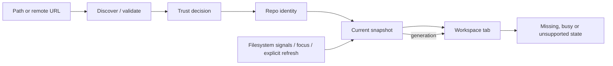

# 03 · Repository workspace

Parent: [PRD index](../PRD.md). Owns repository discovery, local organization, opening and clone/init entry flows. Mutation safety is owned by [08](PRD_08_recovery.md); persistence by [13](PRD_13_state_control.md).

## Outcome tree

```text
Outcome: arrive at the correct repository with current context
├── Enter — open, drag a directory, recent entry, init or clone
├── Identify — worktree root, Git dir, common dir and trust
├── Organize — groups, favorites, tabs and local search
├── Configure — visible Git scopes, ignore rules and capability settings
└── Observe — branch, worktree/index counts, operation and remote freshness
```



## Required behavior

Open accepts a directory, a file inside a working tree, a linked worktree with a `.git` file, a submodule checkout or a bare repository. For unknown existing roots, bounded metadata inspection and the trust decision in [11](PRD_11_security.md) precede Git discovery; candidate metadata never establishes trusted repository identity. After trust, Git discovery establishes actual worktree/git/common-dir roots; never assume `.git` is a directory. Bare repositories have history/refs/remotes views and clearly unavailable working-tree actions. An uninitialized submodule is not an empty normal repository. A nested repository is shown as distinct, with parent navigation when known.

Canonical identities deduplicate aliases while preserving the user's display path. Symlinks, case folding, network mounts and removable media need explicit identity checks rather than string-only normalization. A missing recent repository remains a repairable entry with Locate/Remove; Remove only removes the bookmark. Replacing a path with another repository invalidates snapshots and pending plans. A tab binds a worktree; related worktrees share a visible repository family.

Welcome offers Open, Clone and Create. Init previews target, initial branch and existing files; never stages or commits existing files automatically. Clone validates transport/trust, target emptiness and name, supports branch and shallow depth as explicit options, and leaves submodule recursion off until separately selected. Authentication behavior belongs to [07](PRD_07_remotes.md). During cancellation or failure retain a recognizable partial target and offer inspect/remove only after checking ownership and current contents; never delete an arbitrary existing directory.

The sidebar provides favorites, user groups, recent repositories and per-repository branches/tags/remotes/stashes/worktrees. Groups and labels are local metadata, never repository changes. Search filters names/paths without scanning disk. Tab close preserves draft and selection by repository; it never cancels a mutation silently. Offer detach-to-background or wait when an operation remains active. The active repo path, branch/detached indicator and ongoing operation remain visible during dialogs.

Refresh on focus, completed operation and explicit user action. File signals coalesce with a 250 ms debounce; prefer native watches and dirty flags over periodic full scans. If watches fail, only the visible active repository uses fallback polling, starting at two seconds and backing off after unchanged results to thirty seconds; enforce the CPU budgets in 14 and lengthen intervals for expensive scans. Pause idle polling/history prefetch for hidden tabs and when the app is minimized or occluded, while retaining the bounded monitoring needed for an active job. On return, refresh before displaying state as current; mutation preflight always obtains fresh state. All intervals are configurable implementation constants, not timers in the UI. Loss/overflow of watch events triggers a coalesced authoritative rescan. Background tabs do not recursively poll all files. Cached counts carry stale/loading state; ahead/behind carries the last successful fetch time and is never presented as live server truth.

Repository Settings shows effective Git identity, upstream, signing, integration defaults and reviewed tool/helper settings with their origin and scope. Writes default to repository-local configuration; global writes require explicit scope selection and effect preview. App preferences (theme, language, fonts, limits, Git executable) are visibly separate. Do not overwrite unknown config keys or silently resolve conflicting multi-values. Worktree-specific settings stay scoped to that worktree when Git supports them. Trust-sensitive edits follow [11](PRD_11_security.md) and invalidate relevant grants.

Ignore from the file list previews a literal escaped rule and destination: tracked `.gitignore` or local `.git/info/exclude`. Default is the exact selected path, not a broad extension wildcard. Explain that ignore does not stop tracking an already tracked file; Stop tracking is a separate index change preserving worktree content, previewed like staging. Existing rules/comments remain intact; external file changes invalidate the edit preview. Show which rule ignored an entry on demand. No auto-commit of ignore/config edits.

## Delivery contracts

| ID / leaf | Invariant | Observable evidence | Safe failure | Dependencies | Non-goal |
|---|---|---|---|---|---|
| REPO-01 · identify | Actions bind canonical Git identity, not tab label | QA-J01/J05/J07 aliases, bare, linked and nested fixtures | Unavailable/changed identity disables mutation | 02, 11 | Treat every folder as Git |
| REPO-02 · enter | Init/clone targets are explicit and preserve preexisting data | QA-J02 empty/existing target and interrupted clone | Retain partial state with repair choices | 07, 08 | Automatic first commit |
| REPO-03 · organize | Remove/group/rename changes only local workspace metadata | QA-J08 reopen and bookmark deletion | Corrupt metadata recovers separately from repo | 13 | Move repository directories |
| REPO-04 · freshness | Displayed state identifies its generation/freshness | QA-J05 lost watch, focus, external commit | Stale banner and explicit refresh | 02, 13 | Continuous remote polling |
| REPO-05 · configure | Config/ignore changes preserve scope and exact intended paths | QA-J01/J08 scoped settings, escaped ignore and concurrent edit fixtures | Reject stale/ambiguous edit; preserve existing keys/rules | 04, 11, 13 | Automatically untrack ignored files |

## Current 0.0.6 entry slice

Partial implementation: launch without a path shows Welcome and passive recent entries; selecting a recent row does not open it. Open/Ctrl+O or deliberate activation requests its native path on the worker. An untrusted plain `.git` repository receives a metadata-only, expiring, one-use trust review before repository Git runs. Cancel retains the entered path and writes no grant; Enter does not approve trust. The worker checks reviewed metadata again before saving explicit approval, then builds a snapshot before replacing the active target. A refusal preserves the original target. Entry cannot overtake active/queued old-repository work; successful entry loads that worktree's draft and rejects obsolete details. Recents are bounded metadata under 13, not trust grants; removing a record preserves files and drafts. Native title/context updates identify the selected worktree. Graphical Git selection and repository-local identity setup are available as described below. Repository tabs now retain lightweight navigation through the scoped contract below; complete settings/accessibility and first-user context qualification remain open. Implementation/evidence and the remaining task tree live in [the active plan](../plan/plan-0.0.6.md).

### Local repository tabs

Keep up to 16 canonical worktree tabs, deduplicating successful opens of the same canonical target. The active path remains visible in the native title/header; tab summaries identify the worktree and last observed branch/HEAD, explicitly marking inactive summaries as last observed. Overflow uses a bounded visible tab strip with previous/next controls. Background tabs retain metadata, not full status/Diff snapshots or polling workers. Returning to a tab reads current trusted state before replacing the active target; metadata never authorizes a Git write.

Before switching or closing, finish IME composition and acknowledge the latest dirty draft, then save the source tab's navigation through the profile writer. A source mismatch, unavailable target or failed context save preserves the active target and tabs. A refusal from Close/switch restores the existing workspace, without turning it into an editable Open dialog. Ordinary Open failures still retain the user's entered path. Busy repository work must finish before activation or close; never silently cancel it. Closing the active tab activates an adjacent remaining target only after successful entry, or returns to Welcome after the last tab closes. Reopening explicitly retrieves its saved selection/view position and draft; closing a tab never deletes source, drafts, recents or navigation records.

The current navigation checkpoint stores pane/source, raw selected identities, stash mode, detail read request, cursor/scroll and the three local queries with pre-filter anchors. It also retains the current commit → files → file Diff return path, using at most two metadata frames and raw committed-file selection rather than cached content. Re-read selected detail and clamp restored positions to current content; a hidden or missing target cannot reuse an old actionable Diff. Back rereads the prior level before restoring its position. This applies to the currently loaded history scope; graph/blame navigation remains separate. Tab membership is session-local; explicit recent/Open entry restores saved per-worktree context after restart. Do not claim automatic session restoration or complete L3 acceptance from this slice.

An invalid saved view blocks target activation and offers explicit Cancel or Archive view and open. Enter never approves. Cancellation preserves the record and source workspace; approval archives only the reviewed navigation value through 13's bounded, fresh, one-use transaction, then repeats ordinary discovery/trust/open. Drafts, trust and Git data are preserved. A known archive followed by failed opening is reported as two distinct outcomes, retaining the source workspace and archive. Missing-repository Locate/Remove and complete entry acceptance remain separate requirements.

Create/N from Welcome provides directory and initial-branch fields, then a filesystem-only review of the canonical target and up to 50 untraversed top-level names, explicitly marking an incomplete preview. Preparation writes nothing. The parent must exist; the target must be new or a plain directory with no `.git` entry. Explicit one-use approval rechecks filesystem identities, refuses a competing target/metadata creation and runs installed Git with an empty template, SHA-1 objects and files refs. Existing content is never staged or committed. Initialization success leads to a separate metadata trust review, including when an old grant exists for that path. Cancelling that review leaves the already-created repository intact. Failures retain the input and warn that partial metadata may need inspection; no automatic cleanup or mutation retry is offered. [Git init](https://git-scm.com/docs/git-init) owns initialization semantics; full-ref validation uses [check-ref-format](https://git-scm.com/docs/git-check-ref-format) without branch shorthand expansion.

Git/G opens application Git settings even without an open repository or Git on PATH. Listing the selected path is passive. Test and save explicitly executes the chosen program's version probe, requires the supported floor, persists the canonical native path and applies it to the current worker only after successful storage. A blank field explicitly returns future discovery to PATH, after testing its candidate. Launch-time `--git` overrides the saved preference; a subsequent deliberate GUI save can replace the current-session selection. Failed validation/storage preserves the previous choice and entered path. Setup guidance points to a trusted package manager or Git's download site, without installation or network access. Selection, persistence and executable authority remain separate under 11/13.

Identity/I from an open trusted repository shows effective `user.name`/`user.email` with source scope/origin and Git-resolved author/committer, including environment overrides. Save local writes only those two keys in this repository's config; global/system values are inherited and never edited by this slice. The one-use preview expires after 60 seconds. The adapter reserves `config.lock`, lets the installed Git edit both values in that owned lock and publishes once after source identity/byte rechecks, preserving unrelated settings/comments. Existing locks, stale config, invalid values or Git failures refuse publication and preserve input; Reload preview retains the attempted edit and requires another deliberate Save. A completed write remains acknowledged if subsequent durability/opening is unavailable. Changed config receives a fresh trust review, never an automatic grant. [Git config](https://git-scm.com/docs/git-config) owns syntax, scopes and effective value resolution. Arbitrary/global config editing is outside this partial settings surface.

## Acceptance details

- Opening a linked worktree and its parent shows separate HEAD/index state; opening the same worktree through an alias focuses the existing tab.
- Opening a repository without Git installed retains workspace entries and offers Git selection; it does not initialize anything.
- A permission denied directory, ownership safety rejection or removed mount has a specific reason and retry/locate action. Ownership rejection never writes a wildcard `safe.directory` exception.
- An empty/unborn repository can stage and make its first commit; history is an explanatory empty state.
- A fresh profile can complete init or local open entirely offline. Network is requested only for the selected clone or remote action.
- The repository overview shows branch, change count and operation state from each repository's last snapshot, with its age. Listing starts no Git status for a repository that is neither selected nor visible; the opt-in auto-fetch in [07](PRD_07_remotes.md) is the only exception. A stale snapshot is labelled stale, never shown as current.
