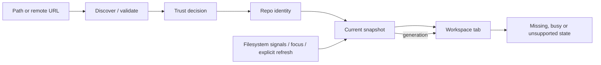

# 03 · Repository workspace

Parent: [PRD index](../PRD.md). Owns repository discovery, local organization, opening and clone/init entry flows. Mutation safety is owned by [08](PRD_08_recovery.md); persistence by [13](PRD_13_state_control.md).

## Outcome tree

```text
Outcome: arrive at the correct repository with current context
├── Enter — open, drag a directory, recent entry, init or clone
├── Identify — worktree root, Git dir, common dir and trust
├── Organize — groups, favorites, tabs and local search
├── Configure — visible Git scopes, ignore rules and capability settings
└── Observe — branch, worktree/index counts, operation and remote freshness
```



## Required behavior

Open accepts a directory, a file inside a working tree, a linked worktree with a `.git` file, a submodule checkout or a bare repository. For unknown existing roots, bounded metadata inspection and the trust decision in [11](PRD_11_security.md) precede Git discovery; candidate metadata never establishes trusted repository identity. After trust, Git discovery establishes actual worktree/git/common-dir roots; never assume `.git` is a directory. Bare repositories have history/refs/remotes views and clearly unavailable working-tree actions. An uninitialized submodule is not an empty normal repository. A nested repository is shown as distinct, with parent navigation when known.

Canonical identities deduplicate aliases while preserving the user's display path. Symlinks, case folding, network mounts and removable media need explicit identity checks rather than string-only normalization. A missing recent repository remains a repairable entry with Locate/Remove; Remove only removes the bookmark. Replacing a path with another repository invalidates snapshots and pending plans. A tab binds a worktree; related worktrees share a visible repository family.

Welcome offers Open, Clone and Create. Init previews target, initial branch and existing files; never stages or commits existing files automatically. Clone validates transport/trust, target emptiness and name, supports branch and shallow depth as explicit options, and leaves submodule recursion off until separately selected. Authentication behavior belongs to [07](PRD_07_remotes.md). During cancellation or failure retain a recognizable partial target and offer inspect/remove only after checking ownership and current contents; never delete an arbitrary existing directory.

The sidebar provides favorites, user groups, recent repositories and per-repository branches/tags/remotes/stashes/worktrees. Groups and labels are local metadata, never repository changes. Search filters names/paths without scanning disk. Tab close preserves draft and selection by repository; it never cancels a mutation silently. Offer detach-to-background or wait when an operation remains active. The active repo path, branch/detached indicator and ongoing operation remain visible during dialogs.

Refresh on focus, completed operation and explicit user action. File signals coalesce with a 250 ms debounce; prefer native watches and dirty flags over periodic full scans. If watches fail, only the visible active repository uses fallback polling, starting at two seconds and backing off after unchanged results to thirty seconds; enforce the CPU budgets in 14 and lengthen intervals for expensive scans. Pause idle polling/history prefetch for hidden tabs and when the app is minimized or occluded, while retaining the bounded monitoring needed for an active job. On return, refresh before displaying state as current; mutation preflight always obtains fresh state. All intervals are configurable implementation constants, not timers in the UI. Loss/overflow of watch events triggers a coalesced authoritative rescan. Background tabs do not recursively poll all files. Cached counts carry stale/loading state; ahead/behind carries the last successful fetch time and is never presented as live server truth.

Repository Settings shows effective Git identity, upstream, signing, integration defaults and reviewed tool/helper settings with their origin and scope. Writes default to repository-local configuration; global writes require explicit scope selection and effect preview. App preferences (theme, language, fonts, limits, Git executable) are visibly separate. Do not overwrite unknown config keys or silently resolve conflicting multi-values. Worktree-specific settings stay scoped to that worktree when Git supports them. Trust-sensitive edits follow [11](PRD_11_security.md) and invalidate relevant grants.

Ignore from the file list previews a literal escaped rule and destination: tracked `.gitignore` or local `.git/info/exclude`. Default is the exact selected path, not a broad extension wildcard. Explain that ignore does not stop tracking an already tracked file; Stop tracking is a separate index change preserving worktree content, previewed like staging. Existing rules/comments remain intact; external file changes invalidate the edit preview. Show which rule ignored an entry on demand. No auto-commit of ignore/config edits.

## Delivery contracts

| ID / leaf | Invariant | Observable evidence | Safe failure | Dependencies | Non-goal |
|---|---|---|---|---|---|
| REPO-01 · identify | Actions bind canonical Git identity, not tab label | QA-J01/J05/J07 aliases, bare, linked and nested fixtures | Unavailable/changed identity disables mutation | 02, 11 | Treat every folder as Git |
| REPO-02 · enter | Init/clone targets are explicit and preserve preexisting data | QA-J02 empty/existing target and interrupted clone | Retain partial state with repair choices | 07, 08 | Automatic first commit |
| REPO-03 · organize | Remove/group/rename changes only local workspace metadata | QA-J08 reopen and bookmark deletion | Corrupt metadata recovers separately from repo | 13 | Move repository directories |
| REPO-04 · freshness | Displayed state identifies its generation/freshness | QA-J05 lost watch, focus, external commit | Stale banner and explicit refresh | 02, 13 | Continuous remote polling |
| REPO-05 · configure | Config/ignore changes preserve scope and exact intended paths | QA-J01/J08 scoped settings, escaped ignore and concurrent edit fixtures | Reject stale/ambiguous edit; preserve existing keys/rules | 04, 11, 13 | Automatically untrack ignored files |

## Acceptance details

- Opening a linked worktree and its parent shows separate HEAD/index state; opening the same worktree through an alias focuses the existing tab.
- Opening a repository without Git installed retains workspace entries and offers Git selection; it does not initialize anything.
- A permission denied directory, ownership safety rejection or removed mount has a specific reason and retry/locate action. Ownership rejection never writes a wildcard `safe.directory` exception.
- An empty/unborn repository can stage and make its first commit; history is an explanatory empty state.
- A fresh profile can complete init or local open entirely offline. Network is requested only for the selected clone or remote action.
