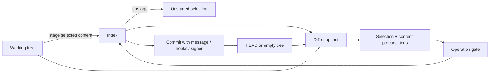

# 04 · Changes, staging and commits

Parent: [PRD index](../PRD.md). Owns working-tree/index inspection, diff selection, staging and commit composition. [08](PRD_08_recovery.md) owns discard, risk confirmation and recovery.

## Outcome tree

```text
Outcome: commit exactly the intended content
├── Inspect — unstaged / staged / untracked / conflict sections
├── Compare — text, binary, rename, mode and attribute effects
├── Select — files, hunks and lines with stale-selection detection
└── Commit — message, identity, signing, hooks and resulting object
```



## Change list and diff semantics

Always distinguish index versus HEAD from worktree versus index. A partially staged file appears in both sections with independent selection; a single checkbox cannot imply that both versions will be committed. Show renamed old/new paths, deletions, modes, symlinks, submodule gitlinks, ignored opt-in view and conflict state. Ignore rules are honored by default; adding ignored content requires a deliberate force-add action naming the file. No automatic stage-all after a refresh.

Text diff offers unified and side-by-side views, line numbers, inline highlighting and context expansion. Whitespace-ignore is a viewing option only; the mutation preview remains exact. CRLF/LF, missing final newline, file mode and encoding changes have explicit indicators. Detect NUL/binary, LFS pointers and undecodable content; show metadata and a safe external-open option rather than pretend text. Display decoding may be chosen by the user, but repository bytes remain unchanged. Diff limits and truncation behavior belong to [14](PRD_14_verification_roadmap.md).

Text filters, external diff/textconv and attributes follow [11](PRD_11_security.md). A synthetic display diff cannot silently become a patch input. For supported text files, stage/unstage whole files or hunks; line selection arrives in M3. A selected patch binds old/new content identities, index stage and literal path. On external change or failed precondition discard the selection and regenerate; never fuzzy-apply or silently widen it. For renames with edits, preserve the relationship while allowing whole-file stage; partial rename operations can be explicitly unavailable when exact semantics are not proven. Binary, symlink, submodule and conflicted entries are whole-entry or dedicated-flow operations, never fake hunks.

Unstage restores selected index content toward HEAD without overwriting worktree content; unborn HEAD uses the empty-tree case. Staging an untracked file honors configured clean filters only after trust. Intent-to-add, sparse/skip-worktree and assume-unchanged states must be recognized; do not silently clear flags or expand a sparse checkout. Unsupported partial operations explain why and preserve all bytes.

## Commit composition

The commit panel shows staged content summary, multiline subject/body draft, author identity, optional amend, sign-off and signing status. Recommended subject length is guidance, never a hard arbitrary refusal. No staged changes disables ordinary Commit; empty commit is an explicit advanced action. Missing identity opens a form that distinguishes repository-local from global configuration; default write scope is local and includes a preview. Drafts persist by repo/worktree and operation mode.

Ordinary commit submits the live index after confirming its current tree and HEAD; it never stages unseen worktree content. The app serializes its own writers, checks preconditions immediately before launch and inspects actual resulting objects afterward. An unrelated external writer or authorized hook can still change the live index after the check: do not claim snapshot isolation or exact-tree compare-and-swap for `git commit`. On a mismatch, report the observed commit/tree and warning; never auto-reset it. Using a synthetic index or bypassing hooks to manufacture a stronger guarantee is outside the baseline.

Hooks/signers may run only under trust and may modify files/index even when they fail. Show their bounded live output and actual post-state; do not promise a failed hook leaves staged bytes untouched. The app preserves the message draft and does not undo hook changes or add `--no-verify` automatically. Reconcile HEAD/index even on nonzero exit, since an error after a side effect is not proof that no commit exists. While a signer/helper prompt is pending, show Waiting for signing/authentication and a cancel path. Git's [commit documentation](https://git-scm.com/docs/git-commit) defines its hook behavior; these observation/reporting rules are product requirements.

Successful commit reports the actual OID, refreshes history/status and clears only the draft that produced that commit. Amend previews the old OID, changed message/tree and history rewrite risk; warn when the commit is reachable from known remote-tracking refs, without claiming the absence of such reachability means it was never published. Amend remains off by default and does not persist as a hidden sticky mode. Signing enablement and verification are distinct states.

Bind an ordinary review to HEAD, its symbolic destination, all merge parents when present, and the complete index-to-HEAD raw delta. A changed merge parent or destination invalidates submission just as a changed staged path does. Unresolved index entries block submission. Keep diff reading literal-path and read-only, with freshness checks around the read; a failed or superseded read cannot authorize the selected path. After launch, compare the observed tree delta, parents and destination against the review. An observed write with a mismatch or unavailable comparison is an acknowledged OID with a warning and retained draft; an unreadable outcome requires reconciliation before another attempt.

## Filtered change lists

For the proposed quick-filter slice, a visible result authorizes no action by itself: selected file/hunk/line actions still bind the actual raw path, content, repository and fresh index state under the existing guards. Filtering neither stages files nor narrows a pre-existing whole-index operation. Zero results or a hidden/removed selection provides no selected-file action target; stale details cannot remain actionable.

While Files has a nonempty query, all-files stage/unstage and stash creation require clearing that filter, even when focus moved to another pane. Explain `Clear Files filter to review the full operation scope`; do not silently apply “all” to visible or hidden subsets. Single visible file/hunk/line actions retain existing guards. Prepared confirmations still need freshness checks; query changes never authorize a different target.

Commit is a distinct full-index operation and may proceed while the worktree list is filtered only through a **complete, unfiltered staged-index review**. Keep it beside the composer: all staged paths with actual change/line counts or unknown markers, reviewable staged Diff, branch/HEAD and ordinary versus amend mode. Counts alone or the filtered list are not a complete review. Large lists virtualize rather than omit hidden staged entries. Empty/unknown/stale review or unresolved index conflicts disable submission with a reason; refresh through the existing worker without losing the draft. Query edits themselves launch no Git work. Bind review/preflight to repo/HEAD/index state under the existing race/reconciliation rules; external index changes invalidate review rather than silently widening the commit. A query never changes the tree being committed. This replaces the earlier blanket clear-before-commit proposal. Interaction ownership is [10](PRD_10_desktop_ux.md#first-user-workspace-and-journeys); sequencing is [the 0.0.6 plan](../plan/plan-0.0.6.md).

## Delivery contracts

| ID / leaf | Invariant | Observable evidence | Safe failure | Dependencies | Non-goal |
|---|---|---|---|---|---|
| CHANGE-01 · inspect | Staged and unstaged versions are independently visible | QA-J01 mixed-state fixture, byte comparison | Unsupported/binary badge with metadata | 02, 03 | General code editor |
| CHANGE-02 · stage | Only selected exact content changes the index | QA-J01/J05/J11 hunk/line and stale patch tests | No mutation on invalid selection; refresh | 08, 11 | Fuzzy patch success |
| CHANGE-03 · commit | Actual committed tree/OID is reconciled and draft survives failure | QA-J01/J10 hooks, signing and first commit | Keep draft; inspect actual state | 06, 08, 13 | Automatically bypass hooks |
| CHANGE-04 · precise files | Display transforms cannot corrupt path/content identity | QA-J11 CRLF, invalid UTF-8, symlink, binary, long paths | Disable unsupported partial action | 02, 11 | Normalize every file |

## Acceptance details

Given a file containing independent edits A and B, staging A and committing yields A in the new tree while B remains unstaged. Repeat for an already partially staged file and for unstage. A hook that fails leaves the message available after restart. A hook that modifies the index is surfaced in the resulting commit report. An external write after a hunk preview prevents reuse of that preview. A signing error never causes an unsigned fallback commit. After each stage or unstage, the result line reports observed index-to-HEAD file and line counts for the affected path, or explicitly names the whole-index scope for an all-files action. Binary line counts stay unknown. State that the index action did not request worktree writes; do not promise that trusted filters or external writers could not change files.
