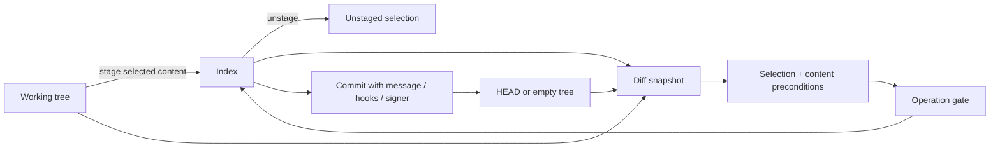

# 04 · Changes, staging and commits

Parent: [PRD index](../PRD.md). Owns working-tree/index inspection, diff selection, staging and commit composition. [08](PRD_08_recovery.md) owns discard, risk confirmation and recovery.

## Outcome tree

```text
Outcome: commit exactly the intended content
├── Inspect — unstaged / staged / untracked / conflict sections
├── Compare — text, binary, rename, mode and attribute effects
├── Select — files, hunks and lines with stale-selection detection
└── Commit — message, identity, signing, hooks and resulting object
```



## Change list and diff semantics

Always distinguish index versus HEAD from worktree versus index. A partially staged file appears in both sections with independent selection; a single checkbox cannot imply that both versions will be committed. Show renamed old/new paths, deletions, modes, symlinks, submodule gitlinks, ignored opt-in view and conflict state. Ignore rules are honored by default; adding ignored content requires a deliberate force-add action naming the file. No automatic stage-all after a refresh.

Text diff offers unified and side-by-side views, line numbers, inline highlighting and context expansion. Whitespace-ignore is a viewing option only; the mutation preview remains exact. CRLF/LF, missing final newline, file mode and encoding changes have explicit indicators. Detect NUL/binary, LFS pointers and undecodable content; show metadata and a safe external-open option rather than pretend text. Display decoding may be chosen by the user, but repository bytes remain unchanged. Diff limits and truncation behavior belong to [14](PRD_14_verification_roadmap.md).

Text filters, external diff/textconv and attributes follow [11](PRD_11_security.md). A synthetic display diff cannot silently become a patch input. For supported text files, stage/unstage whole files or hunks; line selection arrives in M3. A selected patch binds old/new content identities, index stage and literal path. On external change or failed precondition discard the selection and regenerate; never fuzzy-apply or silently widen it. For renames with edits, preserve the relationship while allowing whole-file stage; partial rename operations can be explicitly unavailable when exact semantics are not proven. Binary, symlink, submodule and conflicted entries are whole-entry or dedicated-flow operations, never fake hunks.

Unstage restores selected index content toward HEAD without overwriting worktree content; unborn HEAD uses the empty-tree case. Staging an untracked file honors configured clean filters only after trust. Intent-to-add, sparse/skip-worktree and assume-unchanged states must be recognized; do not silently clear flags or expand a sparse checkout. Unsupported partial operations explain why and preserve all bytes.

## Commit composition

The commit panel shows staged content summary, multiline subject/body draft, author identity, optional amend, sign-off and signing status. Recommended subject length is guidance, never a hard arbitrary refusal. No staged changes disables ordinary Commit; empty commit is an explicit advanced action. Missing identity opens a form that distinguishes repository-local from global configuration; default write scope is local and includes a preview. Drafts persist by repo/worktree and operation mode.

Commit uses the index as confirmed, never stages unseen content. Bind expected HEAD and index tree; refresh immediately before execution and detect unexpected post-state. Hooks/signers may run only under trust and may modify files/index. Show their output and post-operation changes; do not assert the commit exactly equals the pre-hook tree if the hook changed it. A hook/sign failure preserves draft and staged state, with no automatic `--no-verify`. While a signer/helper prompt is pending, show Waiting for signing/authentication and a cancel path.

Successful commit reports the actual OID, refreshes history/status and clears only the draft that produced that commit. Amend previews the old OID, changed message/tree and history rewrite risk; warn when the commit is reachable from known remote-tracking refs, without claiming the absence of such reachability means it was never published. Amend remains off by default and does not persist as a hidden sticky mode. Signing enablement and verification are distinct states.

## Delivery contracts

| ID / leaf | Invariant | Observable evidence | Safe failure | Dependencies | Non-goal |
|---|---|---|---|---|---|
| CHANGE-01 · inspect | Staged and unstaged versions are independently visible | QA-J01 mixed-state fixture, byte comparison | Unsupported/binary badge with metadata | 02, 03 | General code editor |
| CHANGE-02 · stage | Only selected exact content changes the index | QA-J01/J05/J11 hunk/line and stale patch tests | No mutation on invalid selection; refresh | 08, 11 | Fuzzy patch success |
| CHANGE-03 · commit | Actual committed tree/OID is reconciled and draft survives failure | QA-J01/J10 hooks, signing and first commit | Keep draft; inspect actual state | 06, 08, 13 | Automatically bypass hooks |
| CHANGE-04 · precise files | Display transforms cannot corrupt path/content identity | QA-J11 CRLF, invalid UTF-8, symlink, binary, long paths | Disable unsupported partial action | 02, 11 | Normalize every file |

## Acceptance details

Given a file containing independent edits A and B, staging A and committing yields A in the new tree while B remains unstaged. Repeat for an already partially staged file and for unstage. A hook that fails leaves the message available after restart. A hook that modifies the index is surfaced in the resulting commit report. An external write after a hunk preview prevents reuse of that preview. A signing error never causes an unsigned fallback commit.
