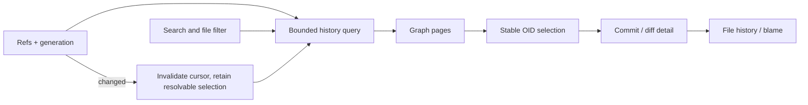

# 05 · History, comparison and inspection

Parent: [PRD index](../PRD.md). Owns commit graph, search, commit/file inspection and blame; branch mutations are owned by [06](PRD_06_references.md).

## Outcome tree

```text
Outcome: explain how repository content reached its current state
├── Navigate — paged commit DAG and decorations
├── Find — author, message, OID, date, refs and paths
├── Compare — selected commits, parent and merge choices
└── Trace — file history, rename follow and blame
```



## Required behavior

The graph displays commit lanes, parent edges, local/remote branches, tags, HEAD and merge commits alongside subject, author and date. Use topological ordering with a deterministic tie rule; dates do not define ancestry. Tooltips expose full OID, author/committer distinction, exact time/offset, parents and signature status when requested. Lane colors aid tracking but carry no independent meaning. A worktree changes summary may sit above the graph but must not masquerade as a commit.

Load pages incrementally and virtualize rows. A continuation cursor binds the query/ref generation and anchor; ref rewrites invalidate it. A parent outside a loaded/filtered page is an explicit continuation edge, never a missing commit. Shallow boundaries and replacement/graft effects carry explanatory markers; do not pretend a shallow root is the original repository root. Refs changing preserve selected OID if still resolvable, otherwise show that it became unavailable. Search highlights must not change the revision arguments executed.

Search supports message, author/committer, OID prefix, date range, ref and literal path filters with explicit AND/OR semantics: different filter categories combine with AND; multiple values within a category use OR. Message matching defaults to literal case-insensitive substring; regex is an opt-in with error/timeout handling. OID prefixes must resolve uniquely; ambiguity prompts selection. Dates use explicit local timezone boundaries and display the resolved range. Path filtering changes graph reachability shown, so label the filtered view and keep reset visible.

Select one commit to inspect metadata/files and compare against its first parent by default. A root compares to the empty tree. For a merge, list parents and make the chosen parent explicit; offer per-parent and combined review without suggesting the combined view is the merge's complete patch. Select two commits for directed A → B tree diff; swap reverses direction. Open working-tree comparison as a separately named mode. Never run a merge merely to preview differences.

File history optionally follows detected renames; label it heuristic and single-path scoped. Blame is requested on demand for committed text at a selected OID, with navigation to commit/previous revision; binary/large/undecodable files explain unavailability. Worktree edits are visibly separate. Submodule entries navigate to the child repository only if initialized and trusted.

Signature display distinguishes not checked, unsigned, good cryptographic signature with known/unknown trust, bad signature and verifier unavailable. A green badge must not equate an unknown identity with a trusted author. Verification is explicit/on-demand and bounded, never a silent network lookup.

## Loaded-history quick filter

The local [0.0.6 slice](../plan/plan-0.0.6.md) filters only the commits already loaded by the current HEAD history view, using subject text or full-OID prefix. Show `Loaded history only`, the current reachability scope and actual loaded count, including the configured maximum. The compact list title must show the full maximum rather than a clipped value; the filter panel explains that the latest loaded HEAD history is searched, without implying an all-history search. No match means no match in that loaded set, not absence from the repository. This is an incremental subset of HIST-02; author/date/path/ref filters, graph pagination and all-history search retain their broader requirements above and are not delivered by this slice.

Filter edits do not load more commits, run revision queries or fetch objects. Full OIDs bind details; changing query/ref generation invalidates obsolete details. Returning from commit files/diff restores the active query, selected full OID and viewport where still valid. A moved HEAD refreshes and labels the actual new scope rather than mixing old and new histories. General text-input, clear and selection behavior is owned by [10](PRD_10_desktop_ux.md#quick-filter-interaction).

## Local historical return path

For the current loaded-history slice, commit details → committed files → committed file Diff has a named Back action and equivalent Escape path. Back takes precedence over clearing an applied query. Retain the selected full OID, query, each level's cursor/viewport and the raw committed-file path across repository departure and an acknowledged graceful restart checkpoint. Store at most two small return frames under 13; do not retain full historical Diff views in background tabs.

Back and reopened detail issue fresh generation-bound reads. Loading is distinct from Ready; obsolete replies cannot replace the current target. Resolve raw file selection against the fresh list and clamp positions. Missing/hidden commits or files leave a truthful inspection/reload route and explanation rather than an old actionable view. Older checkpoint bodies without prior positions derive a minimal return route; they cannot promise positions never saved. This contract does not deliver graph paging, arbitrary navigation stacks, blame or all-history search. Scoped implementation evidence belongs to the active version plan.

## Delivery contracts

| ID / leaf | Invariant | Observable evidence | Safe failure | Dependencies | Non-goal |
|---|---|---|---|---|---|
| HIST-01 · graph | Every displayed ancestry edge follows actual parents | QA-J06 merge/octopus/shallow/rewritten refs and page boundaries | Invalidate query; show continuation and shallow labels | 02, 13 | Load entire graph eagerly |
| HIST-02 · find | Filters are explicit, bounded and injection-safe | QA-J06/J11 ambiguous OID and literal path fixtures | Query error preserves prior results with stale label | 02 | Hosted code search |
| HIST-03 · compare | A/B direction and merge parent are always visible | QA-J06 compare known trees and root/merge cases | Missing object permits fetch guidance, no fabricated diff | 04, 07 | Modify repository to preview |
| HIST-04 · trace | Blame/rename/signature evidence states its limits | QA-J06 rename heuristic and signature status fixtures | Unavailable or unverified badge | 11 | Certify author identity automatically |
