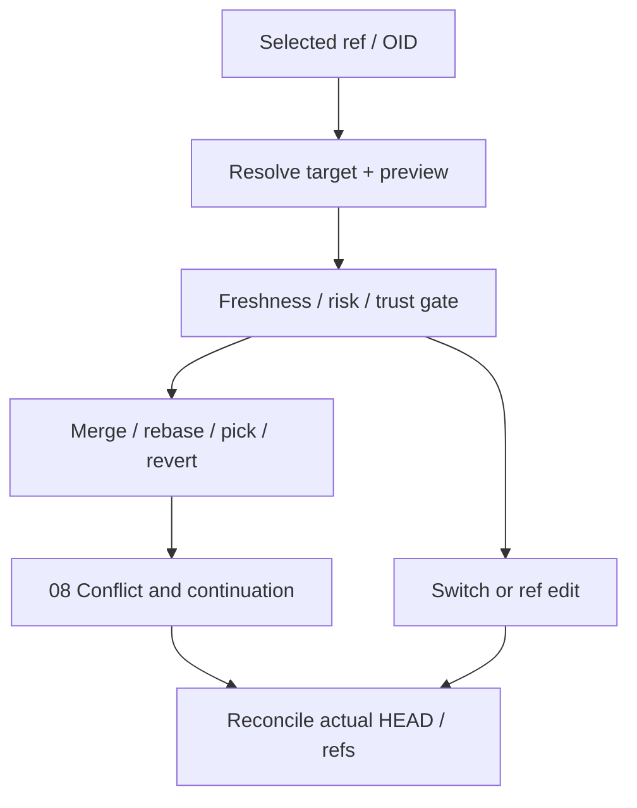

# 06 · Branches, tags and integration

Parent: [PRD index](../PRD.md). Owns refs and integration intent; [08](PRD_08_recovery.md) owns interrupted operation state and risk/recovery mechanics.

## Outcome tree

```text
Outcome: move work between explicit references without losing changes
├── References — create, rename, track and delete branches/tags
├── Switch — current branch, remote tracking and detached checkout
├── Integrate — merge, rebase and interactive plan
└── Apply history — cherry-pick, revert and selected reset mode
```



## References and switching

Create branch from selected OID/ref, with optional switch and upstream explicitly shown. Validate using Git's ref rules; present namespace collisions and names differing only by case on the current filesystem. Rename updates the intended local branch and related configuration through Git; it does not rename a remote branch. Delete defaults to merged-safe deletion; force delete is separately confirmed with last OID and known reachability. A checked-out branch in any linked worktree cannot be deleted/force-reassigned by this flow.

Switch previews source/target and dirty state. If Git permits carrying changes safely, explain that they remain in the destination; if blocked, offer commit, explicit stash or cancel. Never auto-stash, discard or force switch. Switching a remote-tracking branch proposes a new local tracking branch; checkout an OID/tag makes detached HEAD explicit and offers Create branch. Concurrent state change invalidates the preview. Restore last tab/view per branch only as UI metadata, never as file state.

Tags support lightweight and annotated creation; annotation/signing are explicit. Tag details include target, tagger and signature verification status. Replacing/deleting tags is a risk action, and local deletion does not silently delete remote tags. Publish tags selects named tags; never implicit `--tags`.

## Integration and history actions

Merge shows current branch, source ref/OID and fast-forward possibility. User chooses fast-forward-only, normal merge, or explicit no-fast-forward; normal does not silently squash. Squash merge is a separate action with explanation that it prepares index/worktree without recording a merge parent; committing remains explicit. Dirty-state and active-operation preflight apply. Conflicts enter the dedicated continuation state.

Rebase shows source commits and new base; default auto-stash is off. Detect a remote-tracking reachability risk and require rewrite confirmation. M3 interactive rebase supports reorder, reword, squash, fixup and drop; list affected OIDs and resulting order before start. Preserve message edits across conflict/restart. Merge-containing ranges are blocked unless explicit topology-preserving behavior is implemented and qualified; do not silently flatten them. Arbitrary shell `exec` in a plan is excluded.

Cherry-pick and revert accept an ordered selected sequence; preview direction and order, avoid accidental duplicate selection. Merge commits require explicit mainline parent. Stop at conflicts and retain the remaining sequence. Revert produces new history, not erasure. Reset exposes soft (move HEAD), mixed (HEAD + index), hard (HEAD + index + worktree tracked content) with distinct impact previews; [08](PRD_08_recovery.md) owns safeguards and undo limits. Reset does not imply deletion of all untracked files.

## Delivery contracts

| ID / leaf | Invariant | Observable evidence | Safe failure | Dependencies | Non-goal |
|---|---|---|---|---|---|
| REF-01 · refs | Local and remote ref changes are separate intents | QA-J02/J07 branch/tag and worktree occupancy fixtures | Reject collision/occupied refs without force fallback | 02, 09 | Rename server refs magically |
| REF-02 · switch | Dirty content is never implicitly stashed/discarded | QA-J01/J03 safe carry and blocked switch | Keep original state; explicit choices | 04, 08 | Force switch default |
| REF-03 · integrate | Source, destination, mode and rewrite range are confirmed | QA-J03 merge/rebase sequence and restart | Continue via actual Git operation state | 07, 08 | Automatic topology rewriting |
| REF-04 · history actions | Pick/revert/reset state exact impact and parent choice | QA-J03/J04 multi-commit and reset mode fixtures | Stop on conflict/stale target | 05, 08 | Arbitrary rebase commands |

## Acceptance details

Canceling any preview leaves refs/index/worktree unchanged. A branch already checked out elsewhere shows the owning worktree. A merge conflict can be resolved and continued after app restart. Dropped interactive-rebase commits are visible before execution and represented in the recovery record. Ref labels displayed during execution cannot silently retarget an operation if the ref moves; bind resolved OIDs and use expected-old-value checks where Git supports them.
