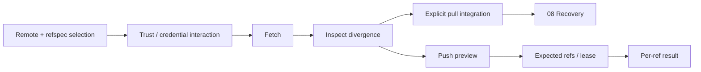

# 07 · Remotes and collaboration

Parent: [PRD index](../PRD.md). Owns remote configuration and network Git workflows. [11](PRD_11_security.md) owns secret storage, trust and executable-content policy.

## Outcome tree

```text
Outcome: exchange exactly the intended refs with an explicit remote
├── Configure — remote names, fetch/push URLs and refspecs
├── Fetch — remote observations with freshness and prune preview
├── Integrate — explicit pull merge/rebase/fast-forward choice
└── Publish — branch/tag selection, upstream and lease-aware rewrite
```



## Remote model

Support multiple named remotes, distinct fetch/push URLs and visible refspecs. Ordinary forms cover HTTPS, SSH including scp-like syntax, and deliberate local-path remotes. Git/ext helpers and unknown transports are quarantined by [11](PRD_11_security.md). URL labels redact credentials. Edit, rename or remove remote configuration previews the local configuration change and never removes a server repository. Custom refspecs are an advanced explicit form, not silently replaced by a friendly branch selector.

Clone uses this network/authentication model; destination handling belongs to [03](PRD_03_workspace.md). Show selected Git executable and transport diagnostics without exposing secrets. Reuse the user's configured credential helper/SSH agent only after trust. Askpass is a private per-job interaction with masked entry, cancel and exact endpoint identity. SSH host-key or HTTPS certificate failure is an actionable error; do not auto-accept host keys or disable TLS verification. Supporting an external SSH trust flow must keep that decision visible and user initiated.

Fetch defaults to the selected remote; Fetch all is a separate action. Show transfer progress when available, indeterminate otherwise, and cancellation. Prune defaults off; when enabled show local remote-tracking refs eligible for deletion, then reconcile actual deletions. Background auto-fetch defaults off, can be enabled per repository with interval and metered/offline suspension, and never opens surprise credential prompts; mark authentication required for the next foreground action. Ahead/behind counts are relative to fetched tracking refs, with timestamp.

Pull is a named two-phase flow: fetch, inspect divergence, then fast-forward-only (default), merge or rebase selected explicitly. Do not inherit a hidden integration choice from ambient `pull.*` settings without showing the effective mode. Dirty changes, unborn branch and missing upstream are handled before integration. If fetch succeeds and integration fails, report both outcomes; do not describe it as all-or-nothing.

Push preview shows destination URL label, local source OID/ref, remote destination ref, creation/deletion, upstream intent and expected non-fast-forward behavior. Default is current branch, not every ref. Missing upstream offers an explicit mapping. Multi-ref push displays each result and partial success; atomic push is optional only when supported. Remote branch deletion is a separate risk action.

Ordinary force push is excluded. A deliberate rewrite uses `--force-with-lease` with an explicit expected destination OID recorded at the reviewed fetch; background fetch cannot silently update that expectation. On lease mismatch, fetch/review/reconfirm; never retry with bare force. Lease protects against that ref moving, not branch policy or all server-side effects. Server protections/hooks/permissions surface as remote rejection. Cancellation or lost connection may leave remote completion unknown: mark Unknown, query the destination and reconcile before retry. A timed-out push is never automatically replayed.

## Delivery contracts

| ID / leaf | Invariant | Observable evidence | Safe failure | Dependencies | Non-goal |
|---|---|---|---|---|---|
| REMOTE-01 · auth | Auth prompts bind current job and endpoint without leaking secrets | QA-J02/J10 helper/agent/askpass and cancellation | Auth required/cancelled; no credential fallback | 02, 11 | Built-in hosting accounts |
| REMOTE-02 · fetch/pull | Observation and integration outcomes remain distinct | QA-J02/J03 diverged refs and failed merge after fetch | Preserve fetched facts; offer explicit continuation | 06, 08 | Silent pull strategy |
| REMOTE-03 · push | Only confirmed destination refs are attempted | QA-J02 per-ref partial success and policy rejection | Report per-ref actual/unknown outcome | 08, 13 | Push every ref by default |
| REMOTE-04 · rewrite | Explicit lease uses the reviewed expected OID | QA-J02/J05 two-client stale lease race | Reject and require new review | 06, 11 | Bare force push |

## Acceptance details

Use two independent clones and a local bare remote for deterministic collaboration tests; controlled HTTPS/SSH fixtures cover transport/auth separately. Exercise successful push, competing update, server rejection, lost response after server acceptance, remote deletion and fetch prune. Diagnostics must distinguish DNS/connectivity, authentication, host trust, ref conflict and server policy without printing the credential-bearing input.
