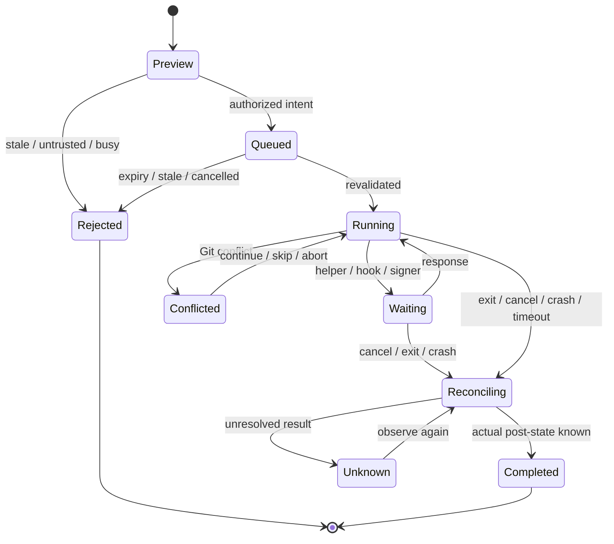

# 08 · Conflicts, operation safety and recovery

Parent: [PRD index](../PRD.md). Owns the mutation gate, interrupted operation state, destructive action policy and undo limits. This is the common prerequisite for all writers.

## Outcome tree

```text
Outcome: every risky transition is deliberate and every interruption is understandable
├── Gate — identity, freshness, trust, locks and explicit intent
├── Operate — one owned writer, progress and truthful cancellation
├── Resolve — actual Git sequencer state and conflict entries
└── Recover — bounded snapshots, refs, reflog and explicit limitations
```



## Mutation gate and risks

An operation plan contains backend/worktree/common-dir identities, action, literal paths/resolved OIDs, observed HEAD/index/content fingerprints, trust generation, risk class, expected effects and recovery limits. Internal GUI plans follow the same expiry/consumption rules as control plans in [13](PRD_13_state_control.md), starting in M1; the control transport itself arrives later. Preflight occurs before preview and immediately before execution. A changed target, trust decision or observed material state invalidates confirmation. A queued job never treats an old confirmation as permission for a different effect.

Freshness checks detect observed changes and Git supplies its native locks/conditional updates; neither creates a global transaction against other tools. Use exact patch baselines and expected-old ref values where supported. Where a native command cannot compare-and-swap all preconditions, disclose and reconcile the race as specified for commits in [04](PRD_04_changes_commits.md); never claim every possible external write is prevented. File mutation guards use content identity and entry/link identity, not timestamps alone. A race detected after a side effect leads to reconciliation rather than automatic destructive rollback.

| Risk class | Examples | Interaction |
|---|---|---|
| Read | graph, raw diff, status | No risk dialog; security policy still applies |
| Reversible local intent | stage/unstage, create branch, normal commit | Direct named action and visible result; preflight required |
| Destructive/rewrite | discard, hard/mixed reset, amend, rebase/drop, force-delete, replace tag | Preview exact scope and recovery limits; explicit confirm bound to current state |
| Remote publication/deletion | push, lease rewrite, delete remote ref | Destination/ref preview; lease rewrite and delete require a distinct confirmation |
| Irrecoverable deletion | remove untracked content, delete worktree files, delete local safety copy | Typed target confirmation and explicit no-guaranteed-recovery warning |

Pointer and keyboard confirmations share the same prepared plan: use a named consequence-bearing confirm button for pointer input and the established explicit keyboard confirmation, with Cancel initially focused. Ordinary stage/unstage/create-branch/commit uses direct named actions and visible target/result, not a generic confirmation modal. Irrecoverable typed-target requirements remain unchanged.

No permanent “never warn again” switch for destructive classes. Keyboard Enter cannot confirm while a modal is still receiving its opening keypress; destructive default focus is Cancel. Snapshot/backup creation happens only after a valid confirmation and before its associated destructive write; it is not a side effect of browsing a preview. The user sees whether a durable safety copy exists before proceeding. Each destructive or irrecoverable row in the risk table shows one recovery label as part of its preview, before confirmation: restorable from a recovery ref or safety copy, restorable with the limits stated, or not restorable. The label is not a help link.

## Conflict center

Detect merge, rebase, cherry-pick, revert, commit-series `am` and sequencer progress from Git-reported state and metadata, including operations started outside the app. Show operation type, original/current HEAD, current item and remaining sequence when available. Externally created/broken metadata yields Inspect/Refresh guidance; no inferred abort based on one filename.

List unmerged paths and index stages. Provide base/current/incoming and result panes for text, with exact stage labels; during rebase explain the stage roles instead of relabeling them as the user's branch ambiguously. Handle add/add, delete/modify, rename/rename, directory/file, binary, symlink and submodule conflicts explicitly. Whole-side choice previews the resulting path/content/deletion and stages only after the user marks resolved. External merge tool launch is separately trusted and path-safe. A zero tool exit code does not prove resolution; inspect unmerged entries afterward.

The text result editor is limited to resolving a conflict, supports search and IME, and saves exact user-approved encoding/newlines. Check marker-like lines as a warning rather than assuming every marker is a conflict. Mark resolved requires an actual chosen result or explicit deletion. Continue is enabled only when the required Git state permits it. Skip previews the commit being omitted. Abort invokes the matching Git operation; abort failure or leftover edits remains visible, never called a successful rollback.

## Cancellation, crash and locks

Cancel means request interruption of the owned process tree, allow bounded graceful exit, then terminate only owned descendants under the platform policy. Do not kill arbitrary processes named Git. After cancellation, re-read repository and remote state. Hooks can have external side effects and Git can leave a resumable operation; cancellation is not undo. Local read default timeout is thirty seconds with explicit extension; mutation/network jobs prompt after 120 seconds of no observable progress, without silently terminating a possibly successful write. Bounded pipe sizes are owned by [14](PRD_14_verification_roadmap.md).

On startup, journal jobs left running become Needs reconciliation, never success/failed by assumption. A second app instance observes shared common-dir writer ownership. Git `index.lock`/ref locks are reported as Busy with path-safe diagnostics. No automatic lock removal; manual removal is outside the baseline UI.

## Recovery and destructive content

Before destructive tracked-content actions, offer a durable safety copy of affected worktree bytes and index intent, including deletions/modes where supported. Recovery storage is outside the repository and must pass free-space/permission/write/read-back checks. If the action depends on a safety copy and storage fails, block it; a separate clearly labeled proceed-without-copy path requires the irreversible confirmation class. Untracked cleanup is previewed file by file and defaults to OS trash where reliably supported, with explicit capability error otherwise; permanent deletion is never a fallback selected silently. Submodules, nested repositories and links are never recursively cleaned by a generic action.

Before ref rewrites, retain an application recovery ref to the old OID and record the operation. Reflog/recovery refs can restore reachable commits, not never-committed bytes or external hook effects. Restore previews current versus recovered state and uses the same gate; do not overwrite new work because an old job has an Undo button. Delete safety records only through storage management under [13](PRD_13_state_control.md). No unlimited durable backup guarantee.

Reserve `refs/srcmgr/recovery/<opaque-operation-id>` for application recovery refs. They remain ordinary local refs: exclude them from default product history/query/push selections and clearly identify them in recovery management. Never issue a broad mirror/all-ref push that publishes them. They can retain otherwise unreachable source objects until explicitly removed; show that storage/privacy consequence. Creation failure blocks the dependent ref rewrite, and restore/delete uses expected old OIDs rather than acting on a display label. Git tools outside this product can still enumerate or publish such refs.

Selected stash removal may use the bounded Git-generated publication mechanism in [02](PRD_02_architecture_reuse.md). Retain the original ref/reflog in a private profile transaction before publishing. The ref and reflog replacements are not a single filesystem transaction: an interruption can leave partial publication and stale Git locks. Report the uncertainty, retain the original metadata and recovery ref, refresh what can be read, and require inspection before manual repair; never replay the apply portion of Pop or silently remove a lock. A failed preview/authorization also refreshes trusted state where possible so a moved list is not presented as current.

## Delivery contracts

| ID / leaf | Invariant | Observable evidence | Safe failure | Dependencies | Non-goal |
|---|---|---|---|---|---|
| REC-01 · gate | Authorizations bind fresh target/effects | QA-J05 stale diff/ref/identity and queue race | Reject without widening intent | 02, 11, 13 | Global transaction across Git |
| REC-02 · resolve | Continue/skip/abort follow actual Git state | QA-J03 all conflict types and external sequencers | Preserve state; show actionable error | 04, 06 | Automatic semantic resolution |
| REC-03 · interruption | Cancel/crash reports observed result truthfully | QA-J04/J10 crash at each state; helper lifecycle | Needs reconciliation / Unknown | 02, 07, 13 | Cancel guarantees rollback |
| REC-04 · recover | Recovery promises match stored content/refs | QA-J04 destructive preview, full disk and undo-after-new-edit | Block unsafe overwrite; expose limits | 11, 13 | Full backup of every file |

References: Git defines [index stages](https://git-scm.com/docs/git-update-index); the product's risk, recovery and UX requirements above are design decisions, not claims that Git implements a transactional GUI undo layer.

## Release 0.0.4 status

The window now discards the unstaged changes of one file or one hunk, each behind a question that names the file or hunk and keeps the state on `n` or Escape. A discard of a tracked file restores it from the index and removes only its unstaged part; an untracked file is removed only when the question is answered `y`. Line discard is not in 0.0.4. The exact scope and limits are in [10](PRD_10_desktop_ux.md#release-004-shell-target-discard-stash-and-detached-checkout) and the verification record in [14](PRD_14_verification_roadmap.md#release-004-plan-discard-stash-detached-checkout).
