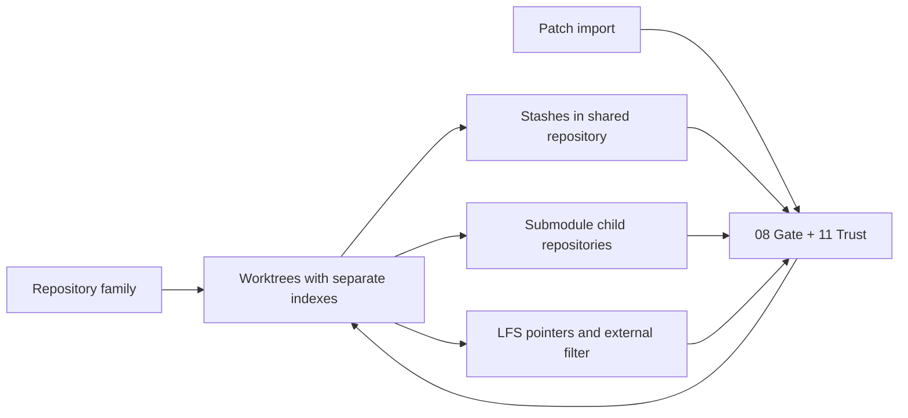

# 09 · Stash, worktrees, submodules, LFS and patches

Parent: [PRD index](../PRD.md). Owns advanced Git workflows and the explicit boundaries of partial support.

## Outcome tree

```text
Outcome: manage parallel and composite work without flattening Git semantics
├── Stash — deliberate save, inspect, apply and drop
├── Worktrees — independent HEAD/index, shared repository coordination
├── Composite content — submodules and LFS capabilities
└── Patches — bounded export and trusted import
```



## Stash

Stash creation previews tracked edits, staged content and optional untracked files. Ignored content is a separate explicit option; no broad include-all default. The user chooses whether to keep staged content and whether restored staging is desired on apply. Inspect shows exact stash OID, base and content; labels such as `stash@{n}` are display positions, never durable identity.

Apply is preferred to Pop because it preserves the source. Pop is a distinct action: remove the exact stash only after confirmed successful apply, and keep it on conflict/uncertain result. Drop/clear previews exact OIDs and recovery limitations; there is no automatic dropping during cleanup. Shared worktree stash lists refresh after external changes.

## Worktrees

List every Git-reported worktree with path, HEAD/branch, locked/prunable/missing status and app tab. Add creates a worktree with a selected existing/new branch or explicit detached OID. Destination checks match repository creation safety. A branch occupied elsewhere offers navigation instead of force checkout. Common-dir mutation serialization is owned by [02](PRD_02_architecture_reuse.md).

M2 includes list/open/add. M3 adds lock/unlock, move, remove and prune metadata. Removal previews dirty/untracked content and requires [08](PRD_08_recovery.md) safeguards; removing a worktree is not removing a sidebar bookmark. Locked worktrees explain the lock reason before unlocking. Prune removes stale metadata only with preview, never treats an offline removable drive as disposable. Move preserves identity only after Git reports success; aliases/bookmarks update afterward. Worktree-specific config is distinct from common configuration. Git's [worktree documentation](https://git-scm.com/docs/git-worktree) is the reference for shared versus per-worktree semantics.

## Submodules

Show gitlink OID, checked-out child OID, initialized state, dirty content and URL changes. Opening a child uses separate identity/trust; a parent commit stages only the gitlink, not child file contents. Add/init/update/deinit are explicit M3 actions. Recursive update defaults off; show every resolved URL and transport, including relative URL resolution, before network/execution trust. Do not change protocol policy globally to make a local test remote work. Deinit/remove previews affected child files/config/gitlink; nested uncommitted work blocks automatic deletion. A missing child object is distinct from a parent conflict.

## LFS

Detect LFS attributes/pointers and probe `git lfs` availability. Missing LFS displays the pointer and setup guidance; never commit a materialized file under the false assumption that the filter ran. Download/smudge and tracking/untracking configuration are explicit trusted operations with network/attribute effects shown. Lock support is optional later scope; M3 displays Unsupported rather than fake lock status. No managed LFS installation or account storage.

## Patch exchange

Export raw selected tree diffs or selected commits via distinct Patch versus Commit series modes. Exporting does not execute external diff drivers. Import previews paths, base assumptions and whitespace policy; validate traversal, absolute paths, links and repository boundaries. Apply to worktree or index is explicit; commit-series import uses the actual `am` operation/recovery mode and is M3. Unsupported binary or format input fails before mutation when possible; partial Git apply failure is reconciled and shown. No automatic three-way fallback without an explicit user selection.

## Delivery contracts

| ID / leaf | Invariant | Observable evidence | Safe failure | Dependencies | Non-goal |
|---|---|---|---|---|---|
| ADV-01 · stash | Position changes cannot retarget apply/drop | QA-J07 stash reorder, untracked and conflicted pop | Keep source stash; report actual effects | 04, 08 | Auto-stash on switch |
| ADV-02 · worktrees | Independent worktree state shares coordinated writer ownership | QA-J07 multiple worktrees and removed mount | Busy/occupied/missing with no deletion | 02, 03, 08 | Copy folders instead of Git worktrees |
| ADV-03 · composite | Parent/child and pointer/materialized content stay distinct | QA-J07/J10 submodule URL and missing LFS | Quarantine or show capability unavailable | 07, 11 | Transparent recursive trust |
| ADV-04 · patches | Import paths and actual post-state remain bounded to intended repo | QA-J11 malformed/traversal/partial patch corpus | No outside write; preserve recoverable partial state | 02, 08, 11 | Arbitrary archive import |
