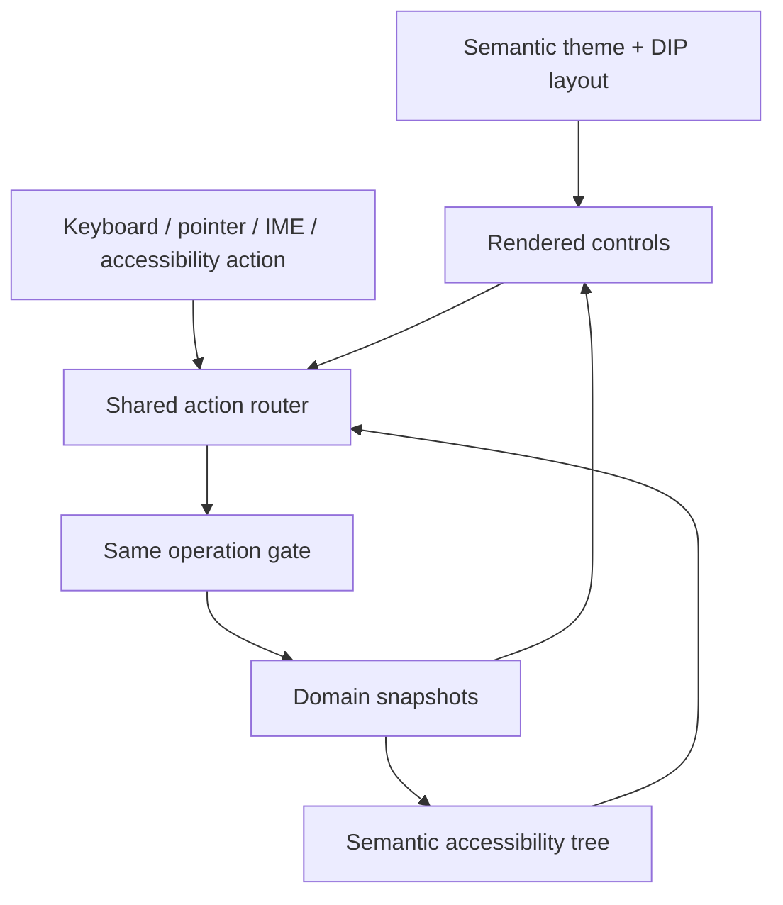

# 10 · Desktop interaction and MiniCon design

Parent: [PRD index](../PRD.md). Owns visual language, layout, interaction, localization and accessibility. Reuse source status is owned by [02](PRD_02_architecture_reuse.md).

Implementation status: a read-only status window (`minicon-srcmgr gui`) renders the trust-gated snapshot through MiniCon's native pixel host, platform font and ui-core blend kernels on Windows. It has no input handling, layout, accessibility, IME, localization or resource budget evidence yet; those remain open under this owner.

## Outcome tree

```text
Outcome: see repository context and act accurately with any supported input
├── Shell — compact panes, collapsible navigation and persistent status
├── Components — graph, file list, diff, forms and operation center
├── Simplicity — contextual actions, progressive detail and direct task paths
├── Design — semantic themes, DPI and readable type
└── Access — keyboard, IME, screen readers and three UI languages
```



## Information architecture

```text
┌ repository tabs / Open / Clone / command palette ────────────────────┐
│ repository + branch + operation context · Fetch / Pull / Push         │
├ navigation ───────┬ primary content ────────────┬ optional inspector ┤
│ favorites/repos  │ Changes: files + diff       │ commit metadata    │
│ branches/tags    │ History: graph + detail     │ selected operation │
│ remotes/stashes  │ Conflict: sides + result    │ contextual help    │
│ worktrees        │                            │                    │
├──────────────────┴────────────────────────────┴────────────────────┤
│ branch / counts / fetch freshness / job progress / diagnostics       │
└────────────────────────────────────────────────────────────────────┘
```

At 1280×800 DIP, navigation defaults to 224 DIP, adjustable 180–420 and collapsible to a 44 DIP rail. Main views divide file/graph lists from content with draggable splitters and explicit minimums. Optional inspector defaults to 280 DIP, adjustable 220–420. Toolbar rows are 36 DIP, dense list rows 28 DIP, status 24 DIP; pointer targets at least 24×24 DIP. These are SrcMgr defaults derived from MiniCon's compact shell, not imported private constants.

At 960×640 DIP, collapse the inspector first and stack detail below lists as needed; preserve active repository, action labels and selected content. Below this design size, use scrollable/stacked content and a resize hint, never inaccessible confirmation controls. Pane sizes are clamped after monitor/DPI changes and stored per view. Long branch/path labels truncate visually with accessible full text and copy action. No screen requires horizontal scrolling to reach its primary action.

Changes, History and Conflicts are primary views. Repository switching does not reset an unfinished message or operation context. Operations center lists running/completed/reconciling jobs; status opens its relevant item. All views define loading, empty, stale, busy, error, unsupported and permission/auth-needed states, with a concrete next action and retry. Toasts report completion but cannot be the sole place an error or recovery action exists.

## Simple, practical and intuitive workflows

The functional reference and milestone mapping are owned by [01](PRD_01_product.md). Translate its efficient panel navigation into a GUI with discoverable labeled actions, readable content previews and equivalent keyboard paths. Keep one clear primary action per task surface; put uncommon flags and history rewrites in contextual menus or an expandable Advanced section. Avoid duplicate dashboards, permanent expert controls, decorative metrics and modal chains for routine inspection. Safety confirmations remain explicit under 08.

Selecting a file immediately presents its diff and applicable actions. Routine Stage/Unstage takes one deliberate action from the selected content; Commit uses the visible composition panel; switching a clean branch uses one named action after target selection. The user does not need to memorize TUI keys or type raw Git commands. Keyboard help shows actions for the focused pane; Escape returns to the prior pane with selection/scroll intact. Disabled actions have a short reason and next step. No context menu with the entire Git command catalog.

Usability acceptance adds a task-path audit: from an already selected applicable item, inspect diff and stage/unstage each require at most one action; open the commit composer or branch switch action requires at most one action, excluding target selection, text entry and required safety confirmation. QA-J09 records pointer/keyboard action counts separately and compares task completion against the pinned lazygit reference checklist from 01. These are SrcMgr flow targets, not claims about lazygit speed. An advanced feature must justify its visible space by a concrete task; defer it or hide its detail when it does not help the current task.

Performance affects interaction design: virtualize long lists/diffs, reuse bounded glyph/layout caches, redraw only damage and suspend animation/redraw while idle or occluded. Do not preload every tab's history or instantiate hidden heavy panels. Backend-specific controls follow [15](PRD_15_vcs_backends.md); future extensibility must not clutter the Git-first screen. Measurable resource/latency budgets remain solely in 14.

## Visual system

Keep MiniCon theme IDs `neutral`, `docs`, `paper`, `dark` and semantic roles: canvas, sidebar, surface, panel, border, text, muted, accent, error. Neutral is the default. Add SrcMgr roles for added/deleted/modified/conflicted files, diff additions/deletions and graph lanes. Palette values must be verified against a published upstream revision when implemented; copying local uncommitted theme values is not a stable contract.

Use restrained flat surfaces, thin separators, visible focus rings and compact labeled controls. Red/green additions also have `+`/`−`, line markers and accessible text; graph selection has outline/weight, not color alone. Aim for 4.5:1 ordinary text contrast, 3:1 large text and meaningful control boundaries in every theme; verify actual rendered pixels. Support system high-contrast preferences without removing state indicators. Motion is minimal and honors reduced motion.

UI text uses the platform UI font with CJK fallback; diff/commit IDs use a configurable monospace stack. Default UI size 13 DIP, code 13 DIP; independent text zoom 80–200%. Layout and hit testing use the same DIP-to-pixel transforms and rounding. Test 100/125/150/200% and monitor transitions. Retained frames/damage redraw are mechanisms, not permission to omit repaint after occlusion, resizing or theme change.

## Input, language and accessibility

Support pointer, context menus and keyboard equivalently. Tab/Shift+Tab follows visible logical order; Escape closes the nearest dismissible surface and restores focus. The command palette exposes discoverable named actions with disabled reasons. Initial bindings: Ctrl+O Open, Ctrl+Shift+O Clone, Ctrl+P palette, Ctrl+1 Changes, Ctrl+2 History, Ctrl+Enter commit when commit input is focused, F5 refresh. macOS uses Command for primary shortcuts. No destructive one-key shortcut. Native text editing bindings take precedence while editing. Rebinding checks collisions and persists a profile.

IME composition cannot trigger Commit, palette actions or shortcuts until committed/cancelled; candidate windows follow the active caret. Text fields support selection, clipboard, undo/redo and multiline input. Diff navigation and selection use codepoint/grapheme-aware display without changing byte identity. Keyboard users can select hunks/lines and inspect their exact target before staging.

English and Simplified Chinese are required by M2; Traditional Chinese by M3. Locale defaults to system with explicit override, changes without data loss, and uses stable internal IDs. No string concatenation for translated grammar; operation labels/path tokens remain distinguishable. Dates/numbers localize while full OIDs and literal paths remain unchanged. Test long translations and CJK filenames; UI language does not change Git parsing.

Pixel rendering must expose native accessibility via UI Automation, macOS accessibility and Linux AT-SPI, directly or through a proven bridge. Required semantics: names/roles/states, focus/action routing, selected graph row, list virtual item navigation, editable text/caret/ranges, diff line descriptions and live progress announcements without flooding. Screen readers must complete the daily journey and conflict continuation. [02](PRD_02_architecture_reuse.md) gates feasibility; screenshots alone are insufficient evidence.

## Release 0.0.2 shell target (lazygit-level minimum)

Scope: the first native window that can carry the daily local loop without the CLI. The benchmark is lazygit's core panel workflow, not its full command set (see [01](PRD_01_product.md#functional-benchmark-and-simplicity)). Each binding was checked against the pinned lazygit reference page (`docs/keybindings`, snapshot `4e1eebe`); the matches and deliberate differences are recorded in [14](PRD_14_verification_roadmap.md#release-002-plan-lazygit-level-minimum).

- **Layout.** A left column holds three panels stacked as Files (status), Branches and Commits. The main panel on the right shows the diff of the selected file, the selected commit's detail, or the commit composer. The header shows the repository and HEAD; a two-line footer shows a notice (such as a refused switch) and the keys of the focused panel. Each list panel shows its name and count, and keeps the selection in view.
- **Focus and navigation.** `1`, `2`, `3` focus Files, Branches and Commits. Tab and Shift+Tab cycle through the three lists and the main panel. Up/Down or `k`/`j` move the selection in a list and scroll the main panel when it has focus. Enter moves into the main panel; Escape returns to the list that feeds it, with its selection intact. `?` shows the key list; Escape closes it. `q` or Ctrl+C quits.
- **Files.** Space stages a file that has unstaged changes, and unstages a fully staged one. In the main panel, Space stages a hunk of the unstaged diff or unstages a hunk of the staged diff. `h` and `l` (or Left and Right) move between hunks. Every action passes the trust gate and the same index checks as the CLI, then refreshes from a fresh status read.
- **Branches.** Space checks out the selected branch; the current branch is refused with a notice. A refused switch (for example one that would overwrite a local edit) shows Git's reason in the footer. `n` opens a one-line name field; the name is checked by Git's rules before any change, the same as `branch create`.
- **Commits.** The list shows the history from `history`. Enter shows the commit's author, date, message and changed files in the main panel. Checking out a commit is not available yet and says so.
- **Commit composer.** `c` opens a multiline field pre-filled from the saved draft. Ctrl+Enter commits the staged content through the same path as the CLI and clears the draft only after Git accepts the commit; a refused commit keeps the text in the field. Escape saves the text as the draft and closes the field. Typing never runs a command by itself.
- **Scrolling.** PgUp and PgDn (or `K` and `J`) scroll the main panel a page at a time; Home and End jump to the ends. Only visible rows are drawn.
- **Pointer.** A left click on a list row focuses that list and selects the row, which shows its diff or detail the same as moving with `j`/`k`; a click on blank space in a list only focuses it. A left click in the main panel focuses it and selects the hunk under the pointer. The wheel over a list moves its selection, and over the main panel it scrolls the content. Clicks and wheel input are ignored while the commit composer, the branch name field or help is open, so they cannot move the panel under the text being typed. Clicking a branch selects it; checkout stays on Space, so a stray click never changes the working tree.
- **Responsiveness.** Every Git call runs on one worker thread, which wakes the window when it has an answer. The footer shows "working..." while jobs are pending, and the window keeps handling keys and resizing. A late answer for an earlier selection is dropped. This closes the risk recorded in 14 for the M1 branch switch, which ran on the UI thread.
- **Deliberate differences from lazygit.** `1`–`3` focus panels by number (superseded in 0.0.3, where the numbers follow lazygit's 1–4); `q` quits; `B` (the 0.0.1 next-branch key) is removed in favour of the Branches panel; `r` reloads. Commit from the editor (`C`), line-level staging, and screen modes are not part of 0.0.2.
- **Non-goals for 0.0.2.** Graph lanes, interactive rebase, cherry-pick, stash, worktrees, search and filter, remote operations, IME composition beyond committed text, screen-reader bridges, Linux and macOS shells, and any destructive one-key action.

Acceptance is recorded in the work order in [14](PRD_14_verification_roadmap.md#release-002-plan-lazygit-level-minimum). Input feedback and idle resource use are measured against the budgets in 14, not inferred from the layout.

## Release 0.0.3 shell target (closer to lazygit)

0.0.3 aligns the window with lazygit's panel numbers and core keys, and adds line-level staging, which 0.0.2 left out. The 0.0.2 list above keeps its record; where 0.0.3 changes a key, the new rule here wins.

- **Panels.** `1` Status, `2` Files, `3` Branches, `4` Commits, as in lazygit. Status is a one-row panel that shows the current branch and HEAD; it takes focus but has no action. Tab and Shift+Tab cycle Status, the three lists and the main panel. The top line shows only the window title, because the branch now lives in Status.
- **Main panel cursor.** In a diff, Up and Down (and `j`/`k`) move a cursor over the lines, not the scroll position; the view follows the cursor. The cursor starts on the first changed line. Clicking a line moves the cursor there.
- **Line staging.** Space stages or unstages the cursor line. `v` starts a range from the cursor and a second `v` ends it; Space then acts on every changed line in the range. A range never crosses into another hunk: lines outside the cursor's hunk are ignored. Space on a line that is not a change says so. Git's index is changed through the same trust gate and index checks as the CLI; the working tree is never written. The patch keeps the unselected removals as context and drops the unselected additions, so the rest of the hunk still applies.
- **Hunks.** `a` in the main panel stages or unstages the whole hunk under the cursor (lazygit's hunk key). `h` and `l` (or Left and Right) move to the previous or next hunk.
- **Files.** `a` stages every changed path, untracked files included, when any path has unstaged changes; otherwise it unstages everything. This is lazygit's toggle.
- **Branches.** `d` asks `Delete branch NAME? y deletes it   n keeps it` in the main panel. `y` runs `git branch -d`, which Git refuses for a branch that is not merged; `n` or Escape keeps it. The checked-out branch is refused before the question. Force delete is not offered.
- **Movement in lists.** `<` and Home go to the first row, `>` and End to the last. PgUp and PgDn (`K` and `J`) move a page, and Ctrl+U and Ctrl+D move half a page, in lists and in the main panel.
- **Mouse.** The 0.0.2 pointer rules still apply. A click on a line in the main panel moves the cursor there and selects its hunk.
- **Resize.** The window redraws at the new size when it is resized, including the end of an interactive resize. The main panel keeps the cursor on screen after a resize.
- **Deliberate differences from lazygit.** Checkout of a commit, commit files under the commit list, search and filter, discard, stash, rebase and the merge-from-branch actions are not part of 0.0.3. `B` stays removed, `r` reloads, and `q` quits. Changes that would discard work have no one-key shortcut; they need the confirmation the Branches panel uses.

## Delivery contracts

| ID / leaf | Invariant | Observable evidence | Safe failure | Dependencies | Non-goal |
|---|---|---|---|---|---|
| UX-01 · shell | Active context and primary action remain reachable | QA-J09 minimum window, long labels and splitters | Stack/collapse with preserved focus | 03, 13 | Exact copy of terminal layout |
| UX-02 · visual | Theme/DPI transformations preserve legibility and hit targets | QA-J09 rendered contrast and mixed-DPI interaction | Repaint/clamp with readable fallback | 02 | Decorative animation |
| UX-03 · input | IME/text input cannot accidentally execute operations | QA-J09 composition, held keys and keyboard journeys | Keep draft/focus; explicit action | 04, 08 | Mouse-only operations |
| UX-04 · access/language | Assistive actions share real application semantics | QA-J09 screen reader per OS plus localization checks | Gate milestone when required bridge is missing | 02, 13 | Accessibility inferred from pixels |
| UX-05 · simplicity | Common actions have direct discoverable paths and advanced detail stays contextual | QA-J09 task-path counts, keyboard/pointer audit and reference checklist | Simplify failed flow before milestone exit | 01, 04–09, 15 | Expose every option permanently |
