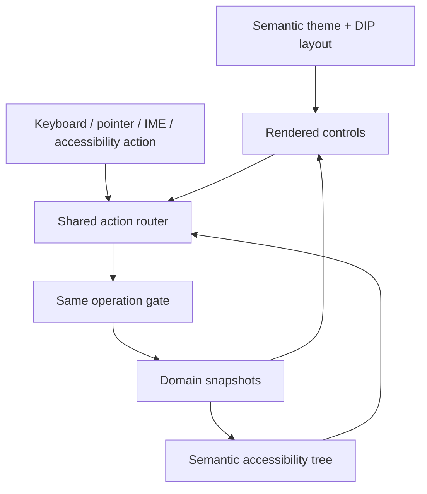

# 10 · Desktop interaction and MiniCon design

Parent: [PRD index](../PRD.md). Owns visual language, layout, interaction, localization and accessibility. Reuse source status is owned by [02](PRD_02_architecture_reuse.md).

Implementation status: the Windows local GUI uses MiniCon's native pixel host, font and ui-core mechanisms with numbered panels, keyboard/pointer input, resizing and local Git actions. Historical release sections below and the version plans linked from 14 identify their exact evidence. Full accessibility/IME/localization coverage and reference-environment resource/response qualification remain open; existing input or a scoped measurement does not prove those broader requirements complete.

## Outcome tree

```text
Outcome: see repository context and act accurately with any supported input
├── Shell — compact panes, collapsible navigation and persistent status
├── Components — graph, file list, diff, forms and operation center
├── Simplicity — contextual actions, progressive detail and direct task paths
├── Design — semantic themes, DPI and readable type
└── Access — keyboard, IME, screen readers and three UI languages
```



## Information architecture

```text
┌ repository tabs / Open / Clone / command palette ────────────────────┐
│ repository + branch + operation context · Fetch / Pull / Push         │
├ navigation ───────┬ primary content ────────────┬ optional inspector ┤
│ favorites/repos  │ Changes: files + diff       │ commit metadata    │
│ branches/tags    │ History: graph + detail     │ selected operation │
│ remotes/stashes  │ Conflict: sides + result    │ contextual help    │
│ worktrees        │                            │                    │
├──────────────────┴────────────────────────────┴────────────────────┤
│ branch / counts / fetch freshness / job progress / diagnostics       │
└────────────────────────────────────────────────────────────────────┘
```

At 1280×800 DIP, navigation defaults to 224 DIP, adjustable 180–420 and collapsible to a 44 DIP rail. Main views divide file/graph lists from content with draggable splitters and explicit minimums. Optional inspector defaults to 280 DIP, adjustable 220–420. Toolbar rows are 36 DIP, dense list rows 28 DIP, status 24 DIP; pointer targets at least 24×24 DIP. These are SrcMgr defaults derived from MiniCon's compact shell, not imported private constants.

At 960×640 DIP, collapse the inspector first and stack detail below lists as needed; preserve active repository, action labels and selected content. Below this design size, use scrollable/stacked content and a resize hint, never inaccessible confirmation controls. Pane sizes are clamped after monitor/DPI changes and stored per view. Long branch/path labels truncate visually with accessible full text and copy action. No screen requires horizontal scrolling to reach its primary action.

Changes, History and Conflicts are primary views. Repository switching does not reset an unfinished message or operation context. Operations center lists running/completed/reconciling jobs; status opens its relevant item. All views define loading, empty, stale, busy, error, unsupported and permission/auth-needed states, with a concrete next action and retry. Toasts report completion but cannot be the sole place an error or recovery action exists.

## Simple, practical and intuitive workflows

The functional reference and milestone mapping are owned by [01](PRD_01_product.md). Translate its efficient panel navigation into a GUI with discoverable labeled actions, readable content previews and equivalent keyboard paths. Keep one clear primary action per task surface; put uncommon flags and history rewrites in contextual menus or an expandable Advanced section. Avoid duplicate dashboards, permanent expert controls, decorative metrics and modal chains for routine inspection. Safety confirmations remain explicit under 08.

Selecting a file immediately presents its diff and applicable actions. Routine Stage/Unstage takes one deliberate action from the selected content; Commit uses the visible composition panel; switching a clean branch uses one named action after target selection. The user does not need to memorize TUI keys or type raw Git commands. Keyboard help shows actions for the focused pane; Escape returns to the prior pane with selection/scroll intact. Disabled actions have a short reason and next step. No context menu with the entire Git command catalog.

Usability acceptance adds a task-path audit: from an already selected applicable item, inspect diff and stage/unstage each require at most one action; open the commit composer or branch switch action requires at most one action, excluding target selection, text entry and required safety confirmation. QA-J09 records pointer/keyboard action counts separately and compares task completion against the pinned lazygit reference checklist from 01. These are SrcMgr flow targets, not claims about lazygit speed. An advanced feature must justify its visible space by a concrete task; defer it or hide its detail when it does not help the current task.

Performance affects interaction design: virtualize long lists/diffs, reuse bounded glyph/layout caches, redraw only damage and suspend animation/redraw while idle or occluded. Do not preload every tab's history or instantiate hidden heavy panels. Backend-specific controls follow [15](PRD_15_vcs_backends.md); future extensibility must not clutter the Git-first screen. Measurable resource/latency budgets remain solely in 14.

## First-user workspace and journeys

The [0.1.0 feature tree](PRD_01_product.md#010-first-user-feature-tree) owns product admission; [the roadmap](../plan/roadmap-0.1.0.md) owns version allocation. This is a target UI/UX contract, not a claim that the current numbered-panel window implements it. Evolve the existing MiniCon composition and semantic action model incrementally; no second UI toolkit, generic docking framework or all-at-once shell rewrite is required.

```text
Welcome
[Open repository] [Create repository] [Clone repository] [Settings]
Recent repositories: name / path / last known branch / availability
Git or identity missing: actionable setup, no account requirement

Repository workspace
┌ [repo-A ×] [repo-B ×] [+ Open] ─────────── Settings / Help ────────┐
│ repo path · branch/upstream · operation · Fetch / Pull / Push      │
├ navigation ─────┬ task list ─────────────┬ main content ──────────┤
│ Changes         │ Query / clear / count │ Staged | Unstaged Diff │
│ History         │ File or history rows  │ Selected item / action │
│ Branches / Tags │ Status + selection    │ Metadata / review      │
│ Remotes / Stash ├───────────────────────┴────────────────────────┤
│ Conflicts*      │ Changes: full staged-index review + message    │
│ Worktrees**     │ [Commit] · saved-state / sign-off / signing     │
├─────────────────┴──────────────────────────────────────────────┤
│ outcome / freshness / job progress and cancel / diagnostics      │
└────────────────────────────────────────────────────────────────┘
* Prominent during an active conflicted operation.
** Existing worktree navigation; future management is not implied.
```

The staged-index review and composer belong to Changes; History/Branches do not retain an unrelated composer at the expense of review space. A sidebar object opens its relevant task surface. Inactive future features do not fill menus with dead actions. An unavailable applicable action shows its reason; an inapplicable action is absent. Existing DIP/minimum-window rules apply: retain active repo/branch/operation, collapse secondary surfaces first and keep primary actions reachable.

| Surface | Main information and primary action | Return/failure behavior |
|---|---|---|
| Welcome/Open/Create | Recent path/availability; explicit init target and branch; Open/Create | Cancel writes nothing; existing content is never staged automatically; missing path offers Locate/Remove |
| Clone | URL/redacted endpoint, destination/options; Clone with progress/cancel | Preserve identified partial destination; auth/transport error gives a next step, no automatic destructive cleanup |
| Changes | Distinct staged/unstaged versions and counts, status and selected Diff; Stage/Unstage, then Commit | Partial staging and binary/large limits explicit; error preserves draft and raw target |
| History | Bounded graph/refs, selected OID/parents/message; files/Diff/A→B comparison | Back restores query, selection and scroll; new ref generation invalidates page/detail cursors |
| Branches/Tags | Current/local/remote, upstream and occupancy; named selected action | No implicit stash/discard on switch; local delete differs from remote delete; tags never move silently |
| Remotes | Name/redacted effective URLs; Fetch, explicit Pull, reviewed Push | Fetch and integration outcomes separate; uncertain writes stay Unknown until reconciled |
| Conflicts | Operation, unresolved paths, exact base/current/incoming/result roles | Saving is not resolving; Mark resolved inspects Git state; Continue/Abort/valid Skip match actual operation |
| Stash | Subject/scope/OID/source retention; Apply primary, Pop/Drop secondary | Apply conflict keeps source; moved rows cannot retarget removal |
| Settings/Diagnostics | App versus repo scope; actual Git/tools/job/error/remediation | Preserve state; no raw secret/path/environment dump or automatic configuration repair |

Core task sequences:

1. **Enter → commit:** Open/Create → trust/identity → select unstaged content → inspect/stage → review complete staged index → compose → Commit → actual OID and refreshed state. Routine stage/commit uses direct named actions, not modal confirmation chains; the visible scope is its preview under 08.
2. **Clone → publish:** Clone/authenticate for selected endpoint → open completed repo → create branch → stage/commit → explicit destination/ref preview → Push → per-ref result. No hidden Commit-and-Push or combined Sync behavior.
3. **Update → resolve:** Fetch → inspect incoming/divergence → choose applicable FF/merge/rebase → review targets → integrate → resolve if needed → Mark resolved → Continue → actual result. Conflicts remain reachable after restart; clean operations do not open an empty conflict center.
4. **Inspect → return:** History query/selection → commit → files → Diff or blame → Back. Preserve full OID/parent/query/viewport; no implicit checkout to inspect content.
5. **Correct → recover:** Selected stash/reset/revert/amend → consequence/recovery preview → deliberate action → observed result. Recovery remains reachable from the outcome, not only a transient toast.

Toolbar, menu, keyboard and palette use one semantic action registry and identical target/capability checks. Existing numbered-pane keys remain compact-navigation aliases; Ctrl+1/2 and named sidebar controls select Changes/History. `/` is list-local, never a global action while typing. Text controls own edit shortcuts and committed IME input; composition cannot leak into Commit. Visible names/tooltips make pointer use independent of memorizing TUI keys. A primary action remains at most one deliberate invocation after selection, excluding necessary text entry and risk confirmation.

The complete staged-index review stays unfiltered beside the composer even when the worktree list is filtered, per [04](PRD_04_changes_commits.md#filtered-change-lists). Selecting a hidden staged entry inside that review is explicit selection, not an invisible target. Empty index, unresolved conflict, missing identity and stale/unavailable review show distinct disabled reasons. Preserve the message on every refusal or unknown outcome.

Editor/terminal handoff names the raw selected file/repository and reviewed executable, using the typed platform boundary instead of interpolated shell code. External tool exit does not establish conflict resolution. External tools are optional handoffs, not required for ordinary stage/commit/push in the completed first-user client.

The 0.0.6 Tools/T surface keeps independent application preferences for Editor and Terminal. Choose a native GUI application by absolute executable path, with one argument per line; preserve spaces/quotes as literal argument content rather than shell quoting. Whole `{file}` and `{repo}` lines expand to one native argument each. Editor requires a selected working-tree file and a `{file}` argument; committed Diff content cannot silently become an editable working file. Terminal uses the active repository as its process working directory; applications which override it need their own directory flag plus `{repo}`. Select a terminal application such as MiniCon or Windows Terminal; bare shell interpreters and shell-script definitions do not receive an interactive console from this handoff. No default executable, discovery probe, installation or automatic execution occurs.

Two shared MiniCon editors provide caret/selection, clipboard and committed IME routing. Tab/click changes field; Enter adds an argument line, Ctrl+S/Save persists without running, Clear saved removes only that preference, Ctrl+Enter/Review launch displays the saved definition. Unsaved edits must be saved before review or tool-kind switching; failures retain editable input. Pending fields are read-only. Clipboard completions bind the form and field epoch so a late paste/cut cannot affect another field or reopened form. Native clipboard/IME/accessibility qualification remains distinct from model routing.

Launch review shows the repository/working directory, executable, raw selected file, resolved destination and every argument, with symbolic-link/outside-worktree and executable-content warnings where applicable. Default Cancel leaves the workspace and saved definition; Enter cannot approve, while the explicit Launch button or dedicated approval key consumes the review. A submitted launch cannot be falsely cancelled. Review and launch run off the UI thread through the ordinary queue gate. Startup success closes Tools and reports startup/lifetime only; existing query, selection, viewport and drafts remain. External changes require ordinary repository refresh. General native semantics and size/localization requirements remain applicable. Tool-specific parameter examples must follow the application's documentation; for example Windows Terminal's new-window and directory options are defined in its [official command-line reference](https://learn.microsoft.com/en-us/windows/terminal/command-line-arguments).

States are consistent: loading retains context; refresh labels cached data stale; busy permits selection/scroll/text and supported cancel; empty explains scope; errors preserve input and offer Retry/Setup/Inspect; completed writes identify actual OIDs/refs; Unknown offers reconciliation instead of replay. Localization keys, English/zh-CN primary strings, accessible names/states and IME-safe text controls accompany each new surface rather than arriving only at final packaging.

## Visual system

Current partial 0.0.6 entry: Welcome exposes named Open and Create affordances and recent locations. Create has pointer/Tab field selection, committed-text input and a visible Review action; its editable fields retain input on return or refusal. Directory input is bounded to 32 KiB UTF-8 and branch input to 255 UTF-8 bytes, with explicit limit feedback rather than silent truncation. Long fields show their trailing text while the confirmation wraps the complete target. Review/approval use the same typed actions for pointer and keyboard; Enter submits the form for review but cannot approve either creation or trust. Cancel/Back is visibly distinguished. Git/G supplies an editable executable path, explicit Test and save, tested version/path diagnostics and Close; unsaved/working/saved/refused states remain distinct. Identity/I supplies pointer/Tab name/email fields, scrollable source/readiness details and a named Save local action. Identity input is bounded to 1024 UTF-8 bytes per field; Git path input to 32 KiB. Pending identity reads/saves show read-only fields and Working; read completion exposes Ready, and Escape may dismiss a read without claiming cancellation of a submitted write. Failed edits retain text; refreshing a consumed preview never submits automatically. This is a partial native surface, not completed localization, accessibility, font/IME or the full first-user workspace. Scoped actual-input/capture evidence is in [the active plan](../plan/plan-0.0.6.md).

Keep MiniCon theme IDs `neutral`, `docs`, `paper`, `dark` and semantic roles: canvas, sidebar, surface, panel, border, text, muted, accent, error. Neutral is the default. Add SrcMgr roles for added/deleted/modified/conflicted files, diff additions/deletions and graph lanes. Palette values must be verified against a published upstream revision when implemented; copying local uncommitted theme values is not a stable contract.

Use restrained flat surfaces, thin separators, visible focus rings and compact labeled controls. Red/green additions also have `+`/`−`, line markers and accessible text; graph selection has outline/weight, not color alone. Aim for 4.5:1 ordinary text contrast, 3:1 large text and meaningful control boundaries in every theme; verify actual rendered pixels. Support system high-contrast preferences without removing state indicators. Motion is minimal and honors reduced motion.

UI text uses the platform UI font with CJK fallback; diff/commit IDs use a configurable monospace stack. Default UI size 13 DIP, code 13 DIP; independent text zoom 80–200%. Layout and hit testing use the same DIP-to-pixel transforms and rounding. Test 100/125/150/200% and monitor transitions. Retained frames/damage redraw are mechanisms, not permission to omit repaint after occlusion, resizing or theme change.

## Input, language and accessibility

Support pointer, context menus and keyboard equivalently. Tab/Shift+Tab follows visible logical order; Escape closes the nearest dismissible surface and restores focus. The command palette exposes discoverable named actions with disabled reasons. Initial bindings: Ctrl+O Open, Ctrl+Shift+O Clone, Ctrl+P palette, Ctrl+1 Changes, Ctrl+2 History, Ctrl+Enter commit when commit input is focused, F5 refresh. macOS uses Command for primary shortcuts. No destructive one-key shortcut. Native text editing bindings take precedence while editing. Rebinding checks collisions and persists a profile.

IME composition cannot trigger Commit, palette actions or shortcuts until committed/cancelled; candidate windows follow the active caret. Text fields support selection, clipboard, undo/redo and multiline input. Diff navigation and selection use codepoint/grapheme-aware display without changing byte identity. Keyboard users can select hunks/lines and inspect their exact target before staging.

English and Simplified Chinese are required by M2; Traditional Chinese by M3. Locale defaults to system with explicit override, changes without data loss, and uses stable internal IDs. No string concatenation for translated grammar; operation labels/path tokens remain distinguishable. Dates/numbers localize while full OIDs and literal paths remain unchanged. Test long translations and CJK filenames; UI language does not change Git parsing.

Pixel rendering must expose native accessibility via UI Automation, macOS accessibility and Linux AT-SPI, directly or through a proven bridge. Required semantics: names/roles/states, focus/action routing, selected graph row, list virtual item navigation, editable text/caret/ranges, diff line descriptions and live progress announcements without flooding. Screen readers must complete the daily journey and conflict continuation. [02](PRD_02_architecture_reuse.md) gates feasibility; screenshots alone are insufficient evidence.

## Release 0.0.2 shell target (lazygit-level minimum)

Scope: the first native window that can carry the daily local loop without the CLI. The benchmark is lazygit's core panel workflow, not its full command set (see [01](PRD_01_product.md#functional-benchmark-and-simplicity)). Each binding was checked against the pinned lazygit reference page (`docs/keybindings`, snapshot `4e1eebe`); the matches and deliberate differences are recorded in [14](PRD_14_verification_roadmap.md#release-002-plan-lazygit-level-minimum).

- **Layout.** A left column holds three panels stacked as Files (status), Branches and Commits. The main panel on the right shows the diff of the selected file, the selected commit's detail, or the commit composer. The header shows the repository and HEAD; a two-line footer shows a notice (such as a refused switch) and the keys of the focused panel. Each list panel shows its name and count, and keeps the selection in view.
- **Focus and navigation.** `1`, `2`, `3` focus Files, Branches and Commits. Tab and Shift+Tab cycle through the three lists and the main panel. Up/Down or `k`/`j` move the selection in a list and scroll the main panel when it has focus. Enter moves into the main panel; Escape returns to the list that feeds it, with its selection intact. `?` shows the key list; Escape closes it. `q` or Ctrl+C quits.
- **Files.** Space stages a file that has unstaged changes, and unstages a fully staged one. In the main panel, Space stages a hunk of the unstaged diff or unstages a hunk of the staged diff. `h` and `l` (or Left and Right) move between hunks. Every action passes the trust gate and the same index checks as the CLI, then refreshes from a fresh status read.
- **Branches.** Space checks out the selected branch; the current branch is refused with a notice. A refused switch (for example one that would overwrite a local edit) shows Git's reason in the footer. `n` opens a one-line name field; the name is checked by Git's rules before any change, the same as `branch create`.
- **Commits.** The list shows the history from `history`. Enter shows the commit's author, date, message and changed files in the main panel. Checking out a commit is not available yet and says so.
- **Commit composer.** `c` opens a multiline field pre-filled from the saved draft. Ctrl+Enter commits the staged content through the same path as the CLI and clears the draft only after Git accepts the commit; a refused commit keeps the text in the field. Escape saves the text as the draft and closes the field. Typing never runs a command by itself.
- **Scrolling.** PgUp and PgDn (or `K` and `J`) scroll the main panel a page at a time; Home and End jump to the ends. Only visible rows are drawn.
- **Pointer.** A left click on a list row focuses that list and selects the row, which shows its diff or detail the same as moving with `j`/`k`; a click on blank space in a list only focuses it. A left click in the main panel focuses it and selects the hunk under the pointer. The wheel over a list moves its selection, and over the main panel it scrolls the content. Clicks and wheel input are ignored while the commit composer, the branch name field or help is open, so they cannot move the panel under the text being typed. Clicking a branch selects it; checkout stays on Space, so a stray click never changes the working tree.
- **Responsiveness.** Every Git call runs on one worker thread, which wakes the window when it has an answer. The footer shows "working..." while jobs are pending, and the window keeps handling keys and resizing. A late answer for an earlier selection is dropped. This closes the risk recorded in 14 for the M1 branch switch, which ran on the UI thread.
- **Deliberate differences from lazygit.** `1`–`3` focus panels by number (superseded in 0.0.3, where the numbers follow lazygit's 1–4); `q` quits; `B` (the 0.0.1 next-branch key) is removed in favour of the Branches panel; `r` reloads. Commit from the editor (`C`), line-level staging, and screen modes are not part of 0.0.2.
- **Non-goals for 0.0.2.** Graph lanes, interactive rebase, cherry-pick, stash, worktrees, search and filter, remote operations, IME composition beyond committed text, screen-reader bridges, Linux and macOS shells, and any destructive one-key action.

Acceptance is recorded in the work order in [14](PRD_14_verification_roadmap.md#release-002-plan-lazygit-level-minimum). Input feedback and idle resource use are measured against the budgets in 14, not inferred from the layout.

## Release 0.0.3 shell target (closer to lazygit)

0.0.3 aligns the window with lazygit's panel numbers and core keys, and adds line-level staging, which 0.0.2 left out. The 0.0.2 list above keeps its record; where 0.0.3 changes a key, the new rule here wins.

- **Panels.** `1` Status, `2` Files, `3` Branches, `4` Commits, as in lazygit. Status is a one-row panel that shows the current branch and HEAD; it takes focus but has no action. Tab and Shift+Tab cycle Status, the three lists and the main panel. The top line shows only the window title, because the branch now lives in Status.
- **Main panel cursor.** In a diff, Up and Down (and `j`/`k`) move a cursor over the lines, not the scroll position; the view follows the cursor. The cursor starts on the first changed line. Clicking a line moves the cursor there.
- **Line staging.** Space stages or unstages the cursor line. `v` starts a range from the cursor and a second `v` ends it; Space then acts on every changed line in the range. A range never crosses into another hunk: lines outside the cursor's hunk are ignored. Space on a line that is not a change says so. Git's index is changed through the same trust gate and index checks as the CLI; the working tree is never written. The patch keeps the unselected removals as context and drops the unselected additions, so the rest of the hunk still applies.
- **Hunks.** `a` in the main panel stages or unstages the whole hunk under the cursor (lazygit's hunk key). `h` and `l` (or Left and Right) move to the previous or next hunk.
- **Files.** `a` stages every changed path, untracked files included, when any path has unstaged changes; otherwise it unstages everything. This is lazygit's toggle.
- **Branches.** `d` asks `Delete branch NAME? y deletes it   n keeps it` in the main panel. `y` runs `git branch -d`, which Git refuses for a branch that is not merged; `n` or Escape keeps it. The checked-out branch is refused before the question. Force delete is not offered.
- **Movement in lists.** `<` and Home go to the first row, `>` and End to the last. PgUp and PgDn (`K` and `J`) move a page, and Ctrl+U and Ctrl+D move half a page, in lists and in the main panel.
- **Mouse.** The 0.0.2 pointer rules still apply. A click on a line in the main panel moves the cursor there and selects its hunk. The wheel over a list moves that list's selection and shows the row in the main panel without changing focus; the wheel over the main panel scrolls it and focuses it.
- **Resize.** The window redraws at the new size when it is resized, including the end of an interactive resize. The main panel keeps the cursor on screen after a resize.
- **Deliberate differences from lazygit.** Checkout of a commit, commit files under the commit list, search and filter, discard, stash, rebase and the merge-from-branch actions are not part of 0.0.3. `B` stays removed, `r` reloads, and `q` quits. Changes that would discard work have no one-key shortcut; they need the confirmation the Branches panel uses.

## Release 0.0.4 shell target (discard, stash and detached checkout)

0.0.4 adds the three actions that the reference clients offer next to staging, and makes Git's refusals readable. The benchmark below compares the window with lazygit (the target for keys and panels), reference GUI and Git SCM (the target for the action set in a GUI). Where a row says "not yet", the action is planned in a later release, not dropped.

| Action | lazygit | reference GUI | Git SCM (VS Code) | 0.0.4 window |
|---|---|---|---|---|
| Discard a file's unstaged changes | `d` in Files | Discard | Discard Changes | `d` in Files; asks `y` / `n`; an untracked file is removed only on `y` |
| Discard one hunk | `d` in the diff | Discard hunk | Revert Block | `d` in the main panel on the hunk under the cursor; asks first |
| Discard single lines | `d` on a selected line | Discard lines | Revert Selected Ranges | not yet (a line discard needs the same patch path as staging lines; planned after 0.0.4) |
| Stash tracked changes | `s` | Stash (with message) | Stash | `s` in Files; saves tracked changes; no message yet |
| Apply the newest stash | `g` (pop, in the Stash panel) | Apply / Pop | Stash: Pop | `S` applies and keeps the stash (PRD 09: apply is preferred to pop); no stash list yet |
| Check out a commit detached | `Space` in Commits | Checkout this revision | not offered | `Space` in Commits; asks `y` / `n`; HEAD is detached |
| Refusal reason | error popup with Git's text | error dialog with Git's text | notification with Git's text | the notice shows Git's first error line |

Rules for these actions:

- **Confirmation.** Every discard and the detached checkout ask first. `n` and Escape keep the state. A discard never runs on the first key, and the question names the file or hunk.
- **What a discard keeps.** A discard of a file removes only its unstaged change; staged content stays in the index. A hunk discard works on the working tree, and the index is not written.
- **Stash scope.** `s` saves tracked staged and unstaged changes. Untracked files stay in the working tree, and a list of only untracked files says there is nothing tracked to stash.
- **Refusals.** Git's refusals (for example a checkout that would overwrite local edits) show Git's own first error line, so the user sees the reason. The notice does not change the repository.

Not part of 0.0.4, and the next candidates in order: the stash list with pop, drop and a message; discard of single lines; commit files under the commit list (lazygit's Enter on a commit); search and filter in lists (`/`); reset and revert with their preview; and the remote actions of M2 (fetch, pull, push), which need PRD 07's trust work first. Status shows the branch and HEAD; a count of stashes and of ahead and behind commits is planned with the stash list.

## 0.0.5 local-workflow interaction slice

`5` opens Stashes in the Files panel's area; `2` returns to Files. `S` from Files also opens Stashes. In that list, Space/`S` applies and retains the selected source, `p` requests Pop and `d` requests Drop through [08](PRD_08_recovery.md)'s prepared confirmation. Display selectors are navigation labels; authorization uses [09](PRD_09_advanced_git.md)'s full identity. Cancelling preserves selection.

Enter in Commits opens changed files; Enter on a file opens its committed diff. Escape returns one level with list selection and scroll preserved. Show commit and resolved base at both levels, and show file status/modes with old/new rename paths. Historical detail is read-only and offers navigation hints rather than stage/discard hints. Stage/unstage shows [04](PRD_04_changes_commits.md)'s observed result. A header busy indicator remains readable when footer hints truncate. Qualification and version status belong to [the plan](../plan/plan-0.0.5.md).

## Recent-location interaction

Welcome shows separate Open selected, Locate/L and Remove/d controls bound to the selected raw record. Remove is a navigation-metadata action, never repository deletion. The editable Open surface has named Open and Back controls; from Welcome with a selected recent row it also offers Locate recent. A refused Open retains the actual entered path and actionable error, and Locate carries that input into its new-path field while retaining the selected original record identity. Open titles distinguish Working from Ready instead of implying that a failed/pending destination has activated.

Selected recent details wrap the full location into the content area above the fixed actions. PageUp/PageDown and wheel over that detail area scroll overflow without opening/probing it; changing selection resets the detail offset. The compact list may ellipsize a long path, but the selected detail and location review must expose its distinguishing end rather than repeat the same truncated prefix.

Locate uses the shared MiniCon composer for a single-line path, with caret/selection, Ctrl+A/C/V, committed IME and explicit 32 KiB UTF-8/NUL/line-break limits. Reject overflow rather than truncate. Native source-path identity stays separate from display text; an unrepresentable/foreign source is shown as metadata and is not reconstructed into a local path. Enter/Review location performs metadata-only review. Default Back/Cancel preserves the old record and input; Enter never approves the review, while the named Save location action or dedicated approval key consumes it. Working fields are read-only; submitted metadata publication cannot be falsely cancelled. Save returns to the updated selected recent row and explicitly asks the user to Open for trust/current state. The effect text explains that old drafts/views/trust remain separate. Native input, clipboard, IME, semantics and size/localization acceptance remain distinct gates.

## Quick-filter interaction

The 0.0.6 local quick-filter slice provides Files, Branches and Commits with a visible Filter control and `/` entry from the focused list; exact qualification remains in the active plan. Use the existing MiniCon text-input mechanism, including committed IME text and paste. While editing, printable keys and spaces are text, not application shortcuts; do not process composition as completed commands. Limit queries to 256 Unicode scalar values on one line and expose the limit without truncating silently. No new editor, browser runtime or input stack is implied. Native IME/clipboard/accessibility acceptance is separate from model input routing or Unicode injection.

Match a literal, case-insensitive substring of the displayed repository-relative file path or branch name. Match commit subjects the same way, or a hexadecimal prefix of the full OID; query characters are never interpreted as regex, shell, pathspec or revision syntax. Empty query restores the loaded list in its original order. Do not silently trim meaningful spaces. Filtering display text never replaces raw path/OID action identity. Loaded-history limits are owned by [05](PRD_05_history.md#loaded-history-quick-filter).

Show query, matched/loaded counts and Clear whenever a filter is active. A no-match state says it concerns loaded items and keeps Clear reachable with keyboard and pointer. Expose control name, query value, counts and clear action through the existing accessibility boundary. High-DPI clipping must not hide the active-filter indication or the clear route.

Enter applies the query and returns focus to its list; it performs no mutation or existing Enter action in that same event. Up/Down while editing may move the preview selection but must not request details; result activation after leaving editing uses the existing inspection flow. Escape while editing restores the previous query, selection and scroll where their identities remain valid. Tab or clicking another pane applies the current query and changes focus without executing an item. Clicking a result applies and inspects that result once. A separate Clear control, or Escape in the filtered list when not editing, clears its filter and consumes that event. Escape inside a commit detail still returns one detail level before a later list Escape can clear the query.

Queries are independent per supported list and worktree. Switching panes retains them; repository departure/graceful close checkpoints them with that worktree's navigation under 13. Switching repositories loads that target's own queries, and an explicit reopen can restore its last acknowledged checkpoint. This supersedes the earlier session-only/clear-on-repository-change proposal to satisfy the approved continuity contract. Before filtering, retain a stable selection/scroll anchor. Keep the selected identity if visible, otherwise highlight the first match; zero matches has no selected-list-item action target; the full-index commit review is a separate scope. Clearing restores the pre-filter identity where present, otherwise a valid nearby item, without an automatic mutation. On refreshed snapshots, recompute visible indices and preserve resolvable visible identities. Removed/hidden targets invalidate pending detail generations; never show a previous target's diff as the new selection. During editing, retain details only if they still match the visible selection, otherwise show a neutral selection hint without a new Git request. Apply/click may request one current detail, coalescing obsolete reads through the existing worker. Cancelling during an unfinished read must leave an explicit inspection/reload route; never restore a Loading placeholder whose request has been invalidated.

Typing, deleting, clearing and cancelling use already loaded rows and launch no Git, database or network job. Do not duplicate full snapshots/diffs or introduce idle polling. New snapshots may arrive during editing; cancellation restores anchors only if still valid. Action rules for a filtered Files list are owned by [04](PRD_04_changes_commits.md#filtered-change-lists). Version sequencing and evidence live in [the 0.0.6 plan](../plan/plan-0.0.6.md).

## Delivery contracts

The local tab strip exposes named repository targets, previous/next and Close. Ctrl+Tab/Ctrl+Shift+Tab select adjacent repositories; Ctrl+W closes the active one through the same save/entry gate. Clicking a tab while composing first saves the latest message; an active IME composition or submitted write blocks departure with a reason. Pending source work blocks activation. Rejected tab actions keep the current workspace usable; only an actual Open request may retain an editable path form. Inactive HEAD labels say last observed, and active title/path remains authoritative during loading/dialogs. Queries and the current three-level historical return path persist through 13; complete context and accessibility still require their applicable acceptance evidence.

Historical detail shows a named Back control, the current detail kind and Ready/Loading state. Pointer Back and Escape request the same fresh prior-level read; Escape clears a filter only after the historical return path is exhausted. A saved-view recovery dialog identifies the destination, retained data, recovery limit and archive effect. Cancel is the default; Enter cannot approve. Archive view and open requires its explicit pointer action or dedicated approval key. Working prevents another approval or misleading cancellation of a submitted archive. Actual repository activation must be distinguished from a recovery dialog merely naming the destination. These controls remain subject to the native semantics, localization and size contracts above; functional pixel captures alone do not complete those gates.

The ordinary commit surface has a named Commit entry and three navigable regions: complete staged index, multiline message and selected staged Diff. Tab cycles the regions; the index supports bounded visible rows and selection, and Diff supports independent vertical/horizontal scroll. Message editing uses shared MiniCon caret/selection/word movement and clipboard mechanisms. Literal Unicode/IME text never becomes a repository shortcut; composition must finish before submit. Ctrl+Enter and the named Commit control share the same readiness and pending-write guards. Refresh review retains the message; save failure retains editable/copyable text and requires explicit retry instead of a timer loop. Save and close waits for the exact latest text acknowledgement. These interaction requirements do not imply native clipboard, IME or accessibility qualification; scoped evidence remains in the active version plan.

| ID / leaf | Invariant | Observable evidence | Safe failure | Dependencies | Non-goal |
|---|---|---|---|---|---|
| UX-01 · shell | Active context and primary action remain reachable | QA-J09 minimum window, long labels and splitters | Stack/collapse with preserved focus | 03, 13 | Exact copy of terminal layout |
| UX-02 · visual | Theme/DPI transformations preserve legibility and hit targets | QA-J09 rendered contrast and mixed-DPI interaction | Repaint/clamp with readable fallback | 02 | Decorative animation |
| UX-03 · input | IME/text input cannot accidentally execute operations | QA-J09 composition, held keys and keyboard journeys | Keep draft/focus; explicit action | 04, 08 | Mouse-only operations |
| UX-04 · access/language | Assistive actions share real application semantics | QA-J09 screen reader per OS plus localization checks | Gate milestone when required bridge is missing | 02, 13 | Accessibility inferred from pixels |
| UX-05 · simplicity | Common actions have direct discoverable paths and advanced detail stays contextual | QA-J09 task-path counts, keyboard/pointer audit and reference checklist | Simplify failed flow before milestone exit | 01, 04–09, 15 | Expose every option permanently |

The current Changes view places Stage, Unstage, Discard and Ignore below the file list, with explicit side/hunk/line/range controls below the selected Diff. Reserve their geometry from scrollable content and share drawn rectangles with pointer hit targets. Controls reflect selected file/side and readiness; preserve existing keyboard aliases through the same typed actions. Ignore review offers Project .gitignore/Local exclude, a scrollable full explanation and fixed Save rule/Cancel. Loading content and unavailable operations must not look like completed partial staging. These affordances do not by themselves qualify localization, screen-reader or minimum-size acceptance.

While a fresh repository-action review is open, its footer cannot fall back to an earlier mutation's completion result. Current review errors remain visible; dismissing the review preserves the earlier known result for ordinary workspace inspection. This is a presentation rule, not permission to clear repository outcomes or weaken review freshness.

## Current native accessibility work

The initial Windows UIA publisher is an in-progress consumer of the private capability in [02](PRD_02_architecture_reuse.md#native-accessibility-publication-extension). The UI exports bounded names/roles/current values and physical rectangles from the same layout functions as pointer handling. Welcome/Open, separate repository trust, ordinary rows/tabs/Changes controls, prepared action review and commit composition have initial semantic mappings. Invoke reaches the existing pointer/workspace dispatch; field replacement names only the currently editable field, never submits, preserves an in-flight target and retains commit draft acknowledgement. Disabled/modal/stale nodes cannot authorize a new target. Focus is not invocation; controls without a dedicated focus contract must not advertise keyboard focus support.

This is not completed UX-04 or a screen-reader pass. Other forms currently expose explicit readable content with their field/action mappings pending; they cannot advertise invented buttons. Full focus/selection/text-range semantics, remaining forms, actual screen-reader interaction, native IME/clipboard/DPI and Linux/macOS publication remain required. A real UIA tree/read/action receipt proves only its selected cases. Native initialization/publication errors are capability failures; a title, compile result or accepted no-op is insufficient evidence.
