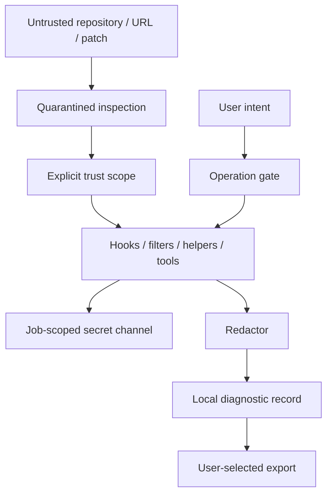

# 11 · Trust, credentials and privacy

Parent: [PRD index](../PRD.md). Owns threat boundaries, repository trust, secret handling, external execution and diagnostic privacy.

## Outcome tree

```text
Outcome: local source control does not grant hidden execution or disclose secrets
├── Trust — quarantine unknown repository configuration
├── Authenticate — installed Git helpers/agents with job-scoped interaction
├── Execute — typed commands, allowed tools and bounded native authority
└── Protect — local-only state, redacted diagnostics and explicit export
```



## Threat model and trust

Protect repository content, local files outside the target, credentials, signing keys and remote refs. Untrusted inputs include repository config/attributes, hooks, filenames/messages, remote URLs/refspecs, patches, helper output, update manifests and control clients. The current-user OS account is the trust boundary; this product cannot protect secrets from an already compromised kernel or another process with equivalent debugging authority.

An unknown repository opens in quarantined inspection mode. Before invoking Git, build a documented configuration/command allowlist and fail closed if execution cannot be bounded. Disable hooks via a controlled empty hooks directory, external diff/textconv, fsmonitor commands, pagers, editors, credential helpers, SSH commands, proxy commands and unknown remote helpers unless the selected trusted operation needs them. Block untrusted include/includeIf expansion outside approved config scope. Attributes can cause filters; quarantined mode must avoid operations that materialize content through them and label unavailable diffs. `safe.directory` is not an execution sandbox or a substitute for this policy.

M0 must prove quarantine using malicious fixtures that attempt marker-file/process creation during status/diff/log/open. No execution path is presumed safe merely because it is called read-only. If the installed Git cannot provide an adequately bounded inspection path, present metadata/setup guidance without launching that path until trust is granted. No silent fallback to unrestricted Git.

Trust grants name canonical repository/common-dir identity and capabilities (repository commands with hooks/filters, network helpers, external merge/editor). Show that hooks/filters/helpers can execute programs. Do not authorize an entire parent folder by default. Moving/replacing the repository or changes to execution-relevant configuration/hooks invalidate the grant and prompt on the next affected action. Global/user helper configuration is displayed as inherited user authority; repo overrides remain separately reviewed. Revoke stops new affected actions and cancels queued authority, without pretending already running hooks can be undone.

## Credentials and signing

Delegate HTTPS credentials to configured trusted Git helpers and SSH to the trusted agent/client. The baseline does not store passwords/tokens in its own workspace database. Prompted secrets are transient memory through a private job-scoped askpass channel, not argv, environment value logs, URL query strings, crash reports or clipboard. Never echo a masked field into console output. A future remember-secret feature requires an OS-vault design and separate requirement review; it is excluded here.

Helper configuration itself can execute programs. Prompts show endpoint, user field, operation and cancel; reject late responses from expired jobs. Avoid background modal prompts. Private keys and signing material remain with external agent/signer or OS providers; absence or failure never downgrades to unsigned/insecure behavior. Host-key/certificate decisions remain explicit as specified by [07](PRD_07_remotes.md). [Git credential documentation](https://git-scm.com/docs/gitcredentials) explains helper integration; the product's no-storage policy is an additional requirement.

## Process, filesystem and network policy

No shell concatenation of paths, messages, refs or URLs. Executable selection is a user-controlled setting with resolved path/version; reject a repository-local executable discovered ahead of the configured Git. Text labels escape control sequences and bidi controls while retaining original raw identities. External editor/diff/merge tool definitions use executable plus structured arguments and explicit path placeholders; arbitrary shell command templates are excluded. File open is deliberate, with executable/symlink warnings and no automatic preview execution.

Patch/clone/worktree writes are scoped to reviewed destinations and revalidated against links/reparse changes; path boundary checks are necessary but not a claim that hostile same-user races are impossible. Recovery files receive owner-only permissions where available, since they contain source code. Remote transports default to HTTPS/SSH; insecure/unknown protocols require an explicit advanced decision and must not weaken global Git settings. Submodule recursion rechecks every child URL. Update networking follows [12](PRD_12_platform_delivery.md).

## Privacy and diagnostics

No telemetry, analytics, crash upload, cloud account, source indexing service or background update network by default. Local logs exclude file content, commit message bodies, raw patches, credential-bearing URLs, tokens, environment dumps and private expanded paths. An explicit detailed capture is local, time-bounded and warns that Git/helper output can contain source/identities. Redaction runs before storage, not only at export. Error summaries preserve category/correlation ID and remediation without repeating raw secrets.

Export diagnostics shows selected fields and destination before saving; sending anywhere is outside the application baseline. Tests seed canary secrets in URLs, stderr, config, askpass and filenames, then search all durable logs/exports/control output. Local secret-bearing recovery content is governed separately from redacted logs and never included automatically in diagnostics.

## Delivery contracts

| ID / leaf | Invariant | Observable evidence | Safe failure | Dependencies | Non-goal |
|---|---|---|---|---|---|
| SEC-01 · quarantine | Unknown repo input cannot silently execute configured programs | QA-J10 malicious hook/filter/fsmonitor/helper/include fixtures | Remain quarantined or disable inspection path | 02, 03 | Claim Git reads are inherently safe |
| SEC-02 · secrets | Secrets are job-scoped and absent from durable product logs | QA-J10 canary scan and late prompt response | Cancel auth; no plaintext store fallback | 07, 13 | Built-in password vault |
| SEC-03 · execution | Paths/refs/content never become shell code | QA-J11 injection, control chars and link escape corpus | Reject unsafe input and preserve state | 02, 08 | Arbitrary plugin/shell system |
| SEC-04 · privacy | No unsolicited data/network emission | QA-J10 offline/network observation and export review | Keep operation local; actionable network error | 12, 13 | Remote monitoring service |
