# 12 · Platforms, packaging, release and updates

Parent: [PRD index](../PRD.md). Owns target support, runtime floors, packaging, artifact identity and release/update authority. All platform support below is a target requirement, not an existing certification.

## Outcome tree

```text
Outcome: run the same reviewed product meaning on each native target
├── Targets — three OS families × two native ISAs
├── Packages — matching GUI entry, dependencies and notices
├── Qualify — exact bytes, runtime courts and signatures
└── Update — explicit check, verified download and recoverable replacement
```

```mermaid
flowchart LR
    S["Frozen source + lockfile + toolchain"] --> B["Six native builds"]
    B --> P["Package and sign"] --> C["Immutable candidate manifest + hashes"]
    C --> R["Execute exact artifacts per cell"] --> G["14 Evidence gate"]
    G --> A["Explicit version/publish authority"] --> PUB["Promote same bytes"]
    PUB --> U["Manual update check + verification"] --> V["Recoverable replacement"]
```



## Support matrix

These are deliberately scoped proposed minimums. M0 must prove the selected dependency/toolchain ABI; a failed floor requires an explicit baseline revision before public compatibility claims.

| Cell | Target ABI | Proposed minimum qualification image | Runtime coverage |
|---|---|---|---|
| Windows x86_64 | `x86_64-pc-windows-msvc` | Windows 11 24H2 x64 | Native launch, paths, pipes, job cancellation, IME, clipboard, accessibility |
| Windows ARM64 | `aarch64-pc-windows-msvc` | Windows 11 24H2 ARM64 | Native ARM64 artifact and matching installed Git/helper compatibility |
| macOS x86_64 | `x86_64-apple-darwin` | macOS 14 Intel | Native Intel execution, app launch, signing, accessibility and IME |
| macOS ARM64 | `aarch64-apple-darwin` | macOS 14 Apple Silicon | Native ARM64 execution and equivalent interaction |
| Linux x86_64 | `x86_64-unknown-linux-gnu` | Ubuntu 24.04 x64, glibc 2.39 | X11 and Wayland sessions, fonts/IME/clipboard, AT-SPI and runtime libraries |
| Linux ARM64 | `aarch64-unknown-linux-gnu` | Ubuntu 24.04 ARM64, glibc 2.39 | Native ARM64 and both Linux display paths |

Newer OS versions receive regression checks as available; that does not imply all intervening versions or distributions are qualified. Linux musl, Windows 7/10, 32-bit and additional ISAs are outside the baseline. Rosetta/QEMU can provide separately labeled compatibility receipts; they never replace the native ISA gate. GPU-independent pixel presentation remains a goal but does not remove window-system/runtime requirements.

Git is separately installed and user-selected; show its architecture/path/version. Matching-native Git is the qualification default. Mixed-architecture helpers must be explicitly recorded if tested; the GUI does not claim to translate them. System fonts, CJK fonts, Linux window/IME/accessibility libraries and permissions must be listed in the eventual package manifest from actual inspection. Missing libraries result in setup guidance rather than a panic. No developer SDK is a runtime prerequisite.

## Package contract

Windows supplies signed ZIP archives per ISA containing a directly runnable GUI executable and notices. macOS supplies signed/notarized/stapled `.app` distribution in a DMG; a Universal package may combine qualified slices without collapsing their evidence. Linux supplies `.tar.gz` archives per ISA with executable, desktop integration instructions, runtime prerequisites and notices. A single product executable may have external installed Git/system library dependencies; do not market it as dependency-free. No installer/admin rights required for the portable path. Product settings/recovery files persist deliberately; unlike a throwaway terminal, this tool does not promise to leave no local state.

Package identity is `minicon-srcmgr-<version>-<os>-<arch>` with explicit manifest fields for source SHA, lockfile hash, toolchain, target ABI, build profile, enabled features, MiniCon revision, required runtime packages, artifact SHA-256, signing result and evidence receipt IDs. Product names, app IDs, IPC namespaces and update channels must differ from MiniCon. Never copy upstream signing identities/configuration secrets. Obtain applicable approved signing procedures before implementing signing.

## Release gates

Select functional/runtime/resource rechecks under [14's risk-based policy](PRD_14_verification_roadmap.md#risk-based-test-selection-and-stopping). Exact-artifact identity and applicable native smoke remain delivery requirements; packaging or promotion is not an instruction to replay every feature/fault/performance matrix. First qualification must establish required baseline coverage; subsequent candidates reuse unaffected evidence with explicit source/artifact scope and only requalify affected contracts. Promotion of unchanged qualified bytes does not rerun candidate functionality.

Freeze source before qualification. Build once per cell, package/sign, then hash the signed final candidate. Run runtime/security/GUI/performance checks on those exact candidate bytes; if signing changes bytes, earlier unsigned hashes do not qualify the final artifact. Signing/notarization operations and malware scans are separate gates. Windows packages require valid Authenticode and scans on both native executables; macOS requires codesign, notarization, stapling where applicable and Gatekeeper launch; Linux requires authenticated signed release metadata in addition to hashes. CI keys live only in protected signing environments, never in the public repository.

A receipt records source/artifact identity, environment, actual ISA/translation, enabled features, test cases, timestamps and verdict. Missing native court, signing authority or evidence is BLOCKED. Do not fabricate a pass or silently drop a target. M3 stable promotion requires every baseline requirement, all six cells and explicit human authority for the named version. Creating this repository is authorized; publishing a future binary version is not authorized by this PRD task. Promotion publishes the already qualified bytes without rebuilding.

## Updates

Default is no background check. Manual Check for updates shows channel/version/release notes and performs no download until chosen. A later optional scheduled check requires opt-in. Verify trusted signed metadata binding repository/channel/version/OS/ISA/length/hash, then verify downloaded bytes and applicable OS signatures. A hash fetched from the same unauthenticated location is insufficient trust. Trust-root/key provisioning and rotation must be designed/tested before updater implementation; absent roots disable in-app installation and offer a release-page link.

Reject wrong architecture/channel, downgrade and replay unless the user explicitly chooses a separately verified rollback. Extract without path traversal/link escape; stage alongside current version and preserve the previous working executable. Refuse replacement while a repository mutation is active. Linux/macOS/Windows replacement differences stay behind the platform mechanism. Verify launch/readiness before marking success; failed replacement retains a runnable previous version and settings compatibility. Never replace Git or migrate repositories during an application update.

## Delivery contracts

| ID / leaf | Invariant | Observable evidence | Safe failure | Dependencies | Non-goal |
|---|---|---|---|---|---|
| SHIP-01 · targets | Each cell has its own actual runtime verdict | QA-J12 native six-cell matrix and two Linux display paths | BLOCKED cell prevents baseline release | 02, 10, 14 | Build success means runtime support |
| SHIP-02 · packages | Package identity/dependencies match executed artifact | QA-J12 clean image launch and manifest/hash check | Specific dependency/setup error | 11 | Bundled Git or one universal ISA binary |
| SHIP-03 · promotion | Published bytes equal signed qualified bytes | QA-J13 candidate/public digest and signing receipts | Stop promotion on mismatch/missing authority | 14 | Rebuild during publish |
| SHIP-04 · update | Only authenticated matching bytes replace an idle product | QA-J13 tamper/replay/wrong-ISA/full-disk/rollback | Keep previous executable and data | 11, 13 | Silent self-update |

## Release 0.0.1 status

Source-level first version, tagged locally as `v0.0.1` and not published. No binary is built for distribution, no signing or notarization is performed, and nothing is pushed to the public repository. The work order excludes binary publication, and the outcome-tree gates above require signed, cross-platform evidence before any binary release.

### What works on the Windows host

Verified with MinGit 2.56.0 through `SRCMGR_TEST_GIT`:

- Repository status with a trust gate: a metadata-only check runs before any Git command; grants cover the `.git` directory and a SHA-256 fingerprint of the config, attributes and hooks.
- Stage and unstage of literal paths, whole-hunk staging through `git apply --cached --recount`, and commit with the message passed on stdin.
- Ignore reporting through `git check-ignore -v`, with negated patterns treated as not ignored.
- Commit history from HEAD, paged with `--skip` and `--limit`, with a merge marker.
- Local branch list, create, and switch; the status window cycles branches with `B`.
- Commit-message drafts and an app setting `history.limit`, both in the SQLite profile store.
- A native status window built on MiniCon's platform host, font masks and pixel kernels.

### Known limits

- Git 2.43 is the release floor; the host's own Git 2.42 is refused by design.
- No graph lanes, per-parent diffs, scrollable diff view, branch picker, or window branch creation.
- Window interaction, layout, accessibility, IME, DPI and resource measurements are not evidenced.
- Linux and macOS cells are not run; invalid UTF-8 and newline file names need a Unix host.
- Crash injection and power-loss durability are not evidenced.
- Remote helpers, the full deny/grant matrix, and clean-machine or MSRV verification are open.

See [the implementation work order and evidence](PRD_14_verification_roadmap.md#implementation-work-order-and-evidence) for the evidence behind each item.

## Release 0.0.2 status

Source-level release, tagged locally as `v0.0.2` and not published: nothing is pushed, no GitHub Release is created, and no binary is built for distribution. The same limits as 0.0.1 apply: no signing or notarization, and no six-cell platform evidence.

### What changed since 0.0.1

- The status window is now a workspace with three list panels (Files, Branches, Commits) and a main panel for the diff, the commit detail or the commit composer. The key map follows lazygit's core flow, with the differences listed in [10](PRD_10_desktop_ux.md#release-002-shell-target-lazygit-level-minimum).
- From the window: stage and unstage files and hunks, check out and create branches, commit from a composer that keeps the saved draft, browse history and commit details, and scroll long diffs.
- Every Git call runs on a worker thread, so the window keeps handling keys while Git works.
- The `B` key from 0.0.1 is removed; the Branches panel does the switch.

### Verified on the Windows host

- `cargo test --workspace` with MinGit 2.56.0 through `SRCMGR_TEST_GIT`: 139 tests pass, including the backend job tests that drive the same trust gate, Git calls and profile store the window uses.
- `cargo clippy --workspace --all-targets`: zero warnings.
- `python scripts/check_docs.py`: PASS.
- A desktop capture of the window contents shows the three list panels, the diff and the footer hints.

### Known limits

- Key-to-redraw latency and resource use are not measured against the budgets in [14](PRD_14_verification_roadmap.md#performance-and-resource-budgets). The worker thread removes Git from the UI thread, but that is not yet evidence of responsiveness.
- The window's key handling is covered by unit tests of the state machine, not by sending keys to the live window: during verification, focus stayed with another application, so synthetic keys were not delivered.
- No IME composition beyond committed text, no screen-reader bridge, no line-level staging, no checkout of a commit, no graph lanes.
- Linux and macOS cells are not run.

See [the implementation work order and evidence](PRD_14_verification_roadmap.md#release-002-plan-lazygit-level-minimum) for the package-by-package record.
