# 12 · Platforms, packaging, release and updates

Parent: [PRD index](../PRD.md). Owns target support, runtime floors, packaging, artifact identity and release/update authority. All platform support below is a target requirement, not an existing certification.

## Outcome tree

```text
Outcome: run the same reviewed product meaning on each native target
├── Targets — three OS families × two native ISAs
├── Packages — matching GUI entry, dependencies and notices
├── Qualify — exact bytes, runtime courts and signatures
└── Update — explicit check, verified download and recoverable replacement
```

```mermaid
flowchart LR
    S["Frozen source + lockfile + toolchain"] --> B["Six native builds"]
    B --> P["Package and sign"] --> C["Immutable candidate manifest + hashes"]
    C --> R["Execute exact artifacts per cell"] --> G["14 Evidence gate"]
    G --> A["Explicit version/publish authority"] --> PUB["Promote same bytes"]
    PUB --> U["Manual update check + verification"] --> V["Recoverable replacement"]
```



## Support matrix

These are deliberately scoped proposed minimums. M0 must prove the selected dependency/toolchain ABI; a failed floor requires an explicit baseline revision before public compatibility claims.

| Cell | Target ABI | Proposed minimum qualification image | Runtime coverage |
|---|---|---|---|
| Windows x86_64 | `x86_64-pc-windows-msvc` | Windows 11 24H2 x64 | Native launch, paths, pipes, job cancellation, IME, clipboard, accessibility |
| Windows ARM64 | `aarch64-pc-windows-msvc` | Windows 11 24H2 ARM64 | Native ARM64 artifact and matching installed Git/helper compatibility |
| macOS x86_64 | `x86_64-apple-darwin` | macOS 14 Intel | Native Intel execution, app launch, signing, accessibility and IME |
| macOS ARM64 | `aarch64-apple-darwin` | macOS 14 Apple Silicon | Native ARM64 execution and equivalent interaction |
| Linux x86_64 | `x86_64-unknown-linux-gnu` | Ubuntu 24.04 x64, glibc 2.39 | X11 and Wayland sessions, fonts/IME/clipboard, AT-SPI and runtime libraries |
| Linux ARM64 | `aarch64-unknown-linux-gnu` | Ubuntu 24.04 ARM64, glibc 2.39 | Native ARM64 and both Linux display paths |

Newer OS versions receive regression checks as available; that does not imply all intervening versions or distributions are qualified. Linux musl, Windows 7/10, 32-bit and additional ISAs are outside the baseline. Rosetta/QEMU can provide separately labeled compatibility receipts; they never replace the native ISA gate. GPU-independent pixel presentation remains a goal but does not remove window-system/runtime requirements.

Git is separately installed and user-selected; show its architecture/path/version. Matching-native Git is the qualification default. Mixed-architecture helpers must be explicitly recorded if tested; the GUI does not claim to translate them. System fonts, CJK fonts, Linux window/IME/accessibility libraries and permissions must be listed in the eventual package manifest from actual inspection. Missing libraries result in setup guidance rather than a panic. No developer SDK is a runtime prerequisite.

## Package contract

Windows supplies signed ZIP archives per ISA containing a directly runnable GUI executable and notices. macOS supplies signed/notarized/stapled `.app` distribution in a DMG; a Universal package may combine qualified slices without collapsing their evidence. Linux supplies `.tar.gz` archives per ISA with executable, desktop integration instructions, runtime prerequisites and notices. A single product executable may have external installed Git/system library dependencies; do not market it as dependency-free. No installer/admin rights required for the portable path. Product settings/recovery files persist deliberately; unlike a throwaway terminal, this tool does not promise to leave no local state.

Package identity is `minicon-srcmgr-<version>-<os>-<arch>` with explicit manifest fields for source SHA, lockfile hash, toolchain, target ABI, build profile, enabled features, MiniCon revision, required runtime packages, artifact SHA-256, signing result and evidence receipt IDs. Product names, app IDs, IPC namespaces and update channels must differ from MiniCon. Never copy upstream signing identities/configuration secrets. Obtain applicable approved signing procedures before implementing signing.

## Private Windows candidate preparation

`scripts/build_windows_candidate.py --out target/qualification/<new-run>` builds the committed native Windows x64 release input once with the pinned compiler and a locked, already fetched source cache. It maps known workspace/Cargo/developer/toolchain prefixes to stable non-private labels through [Rust path remapping](https://doc.rust-lang.org/rustc/command-line-arguments.html#--remap-path-prefix-remap-source-paths-in-output) and [Cargo's encoded Rust flags](https://doc.rust-lang.org/cargo/reference/environment-variables.html). It refuses unreviewed compiler/flag overrides, checks unchanged inputs before/after compilation, scans the executable for known private roots and freezes exact bytes with source/build/recipe receipts. Absence of those known strings is a scoped privacy check, not a general secret scan or reproducible-build/signing attestation. Exact flags and raw logs stay private.

`scripts/prepare_windows_candidate.py --candidate <frozen-dir> --build-profile release --receipt <passing-native-receipt> --out target/qualification/<new-package-run>` prepares only a private, explicitly UNQUALIFIED ZIP. It verifies executable/source/build/recipe identity and a matching completed scoped native receipt; inventories normal/build dependencies from locked target-filtered Cargo metadata; copies license texts from checksum-verified registry archives or immutable Git blobs, including bundled SQLite's source notice; includes the matching installed Rust standard-library copyright index and license catalogue, and records direct/delayed DLL imports, observed Authenticode status and unchanged archived file hashes. Raw host paths, Rust flags and native receipts are excluded from the archive. A native read-only CLI startup receipt can supply the private preparation preflight; it supplies no GUI/input evidence. Actual GUI and release qualification still apply to the final delivered bytes. Build inventory includes tooling; it is not a claim that every listed crate is a runtime library. License declarations/texts still need distribution review, and DLL imports do not prove clean-image resolution.

The tools never sign, scan, claim a performance/native-platform gate, upload or publish. A successful private ZIP remains unqualified until the applicable release requirements below actually pass. The Windows candidate CI lane covers the real optimized build, source identity, known-root removal and startup of the exact frozen executable with a fresh profile; its hosted runner is not the supported clean desktop/reference court and supplies no package/signature/native-UI certification. A tampered artifact or mismatched/missing receipt stops candidate preparation; failure logs remain in the new private run directory.

## Release gates

Select functional/runtime/resource rechecks under [14's risk-based policy](PRD_14_verification_roadmap.md#risk-based-test-selection-and-stopping). Exact-artifact identity and applicable native smoke remain delivery requirements; packaging or promotion is not an instruction to replay every feature/fault/performance matrix. First qualification must establish required baseline coverage; subsequent candidates reuse unaffected evidence with explicit source/artifact scope and only requalify affected contracts. Promotion of unchanged qualified bytes does not rerun candidate functionality.

Freeze source before qualification. Build once per cell, package/sign, then hash the signed final candidate. Run runtime/security/GUI/performance checks on those exact candidate bytes; if signing changes bytes, earlier unsigned hashes do not qualify the final artifact. Signing/notarization operations and malware scans are separate gates. Windows packages require valid Authenticode and scans on both native executables; macOS requires codesign, notarization, stapling where applicable and Gatekeeper launch; Linux requires authenticated signed release metadata in addition to hashes. CI keys live only in protected signing environments, never in the public repository.

A receipt records source/artifact identity, environment, actual ISA/translation, enabled features, test cases, timestamps and verdict. Missing native court, signing authority or evidence is BLOCKED. Do not fabricate a pass or silently drop a target. M3 stable promotion requires every baseline requirement, all six cells and explicit human authority for the named version. Creating this repository is authorized; publishing a future binary version is not authorized by this PRD task. Promotion publishes the already qualified bytes without rebuilding.

## Development source checkpoints

The existing source-only 0.0.x delivery line is distinct from the first qualified runnable beta below. A public development source checkpoint requires the version's delivered local tasks, affected correctness/safety checks, real changed-path execution on the available host, passing applicable source CI, source/version identity and explicit known limitations. Observed product correctness or data-loss defects in those paths are repaired before publication. Source publication does not qualify a supported Windows binary, cumulative M1/M2 acceptance or any unmeasured performance/platform claim.

For 0.0.6, the owner has instructed development and public release to continue without supplying another test machine. Use the available native host for actual measurements and repairs and publish the completed development source checkpoint with its scoped evidence. Do not make owner-provided Windows 11 hardware a prerequisite for publishing source. The supported-image, CJK/clipboard/screen-reader/DPI, 60 Hz presentation, long-session and signed-package requirements remain open for their qualified first-user delivery scope; no threshold or target platform is lowered. Known failed observations remain visible. Do not attach the unsigned private ZIP/executable or advertise reference-platform certification as part of this source release. A source-only checkpoint still does not satisfy the 0.1.0 runnable-client outcome.

## Private candidates and preview builds

An unsigned build is never published. Development candidates are private: they carry source and recipe binding, exact-byte startup evidence and a malware preflight, and they are used for the five-participant study and native checks. A public distribution channel opens only with the signed 0.1.0 package. Preview naming, in-app limitation notices and asset withdrawal are defined before any preview is considered; the source-checkpoint line above remains source-only.

## 0.1.0 private candidate

`010-candidate-v1` builds source `b609290` into Windows x64 artifact `ec245f2f174bd2701865aaca288a610c0c2ef16828e5fa980c6744b9c57c800b` with zero known developer/Cargo/workspace/toolchain root occurrences. A fresh profile starts the exact bytes, exits 0 and reads `history.limit` as `unset`. The artifact is unsigned and private: it is not a beta, not published and not a substitute for the signed package gate below. Signing readiness follows the company process learned from the sibling products: canonical inspectors are installed and verified, `release-policy.json` is `off`, and an inert `windows-signed-candidate.yml` refuses to run without provisioning. The repository has no `release-signing` environment yet (the protected-environment name check returns HTTP 404), so signing and the product's PE version resource remain open.

## 0.1.0 first-user beta delivery target

Status: planned, not built, signed, qualified or published. Product admission is owned by [01](PRD_01_product.md#010-first-user-feature-tree) and sequencing by [the roadmap](../plan/roadmap-0.1.0.md). Existing 0.0.x source releases retain their original scope; a source archive alone does not satisfy the new first-user runnable-client target.

The first named beta cell is **Windows x86_64** at this document's supported OS floor. Supply the signed portable ZIP, directly runnable executable, notices, actual runtime/Git prerequisites, concise start/known-limits instructions, version/source/artifact identity and a feedback path. A clean user profile must launch without Rust, a developer SDK, a mandatory account or admin installation. Git remains separately installed; missing Git has actionable guidance. Returning users keep settings/drafts; archive extraction is not permission to overwrite repository data.

This explicitly scoped early beta does not require claiming full M2/M3 or native qualification for the other five cells. List their status accurately; keep their existing baseline requirements. The Windows x86_64 candidate must meet all applicable functional, security, accessibility, IME/DPI, performance, stability, Authenticode and malware-scan gates on its declared cell. Statements above about both Windows ISAs apply to full Windows baseline delivery; each early-beta artifact still needs its own native/signing evidence. Do not bypass signatures or weaken a core quality gate for speed. M3 stable promotion still needs the entire baseline and all six cells.

Package/signing procedure, clean-launch environment and reference display/storage access are implementation dependencies investigated from 0.0.6, not paperwork deferred until 0.1.0. Qualify the final signed candidate identity, reuse unaffected evidence only within its actual scope, and publish only under applicable named release authority. This design task provisions no keys, installs no package, publishes no binary and grants no unrelated account access.

## Updates

Default is no background check. Manual Check for updates shows channel/version/release notes and performs no download until chosen. A later optional scheduled check requires opt-in. Verify trusted signed metadata binding repository/channel/version/OS/ISA/length/hash, then verify downloaded bytes and applicable OS signatures. A hash fetched from the same unauthenticated location is insufficient trust. Trust-root/key provisioning and rotation must be designed/tested before updater implementation; absent roots disable in-app installation and offer a release-page link.

Reject wrong architecture/channel, downgrade and replay unless the user explicitly chooses a separately verified rollback. Extract without path traversal/link escape; stage alongside current version and preserve the previous working executable. Refuse replacement while a repository mutation is active. Linux/macOS/Windows replacement differences stay behind the platform mechanism. Verify launch/readiness before marking success; failed replacement retains a runnable previous version and settings compatibility. Never replace Git or migrate repositories during an application update.

## Delivery contracts

| ID / leaf | Invariant | Observable evidence | Safe failure | Dependencies | Non-goal |
|---|---|---|---|---|---|
| SHIP-01 · targets | Each cell has its own actual runtime verdict | QA-J12 native six-cell matrix and two Linux display paths | BLOCKED cell prevents baseline release | 02, 10, 14 | Build success means runtime support |
| SHIP-02 · packages | Package identity/dependencies match executed artifact | QA-J12 clean image launch and manifest/hash check | Specific dependency/setup error | 11 | Bundled Git or one universal ISA binary |
| SHIP-03 · promotion | Published bytes equal signed qualified bytes | QA-J13 candidate/public digest and signing receipts | Stop promotion on mismatch/missing authority | 14 | Rebuild during publish |
| SHIP-04 · update | Only authenticated matching bytes replace an idle product | QA-J13 tamper/replay/wrong-ISA/full-disk/rollback | Keep previous executable and data | 11, 13 | Silent self-update |

## Release 0.0.1 status

Source-level first version, tagged locally as `v0.0.1` and not published. No binary is built for distribution, no signing or notarization is performed, and nothing is pushed to the public repository. The work order excludes binary publication, and the outcome-tree gates above require signed, cross-platform evidence before any binary release.

### What works on the Windows host

Verified with MinGit 2.56.0 through `SRCMGR_TEST_GIT`:

- Repository status with a trust gate: a metadata-only check runs before any Git command; grants cover the `.git` directory and a SHA-256 fingerprint of the config, attributes and hooks.
- Stage and unstage of literal paths, whole-hunk staging through `git apply --cached --recount`, and commit with the message passed on stdin.
- Ignore reporting through `git check-ignore -v`, with negated patterns treated as not ignored.
- Commit history from HEAD, paged with `--skip` and `--limit`, with a merge marker.
- Local branch list, create, and switch; the status window cycles branches with `B`.
- Commit-message drafts and an app setting `history.limit`, both in the SQLite profile store.
- A native status window built on MiniCon's platform host, font masks and pixel kernels.

### Known limits

- Git 2.43 is the release floor; the host's own Git 2.42 is refused by design.
- No graph lanes, per-parent diffs, scrollable diff view, branch picker, or window branch creation.
- Window interaction, layout, accessibility, IME, DPI and resource measurements are not evidenced.
- Linux and macOS cells are not run; invalid UTF-8 and newline file names need a Unix host.
- Crash injection and power-loss durability are not evidenced.
- Remote helpers, the full deny/grant matrix, and clean-machine or MSRV verification are open.

See [the implementation work order and evidence](PRD_14_verification_roadmap.md#implementation-work-order-and-evidence) for the evidence behind each item.

## Release 0.0.2 status

Source-level release, tagged locally as `v0.0.2` and not published: nothing is pushed, no GitHub Release is created, and no binary is built for distribution. The same limits as 0.0.1 apply: no signing or notarization, and no six-cell platform evidence.

### What changed since 0.0.1

- The status window is now a workspace with three list panels (Files, Branches, Commits) and a main panel for the diff, the commit detail or the commit composer. The key map follows lazygit's core flow, with the differences listed in [10](PRD_10_desktop_ux.md#release-002-shell-target-lazygit-level-minimum).
- From the window: stage and unstage files and hunks, check out and create branches, commit from a composer that keeps the saved draft, browse history and commit details, and scroll long diffs.
- Every Git call runs on a worker thread, so the window keeps handling keys while Git works.
- The `B` key from 0.0.1 is removed; the Branches panel does the switch.

### Verified on the Windows host

- `cargo test --workspace` with MinGit 2.56.0 through `SRCMGR_TEST_GIT`: 139 tests pass, including the backend job tests that drive the same trust gate, Git calls and profile store the window uses.
- `cargo clippy --workspace --all-targets`: zero warnings.
- `python scripts/check_docs.py`: PASS.
- A desktop capture of the window contents shows the three list panels, the diff and the footer hints.

### Known limits

- Key-to-redraw latency and resource use are not measured against the budgets in [14](PRD_14_verification_roadmap.md#performance-and-resource-budgets). The worker thread removes Git from the UI thread, but that is not yet evidence of responsiveness.
- The window's key handling is covered by unit tests of the state machine, not by sending keys to the live window: during verification, focus stayed with another application, so synthetic keys were not delivered.
- No IME composition beyond committed text, no screen-reader bridge, no line-level staging, no checkout of a commit, no graph lanes.
- Linux and macOS cells are not run.

See [the implementation work order and evidence](PRD_14_verification_roadmap.md#release-002-plan-lazygit-level-minimum) for the package-by-package record.

## Release 0.0.3 status

Source-level release, tagged `v0.0.3` and published to `origin` as a GitHub Release with source only. No binary is built or attached: the signing and six-cell evidence in the release gates above are not available, so a binary would not qualify. The limits of 0.0.1 and 0.0.2 still apply.

### What changed since 0.0.2

- The window follows lazygit's panel numbers (1 Status, 2 Files, 3 Branches, 4 Commits) and has a cursor in the main panel.
- Line-level and hunk staging from the diff, stage-all and unstage-all on Files, branch delete with a confirmation, and list motion keys (`<`/`>`, PgUp/PgDn, Ctrl+U/Ctrl+D).
- The window redraws when it is resized, and it responds to the mouse: clicks select rows and lines, and the wheel moves lists and the diff.

### Verified on the Windows host

- `cargo test --workspace` with MinGit 2.56.0 through `SRCMGR_TEST_GIT`: 154 tests pass.
- `cargo clippy --workspace --all-targets`: zero warnings. `python scripts/check_docs.py`: PASS.
- A live window run, driven by posted keys and clicks and by real keys in the foreground window: a click selects a branch; a line stage put only the added line in the index; `a` unstaged everything; the wheel scrolls the diff and End/Home move it; Ctrl+D and Ctrl+U move the view; `d` asks, `n` keeps the branch and `y` deletes it; a click on the Status row changes focus; a resize redraws the panels.

### Known limits

- Key-to-redraw latency and resource use are not measured against the budgets in [14](PRD_14_verification_roadmap.md#performance-and-resource-budgets).
- No IME composition beyond committed text, no screen-reader bridge, no checkout of a commit, no commit files, no search or filter, no discard, stash or rebase.
- Linux and macOS cells are not run.

## Development 0.0.9 status

Status: source checkpoint delivered for explicit upstream, fetch-then-fast-forward pull and current-branch push. Pull refuses divergence instead of merging, push sends one explicit refspec and reports per-ref Updated/UpToDate/Rejected, and a cancelled or timed-out push is reconciled once with `ls-remote` and never retried. Window `p`/`P` report the final outcome. Clone/Remotes panels, authenticated HTTPS/SSH qualification, a killed-transfer receipt, JSON for the new CLI verbs, native journeys and signing remain open. No executable is distributed and no platform certification is claimed. Scoped evidence is in [the 0.0.9 plan](../plan/plan-0.0.9.md).

## Development 0.0.8 status

Status: source checkpoint delivered for clone and reviewed remote configuration. Clone validates transport, destination, branch and depth before transfer, disables checkout until review, refuses a nonempty target without touching it and retains a partial target. Remote add/set-URL/rename/remove preview the local effect, apply only with an explicit `--yes`, preserve unrelated keys and report the trust-fingerprint change. Both are delivered through the Git layer and CLI; the window has no Clone form or Remotes surface yet, so window surfaces, pull and push remain 0.0.9. No executable is distributed, authenticated transports are BLOCKED without a fixture host, and no native, reference-host or signing certification is claimed. Scoped evidence is in [the 0.0.8 plan](../plan/plan-0.0.8.md).

## Development 0.0.7 status

Status: source checkpoint delivered for remote observation and explicit fetch. It adds redacted remote listing with configured refspecs, upstream distance, one-remote fetch with per-ref results, cancellation, filtered progress, the `f` window action and `remote`/`fetch` CLI commands. Clone and remote configuration writes are 0.0.8; pull, push and authentication qualification are 0.0.9. No executable is distributed: authenticated transports are BLOCKED without a controlled fixture host, the window has no dedicated Remotes surface or live progress, and no native remote journey, reference-host, signing or platform certification is claimed. Scoped evidence is in [the 0.0.7 plan](../plan/plan-0.0.7.md).

## Development 0.0.6 status

Workspace version: **0.0.6**, publicly released as a [development source checkpoint](https://github.com/partnernetsoftware/minicon-srcmgr/releases/tag/v0.0.6) on 2026-10-24 at 14:58:21 UTC. Annotated tag `v0.0.6` resolves to source `fc57042651a35add655141c0f5e04f1a2ca2a066`; the public release is neither draft nor prerelease and has no uploaded binary assets. The [execution plan](../plan/plan-0.0.6.md) records implemented entry/setup, coherent Changes/full-index composition, tabs/context, quick filters and external handoff, together with actual native/Git/UIA and available-host measurements. The measured refresh-navigation defect is repaired and its regression/negative control and native follow-up pass. No supported-platform, presentation-budget or signed-binary certification is claimed; qualified runnable delivery remains the separate 0.1.0 target.

The public tag's source ZIP was downloaded without authentication and all 124 files compared byte-for-byte against that exact source commit, including version 0.0.6 and release notes. SHA-256 is `8f63138b34820c44f74a3d43155940dac571f8cdbc84e155eac782480290f6d5` (587,352 bytes). No target outputs or native binaries occur in the archive. Final-source local-client CI `40104639266`, Windows/Linux ignore/runner CI `40104639293` and documentation CI `40104639260` pass; unchanged profile/accessibility/Windows build contracts retain their successful `31971ba` integration evidence. The final private candidate's build/source identity and native CLI startup pass, but it is not distributed. Earlier failed or incomplete qualification remains recorded rather than waived.

## 0.0.5 source checkpoint

Historical workspace target: **0.0.5**, an unpublished source checkpoint with scoped qualification evidence; no `v0.0.5` public tag or GitHub Release has been published. Local optimized binaries exist solely for validation and are not distribution artifacts. At that checkpoint the latest public release was 0.0.4; current release status is recorded above. Its scope, scoped host evidence and remaining gates live in [the version plan](../plan/plan-0.0.5.md). Reference-environment response/resource certification remains open; implementation and a passing diagnostic do not waive that gate.

## Release 0.0.4 status

Source-level release, tagged `v0.0.4` and published to `origin` as a GitHub Release with source only. No binary is built or attached: the signing and six-cell evidence in the release gates above are not available. The limits of 0.0.1 to 0.0.3 still apply.

### What changed since 0.0.3

- Discard: `d` in Files discards a file's unstaged changes, and `d` in the main panel discards the hunk under the cursor. Both ask first.
- Stash: `s` in Files saves tracked changes, and `S` applies the newest stash and keeps it.
- Detached checkout: `Space` in Commits checks a commit out detached, after a question.
- A refused Git command shows Git's first error line, for example why a checkout would overwrite local edits.

### Verified on the Windows host

- `cargo test --workspace` with MinGit 2.56.0 through `SRCMGR_TEST_GIT`: 164 tests pass.
- `cargo clippy --workspace --all-targets`: zero warnings. `python scripts/check_docs.py`: PASS.
- A live window run in the foreground: a hunk discard reverted only the first of two hunks; `s` stashed the change and `S` restored it; `d` then `n` kept the change and `d` then `y` restored the file; a commit checkout asked, and `y` left HEAD detached. A dirty-tree checkout was refused with Git's reason in the notice.

### Known limits

- Line discard, the stash list with pop, drop and messages, commit files, search and filter, reset and revert are not in 0.0.4. The plan and the benchmark against lazygit, reference GUI and Git SCM are in [10](PRD_10_desktop_ux.md#release-004-shell-target-discard-stash-and-detached-checkout).
- Key-to-redraw latency and resource use are not measured against the budgets in [14](PRD_14_verification_roadmap.md#performance-and-resource-budgets).
- No IME composition beyond committed text, no screen-reader bridge. Linux and macOS cells are not run.
