# 12 · Platforms, packaging, release and updates

Parent: [PRD index](../PRD.md). Owns target support, runtime floors, packaging, artifact identity and release/update authority. All platform support below is a target requirement, not an existing certification.

## Outcome tree

```text
Outcome: run the same reviewed product meaning on each native target
├── Targets — three OS families × two native ISAs
├── Packages — matching GUI entry, dependencies and notices
├── Qualify — exact bytes, runtime courts and signatures
└── Update — explicit check, verified download and recoverable replacement
```

```mermaid
flowchart LR
    S["Frozen source + lockfile + toolchain"] --> B["Six native builds"]
    B --> P["Package and sign"] --> C["Immutable candidate manifest + hashes"]
    C --> R["Execute exact artifacts per cell"] --> G["14 Evidence gate"]
    G --> A["Explicit version/publish authority"] --> PUB["Promote same bytes"]
    PUB --> U["Manual update check + verification"] --> V["Recoverable replacement"]
```



## Support matrix

These are deliberately scoped proposed minimums. M0 must prove the selected dependency/toolchain ABI; a failed floor requires an explicit baseline revision before public compatibility claims.

| Cell | Target ABI | Proposed minimum qualification image | Runtime coverage |
|---|---|---|---|
| Windows x86_64 | `x86_64-pc-windows-msvc` | Windows 11 24H2 x64 | Native launch, paths, pipes, job cancellation, IME, clipboard, accessibility |
| Windows ARM64 | `aarch64-pc-windows-msvc` | Windows 11 24H2 ARM64 | Native ARM64 artifact and matching installed Git/helper compatibility |
| macOS x86_64 | `x86_64-apple-darwin` | macOS 14 Intel | Native Intel execution, app launch, signing, accessibility and IME |
| macOS ARM64 | `aarch64-apple-darwin` | macOS 14 Apple Silicon | Native ARM64 execution and equivalent interaction |
| Linux x86_64 | `x86_64-unknown-linux-gnu` | Ubuntu 24.04 x64, glibc 2.39 | X11 and Wayland sessions, fonts/IME/clipboard, AT-SPI and runtime libraries |
| Linux ARM64 | `aarch64-unknown-linux-gnu` | Ubuntu 24.04 ARM64, glibc 2.39 | Native ARM64 and both Linux display paths |

Build status 2026-11-08: the six-cell path ran green ([run 42476631093](https://github.com/partnernetsoftware/minicon-srcmgr/actions/runs/42476631093) at source `687f93b`). Each cell built on its own native runner, a runtime court ran on its own executable and produced a receipt, and each cell produced its own archive with a receipt; the aggregate wrote a receipt naming six cells and refuses a partial set. Neither Windows archive is signed: the two-asset signing run has not been dispatched, so both receipts record `signing: blocked`. The signing path itself is already qualified — 0.1.0 was signed release-eligible by run 42453987936. What that path proves is compilation, start and real Git reads per cell. What it does **not** prove is a GUI journey on any cell (needs a display and, on Linux, a compositor), macOS Developer ID signing, or an image other than the runner's. Only Windows x86_64 additionally has a published signed archive. The path's own evidence and stopping conditions live in [the 0.1.2 plan](../plan/plan-0.1.2.md).

Newer OS versions receive regression checks as available; that does not imply all intervening versions or distributions are qualified. Linux musl, Windows 7/10, 32-bit and additional ISAs are outside the baseline. Rosetta/QEMU can provide separately labeled compatibility receipts; they never replace the native ISA gate. GPU-independent pixel presentation remains a goal but does not remove window-system/runtime requirements.

Git is separately installed and user-selected; show its architecture/path/version. Matching-native Git is the qualification default. Mixed-architecture helpers must be explicitly recorded if tested; the GUI does not claim to translate them. System fonts, CJK fonts, Linux window/IME/accessibility libraries and permissions must be listed in the eventual package manifest from actual inspection. Missing libraries result in setup guidance rather than a panic. No developer SDK is a runtime prerequisite.

## Package contract

Windows supplies signed ZIP archives per ISA containing a directly runnable GUI executable and notices. macOS supplies signed/notarized/stapled `.app` distribution in a DMG; a Universal package may combine qualified slices without collapsing their evidence. Linux supplies `.tar.gz` archives per ISA with executable, desktop integration instructions, runtime prerequisites and notices. A single product executable may have external installed Git/system library dependencies; do not market it as dependency-free. No installer/admin rights required for the portable path. Product settings/recovery files persist deliberately; unlike a throwaway terminal, this tool does not promise to leave no local state.

Package identity is `minicon-srcmgr-<version>-<os>-<arch>` with explicit manifest fields for source SHA, lockfile hash, toolchain, target ABI, build profile, enabled features, MiniCon revision, required runtime packages, artifact SHA-256, signing result and evidence receipt IDs. Product names, app IDs, IPC namespaces and update channels must differ from MiniCon. Never copy upstream signing identities/configuration secrets. Obtain applicable approved signing procedures before implementing signing.

## Private Windows candidate preparation

`scripts/build_windows_candidate.py --out target/qualification/<new-run>` builds the committed native Windows x64 release input once with the pinned compiler and a locked, already fetched source cache. It maps known workspace/Cargo/developer/toolchain prefixes to stable non-private labels through [Rust path remapping](https://doc.rust-lang.org/rustc/command-line-arguments.html#--remap-path-prefix-remap-source-paths-in-output) and [Cargo's encoded Rust flags](https://doc.rust-lang.org/cargo/reference/environment-variables.html). It refuses unreviewed compiler/flag overrides, checks unchanged inputs before/after compilation, scans the executable for known private roots and freezes exact bytes with source/build/recipe receipts. Absence of those known strings is a scoped privacy check, not a general secret scan or reproducible-build/signing attestation. Exact flags and raw logs stay private.

`scripts/prepare_windows_candidate.py --candidate <frozen-dir> --build-profile release --receipt <passing-native-receipt> --out target/qualification/<new-package-run>` prepares only a private, explicitly UNQUALIFIED ZIP. It verifies executable/source/build/recipe identity and a matching completed scoped native receipt; inventories normal/build dependencies from locked target-filtered Cargo metadata; copies license texts from checksum-verified registry archives or immutable Git blobs, including bundled SQLite's source notice; includes the matching installed Rust standard-library copyright index and license catalogue, and records direct/delayed DLL imports, observed Authenticode status and unchanged archived file hashes. Raw host paths, Rust flags and native receipts are excluded from the archive. A native read-only CLI startup receipt can supply the private preparation preflight; it supplies no GUI/input evidence. Actual GUI and release qualification still apply to the final delivered bytes. Build inventory includes tooling; it is not a claim that every listed crate is a runtime library. License declarations/texts still need distribution review, and DLL imports do not prove clean-image resolution.

The tools never sign, scan, claim a performance/native-platform gate, upload or publish. A successful private ZIP remains unqualified until the applicable release requirements below actually pass. The Windows candidate CI lane covers the real optimized build, source identity, known-root removal and startup of the exact frozen executable with a fresh profile; its hosted runner is not the supported clean desktop/reference court and supplies no package/signature/native-UI certification. A tampered artifact or mismatched/missing receipt stops candidate preparation; failure logs remain in the new private run directory.

## Release gates

Select functional/runtime/resource rechecks under [14's risk-based policy](PRD_14_verification_roadmap.md#risk-based-test-selection-and-stopping). Exact-artifact identity and applicable native smoke remain delivery requirements; packaging or promotion is not an instruction to replay every feature/fault/performance matrix. First qualification must establish required baseline coverage; subsequent candidates reuse unaffected evidence with explicit source/artifact scope and only requalify affected contracts. Promotion of unchanged qualified bytes does not rerun candidate functionality.

Freeze source before qualification. Build once per cell, package/sign, then hash the signed final candidate. Run runtime/security/GUI/performance checks on those exact candidate bytes; if signing changes bytes, earlier unsigned hashes do not qualify the final artifact. Signing/notarization operations and malware scans are separate gates. Windows packages require valid Authenticode and scans on both native executables; macOS requires codesign, notarization, stapling where applicable and Gatekeeper launch; Linux requires authenticated signed release metadata in addition to hashes. CI keys live only in protected signing environments, never in the public repository.

A receipt records source/artifact identity, environment, actual ISA/translation, enabled features, test cases, timestamps and verdict. Missing native court, signing authority or evidence is BLOCKED. Do not fabricate a pass or silently drop a target. M3 stable promotion requires every baseline requirement, all six cells and explicit human authority for the named version. Creating this repository is authorized; publishing a future binary version is not authorized by this PRD task. Promotion publishes the already qualified bytes without rebuilding.

## Development source checkpoints

The existing source-only 0.0.x delivery line is distinct from the first qualified runnable beta below. A public development source checkpoint requires the version's delivered local tasks, affected correctness/safety checks, real changed-path execution on the available host, passing applicable source CI, source/version identity and explicit known limitations. Observed product correctness or data-loss defects in those paths are repaired before publication. Source publication does not qualify a supported Windows binary, cumulative M1/M2 acceptance or any unmeasured performance/platform claim.

For 0.0.6, the owner has instructed development and public release to continue without supplying another test machine. Use the available native host for actual measurements and repairs and publish the completed development source checkpoint with its scoped evidence. Do not make owner-provided Windows 11 hardware a prerequisite for publishing source. The supported-image, CJK/clipboard/screen-reader/DPI, 60 Hz presentation, long-session and signed-package requirements remain open for their qualified first-user delivery scope; no threshold or target platform is lowered. Known failed observations remain visible. Do not attach the unsigned private ZIP/executable or advertise reference-platform certification as part of this source release. A source-only checkpoint still does not satisfy the 0.1.0 runnable-client outcome.

## Private candidates and preview builds

An unsigned build is never published. Development candidates are private: they carry source and recipe binding, exact-byte startup evidence and a malware preflight, and they are used for the five-participant study and native checks. A public distribution channel opens only with the signed 0.1.0 package. Preview naming, in-app limitation notices and asset withdrawal are defined before any preview is considered; the source-checkpoint line above remains source-only.

## 0.1.0 private candidate

`010-candidate-v1` builds source `b609290` into Windows x64 artifact `ec245f2f174bd2701865aaca288a610c0c2ef16828e5fa980c6744b9c57c800b` with zero known developer/Cargo/workspace/toolchain root occurrences. A fresh profile starts the exact bytes, exits 0 and reads `history.limit` as `unset`. `010-candidate-v3` rebuilds source `543cfbd` into artifact `1362b570447c19dbe364f637c878b0188317dbe898d7909e50b3a3ef0a991791`; that source embeds `ProductName`, `CompanyName` and the package version on every MSVC PE, verified in the candidate bytes. The artifact is unsigned and private: it is not a beta, not published and not a substitute for the signed package gate below. Signing is provisioned and the mechanism is qualified. The repository owns a `release-signing` environment with the three Azure secrets and three provider variables, a dedicated Entra application whose federated credential subject is exactly this repository's environment, and only the profile-scoped `Artifact Signing Certificate Profile Signer` role. Both `check-github-signing-environment.sh` and `check-azure-signing-state.sh` report READY. Run 42369612531 signed source `cb117b0` and produced a `Valid` Authenticode signature with the company `O=`, a Microsoft RFC 3161 timestamp and a credential-free receipt that the fail-closed auditor accepted with `release_eligible=false`. A release-eligible receipt still requires version 0.1.0, `signing.mode = required` and an unpublished version; the `ProductName`/`ProductVersion` resource is already embedded and verified.

## 0.1.0 first-user beta delivery target

Status: the Windows x86_64 cell is **published** (v0.1.0, 2026-11-07) and the remaining cells are not. Product admission is owned by [01](PRD_01_product.md#first-user-admission-matrix) and sequencing by [the roadmap](../plan/roadmap-0.1.0.md). Existing 0.0.x source releases retain their original scope; a source archive alone does not satisfy the first-user runnable-client target. The published artifact meets the package, signature and first-run parts of this section, but **not** the accessibility, IME/DPI, clean-image and usability parts; [0.1.1](PRD_12_platform_delivery.md#011-delivery-target) carries those gates, and the 0.1.0 release notes name them as limits rather than passes.

The first named beta cell is **Windows x86_64** at this document's supported OS floor. Supply the signed portable ZIP, directly runnable executable, notices, actual runtime/Git prerequisites, concise start/known-limits instructions, version/source/artifact identity and a feedback path. A clean user profile must launch without Rust, a developer SDK, a mandatory account or admin installation. Git remains separately installed; missing Git has actionable guidance. Returning users keep settings/drafts; archive extraction is not permission to overwrite repository data.

This explicitly scoped early beta does not require claiming full M2/M3 or native qualification for the other five cells. List their status accurately; keep their existing baseline requirements. The Windows x86_64 candidate must meet all applicable functional, security, accessibility, IME/DPI, performance, stability, Authenticode and malware-scan gates on its declared cell. Statements above about both Windows ISAs apply to full Windows baseline delivery; each early-beta artifact still needs its own native/signing evidence. Do not bypass signatures or weaken a core quality gate for speed. M3 stable promotion still needs the entire baseline and all six cells.

Package/signing procedure, clean-launch environment and reference display/storage access are implementation dependencies investigated from 0.0.6, not paperwork deferred until 0.1.0. Qualify the final signed candidate identity, reuse unaffected evidence only within its actual scope, and publish only under applicable named release authority. This design task provisions no keys, installs no package, publishes no binary and grants no unrelated account access.

## Updates

Default is no background check. Manual Check for updates shows channel/version/release notes and performs no download until chosen. A later optional scheduled check requires opt-in. Verify trusted signed metadata binding repository/channel/version/OS/ISA/length/hash, then verify downloaded bytes and applicable OS signatures. A hash fetched from the same unauthenticated location is insufficient trust. Trust-root/key provisioning and rotation must be designed/tested before updater implementation; absent roots disable in-app installation and offer a release-page link.

Reject wrong architecture/channel, downgrade and replay unless the user explicitly chooses a separately verified rollback. Extract without path traversal/link escape; stage alongside current version and preserve the previous working executable. Refuse replacement while a repository mutation is active. Linux/macOS/Windows replacement differences stay behind the platform mechanism. Verify launch/readiness before marking success; failed replacement retains a runnable previous version and settings compatibility. Never replace Git or migrate repositories during an application update.

## Delivery contracts

| ID / leaf | Invariant | Observable evidence | Safe failure | Dependencies | Non-goal |
|---|---|---|---|---|---|
| SHIP-01 · targets | Each cell has its own actual runtime verdict | QA-J12 native six-cell matrix and two Linux display paths | BLOCKED cell prevents baseline release | 02, 10, 14 | Build success means runtime support |
| SHIP-02 · packages | Package identity/dependencies match executed artifact | QA-J12 clean image launch and manifest/hash check | Specific dependency/setup error | 11 | Bundled Git or one universal ISA binary |
| SHIP-03 · promotion | Published bytes equal signed qualified bytes | QA-J13 candidate/public digest and signing receipts | Stop promotion on mismatch/missing authority | 14 | Rebuild during publish |
| SHIP-04 · update | Only authenticated matching bytes replace an idle product | QA-J13 tamper/replay/wrong-ISA/full-disk/rollback | Keep previous executable and data | 11, 13 | Silent self-update |

## 0.1.2 six-cell delivery target

Status: release candidate at version 0.1.2, publication pending. The product builds, executes and packages on all six declared cells with one native runner per cell; the aggregate court refuses anything short of the exact six. Windows keeps its signature gate and now covers both Windows cells in one provider call with a two-asset receipt.

Per cell, an archive contains the executable, a README, a checksum list and a receipt naming the source SHA and the asset digests. A cell whose runtime court did not pass is never packaged, and a partial matrix is never a release candidate. [The 0.1.2 plan](../plan/plan-0.1.2.md) owns the evidence.

## 0.1.1 delivery target

Status: open. 0.1.1 closes the gaps the 0.1.0 release notes named, without widening reach: in-window Clone and Remotes surfaces bound to the existing preview/apply contracts, zh-CN primary strings with a persistent locale choice, reviewed divergence with conflict detection and terminal handoff, and the qualification courts that 0.1.0 could not run — clean-image launch, accessibility and CJK/clipboard checks, a long-session resource read and the five-participant study.

The release gate is unchanged: `signing.mode=required`, an unpublished version, a release-eligible signature that the canonical inspector reports as `Valid` with the company organization and an RFC 3161 timestamp, and downloaded assets re-hashed and started before publication. Anything still unqualified is stated in the release notes. [The 0.1.1 plan](../plan/plan-0.1.1.md) owns the evidence.

## 0.1.0 signed beta status

Status: published. The Windows x86_64 archive carries an Authenticode-valid executable signed through the repository's own GitHub OIDC identity, with the company publisher, a Microsoft RFC 3161 timestamp and a public receipt that the fail-closed auditor accepted with `release_eligible=true` (signing run 42453987936 at source `d3531ea`). The signed bytes were re-downloaded, started from a fresh profile on Windows Server 2022 and scanned with Microsoft Defender without detections.

The following gates are explicitly **not** qualified and are stated in the release notes: in-window Clone and Remotes panels, zh-CN localisation, clean-image launch, accessibility and CJK/clipboard composition, long-session resource evidence, and the five-participant usability study. The beta is published with those limits named rather than withheld; the next increment closes them.

## Earlier checkpoints

Status for 0.0.1 to 0.0.9 moved to
[the superseded delivery record](../archive/prd12-superseded-status.md) on
2026-11-08 and is kept verbatim there. This module records only the current
release and the next delivery target, so a reader cannot mistake a superseded
statement for present status. The public release notes for each version stay in
[releases/](../releases/), and the execution evidence stays in its version plan.

