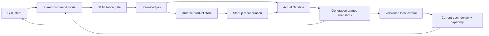

# 13 · Persistence, jobs and public control

Parent: [PRD index](../PRD.md). Owns durable application state, snapshots, operation records and automation contracts. No control endpoint is implemented yet.

## Outcome tree

```text
Outcome: preserve user context and make product behavior observable without widening authority
├── Store — settings, bookmarks, drafts and recovery metadata
├── Reconcile — snapshots, job journal and restart
├── Observe — read-only versioned control and UI snapshots
└── Act — explicit local opt-in through the same operation gate
```



## Storage model

Default product roots: `%LOCALAPPDATA%/PartnerNetSoftware/MiniConSrcMgr` on Windows, `~/Library/Application Support/MiniConSrcMgr` on macOS, and `$XDG_STATE_HOME/minicon-srcmgr` (fallback `~/.local/state/minicon-srcmgr`) on Linux; use the platform's config/cache conventions for settings and disposable cache respectively. Paths here are public templates, never expanded private home paths. A user-selected portable profile is optional and warns that drafts/recovery source may be sensitive. Never store product metadata in a repository unless it is an explicitly requested Git config change or recovery ref.

Use a versioned SQLite database for bookmarks/groups, identities, per-view settings, drafts and job/recovery metadata; put potentially large recovery payloads in a separate owner-only content store referenced by digest. SQLite is product-owned; select a maintained Rust binding with consistent native builds during M0 and record it in the dependency audit. UI themes and Git identities are separate from secret credentials, which are never stored here. Cache Git-derived graph/diff data only when useful, bind it to identities/generations and treat it as disposable.

All persisted identities, revision tokens, drafts, trust grants and plans include backend tags from the first schema, following [15](PRD_15_vcs_backends.md). Git HEAD/index/ref fields are optional Git-owned detail, not mandatory fields of every shared snapshot. Control advertises backend kind and capabilities; action dispatch rejects backend mismatches before invoking an adapter.

Draft keys include canonical worktree identity, task/mode and original HEAD where relevant. While dirty, schedule a save at least every 500 ms, including during continuous typing, and flush at deliberate tab/app close. Show Unsaved/Saving/Saved/Error; acknowledge Saved only after a successful durability-configured transaction, not when an edit enters a debounce queue. Scheduling delay or I/O failure means there is no guaranteed maximum crash-loss interval for unacknowledged edits. A delayed/error save stays visible and supports retry/copy/export; never discard a draft merely because shutdown or commit was requested.

Database writes use transactions and a documented SQLite durability mode; recovery payload publication uses write/flush/rename/read-back before a record becomes usable. Mutations requiring journal/draft persistence do not start if that prerequisite write fails. Crash claims apply to acknowledged records within the tested OS/filesystem durability boundary, not failed media or unflushed edits. One writer per profile coordinates multiple processes. A migration is transactional, creates a compatible backup and checks free space. On unreadable/newer schema open read-only recovery/settings guidance rather than overwrite/reset silently.

For ordinary Git commit, persist the exact submitted draft and a pending intent containing the reviewed prior HEAD (or unborn state) in one transaction before launching Git. A pending intent blocks another attempt, including after restart. Explicit repository Refresh reads actual state and reconciles that record without replaying the command; report the prior HEAD, preserve the draft and ask the user to inspect current history/index. Unknown outcome keeps the intent. A known unchanged-HEAD refusal can clear the intent while keeping the draft; a known observed commit clears the draft only after clean reconciliation. Failed cleanup reports the observed OID and retained recovery state. This bounded journal uses schema 1 settings, keyed by the repository-key SHA-256 digest under `git.commit.intent.v1.`, and never claims exactly-once execution across crashes.

Hold the cooperative profile writer through commit launch and observation. Release it before reacquiring for cleanup. A writer releasing its lock must not remove a replacement lock with different owner contents; this protects cooperative lifecycle mistakes, without promising isolation from a hostile same-user process.

## Repository navigation checkpoints

Schema 1 settings store `git.navigation.v1.<digest>` records. The digest binds the lossless platform-tagged canonical worktree path using the existing bounded native-path codec; reading/saving a checkpoint requires no filesystem access to that target. This lets an already-open missing worktree close without rescanning it. Git drafts and commit intents remain separately keyed and are never cleared by navigation writes.

The UI-owned record is bounded at 256 KiB, checked inside SQLite before allocation, then decoded strictly: pane/source enums, optional platform-native selected file, hex-encoded branch/commit/stash labels, stash flag, bounded cursor/scroll and a typed read-only detail request. Body version 3 retains version 2's three literal queries and pre-filter raw selection/position anchors, adding current committed-file selection and at most two historical return frames. Frames contain typed read requests, cursor/scroll and an optional raw file path, never cached Diffs; depth, order, source pane and matching commit OID are validated. Version 1 reads with empty queries; versions 1/2 derive a minimal historical return route where they lack prior positions. Schema and setting-key namespace do not change. Queries retain meaningful spaces, are bounded at 256 Unicode scalars and reject line breaks. Native paths preserve Unix bytes or Windows UTF-16; incompatible platform tags, malformed fields, unknown versions and oversized records are refused and retained. This checkpoint is navigation metadata, never a replayable mutation or a substitute for repository trust/freshness. Save on deliberate source departure and graceful app close; after restart only the last successful checkpoint is promised.

Explicit saved-view recovery reviews an invalid record up to 1 MiB, checking SQLite length before allocation; larger values remain untouched with manual profile-recovery guidance. A cryptographically random 128-bit ticket binds the exact reviewed value and worktree for sixty seconds and is consumed once. Approval atomically renames only the matching active setting to `git.navigation.archive.v1.<digest>.<ticket>` using an exact binary value comparison. Changed records, archive-key collisions or failed transactions preserve the active record. The archive retains the complete original value, including embedded NULs, without truncation or automatic eviction. No schema migration, draft/trust deletion or Git mutation occurs. Cancellation leaves it unchanged. After known publication, repeat ordinary Open and report any subsequent failure separately; an archive acknowledgement does not prove successful repository entry. Archive inspection/export and broader profile recovery remain outside this bounded UI repair.

Only the active worker target can save the submitted source context. Resolve the target's fresh snapshot and saved context before publishing an activation reply. Failed saves/discovery leave the worker target unchanged. The GUI consumes the same acknowledgement before changing the visible active tab; increasing generations fence obsolete details. The pending draft remains in its original worktree until an exact save acknowledgement, and failure leaves it copyable and explicitly retryable.

## External tool preferences

Schema 1 settings `tools.editor.v1` and `tools.terminal.v1` independently retain application-level definitions. Body version 1 contains a lossless platform-tagged executable path using the existing native-path codec, argument count and hex-encoded UTF-8 argument values. Reads check the 180,000-byte record bound inside SQLite before allocation. At most 32 arguments, 4096 UTF-8 bytes each and 16 KiB total are accepted; NUL/CR/LF within one argument are refused. Literal spaces, metacharacters, quotes and empty arguments are retained. Editor requires a whole `{file}` placeholder; terminal forbids it and may use `{repo}`. UI line breaks delimit arguments, with CRLF paste normalized as line separators. Unknown/malformed/foreign or oversized records are refused and retained; do not silently choose another executable.

Saving/clearing is transactional, performs no process launch and touches only that preference. Drafts, trust, repository config and navigation remain independent. Executable existence/selection and expiring launch authority belong to 10/11 and are rechecked at use, not inferred from stored data. No schema migration, credentials store, VCS coupling or automatic tool installation is introduced.

## Installed Git preference

The Git executable preference uses schema 1's existing settings table at `git.executable.v1`, as native path tag, tab and hex payload. It shares the bounded lossless path codec with recent metadata: Windows payload is little-endian UTF-16, Unix payload is raw bytes, each bounded at 64 KiB. Reads check stored length inside SQLite before allocation, refuse malformed/foreign-platform data and never probe an executable or silently fall back. Explicit clear deletes only this preference; drafts, recents and Git config remain intact. No migration or new dependency is needed. The application validates execution/version before saving and applies only after the durability-configured transaction succeeds. Precedence and graphical behavior belong to [03](PRD_03_workspace.md#current-006-entry-slice); this preference is not repository trust.

## Recent repository navigation records

The initial 0.0.6 storage slice holds at most 32 backend-tagged recent worktree paths, newest explicitly opened first, in the existing transactional settings row `workspace.recents.v1`. Each record is backend, native path tag and hex payload separated by tabs, followed by newline; Windows units use little-endian UTF-16 and Unix uses raw bytes. Payload is bounded at 64 KiB per path and 2 MiB per stored list, checked inside SQLite before materializing oversized values. This is a versioned product record inside schema 1, not a schema migration or a new filesystem index. Unknown/malformed/duplicate records refuse update and remain intact rather than being silently cleared.

The caller records a canonical worktree after explicit successful trusted discovery. A recent path is a navigation hint, never authorization or proof that the same repository still exists there. Reads/removal do not probe paths, run Git, grant trust, delete source or remove drafts/recovery. Reopening rechecks identity/trust under 03/11. Foreign-platform path records stay tagged and unavailable for native opening; no lossy path conversion is allowed. Selecting/removing metadata must remain distinct from repository deletion. Current GUI integration and evidence live in [the 0.0.6 plan](../plan/plan-0.0.6.md); storage support alone is not a completed Welcome flow.

Explicit Locate may replace a selected recent record after the metadata-only review in 03/11, without recording a successful open or granting trust. Keep the same schema/key/encoding/bounds. The source backend plus encoded path must still be present; remove an existing matching destination bookmark, replace the source at its remaining position and preserve every unrelated record's contents/order. The cooperative profile writer serializes read/validation and the single transactional settings publication. Absent/stale source, invalid/oversized target or failed write leaves the stored list intact. An unchanged target needs no rewrite. Storage itself never probes source/target paths. Drafts, navigation, trust, intents and all repository files remain independent; no implicit state migration follows a bookmark replacement. Return the known published list directly rather than allowing a later reread error to obscure successful publication.

## Journal and recovery retention

Persist job intent before mutation, then state transitions and observed outcomes. Records contain redacted operation labels, repo/common-dir IDs, target refs/OIDs, relevant fingerprints, recovery refs/payload references and timestamps. No credential, patch body or raw helper stderr in the journal. State machine semantics belong to [08](PRD_08_recovery.md). A journal entry is an audit hint, not proof Git executed exactly once; a crash between side effect and journal update requires reconciliation.

Defaults: diagnostic logs rotate at 20 MiB total and expire after seven days; completed job metadata retains thirty days with a 10,000-record cap. Disposable on-disk cache budget is 256 MiB with LRU eviction; this is not an in-memory allowance. In-memory cache allocation is adaptive and counts toward the total product memory ceilings in 14; release hidden repository pages/diffs and trim glyph/layout caches when necessary. Recovery storage soft budget is 1 GiB; warn at 80%, block new recovery-dependent operations at the limit unless the user changes budget or explicitly chooses the irreversible path. Never silently evict recovery payloads/refs based on age or LRU. Storage manager lists affected repos/dates/bytes and requires confirmation to delete; old records can be marked eligible for review after thirty days. Removing a bookmark never removes recovery records or source files.

## Domain snapshots and observation

Snapshots include protocol schema version, instance ID, repo/worktree/common-dir IDs, generation, HEAD OID/branch, change counts, operation state, trust/capability summary, selected view/semantic control IDs and stale reasons. Secret/raw path fields are omitted by default; opted-in detailed access follows [11](PRD_11_security.md). A generation increases on authoritative state replacement. Commands return job IDs and result states, never fake synchronous success while Git runs. Stable IDs are distinct from localized labels and row numbers.

M1 needs a public local observation surface for black-box tests: `version`, `capabilities`, `list-repositories`, `repo-snapshot`, `jobs`, `wait-job` and semantic `ui-snapshot`. Screenshot capture is separately opted in because it can expose source. CLI spelling is planned as `minicon-srcmgr control <verb>`; an implementation must version the concrete JSON schema before testing against it. Read-only control is explicitly enabled per profile and disabled by default in ordinary user builds; test profiles may enable it at launch. No TCP listener or external service.

M2 adds optional mutation control: `plan-action`, `execute-plan`, `cancel-job` and semantic UI actions. A plan has unpredictable ID, instance/repo/trust/generation binding, exact effects, risk class and sixty-second expiry. Harmless refresh/navigation actions need no destructive approval. Risky commands require either foreground GUI confirmation or an explicitly configured narrowly scoped local automation capability; a generic API token is insufficient. Automation cannot call a hidden raw-Git escape hatch or bypass safety copies/trust. Replayed plan IDs fail, and stale plans replan rather than widening scope.

Plan lifetime starts at creation; revalidate immediately before launch even if queued. Mark a plan consumed when launch is attempted under the writer gate, so an unknown result cannot be retried with the same token. Expired queued work requires a new preview/authorization; process restart invalidates all outstanding tokens. The domain plan contract is required for M1 GUI actions; the network-free control transport exposes it only from M2. M0 proves domain serialization and rejection with fixture calls, without depending on a production IPC or GUI mutation endpoint.

Bound GUI work queues while the worker is occupied. Coalesce superseded pending detail reads within their mutation-order boundary; do not coalesce repository writes or silently discard confirmation cancellation. Queue saturation reports refusal instead of growing memory indefinitely, and a refused read/preparation resolves its loading/prompt state. Worker completion clears the visible busy state only after pending work has drained. A refused confirmed action refreshes trusted repository state where possible; an unavailable refresh remains explicit.

Only completion of the submitted prompt action may acknowledge its commit, branch creation or draft save. An unrelated snapshot or job error must not close that prompt or enable duplicate submission. Saving a draft keeps its text available until durable persistence is acknowledged; a save failure or stopped worker leaves it available for retry/copy. A metadata refresh invalidates an outstanding destructive confirmation and releases the worker preparation instead of leaving an expired loading prompt.

Once Git reports a commit or branch creation completed, a later draft-cleanup or snapshot failure must not be reported as a refused submission. Acknowledge the known write, identify its actual commit/branch, retain any durable draft whose cleanup failed, and explain unavailable refresh/stale displayed lists without inviting resubmission. A fresh snapshot is still required before claiming reconciled state; completion of a different action cannot acknowledge another pending prompt.

## Transport and compatibility

Use current-user-restricted named pipes on Windows and owner-only Unix sockets in a private runtime directory elsewhere. Validate peer identity where supported and use a per-instance secret capability delivered through a private launch channel; no world-readable token files or token-in-argv logging. Equivalent current-user hostile processes remain outside the security promise, as defined in 11. Endpoint cleanup validates ownership and live instance identity before removing stale files.

Request JSON is length-framed UTF-8, capped at 1 MiB; cap concurrent requests and reject unknown write verbs, invalid enums, duplicate IDs and schema mismatches. Responses carry request ID, schema version, result/error kind and job/generation when applicable. Event streams are bounded; slow clients get an overflow/resync marker and request a snapshot rather than blocking the GUI. Major schema mismatch fails with guidance; additive optional fields are minor-compatible. No test backdoor with broader production authority.

## Delivery contracts

| ID / leaf | Invariant | Observable evidence | Safe failure | Dependencies | Non-goal |
|---|---|---|---|---|---|
| STATE-01 · durability | Restart preserves acknowledged settings/drafts without modifying Git | QA-J08 crash, migration, full disk and simultaneous profiles | Read-only recovery; no silent reset | 02, 11 | Unlimited crash-proof unflushed input |
| STATE-02 · journal | Uncertain jobs reconcile against actual state before retry | QA-J04 crash before/after side effect and journal flush | Needs reconciliation, no automatic replay | 08 | Exactly-once Git across crashes |
| STATE-03 · observe | Public snapshots have bounded stable identities and explicit freshness | QA-J05/J11 schema, overflow and stale generation fixtures | Resync/error without GUI blockage | 02, 10 | Source content export by default |
| STATE-04 · control | Automation uses the same gate with scoped authority | QA-J10 cross-user, replay, expiry and stale-plan checks | Reject/cancel without mutation | 08, 11 | Unrestricted remote control |
