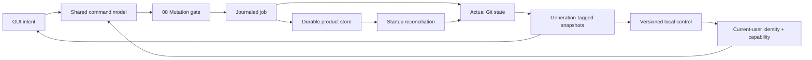

# 13 · Persistence, jobs and public control

Parent: [PRD index](../PRD.md). Owns durable application state, snapshots, operation records and automation contracts. No control endpoint is implemented yet.

## Outcome tree

```text
Outcome: preserve user context and make product behavior observable without widening authority
├── Store — settings, bookmarks, drafts and recovery metadata
├── Reconcile — snapshots, job journal and restart
├── Observe — read-only versioned control and UI snapshots
└── Act — explicit local opt-in through the same operation gate
```



## Storage model

Default product roots: `%LOCALAPPDATA%/PartnerNetSoftware/MiniConSrcMgr` on Windows, `~/Library/Application Support/MiniConSrcMgr` on macOS, and `$XDG_STATE_HOME/minicon-srcmgr` (fallback `~/.local/state/minicon-srcmgr`) on Linux; use the platform's config/cache conventions for settings and disposable cache respectively. Paths here are public templates, never expanded private home paths. A user-selected portable profile is optional and warns that drafts/recovery source may be sensitive. Never store product metadata in a repository unless it is an explicitly requested Git config change or recovery ref.

Use a versioned SQLite database for bookmarks/groups, identities, per-view settings, drafts and job/recovery metadata; put potentially large recovery payloads in a separate owner-only content store referenced by digest. SQLite is product-owned; select a maintained Rust binding with consistent native builds during M0 and record it in the dependency audit. UI themes and Git identities are separate from secret credentials, which are never stored here. Cache Git-derived graph/diff data only when useful, bind it to identities/generations and treat it as disposable.

All persisted identities, revision tokens, drafts, trust grants and plans include backend tags from the first schema, following [15](PRD_15_vcs_backends.md). Git HEAD/index/ref fields are optional Git-owned detail, not mandatory fields of every shared snapshot. Control advertises backend kind and capabilities; action dispatch rejects backend mismatches before invoking an adapter.

Draft keys include canonical worktree identity, task/mode and original HEAD where relevant. Persist draft edits after a 500 ms debounce and synchronously at deliberate tab/app close; a crash may lose at most the last unflushed interval, which the product must not promise to eliminate. Database writes use transactions; recovery payload publication uses write/flush/rename/read-back before a record becomes usable. One writer per profile coordinates multiple processes. A migration is transactional, creates a compatible backup and checks free space. On unreadable/newer schema open read-only recovery/settings guidance rather than overwrite/reset silently.

## Journal and recovery retention

Persist job intent before mutation, then state transitions and observed outcomes. Records contain redacted operation labels, repo/common-dir IDs, target refs/OIDs, relevant fingerprints, recovery refs/payload references and timestamps. No credential, patch body or raw helper stderr in the journal. State machine semantics belong to [08](PRD_08_recovery.md). A journal entry is an audit hint, not proof Git executed exactly once; a crash between side effect and journal update requires reconciliation.

Defaults: diagnostic logs rotate at 20 MiB total and expire after seven days; completed job metadata retains thirty days with a 10,000-record cap. Disposable on-disk cache budget is 256 MiB with LRU eviction; this is not an in-memory allowance. In-memory cache allocation is adaptive and counts toward the total product memory ceilings in 14; release hidden repository pages/diffs and trim glyph/layout caches when necessary. Recovery storage soft budget is 1 GiB; warn at 80%, block new recovery-dependent operations at the limit unless the user changes budget or explicitly chooses the irreversible path. Never silently evict recovery payloads/refs based on age or LRU. Storage manager lists affected repos/dates/bytes and requires confirmation to delete; old records can be marked eligible for review after thirty days. Removing a bookmark never removes recovery records or source files.

## Domain snapshots and observation

Snapshots include protocol schema version, instance ID, repo/worktree/common-dir IDs, generation, HEAD OID/branch, change counts, operation state, trust/capability summary, selected view/semantic control IDs and stale reasons. Secret/raw path fields are omitted by default; opted-in detailed access follows [11](PRD_11_security.md). A generation increases on authoritative state replacement. Commands return job IDs and result states, never fake synchronous success while Git runs. Stable IDs are distinct from localized labels and row numbers.

M1 needs a public local observation surface for black-box tests: `version`, `capabilities`, `list-repositories`, `repo-snapshot`, `jobs`, `wait-job` and semantic `ui-snapshot`. Screenshot capture is separately opted in because it can expose source. CLI spelling is planned as `minicon-srcmgr control <verb>`; an implementation must version the concrete JSON schema before testing against it. Read-only control is explicitly enabled per profile and disabled by default in ordinary user builds; test profiles may enable it at launch. No TCP listener or external service.

M2 adds optional mutation control: `plan-action`, `execute-plan`, `cancel-job` and semantic UI actions. A plan has unpredictable ID, instance/repo/trust/generation binding, exact effects, risk class and sixty-second expiry. Harmless refresh/navigation actions need no destructive approval. Risky commands require either foreground GUI confirmation or an explicitly configured narrowly scoped local automation capability; a generic API token is insufficient. Automation cannot call a hidden raw-Git escape hatch or bypass safety copies/trust. Replayed plan IDs fail, and stale plans replan rather than widening scope.

## Transport and compatibility

Use current-user-restricted named pipes on Windows and owner-only Unix sockets in a private runtime directory elsewhere. Validate peer identity where supported and use a per-instance secret capability delivered through a private launch channel; no world-readable token files or token-in-argv logging. Equivalent current-user hostile processes remain outside the security promise, as defined in 11. Endpoint cleanup validates ownership and live instance identity before removing stale files.

Request JSON is length-framed UTF-8, capped at 1 MiB; cap concurrent requests and reject unknown write verbs, invalid enums, duplicate IDs and schema mismatches. Responses carry request ID, schema version, result/error kind and job/generation when applicable. Event streams are bounded; slow clients get an overflow/resync marker and request a snapshot rather than blocking the GUI. Major schema mismatch fails with guidance; additive optional fields are minor-compatible. No test backdoor with broader production authority.

## Delivery contracts

| ID / leaf | Invariant | Observable evidence | Safe failure | Dependencies | Non-goal |
|---|---|---|---|---|---|
| STATE-01 · durability | Restart preserves acknowledged settings/drafts without modifying Git | QA-J08 crash, migration, full disk and simultaneous profiles | Read-only recovery; no silent reset | 02, 11 | Unlimited crash-proof unflushed input |
| STATE-02 · journal | Uncertain jobs reconcile against actual state before retry | QA-J04 crash before/after side effect and journal flush | Needs reconciliation, no automatic replay | 08 | Exactly-once Git across crashes |
| STATE-03 · observe | Public snapshots have bounded stable identities and explicit freshness | QA-J05/J11 schema, overflow and stale generation fixtures | Resync/error without GUI blockage | 02, 10 | Source content export by default |
| STATE-04 · control | Automation uses the same gate with scoped authority | QA-J10 cross-user, replay, expiry and stale-plan checks | Reject/cancel without mutation | 08, 11 | Unrestricted remote control |
