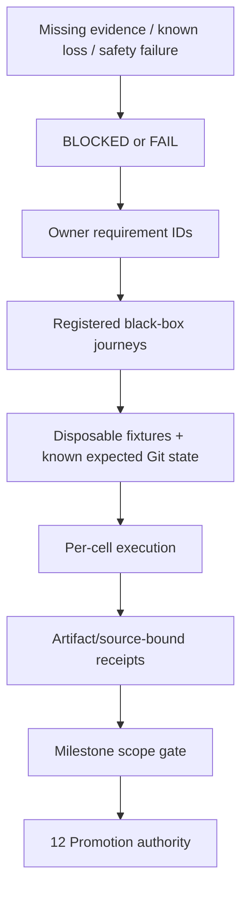

# 14 · Verification, traceability and implementation roadmap

Parent: [PRD index](../PRD.md). Owns test journeys, coverage mapping, performance budgets, evidence format and implementation sequence. Product milestone membership is owned by [01](PRD_01_product.md); artifact delivery by [12](PRD_12_platform_delivery.md).

## Outcome tree

```text
Outcome: qualify stated behavior with reproducible observable evidence
├── Contracts — every requirement mapped to a meaningful journey
├── Fixtures — disposable repositories, controlled remotes and adversarial data
├── Measurements — UI latency, resources and bounded workloads
└── Gates — source checks, native runtimes and exact artifact release evidence
```



## Traceability and journey registry

These are **specified cases, not existing tests**. Every case currently has verdict `NOT-RUN`. Each journey may contain multiple fixtures, but reports outcomes separately; one happy path cannot satisfy an entire family. Named requirement IDs are the source of truth; implementation changes add cases without moving requirements into test comments.

| Journey | Requirement coverage | Minimum observable scenario and oracle |
|---|---|---|
| QA-J01 · precise local cycle | PROD-01/02, REPO-01/05, CHANGE-01/02/03, REF-02 | Open/init offline; scoped config/escaped ignore; mixed staged/unstaged/untracked; hunk and line stage/unstage; first commit; dirty switch; compare actual index/tree/worktree bytes and refs |
| QA-J02 · two-user collaboration | PROD-01, REPO-02, REF-01, REMOTE-01/02/03/04 | Two clones + bare remote; clone/auth; tag publish; pull modes; prune; stale lease; rejected/partial/unknown push; compare actual refs at both ends |
| QA-J03 · integration/conflicts | PROD-01, REF-02/03/04, REMOTE-02, REC-02 | Merge/rebase/pick/revert/am conflicts; all conflict classes; interactive order/drop; restart then continue/skip/abort; inspect parents/tree/index stages |
| QA-J04 · interrupted/destructive work | PROD-01, REF-04, REC-03/04, STATE-02 | Kill at journal/process boundaries; cancel hook; full disk safety copy; soft/mixed/hard reset; discard/trash; undo with new edits; verify exact surviving content and truthful status |
| QA-J05 · freshness/concurrency | ARCH-03, REPO-01/04, CHANGE-02, REMOTE-04, REC-01, STATE-03 | External commit/index edit/ref move, file replacement, linked writer overlap, dropped watch events and stale preview; assert rejection/rescan without widened effects |
| QA-J06 · inspection | HIST-01/02/03/04 | Deep/merge/octopus/shallow/SHA-256 graph; page/filter boundaries; root/merge comparison; rename/blame and signature states; oracle is Git object metadata |
| QA-J07 · advanced workflows | REPO-01, REF-01, ADV-01/02/03 | Stash reorder/pop conflict, worktree occupancy/lock/move/prune, missing mount, child gitlink/URL trust, missing LFS; assert no parent/child confusion or unexpected deletion |
| QA-J08 · durable context | REPO-03/05, STATE-01 | Settings/config scopes/drafts/bookmarks across graceful/crash restart, concurrent config edits, schema migration/newer DB, storage limits and simultaneous instances; compare durable records and unchanged repo |
| QA-J09 · desktop/accessibility | PROD-04, UX-01/02/03/04 | Keyboard and mouse full journeys, three languages, CJK IME, held Enter, minimum size, DPI/theme/contrast, screen reader on each OS; semantic assertions plus reviewed captures |
| QA-J10 · trust/privacy | CHANGE-03, REMOTE-01, ADV-03, REC-03, SEC-01/02/04, STATE-04 | Hostile hooks/filters/config/helpers, secret canaries, auth/sign cancel, control cross-user/replay, offline/network observation; zero unauthorized marker files/processes and no durable canaries |
| QA-J11 · hostile data/bounds | ARCH-02, CHANGE-02/04, HIST-02, ADV-04, SEC-03, STATE-03 | Invalid UTF-8/UTF-16 edge paths, whitespace/newlines/leading dash/bidi, symlink/reparse escape, huge output, malformed patch/IPC; bytes preserved, no outside write or shell effect |
| QA-J12 · native portability | PROD-03, ARCH-01/04, SHIP-01/02 | Isolated consumer with exact features/forks; six native builds and runtime GUI/IME/clipboard/accessibility/cancellation/installed Git; real Linux X11 + Wayland; clean-image launch |
| QA-J13 · distribution | SHIP-03/04 | Signature/metadata validation, candidate versus public bytes, wrong-ISA/tamper/replay, failed update/full disk/rollback; exact artifact identities and usable prior version |

## Test layers and evidence integrity

Use pure-rule tests for parsers/geometry/plans only where they guard meaningful behavior; Git integration fixtures for actual object/index/ref changes; public CLI/control and GUI journeys for user-visible effects; native accessibility and real input for platform behavior. Do not substitute mocked Git exit zero for repository-state verification. Deterministic fixtures use local remotes and synthetic identities; HTTPS/SSH/signing tests use dedicated disposable credentials, never real account secrets.

For data-loss/security guards, demonstrate a deliberate broken implementation makes the relevant test fail, then restore it and record the result. Avoid screenshot-only tests for semantic correctness and source-text tests that merely mirror implementation spelling. Capture fixture seed, expected/actual object IDs/content hashes, public command results and redacted failure details. Run isolated parallel tests with independent repositories/profiles/remotes; serially integrate shared gates.

An evidence receipt includes requirement/case IDs, verdict, source SHA, dependency revision/features, artifact hash, test harness revision, OS/version/display backend, actual process ISA, native/emulated classification, Git path/version/capabilities, fixture seed, timestamps and output references. No real private identities or credentials. `PASS` requires successful assertions; `FAIL` is observed violation; `BLOCKED` is a missing prerequisite; `NOT-RUN` means no attempt. None can be silently converted to PASS. Prior upstream evidence is context only, not SrcMgr qualification.

## Performance and resource budgets

Budgets are product targets, not measurements already achieved. Measure release-profile candidate binaries on recorded native hardware with at least 4 CPU cores, 8 GiB RAM, local SSD and 1920×1080 display; record CPU, memory, OS, display scale and installed Git. Run thirty timed trials after five warmups for warm p95; cold-start trials use a fresh process and separately note OS cache conditions. Git/network time and UI scheduling time are reported separately. Do not compare ARM and x86 scores without recording hardware.

| Workload | Target / limit | Failure behavior |
|---|---|---|
| Cold launch to responsive shell, no repo | p95 ≤ 1.5 s | Profile and fail performance gate, never hide behind blank window |
| Warm repo selection to first usable view | p95 ≤ 500 ms on standard fixture, cached preview ≤ 100 ms | Show stale/loading state and allow navigation |
| UI input while Git busy | p95 dispatch-to-feedback ≤ 50 ms, no individual UI stall > 200 ms | Cancel/backpressure worker path; fail responsiveness gate |
| Standard repo | 100k commits, 20k tracked files, 200 refs, 200 changed paths; first 200 graph rows ≤ 1 s warm, status ≤ 2 s warm | Progressive results with bounded workers |
| Large repo | 1M commits, 100k tracked files, 5k refs, 10k changed paths | No unbounded traversal; progress/cancel and explicit incomplete counts; no fixed full-scan latency promise |
| Memory | Product idle RSS ≤ 120 MiB; standard journey peak ≤ 300 MiB; large bounded view ≤ 500 MiB | Evict disposable cache; never recovery/draft data. Child Git/helper RSS reported separately |
| Idle, stable repo | Mean app CPU < 1% of one core over 60 s after settling | No unconditional redraw/poll storm |
| Diffs | Inline rendering default ≤ 5 MiB and 50k lines per file; virtualize rows; user may choose bounded external view | Show metadata/truncation; never partial display used as full patch |
| Pipes and job output | 8 MiB in-memory combined job tail; stream/discard with redaction and explicit truncation; binary protocols use bounded parse/spool paths | Kill only failed owned read job when limits prevent safe parse; mutation continues to reconciliation rather than assuming rollback |
| Workers | At most two repository read jobs plus one common-dir writer; cap background work globally | Queue/coalesce obsolete reads, preserve explicit mutation intent |

Binary size target is ≤ 20 MiB compressed per single-ISA product archive, excluding separately installed Git/system packages. M0 records the first honest baseline; an accessibility/runtime dependency exceeding the budget requires a reviewed target change, not deletion of required behavior. All six native cells must pass resource/latency gates on recorded representative hardware or block M3; noisy CI retries must be labeled and never used to erase a consistent regression.

## Implementation order and hot ownership

| Order | Work package / hot files to introduce | Prerequisite and exit evidence |
|---|---|---|
| 0 | Dependency/toolchain lock, isolated consumer, platform feature manifest | Published immutable MiniCon revision, fork resolution; ARCH-01/04 and QA-J12 feasibility receipts |
| 1 | Domain IDs/snapshots, runner, trust quarantine, SQLite/journal, native accessibility prototype | ARCH-02/03, SEC-01, STATE-01/02, UX-04 M0 proof before general UI expansion |
| 2 | Workspace + Changes + commit + graph + branch switch; shared action model | QA-J01/J05/J08; M1 local vertical slice with preserved drafts and byte-precise staging |
| 3 | Network auth, refs/integration, conflict center, stash/basic worktrees, localization | QA-J02/J03/J07/J09/J10; M2 full collaboration/restart/screen-reader journey |
| 4 | Interactive history, advanced content/patches, remaining localization and hardened control | All M3 behavior cases including hostile paths and partial failures |
| 5 | Package/sign/update, performance, final native receipts, release proposal | QA-J12/J13 + all requirement verdicts, exact-artifact gate and named publish authority |

Runner, operation coordinator, trust policy, shared UI primitives and schema are shared hot files. Stabilize contracts before independent feature work; integrate and execute shared gates serially. No calendar estimates until M0 proves the foundation.

## QA delivery contracts

| ID / leaf | Invariant | Observable evidence | Safe failure | Dependencies | Non-goal |
|---|---|---|---|---|---|
| QA-01 · coverage | Every behavior requirement maps to named scenarios and a verdict | Registry plus owner-table ID audit; application receipts when implemented | Missing case/evidence blocks milestone | 01–13 | Documentation count proves quality |
| QA-02 · measurement | Budgets use declared fixtures/environment and honest samples | Versioned benchmark report, trial data and UI event traces | FAIL/BLOCKED with recorded reason | 02, 10, 12 | Invented performance claims |
| QA-03 · gates | Integrity/security failures cannot be waived by unrelated passes | Gate aggregation and negative-control evidence | Stop milestone/release and preserve evidence | 08, 11–13 | Average away a data-loss case |

## Baseline review checklist

Before implementation, review each owner's contract against user workflows, milestone membership, failure/recovery behavior and dependencies. During implementation, add evidence links adjacent to requirement IDs without duplicating normative behavior in the README or a separate roadmap. Before release, verify no required `NOT-RUN`/`BLOCKED`/`FAIL`, no unresolved known data-loss/security defect, no unsupported target claim and no stale artifact receipt. The present repository intentionally claims only documentation completion.
