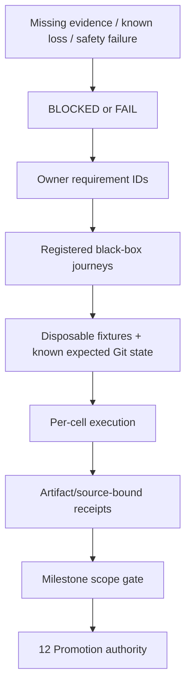

# 14 · Verification, traceability and implementation roadmap

Parent: [PRD index](../PRD.md). Owns test journeys, coverage mapping, performance budgets, evidence format and implementation sequence. Product milestone membership is owned by [01](PRD_01_product.md); artifact delivery by [12](PRD_12_platform_delivery.md).

## Outcome tree

```text
Outcome: qualify stated behavior with reproducible observable evidence
├── Contracts — every requirement mapped to a meaningful journey
├── Fixtures — disposable repositories, controlled remotes and adversarial data
├── Measurements — UI latency, resources and bounded workloads
└── Gates — source checks, native runtimes and exact artifact release evidence
```



## Traceability and journey registry

These are **specified cases, not existing tests**. Every case currently has verdict `NOT-RUN`. Each journey may contain multiple fixtures, but reports outcomes separately; one happy path cannot satisfy an entire family. Named requirement IDs are the source of truth; implementation changes add cases without moving requirements into test comments.

| Journey | Requirement coverage | Minimum observable scenario and oracle |
|---|---|---|
| QA-J01 · precise local cycle | PROD-01/02, REPO-01/05, CHANGE-01/02/03, REF-02 | Open/init offline; scoped config/escaped ignore; mixed staged/unstaged/untracked; hunk and line stage/unstage; first commit; dirty switch; compare actual index/tree/worktree bytes and refs |
| QA-J02 · two-user collaboration | PROD-01, REPO-02, REF-01, REMOTE-01/02/03/04 | Two clones + bare remote; clone/auth; tag publish; pull modes; prune; stale lease; rejected/partial/unknown push; ambient mirror/follow-tags settings cannot add refs or publish recovery refs; compare actual refs at both ends |
| QA-J03 · integration/conflicts | PROD-01, REF-02/03/04, REMOTE-02, REC-02 | Merge/rebase/pick/revert/am conflicts; all conflict classes; interactive order/drop; restart then continue/skip/abort; inspect parents/tree/index stages |
| QA-J04 · interrupted/destructive work | PROD-01, REF-04, REC-03/04, STATE-02 | Kill at journal/process boundaries; nonzero exit after side effect; cancel hook; full disk safety copy; reset modes including untracked obstructions; discard/trash; undo with new edits; verify exact surviving content and truthful status |
| QA-J05 · freshness/concurrency | ARCH-03, REPO-01/04, CHANGE-02, REMOTE-04, REC-01, STATE-03 | External commit/index edit/ref move, file replacement, linked writer overlap, dropped watch events and stale preview; assert rejection/rescan without widened effects |
| QA-J06 · inspection | HIST-01/02/03/04 | Deep/merge/octopus/shallow/SHA-256 graph; page/filter boundaries; recovery refs excluded from default history; root/merge comparison; rename/blame and signature states; oracle is Git object metadata |
| QA-J07 · advanced workflows | REPO-01, REF-01, ADV-01/02/03 | Stash reorder/pop conflict, worktree occupancy/lock/move/prune, missing mount, child gitlink/URL trust, missing LFS; assert no parent/child confusion or unexpected deletion |
| QA-J08 · durable context | REPO-03/05, STATE-01 | Settings/config scopes/drafts/bookmarks across graceful/crash restart; continuous typing, delayed/failed I/O and Saved acknowledgement; concurrent config edits, migrations, storage limits and simultaneous instances; compare durable records and unchanged repo |
| QA-J09 · desktop/accessibility | PROD-04/05, UX-01/02/03/04/05 | Keyboard and mouse full journeys, lazygit reference workflow checklist and task-path counts, three languages, CJK IME, held Enter, minimum size, DPI/theme/contrast, screen reader on each OS; semantic assertions plus reviewed captures |
| QA-J10 · trust/privacy | CHANGE-03, REMOTE-01, ADV-03, REC-03, SEC-01/02/04, STATE-04 | Untrusted metadata-only open/refresh/history/diff starts no repository command; hostile hooks/filters/config/helpers, deny/grant/revoke, secret canaries, auth/sign cancel, control cross-user/replay, offline/network observation; zero unauthorized marker files/processes and no durable canaries |
| QA-J11 · hostile data/bounds | ARCH-02, CHANGE-02/04, HIST-02, ADV-04, SEC-03, STATE-03 | Invalid UTF-8/UTF-16 edge paths, whitespace/newlines/leading dash/bidi, symlink/reparse escape, huge output, malformed patch/IPC; bytes preserved, no outside write or shell effect |
| QA-J12 · native portability | PROD-03, ARCH-01/04, SHIP-01/02 | Isolated consumer with exact features/forks; six native builds and runtime GUI/IME/clipboard/accessibility/cancellation/installed Git; real Linux X11 + Wayland; clean-image launch |
| QA-J13 · distribution | SHIP-03/04 | Signature/metadata validation, candidate versus public bytes, wrong-ISA/tamper/replay, failed update/full disk/rollback; exact artifact identities and usable prior version |
| QA-J14 · backend contract | VCS-01/02/03 | Inert non-Git fixture with opaque revisions, no index/push, optional property data; capability-driven UI/control dispatch, durable round-trip and backend mismatch rejection; verify inactive adapters spawn/probe nothing |

## Test layers and evidence integrity

Use pure-rule tests for parsers/geometry/plans only where they guard meaningful behavior; Git integration fixtures for actual object/index/ref changes; public CLI/control and GUI journeys for user-visible effects; native accessibility and real input for platform behavior. Do not substitute mocked Git exit zero for repository-state verification. Deterministic fixtures use local remotes and synthetic identities; HTTPS/SSH/signing tests use dedicated disposable credentials, never real account secrets.

For data-loss/security guards, demonstrate a deliberate broken implementation makes the relevant test fail, then restore it and record the result. Avoid screenshot-only tests for semantic correctness and source-text tests that merely mirror implementation spelling. Capture fixture seed, expected/actual object IDs/content hashes, public command results and redacted failure details. Run isolated parallel tests with independent repositories/profiles/remotes; serially integrate shared gates.

An evidence receipt includes requirement/case IDs, verdict, source SHA, dependency revision/features, artifact hash, test harness revision, OS/version/display backend, actual process ISA, native/emulated classification, Git path/version/capabilities, fixture seed, timestamps and output references. No real private identities or credentials. `PASS` requires successful assertions; `FAIL` is observed violation; `BLOCKED` is a missing prerequisite; `NOT-RUN` means no attempt. None can be silently converted to PASS. Prior upstream evidence is context only, not SrcMgr qualification.

## Performance and resource budgets

Budgets are product targets, not measurements already achieved. Measure release-profile candidate binaries on recorded native hardware with at least 4 CPU cores, 8 GiB RAM, local SSD and 1920×1080 display; record CPU, memory, OS, display scale and installed Git. Run thirty timed trials after five warmups for warm p95; cold-start trials use a fresh process and separately note OS cache conditions. Git/network time and UI scheduling time are reported separately. Do not compare ARM and x86 scores without recording hardware.

Low memory, fast response and low CPU are simultaneous acceptance constraints. These tightened budgets supersede baseline 1.0's looser resource limits. M0 measures the shell/native foundation; M1 onward enforces every budget applicable to delivered functionality, and M3 qualifies the complete workload. Keep per-OS/ISA measurements; do not average away a failing cell. Defaults must meet the budgets without requiring users to disable accessibility, safety, translations or normal Git behavior. No performance claim is currently certified.

| Workload | Target / limit | Failure behavior |
|---|---|---|
| Cold launch to responsive shell, no repo | p95 ≤ 1 s | Profile and fail performance gate, never hide behind blank window |
| Warm repo selection to first usable view | p95 ≤ 300 ms on standard fixture, cached preview ≤ 50 ms | Show stale/loading state and allow navigation |
| UI input while Git busy | Event dispatch + handler p95 ≤ 16 ms; real input-to-present feedback p95 ≤ 33 ms on the 60 Hz reference display; no individual UI-thread stall > 100 ms | Measure CPU handling and frame presentation separately; fail responsiveness gate for either limit |
| Standard repo | 100k commits, 20k tracked files, 200 refs, 200 changed paths; first 200 graph rows ≤ 1 s warm, status ≤ 2 s warm | Progressive results with bounded workers |
| Large repo | 1M commits, 100k tracked files, 5k refs, 10k changed paths | No unbounded traversal; progress/cancel and explicit incomplete counts; no fixed full-scan latency promise |
| Product memory | No-repo idle RSS ≤ 32 MiB; standard repo settled idle ≤ 64 MiB and journey peak ≤ 128 MiB; large bounded view peak ≤ 256 MiB | Bound active pages/frames/caches and evict disposable state; never recovery/drafts. Measure reference display at 100% scale; report high-DPI results separately with frame-buffer cost |
| Whole process tree memory | Standard journey combined peak RSS ≤ 256 MiB; large journey ≤ 512 MiB, including product-owned Git/helpers; report each process and private/committed allocations too | No moving product work into an unreported helper to pass app-only ceilings; investigate redundant concurrent jobs |
| Idle CPU | Stable visible repo: mean app-owned process-tree CPU ≤ 0.2% of one core over 60 s after settling; minimized/no job ≤ 0.1% | No continuous render loop, full-scan timer or background process churn |
| Idle redraw / wakeups | No content change or active caret: zero presented frames; application-scheduled timer wakeups ≤ 2/s visible and ≤ 0.2/s minimized | Suspend timers/animation and coalesce dirty signals; record native event wakeups separately |
| Active CPU efficiency | Per scripted inspect/stage/commit/refresh cycle, combined app+child CPU time ≤ 1.25× the same verified backend command sequence run directly, plus 0.5 CPU-seconds for UI | Eliminate duplicate queries/scans and full-window rasterization; retain same backend effects and test inputs |
| Repeated use | After 100 repository/view switch cycles and 30 s settling, idle RSS ≤ initial settled RSS + 8 MiB and within absolute limit | Release retained graphs/diffs, cancel obsolete reads and investigate growth |
| Diffs | Inline rendering default ≤ 5 MiB and 50k lines per file; virtualize rows; user may choose bounded external view | Show metadata/truncation; never partial display used as full patch |
| Pipes and job output | 8 MiB in-memory combined job tail; stream/discard with redaction and explicit truncation; binary protocols use bounded parse/spool paths | Kill only failed owned read job when limits prevent safe parse; mutation continues to reconciliation rather than assuming rollback |
| Workers | At most two reads per active repository and one writer per common-dir; product-wide cap two read jobs plus one writer by default; hidden idle repos schedule no reads | Queue/coalesce obsolete reads, preserve explicit mutation intent |

Binary size target is ≤ 20 MiB compressed per single-ISA product archive, excluding separately installed Git/system packages. M0 records the first honest baseline; an accessibility/runtime dependency exceeding the budget requires a reviewed target change, not deletion of required behavior. All six native cells must pass resource/latency gates on recorded representative hardware or block M3; noisy CI retries must be labeled and never used to erase a consistent regression.

Resource reports sample at ≤ 100 ms during tasks, include settled idle after 30 s, and distinguish app-only from the complete owned process tree. Sampling alone can miss short-lived peaks: collect OS/process high-water and lifetime CPU counters where available, and record any measurement limitation as BLOCKED for that gate instead of a passing peak estimate. Combined-tree peak uses simultaneous aggregate samples/high-water evidence, not the sum of unrelated per-process peak times. Count helper lifetime and work left after cancellation; also record read bytes, Git launches, timer wakeups and presented frames per scenario. A user-supplied heavyweight hook/signer is measured separately from the deterministic no-custom-hook benchmark; it never justifies an unresponsive GUI. Record real input-to-present timing for selected-row/diff feedback, not only handler entry. High-DPI/accessibility-enabled runs remain mandatory interaction tests; their resource deltas must be explicit and reviewed rather than silently excluded from claims.

When an OS lacks an exact aggregate-tree RSS peak counter, a documented conservative upper bound from complete lifetime high-water evidence may qualify a budget if that bound is within it; label it Upper bound, not Measured simultaneous peak. An upper bound exceeding the ceiling is inconclusive until better measurement, rather than proof of an actual exceedance. Missing lifetime coverage remains BLOCKED. Benchmark monitor overhead is measured/reported separately and is not counted as product-owned work.

## Implementation order and hot ownership

| Order | Work package / hot files to introduce | Prerequisite and exit evidence |
|---|---|---|
| 0 | Dependency/toolchain lock, isolated consumer, platform feature manifest | Published immutable MiniCon revision, fork resolution; ARCH-01/04 and QA-J12 feasibility receipts |
| 1 | Backend-tagged domain/capabilities, runner, trust quarantine, SQLite/journal, native accessibility prototype and shell resource baseline | ARCH-02/03, SEC-01, STATE-01/02, UX-04, VCS-01/02/03; QA-J14 and applicable resource proofs in M0 before general UI expansion |
| 2 | Workspace + Changes + commit + graph + branch switch; shared action model | QA-J01/J05/J08/J09; M1 local slice with preserved drafts, precise staging, direct action paths and applicable resource gates |
| 3 | Network auth, refs/integration, conflict center, stash/basic worktrees, localization | QA-J02/J03/J07/J09/J10; M2 full collaboration/restart/screen-reader journey |
| 4 | Interactive history, advanced content/patches, remaining localization and hardened control | All M3 behavior cases including hostile paths and partial failures |
| 5 | Package/sign/update, performance, final native receipts, release proposal | QA-J12/J13 + all requirement verdicts, exact-artifact gate and named publish authority |

Runner, operation coordinator, trust policy, shared UI primitives and schema are shared hot files. Stabilize contracts before independent feature work; integrate and execute shared gates serially. No calendar estimates until M0 proves the foundation.

Development is incremental: a missing non-host runtime court blocks that receipt and milestone/release completion, not independent host development or pure domain work. M0 prototype accessibility means one real window, focused editable text and a named action through a screen reader on each OS family; full application accessibility journeys expand with delivered views by M2/M3. M0 non-Git contract checks are domain-level; GUI/control checks arrive according to 15. Never mark an entire cross-milestone journey PASS when only its current subset ran. Record subcase IDs, scope and exclusions explicitly.

Use [the implementation handoff](../plan/implementation-handoff.md) for the first assignment and work order. Keep that plan about sequencing/evidence references; changes to product behavior still belong in the owning PRD.

## Pre-implementation review disposition · baseline 1.2

This table records specification fixes, not executed application tests. All implementation receipts remain NOT-RUN.

| Finding | Specification disposition / owner | Implementation proof still required |
|---|---|---|
| R01 · untrusted Git reads were assumed controllable through config overrides | [11](PRD_11_security.md) now requires metadata-only before trust; [03](PRD_03_workspace.md) orders discovery afterward | QA-J10 process/marker deny tests and trust lifecycle |
| R02 · index snapshot and failed-hook preservation claims exceeded Git guarantees | [04](PRD_04_changes_commits.md), [08](PRD_08_recovery.md) define observed freshness, live-index effects and post-exit reconciliation | QA-J01/J04/J05/J10 hook changes, nonzero-after-effect and external writer races |
| R03 · debounce implied a false maximum crash-loss window | [13](PRD_13_state_control.md) distinguishes scheduled saves from durable acknowledgements | QA-J08 continuous typing, delayed/failing I/O, crash and shutdown |
| R04 · M0 depended on later GUI/control and whole-product accessibility | [01](PRD_01_product.md), [15](PRD_15_vcs_backends.md) and sequence above divide prototype/domain and later full journeys | Scoped M0 receipts plus later cumulative subcases |
| R05 · platform API success could hide a no-op accessibility backend | [02](PRD_02_architecture_reuse.md) records the pinned source's Linux publisher/non-Linux gap | Real UIA/macOS/AT-SPI semantic/action/text proof; no screenshot-only or no-op pass |
| R06 · latency and memory sampling were ambiguous | This module separates event handling/presentation and requires peak/lifetime counters | QA-J12 resource report with limits and per-cell scope |
| R07 · hard reset could destroy untracked obstructions; broad pushes could leak safety refs | [06](PRD_06_references.md), [08](PRD_08_recovery.md), [07](PRD_07_remotes.md) specify obstruction scope, recovery namespace and exact refspecs | QA-J04 untracked obstruction and QA-J02 ambient mirror/follow-tags tests |
| R08 · dependency/tool prerequisites and first assignment were insufficiently concrete | [02](PRD_02_architecture_reuse.md) fixes initial toolchain/provenance; [handoff](../plan/implementation-handoff.md) gives staged work and blocker rules | Isolated consumer/tool inventory; no sibling edits or false six-cell claims |

Review conclusion: the requirements are ready to begin M0 implementation with explicit acceptance gates. Native accessibility extensions, exact consumer fork/build compatibility and supervised process lifecycle remain engineering feasibility risks; documentation review cannot certify them. Do not expand the first assignment to all M3 features to avoid those gates.

## QA delivery contracts

| ID / leaf | Invariant | Observable evidence | Safe failure | Dependencies | Non-goal |
|---|---|---|---|---|---|
| QA-01 · coverage | Every behavior requirement maps to named scenarios and a verdict | Registry plus owner-table ID audit; application receipts when implemented | Missing case/evidence blocks milestone | 01–13, 15 | Documentation count proves quality |
| QA-02 · measurement | Budgets use declared fixtures/environment and honest samples | Versioned benchmark report, trial data and UI event traces | FAIL/BLOCKED with recorded reason | 02, 10, 12 | Invented performance claims |
| QA-03 · gates | Integrity/security failures cannot be waived by unrelated passes | Gate aggregation and negative-control evidence | Stop milestone/release and preserve evidence | 08, 11–13 | Average away a data-loss case |
| QA-04 · efficiency | Memory, responsiveness and CPU gates apply together from the first usable slice | QA-J12 resource/latency receipts, repeated-use and idle traces per delivered milestone | FAIL/BLOCKED on exceeded or unmeasured applicable budget | 02, 03, 10, 12, 13, 15 | Hide resource cost in helpers or defer all optimization to release |

## Baseline review checklist

Before implementation, review each owner's contract against user workflows, milestone membership, failure/recovery behavior and dependencies. During implementation, add evidence links adjacent to requirement IDs without duplicating normative behavior in the README or a separate roadmap. Before release, verify no required `NOT-RUN`/`BLOCKED`/`FAIL`, no unresolved known data-loss/security defect, no unsupported target claim and no stale artifact receipt. The present repository intentionally claims only documentation completion.
