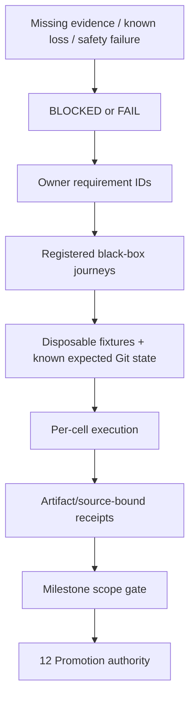

# 14 · Verification, traceability and implementation roadmap

Parent: [PRD index](../PRD.md). Owns test journeys, coverage mapping, performance budgets, evidence format and implementation sequence. Product milestone membership is owned by [01](PRD_01_product.md); artifact delivery by [12](PRD_12_platform_delivery.md).

## Outcome tree

```text
Outcome: qualify stated behavior with reproducible observable evidence
├── Contracts — every requirement mapped to a meaningful journey
├── Fixtures — disposable repositories, controlled remotes and adversarial data
├── Measurements — UI latency, resources and bounded workloads
└── Gates — source checks, native runtimes and exact artifact release evidence
```



## Traceability and journey registry

These rows define **journey families, not executable tests or family-wide verdicts**. Implemented subcases have scoped evidence in the historical records and version plans below; unexecuted subcases remain NOT-RUN and missing required prerequisites are BLOCKED. Each journey may contain multiple fixtures and reports their outcomes separately; one happy path cannot satisfy an entire family. Named requirement IDs are the source of truth; implementation changes add cases without moving requirements into test comments.

| Journey | Requirement coverage | Minimum observable scenario and oracle |
|---|---|---|
| QA-J01 · precise local cycle | PROD-01/02, REPO-01/05, CHANGE-01/02/03, REF-02 | Open/init offline; scoped config/escaped ignore; mixed staged/unstaged/untracked; hunk and line stage/unstage; first commit; dirty switch; compare actual index/tree/worktree bytes and refs |
| QA-J02 · two-user collaboration | PROD-01, REPO-02, REF-01, REMOTE-01/02/03/04 | Two clones + bare remote; clone/auth; tag publish; pull modes; prune; stale lease; rejected/partial/unknown push; ambient mirror/follow-tags settings cannot add refs or publish recovery refs; compare actual refs at both ends |
| QA-J03 · integration/conflicts | PROD-01, REF-02/03/04, REMOTE-02, REC-02 | Merge/rebase/pick/revert/am conflicts; all conflict classes; interactive order/drop; restart then continue/skip/abort; inspect parents/tree/index stages |
| QA-J04 · interrupted/destructive work | PROD-01/06, REF-04, REC-03/04, STATE-02 | Kill at journal/process boundaries; nonzero exit after side effect; cancel hook; full disk safety copy; reset modes including untracked obstructions; discard/trash; undo with new edits; verify exact surviving content and truthful status |
| QA-J05 · freshness/concurrency | ARCH-03, REPO-01/04, CHANGE-02, REMOTE-04, REC-01, STATE-03 | External commit/index edit/ref move, file replacement, linked writer overlap, dropped watch events and stale preview; assert rejection/rescan without widened effects |
| QA-J06 · inspection | HIST-01/02/03/04 | Deep/merge/octopus/shallow/SHA-256 graph; page/filter boundaries; recovery refs excluded from default history; root/merge comparison; rename/blame and signature states; oracle is Git object metadata |
| QA-J07 · advanced workflows | REPO-01, REF-01, ADV-01/02/03 | Stash reorder/pop conflict, worktree occupancy/lock/move/prune, missing mount, child gitlink/URL trust, missing LFS; assert no parent/child confusion or unexpected deletion |
| QA-J08 · durable context | REPO-03/05, STATE-01 | Settings/config scopes/drafts/bookmarks across graceful/crash restart; continuous typing, delayed/failed I/O and Saved acknowledgement; concurrent config edits, migrations, storage limits and simultaneous instances; compare durable records and unchanged repo |
| QA-J09 · desktop/accessibility | PROD-04/05/06, UX-01/02/03/04/05 | Keyboard and mouse full journeys, MiniCon suite coexistence/theme/focus consistency, lazygit reference checklist and task-path counts, three languages, CJK IME, held Enter, minimum size, DPI/theme/contrast, screen reader on each OS; semantic assertions plus reviewed captures |
| QA-J10 · trust/privacy | CHANGE-03, REMOTE-01, ADV-03, REC-03, SEC-01/02/04, STATE-04 | Untrusted metadata-only open/refresh/history/diff starts no repository command; hostile hooks/filters/config/helpers, deny/grant/revoke, secret canaries, auth/sign cancel, control cross-user/replay, offline/network observation; zero unauthorized marker files/processes and no durable canaries |
| QA-J11 · hostile data/bounds | ARCH-02, CHANGE-02/04, HIST-02, ADV-04, SEC-03, STATE-03 | Invalid UTF-8/UTF-16 edge paths, whitespace/newlines/leading dash/bidi, symlink/reparse escape, huge output, malformed patch/IPC; bytes preserved, no outside write or shell effect |
| QA-J12 · native portability | PROD-03/06, ARCH-01/04, SHIP-01/02 | Isolated consumer with exact features/forks; six native builds and runtime GUI/IME/clipboard/accessibility/cancellation/installed Git; sustained stability/resource gates; real Linux X11 + Wayland; clean-image launch |
| QA-J13 · distribution | SHIP-03/04 | Signature/metadata validation, candidate versus public bytes, wrong-ISA/tamper/replay, failed update/full disk/rollback; exact artifact identities and usable prior version |
| QA-J14 · backend contract | VCS-01/02/03 | Inert non-Git fixture with opaque revisions, no index/push, optional property data; capability-driven UI/control dispatch, durable round-trip and backend mismatch rejection; verify inactive adapters spawn/probe nothing |

## Risk-based test selection and stopping

Owner instruction, 2026-10-20: verification is layered, staged and selected by functional dependencies. The journey registry is a coverage map, not an instruction to execute every journey after each change. This selection policy governs the timing/repetition of the gates below and in 12; it preserves their actual qualification scope.

Before running checks, state **change → possible user failure → affected dependency/contract → minimum verification → stopping condition**. One line is enough for an ordinary change; do not introduce a report template or framework for this. A test without an identifiable failure it could detect is not selected. File/import changes suggest dependencies but do not alone prove behavioral impact.

| Change / affected path | Minimum useful verification | Expand only when justified |
|---|---|---|
| PRD, README, evidence wording | Documentation structure/links and review of the changed facts | No Rust build, GUI launch, resource run or native matrix for documentation alone |
| Local label/layout → affected widget | Relevant static check and one real target-widget/input/exit smoke; changed locale/size boundary if applicable | Common widget/theme/input changes justify representative consumer views, not all unrelated Git operations |
| Parser, path or hunk rule → caller/index result | Targeted rule boundaries and one actual Git-state oracle for the affected mutation | Shared path/encoding contract changes expand to its consumers/affected OS cases; no automatic network/signing/soak suite |
| Worker/job/cancellation → UI snapshot/action | Targeted completion, stale result, failure/cancel cases and actual responsive entry/exit path | Shared scheduler/thread model or a systemic race can justify broader interaction/resource/native coverage |
| State/trust/recovery → affected command | Relevant durability/deny/grant/recovery boundaries plus one actual entry | Changed destructive/security guards need meaningful negative controls; unrelated full fault catalogs do not |
| Rendering/cache/polling/lifetime → resource use | Affected latency/memory/CPU scenario and repeated-use check where retention is implicated | First qualification, affected lifetime mechanism, unexplained growth or regression justifies long runs and affected native cells |
| Dependency/native adapter/toolchain/packaging | Changed consumer contract, affected target build/runtime smoke and artifact boundary | Shared ABI/backend or cross-target changes justify the corresponding matrix; preserve unchanged scope explicitly |
| Publish/update → exact user artifact | Candidate identity, selected update success/failure/recovery cases, promotion/hash and actual delivery facts | Do not repeat already qualified feature suites merely because the same bytes move to a release |

**Development:** use relevant static checks, targeted tests and the shortest real smoke. **Integration:** run the project's fast quality/ordinary-test gate once as applicable; a documentation-only change remains documentation-only. **Candidate acceptance:** execute selected changed user paths on the actual optimized artifact, including the negative cases needed by their risk. **Delivery:** promote those bytes and verify identity/distribution; a new stage is not itself a reason to replay the same functional evidence.

A smoke proves a real entry → key observable result → normal exit or recovery. Merely launching and sleeping is insufficient. Unit fixtures do not prove a GUI path, and a short resource sample cannot prove an eight-hour claim. New or materially changed loss/security guards require a discriminating negative control; once that test is established, do not repeat implementation-mutation experiments in every unrelated run.

Reuse evidence when its inputs, dependency contracts and relevant environment assumptions remain unchanged. Record the original source/artifact and why its scope still applies; do not relabel an old receipt as execution of a new binary. Changed product bytes need the affected checks and the applicable exact-candidate identity/native smoke, not automatic replay of every case. A test-script or docs-only change does not invalidate an unchanged product candidate by itself. First-time six-cell/stability qualification still requires the declared evidence before those claims can be made; later changes invalidate only justified scopes. An unaffected older result can be reused, never invented for a case that was not run.

Stop when the selected checks pass and there is no unexplained failure or residual risk in the change. A failure triggers diagnosis of that path and necessary neighbors; do not restart the full matrix by default. New edits, new failures or evidence of wider impact justify escalation. Summarize **risk → evidence → conclusion/limits** once, keep raw reports out of normal output, inspect relevant failure excerpts instead of rereading complete logs, and avoid repeated polling or enumerating routine passes. Test counts are not a quality metric. Missing required evidence remains BLOCKED/NOT-RUN; cases not selected for this change are simply outside its validation scope, not newly failed or newly passed.

## Continuous suite feedback

Owner instruction, 2026-10-24: maintain a suite that provides actionable feedback for continued development. The loop is change/risk → selected observable test → inspect failure evidence → distinguish product defect, harness defect and missing environment → repair → rerun the affected case and justified neighbors → proceed when those pass. Do not retry until green, lower an assertion, discard a failed attempt or expand unrelated checks to look thorough. Add a discriminating regression when fixing an actual bug; a negative control is needed when a changed loss guard or uncertain test requires it, not for every label or record setter.

Local checks precede their integration check. Path-triggered CI provides repeatable independent feedback: the initial profile/identity lane runs real persistence/native-path contracts on Windows and Linux, with fail-fast disabled so a platform failure does not hide the other verdict. This is contract evidence, not native GUI certification or an instruction to run a six-cell matrix. Later Git/GUI/remote lanes follow their delivered dependency/risk scope. Keep raw native receipts/private data ignored, retain failed-run identity and concise diagnosis, and report configured, running, passed and blocked states distinctly. A new failure determines the next action; passing an unaffected check is reused instead of replayed for every continuation.

Each actionable failure has one concise disposition in the active version plan: affected case/contract, failed source/artifact and run, classification and evidence, repair or missing prerequisite, and the selected follow-up result. Reuse the existing execution ledger; do not create a second reporting system. Unknown causes stay unresolved until diagnosed. A later passing attempt cannot erase the original failure or prove a repair without explaining the changed input.

| Failure classification | Next action | Closure evidence |
|---|---|---|
| Product defect | Reproduce the violated user contract; repair it and retain a regression at the lowest layer that observes the actual failure | Regression detects the original defect and passes after repair; affected Git/UI outcome is checked where the lower layer cannot prove it |
| Harness defect | Repair fixture, driver or oracle against independently observed state; preserve the product candidate identity if its bytes did not change | Corrected affected case passes with an explanation of why the oracle is valid; no relaxed product contract |
| Environment/prerequisite | Identify the unavailable capability; continue independent work and qualify on a suitable environment when available | Required case remains BLOCKED until actually executed; a substitute host cannot inherit the missing claim |
| Unexplained/intermittent failure | Preserve timing, seed and relevant process/input evidence; select a bounded diagnostic reproduction | Explained cause and repair or an explicit unresolved issue; repeated green attempts alone do not close it |

Promote a new regression into the relevant path-triggered CI lane when it is deterministic and fits that lane's dependencies. Native desktop, resource and long-session cases stay in their applicable qualification layer instead of turning every push into a full campaign. Review suite cost when a case repeatedly adds time without detecting a distinct failure: consolidate redundant coverage while retaining the user-contract oracle. Continuous improvement changes implementation, fixtures and test selection based on evidence; it never automatically lowers acceptance budgets or declares a release ready.

Use feedback to choose the next development task: first address an observed data-loss, unauthorized-effect or stability defect; then a regression in the current task; then missing evidence required by the current milestone. Continue independent work when a prerequisite is unavailable. A passing selected check permits the next implementation task, not automatic milestone acceptance. An unexplained failure stays visible in the existing plan even when neighboring checks pass.

At each completed implementation slice, briefly review whether a discovered defect now has a durable regression, whether that regression runs in the appropriate existing lane, and whether repeated checks still detect distinct user failures. Record only actionable gaps and their next task in the existing execution ledger. Use observed escaped defects, intermittent failures, diagnostic usefulness and runtime cost to improve the suite; do not optimize test counts or introduce recurring full-suite runs without a concrete risk. Low memory, response latency, CPU and repeated-use stability retain their declared measurement gates; ordinary functional passes cannot substitute for them.

For durable historical navigation and saved-view repair, keep the layers distinct: model checks cover frame/target/generation/input rules; actual SQLite/Git cases cover exact archive freshness, restart context and unchanged repository state; the owned native journey covers pointer/keyboard cancellation, deliberate approval, activation readiness, tab return and process restart. The deterministic cases enter the existing UI/entry and Windows/Linux profile lanes. A title containing a destination is insufficient readiness evidence while a dialog still says Working. Native drivers must wait for actual target activation before subsequent input. Preserve viewport captures and independent HEAD/index/source hashes; process completeness and normal exit supplement those oracles rather than replace them. Resource, accessibility and reference-host gates need their own applicable measurements.

External-tool checks use an actual reporting child to observe discrete native argv, cwd and sanitized environment, with passive save, stale settings/file/executable/trust, expiry, cancellation and replay boundaries. The deterministic `tools::tests` cases join local-client CI; the selected case uses harmless `GIT_CONFIG_COUNT=0` as an inherited canary. Negative controls must observe an actual forbidden execution report. Native acceptance separately opens the intended file in a real editor and observes the cwd inside a real terminal application, with reviewed Cancel/Launch and return/restart. An external tool's independent process tree is not covered by the product-owned process collector; record its new owned window/PID, observed result and closure separately. Retain native-prefix compatibility failures and verify the actual external destination after repair rather than treating correct argv at SrcMgr's boundary as sufficient tool usability.

Recent-location repair selects model input/raw-record/approval/queue cases, real SQLite replacement/deduplication/stale-source cases and an actual-Git entry fixture showing separate drafts/trust and unchanged active/repository state. Metadata review/save must work even with an unavailable Git executable. A native missing-path Open → Locate/Back/Save → separate explicit Open/trust → Remove/restart journey observes actual durable rows, preserved source/index/HEAD/drafts/views/grants and zero owned Git before new-location trust approval, with a positive post-approval Git control. Deterministic cases join the existing UI/entry and Windows/Linux profile lanes. Keep target-freshness and unrelated-record preservation negative controls tied to actual stored values; no unrelated commit/network/long-session replay is implied.

The local-client lane selects the `commit_review` Git cases for complete staged scope, stale-index refusal, unborn/merge/conflict boundaries, hook side effects, profile cleanup, interrupted intent and saved executable/worktree binding. Their oracles inspect actual objects, index contents and durable drafts. The UI model lane covers late generations, duplicate submission, IME routing and exact save acknowledgements; profile CI owns SQLite restart and lock ownership contracts. `scripts/probe_commit.py` adds the optimized native entry/refusal/refresh/pointer-commit/close-restart journey with independent Git and SQLite oracles. It is a scoped candidate check, not an every-push desktop/resource campaign. Native injection completion is not input delivery: the driver must observe the rendered input before issuing a close message from a separate message source.

Changes selects `file_review` and `ignore_review` in the existing local-client lane: actual index/tree and source bytes distinguish reviewed line/hunk effects from retargeted stale content, undecodable patch refusal, cancellation, concurrent rule edits and known publication despite failed refresh. The path-triggered ignore-publication lane checks the shared writer/runner contract on Windows and Linux, including raw Unix names/link refusal; it does not certify either native GUI. Established negative controls remove byte freshness, literal escaping and diff-digest checks separately and must fail on the actual changed file or index, with exact restoration. `scripts/probe_changes.py` combines the selected visible pointer controls, explicit side, stale read, recovery and project/local ignore path on one optimized candidate. Await completed owned work and current content before opening a new review; a previously rendered Ready Diff is not a completion acknowledgement for a new mutation. Use NUL-delimited Git oracles for Unicode filenames, retaining failed text-quoting assumptions as harness defects. Native/resource/accessibility gates retain their separate scope.

`scripts/probe_local_client.py` selects the P5 coherent fresh-profile path: Welcome/Open/separate trust → selected stage → actual full-index commit → independent project drafts and query/Diff context → tab close/reopen → process restart and editing the restored draft. It also observes the current review-footer presentation repair. Git objects/index/source and SQLite records are independent oracles; captures and actual draft editing establish the visible return context. Reuse the separately qualified refusal/fault/ignore/tool cases instead of repeating them inside this journey. This is functional integration on its recorded native host; owned-topmost isolation and a remote display cannot certify resource/response or the supported-reference-host gates.

The private accessibility lane checks bounded snapshots/requests, failed-wake cleanup and the actual Windows COM interface IDs; its Linux cell validates the host-neutral contract and explicit unsupported native boundary. `scripts/probe_accessibility.py` and its separate `uia_client.ps1` client select actual cross-process UIA discovery, native process ownership, Invoke/Value dispatch, separate trust, disabled/stale/modal refusal, real index effects, durable draft and normal closure. Client processes are probe-owned and separate from the product-owned process receipt. Preserve empty-tree/incorrect-provider-metadata attempts and repair the actual publisher rather than relaxing the client oracle. Keep remaining semantic mappings, screen-reader/native text, resource/reference-host and other OS qualification explicit; this lane is not full accessibility certification.

Repository tab regressions belong to the existing entry/UI/profile lanes: actual index isolation and durable source-context checks accompany model generation/save/failure boundaries. `scripts/probe_tabs.py` checks the optimized pointer-switch/long-Diff/close/Welcome/reopen path and real SQLite/Git state. Await selected content before paging; await the stage-result UI refresh before a normal Close scenario. A known Git-side write does not mean the worker and dependent reads are idle. Busy/refused-close behavior is separately guarded by a deterministic window test, preserving a real defect as a regression instead of weakening the native oracle.

Quick-filter verification uses the shared UI lane for projection/input/generation/context contracts and the selected `commit_review_filtered_files` actual-Git fixture for visible raw targets, filtered-all/stash refusal and complete staged commit contents. Discriminating controls remove each new whole-scope guard and must fail on changed index contents. The `--filtered` mode of `scripts/probe_commit.py` combines three local filters, pointer Clear, unfiltered staged review, external widening refusal, actual commit and graceful query/draft recovery on the optimized candidate. A focus frame is not a Clear control; retain failed target attempts and verify resulting match counts. Reuse unaffected store evidence when only its opaque UI-owned navigation body changes; Windows GUI/model results do not qualify foreign-platform paths or native IME/clipboard/accessibility.

Entry-input qualification separates pure model/render checks from actual owned keyboard, native clipboard and IME composition. The selected native driver checks Ctrl+A replacement and Home insertion against fresh UIA values and actual init/config results; committed Unicode injection does not qualify CJK composition. Wait for the actual native control to be enabled before an intended action, retain initial/final state and bounded readiness timing, and issue that approval once. Never retry an uncertain mutation invocation into green. A title alone is insufficient readiness evidence. Failed readiness and lost foreground/capture ownership stay failed or blocked with their original receipt; no whole-journey pass follows from a successful initial field edit.

Run GUI input journeys serially on a desktop; do not start unrelated terminal commands while the owned input process is live. Console-only UIA helper processes use hidden/no-console startup. Observe the same live process handle while waiting rather than launching another shell that may disturb foreground ownership. This scheduling rule follows the recorded foreground/capture interference; it does not disable input ownership, native control readiness or state oracles. A later successful isolated run keeps earlier failures and their limits visible.

Probe cleanup must preserve the initial failure and unwind nested non-writing modals before normal close. If foreground input is unavailable, a cleanup-only Escape may be posted to the verified launched PID's own window; this cannot supply functional input evidence or approve a VCS operation. Do not manipulate the other foreground application. A controlled harness-only activation failure on an actual owned missing-path dialog checks receipt preservation, modal cancellation, normal exit and complete process accounting. Functional assertions and input-ownership guards remain intact.

## Test layers and evidence integrity

Use pure-rule tests for parsers/geometry/plans only where they guard meaningful behavior; Git integration fixtures for actual object/index/ref changes; public CLI/control and GUI journeys for user-visible effects; native accessibility and real input for platform behavior. Do not substitute mocked Git exit zero for repository-state verification. Deterministic fixtures use local remotes and synthetic identities; HTTPS/SSH/signing tests use dedicated disposable credentials, never real account secrets.

For new or materially changed data-loss/security guards selected under the policy above, demonstrate that a deliberate broken implementation makes the relevant test fail, then restore it and record the result once. Avoid screenshot-only tests for semantic correctness and source-text tests that merely mirror implementation spelling. Capture fixture seed, expected/actual object IDs/content hashes, public command results and redacted failure details. Isolate independently selected tests with separate repositories/profiles/remotes; serially integrate shared gates.

An evidence receipt includes requirement/case IDs, verdict, source SHA, dependency revision/features, artifact hash, test harness revision, OS/version/display backend, actual process ISA, native/emulated classification, Git path/version/capabilities, fixture seed, timestamps and output references. No real private identities or credentials. `PASS` requires successful assertions; `FAIL` is observed violation; `BLOCKED` is a missing prerequisite; `NOT-RUN` means no attempt. None can be silently converted to PASS. Prior upstream evidence is context only, not SrcMgr qualification.

## Performance and resource budgets

Apply these budgets to their stated certification scope. [12's development source checkpoints](PRD_12_platform_delivery.md#development-source-checkpoints) use actual available-host measurements and explicit limitations while qualified supported-platform/runnable delivery still requires the declared reference evidence. In response to the owner's instruction to continue without another supplied machine, do not equate an unavailable reference certificate with inability to develop, diagnose, test or publish a source checkpoint. Neither an available-host pass nor a source release changes a missing/failed certification verdict. In particular, retain the observed remote-desktop presentation result above budget and the real IME/clipboard gap rather than relabeling them as passes or repeatedly running unrelated suites.

Budgets are product targets, not measurements already achieved. Measure release-profile candidate binaries on recorded native hardware with at least 4 CPU cores, 8 GiB RAM, local SSD and 1920×1080 display; record CPU, memory, OS, display scale and installed Git. Run thirty timed trials after five warmups for warm p95; cold-start trials use a fresh process and separately note OS cache conditions. Git/network time and UI scheduling time are reported separately. Do not compare ARM and x86 scores without recording hardware.

Low memory, fast response and low CPU are simultaneous acceptance constraints. These tightened budgets supersede baseline 1.0's looser resource limits. M0 measures the shell/native foundation; M1 onward enforces every budget applicable to delivered functionality, and M3 qualifies the complete workload. Keep per-OS/ISA measurements; do not average away a failing cell. Defaults must meet the budgets without requiring users to disable accessibility, safety, translations or normal Git behavior. No performance claim is currently certified.

| Workload | Target / limit | Failure behavior |
|---|---|---|
| Cold launch to responsive shell, no repo | p95 ≤ 1 s | Profile and fail performance gate, never hide behind blank window |
| Warm repo selection to first usable view | p95 ≤ 300 ms on standard fixture, cached preview ≤ 50 ms | Show stale/loading state and allow navigation |
| UI input while Git busy | Event dispatch + handler p95 ≤ 16 ms; real input-to-present feedback p95 ≤ 33 ms on the 60 Hz reference display; no individual UI-thread stall > 100 ms | Measure CPU handling and frame presentation separately; fail responsiveness gate for either limit |
| Standard repo | 100k commits, 20k tracked files, 200 refs, 200 changed paths; first 200 graph rows ≤ 1 s warm, status ≤ 2 s warm | Progressive results with bounded workers |
| Large repo | 1M commits, 100k tracked files, 5k refs, 10k changed paths | No unbounded traversal; progress/cancel and explicit incomplete counts; no fixed full-scan latency promise |
| Product memory | No-repo idle RSS ≤ 32 MiB; standard repo settled idle ≤ 64 MiB and journey peak ≤ 128 MiB; large bounded view peak ≤ 256 MiB | Bound active pages/frames/caches and evict disposable state; never recovery/drafts. Measure reference display at 100% scale; report high-DPI results separately with frame-buffer cost |
| Whole process tree memory | Standard journey combined peak RSS ≤ 256 MiB; large journey ≤ 512 MiB, including product-owned Git/helpers; report each process and private/committed allocations too | No moving product work into an unreported helper to pass app-only ceilings; investigate redundant concurrent jobs |
| Idle CPU | Stable visible repo: mean app-owned process-tree CPU ≤ 0.2% of one core over 60 s after settling; minimized/no job ≤ 0.1% | No continuous render loop, full-scan timer or background process churn |
| Idle redraw / wakeups | No content change or active caret: zero presented frames; application-scheduled timer wakeups ≤ 2/s visible and ≤ 0.2/s minimized | Suspend timers/animation and coalesce dirty signals; record native event wakeups separately |
| Active CPU efficiency | Per scripted inspect/stage/commit/refresh cycle, combined app+child CPU time ≤ 1.25× the same verified backend command sequence run directly, plus 0.5 CPU-seconds for UI | Eliminate duplicate queries/scans and full-window rasterization; retain same backend effects and test inputs |
| Repeated use | After 100 repository/view switch cycles and 30 s settling, idle RSS ≤ initial settled RSS + 8 MiB and within absolute limit | Release retained graphs/diffs, cancel obsolete reads and investigate growth |
| Diffs | Inline rendering default ≤ 5 MiB and 50k lines per file; virtualize rows; user may choose bounded external view | Show metadata/truncation; never partial display used as full patch |
| Pipes and job output | 8 MiB in-memory combined job tail; stream/discard with redaction and explicit truncation; binary protocols use bounded parse/spool paths | Kill only failed owned read job when limits prevent safe parse; mutation continues to reconciliation rather than assuming rollback |
| Workers | At most two reads per active repository and one writer per common-dir; product-wide cap two read jobs plus one writer by default; hidden idle repos schedule no reads | Queue/coalesce obsolete reads, preserve explicit mutation intent |

Binary size target is ≤ 20 MiB compressed per single-ISA product archive, excluding separately installed Git/system packages. M0 records the first honest baseline; an accessibility/runtime dependency exceeding the budget requires a reviewed target change, not deletion of required behavior. All six native cells must pass resource/latency gates on recorded representative hardware or block M3; noisy CI retries must be labeled and never used to erase a consistent regression.

Resource reports sample at ≤ 100 ms during tasks, include settled idle after 30 s, and distinguish app-only from the complete owned process tree. Sampling alone can miss short-lived peaks: collect OS/process high-water and lifetime CPU counters where available, and record any measurement limitation as BLOCKED for that gate instead of a passing peak estimate. Combined-tree peak uses simultaneous aggregate samples/high-water evidence, not the sum of unrelated per-process peak times. Count helper lifetime and work left after cancellation; also record read bytes, Git launches, timer wakeups and presented frames per scenario. A user-supplied heavyweight hook/signer is measured separately from the deterministic no-custom-hook benchmark; it never justifies an unresponsive GUI. Record real input-to-present timing for selected-row/diff feedback, not only handler entry. High-DPI/accessibility-enabled runs remain mandatory interaction tests; their resource deltas must be explicit and reviewed rather than silently excluded from claims.

When an OS lacks an exact aggregate-tree RSS peak counter, a documented conservative upper bound from complete lifetime high-water evidence may qualify a budget if that bound is within it; label it Upper bound, not Measured simultaneous peak. For example, at each kernel lifetime interval boundary sum only high-waters of processes whose lifetimes overlap, then take the maximum. This is a ceiling bound, not an estimate of when each process peaked. Account for every owned process, including exited helpers, and reconcile against independent accounting totals to detect missed notifications. A bound exceeding the ceiling is inconclusive until better measurement, rather than proof of an observed exceedance. Incomplete coverage remains BLOCKED. This does not replace latency, idle or repeated-use measurements. Benchmark monitor overhead is measured/reported separately and is not counted as product-owned work.

Local UI qualification may explicitly enable `SRCMGR_MEASURE_UI=1` with an isolated profile outside the repository. The implemented counters are default-off, bounded histograms and a bounded numeric activity timeline, written once on normal window shutdown; they add no timer, worker, network reporting or repository-content log. Callback wall time, rendering time, native wait callbacks and worker wakes are distinct observations. Five warmups and sufficient samples are required for a percentile; report all observed maxima and missing/truncated evidence. Align idle intervals with the timeline before claiming no application render/wake activity. Include instrumentation overhead in the measured candidate footprint. These counters exclude OS queueing and desktop presentation, so they cannot alone qualify dispatch or input-to-present budgets. Calibrate desktop observation overhead separately; an observation method whose own latency exceeds the budget leaves that gate BLOCKED, without subtracting overhead to manufacture a pass.

An optional Windows desktop observer may pair an acquired DXGI desktop pixel with that frame's OS update QPC, using [DXGI's documented frame metadata](https://learn.microsoft.com/en-us/windows/win32/api/dxgi1_2/ns-dxgi1_2-dxgi_outdupl_frame_info). Verify a prior reset, exclude zero-time/empty frames, retain capture-completion time separately, and refuse protected or unavailable output. Calibrate pixel identity and clock agreement before timed use. A coalesced last-update timestamp is an upper bound on the first matching desktop update; record its frame count. This is desktop-image feedback evidence, not a physical scanout measurement or an inference from a client drawing surface. Static calibration alone does not qualify interactive latency.

## Stability and suite-quality acceptance

These gates qualify the product promise owned by 01 alongside the resource/latency table above. They are specified acceptance cases; existing CLI or screenshot evidence does not certify them.

The durations and cell coverage below define initial qualification and affected-scope requalification, not a per-edit or per-patch routine. Select reruns under the risk-based policy above. In particular, documentation, local wording and unrelated Git rules do not automatically trigger a 30-minute/8-hour run, suite coexistence campaign or six-cell resource matrix. Reuse applicable evidence without expanding what it originally proved.

| Gate | Acceptance scope | Failure / missing evidence |
|---|---|---|
| Sustained local operation | M1: at least 30 minutes on the implemented native host slice; M2/M3: an 8-hour run per supported native cell, repeating delivered inspect/select/scroll/edit/refresh/stage/commit/switch actions in disposable repositories, interleaved with idle periods | Any unexpected crash, hang, lost acknowledged draft, unexplained repository effect or exceeded applicable memory/CPU/latency budget fails the gate |
| Recoverable failures | During the sustained run inject supported Git failures, repository disappearance, denied access, cancellation and profile I/O failures; inspect expected Git refs/index/worktree and saved drafts after each case and controlled restart | No automatic replay of uncertain mutation, hidden unsigned/unsafe fallback or silent data reset; unresolved integrity defect blocks the affected milestone |
| Responsiveness under work | Measure selection/scroll/text input and repaint while actual status/diff/history/switch jobs run; no Git subprocess wait, blocking filesystem scan or database wait on the UI thread | Calling an operation local/usually fast does not waive the UI budgets; missing measurements are NOT-RUN/BLOCKED, never proof of fast response |
| Long-session resources | Apply the existing absolute ceilings and repeated-use growth limits throughout the run, including owned helper lifetimes and idle intervals | A short low-memory startup sample cannot certify a stable daily footprint |
| Suite coexistence | Run a recorded MiniCon version alongside SrcMgr, first both idle, then alternating foreground input/clipboard/IME/theme checks; apply SrcMgr's own budgets without charging MiniCon to its owned process tree | Verify distinct settings/IPC/profile identities, independent close/restart and no required cross-process dependency; unavailable companion evidence blocks suite-coexistence claims, not independent development |

Record fixture seed, action counts, duration, failures injected, final integrity oracle, crash/hang counts and full resource/latency traces with the normal receipt identity. A zero observed failure count is scoped test evidence, not a guarantee of failure-free software. Additional features enter the measured flow only when delivered; partial milestones retain explicit scope labels.

## Implementation order and hot ownership

| Order | Work package / hot files to introduce | Prerequisite and exit evidence |
|---|---|---|
| 0 | Dependency/toolchain lock, isolated consumer, platform feature manifest | Published immutable MiniCon revision, fork resolution; ARCH-01/04 and QA-J12 feasibility receipts |
| 1 | Backend-tagged domain/capabilities, runner, trust quarantine, SQLite/journal, native accessibility prototype and shell resource baseline | ARCH-02/03, SEC-01, STATE-01/02, UX-04, VCS-01/02/03; QA-J14 and applicable resource proofs in M0 before general UI expansion |
| 2 | Workspace + Changes + commit + graph + branch switch; shared action model | QA-J01/J05/J08/J09; M1 local slice with preserved drafts, precise staging, direct action paths and applicable resource gates |
| 3 | Network auth, refs/integration, conflict center, stash/basic worktrees, localization | QA-J02/J03/J07/J09/J10; M2 full collaboration/restart/screen-reader journey |
| 4 | Interactive history, advanced content/patches, remaining localization and hardened control | All M3 behavior cases including hostile paths and partial failures |
| 5 | Package/sign/update, performance, final native receipts, release proposal | QA-J12/J13 + all requirement verdicts, exact-artifact gate and named publish authority |

Runner, operation coordinator, trust policy, shared UI primitives and schema are shared hot files. Stabilize contracts before independent feature work; integrate and execute shared gates serially. No calendar estimates until M0 proves the foundation.

Development is incremental: a missing non-host runtime court blocks that receipt and milestone/release completion, not independent host development or pure domain work. M0 prototype accessibility means one real window, focused editable text and a named action through a screen reader on each OS family; full application accessibility journeys expand with delivered views by M2/M3. M0 non-Git contract checks are domain-level; GUI/control checks arrive according to 15. Never mark an entire cross-milestone journey PASS when only its current subset ran. Record subcase IDs, scope and exclusions explicitly.

The first assignment, work order and implementation evidence are in [Implementation work order and evidence](#implementation-work-order-and-evidence) below. That section records sequencing and evidence only; changes to product behavior still belong in the owning PRD.

## Pre-implementation review disposition · baseline 1.2

This table records specification fixes, not executed application tests. All implementation receipts remain NOT-RUN.

| Finding | Specification disposition / owner | Implementation proof still required |
|---|---|---|
| R01 · untrusted Git reads were assumed controllable through config overrides | [11](PRD_11_security.md) now requires metadata-only before trust; [03](PRD_03_workspace.md) orders discovery afterward | QA-J10 process/marker deny tests and trust lifecycle |
| R02 · index snapshot and failed-hook preservation claims exceeded Git guarantees | [04](PRD_04_changes_commits.md), [08](PRD_08_recovery.md) define observed freshness, live-index effects and post-exit reconciliation | QA-J01/J04/J05/J10 hook changes, nonzero-after-effect and external writer races |
| R03 · debounce implied a false maximum crash-loss window | [13](PRD_13_state_control.md) distinguishes scheduled saves from durable acknowledgements | QA-J08 continuous typing, delayed/failing I/O, crash and shutdown |
| R04 · M0 depended on later GUI/control and whole-product accessibility | [01](PRD_01_product.md), [15](PRD_15_vcs_backends.md) and sequence above divide prototype/domain and later full journeys | Scoped M0 receipts plus later cumulative subcases |
| R05 · platform API success could hide a no-op accessibility backend | [02](PRD_02_architecture_reuse.md) records the pinned source's Linux publisher/non-Linux gap | Real UIA/macOS/AT-SPI semantic/action/text proof; no screenshot-only or no-op pass |
| R06 · latency and memory sampling were ambiguous | This module separates event handling/presentation and requires peak/lifetime counters | QA-J12 resource report with limits and per-cell scope |
| R07 · hard reset could destroy untracked obstructions; broad pushes could leak safety refs | [06](PRD_06_references.md), [08](PRD_08_recovery.md), [07](PRD_07_remotes.md) specify obstruction scope, recovery namespace and exact refspecs | QA-J04 untracked obstruction and QA-J02 ambient mirror/follow-tags tests |
| R08 · dependency/tool prerequisites and first assignment were insufficiently concrete | [02](PRD_02_architecture_reuse.md) fixes initial toolchain/provenance; [work order](#implementation-work-order-and-evidence) gives staged work and blocker rules | Isolated consumer/tool inventory; no sibling edits or false six-cell claims |

Review conclusion: the requirements are ready to begin M0 implementation with explicit acceptance gates. Native accessibility extensions, exact consumer fork/build compatibility and supervised process lifecycle remain engineering feasibility risks; documentation review cannot certify them. Do not expand the first assignment to all M3 features to avoid those gates.

## QA delivery contracts

| ID / leaf | Invariant | Observable evidence | Safe failure | Dependencies | Non-goal |
|---|---|---|---|---|---|
| QA-01 · coverage | Every behavior requirement maps to named scenarios and a verdict | Registry plus owner-table ID audit; application receipts when implemented | Missing case/evidence blocks milestone | 01–13, 15 | Documentation count proves quality |
| QA-02 · measurement | Budgets use declared fixtures/environment and honest samples | Versioned benchmark report, trial data and UI event traces | FAIL/BLOCKED with recorded reason | 02, 10, 12 | Invented performance claims |
| QA-03 · gates | Integrity/security failures cannot be waived by unrelated passes | Gate aggregation and negative-control evidence | Stop milestone/release and preserve evidence | 08, 11–13 | Average away a data-loss case |
| QA-04 · efficiency | Memory, responsiveness and CPU gates apply together from the first usable slice | QA-J12 resource/latency receipts, repeated-use and idle traces per delivered milestone | FAIL/BLOCKED on exceeded or unmeasured applicable budget | 02, 03, 10, 12, 13, 15 | Hide resource cost in helpers or defer all optimization to release |

## Baseline review checklist

Before implementation, review each owner's contract against user workflows, milestone membership, failure/recovery behavior and dependencies. During implementation, add evidence links adjacent to requirement IDs without duplicating normative behavior in the README or a separate roadmap. Before release, verify no required `NOT-RUN`/`BLOCKED`/`FAIL`, no unresolved known data-loss/security defect, no unsupported target claim and no stale artifact receipt. The present repository intentionally claims only documentation completion.

## Implementation work order and evidence

Migrated from the former implementation handoff (requirements baseline 1.2). This section owns the first assignment, the ordered work packages and the implementation evidence log. Behavior stays in the owning PRD modules.

Status: `[-]` M0-A foundation and the M0-B Git runner/status slice are implemented; M0-C (trust and SQLite store, partial), M0-D (first Windows window, partial) and the M1 local slice (status, stage/unstage, commit, whole-hunk staging, ignore, history, branch list/create/switch, the window B-key switch) are implemented in part; the open items are listed under each heading and in the "Still open" lines below (see evidence below). Start with [AGENTS.md](../AGENTS.md) and [PRD.md](../PRD.md). This plan sequences work; the linked PRD owners define behavior, scope and acceptance. The completed review disposition lives in [14](PRD_14_verification_roadmap.md).

### First assignment

Implement the M0 foundation, then demonstrate the smallest host-native M1 local Git slice. Use disposable fixture repositories and an isolated profile. Preserve the sibling MiniCon checkout and user repositories. Keep work reviewable in sequential commits; do not begin the entire M3 feature set at once. No binary publication is part of this assignment.

Read 01 → 02 → 15 → 11 → 08 → 13 → 10 → 14 before introducing production interfaces. For the local slice also read 03/04/05/06. Use these owners for decisions rather than deriving behavior from this plan.

### Ordered work packages

| Work package | Concrete deliverable | Exit evidence / dependency |
|---|---|---|
| M0-A · reproducible foundation | Rust workspace, pinned toolchain/dependencies/lockfile, consumer-root fork policy, actual-feature manifest and real build/test drivers | ARCH-01/04; isolated clean consumer and host build; configure six-cell build lanes without claiming unavailable runtimes |
| M0-B · domain and Git runner | Backend-tagged IDs/lossless paths/capabilities, snapshot/plan/error contracts; typed supervised Git execution with bounded pipes and environment | ARCH-02/03, VCS-01/02/03; domain non-Git fixture, actual Git parser fixtures, cancellation/reap and no shell effects |
| M0-C · trust and durable state | Metadata-only pre-trust entry, grant/revoke/config checks, minimal SQLite schema, durable draft/journal acknowledgements and plan rejection | SEC-01/02/03, STATE-01/02; hostile pre-trust no-execution, I/O failure/crash and consumed/stale plan fixtures |
| M0-D · native shell and access | Real MiniCon-backed window, compact layout/theme/input/IME/clipboard, semantic editable field and action, retained drawing and resource instrumentation | UX-02/03/04, QA-04; host native interaction and resource receipt, per-OS-family accessibility prototype receipts as courts become available |
| M1-A · first visible local slice | Open/trust one repository → status list → selected diff → whole-file stage/unstage → message draft → ordinary commit → refreshed history/HEAD | Relevant QA-J01/J05/J08/J09 subcases; real before/after Git trees/index/worktree, persisted draft and no hidden mutation |
| M1-B · complete local alpha | Extend to hunk staging, paged graph, branch create/switch, scoped settings/ignore and all remaining M1 clauses | Cumulative M1 scope from 01 plus applicable resource/safety/accessibility subcases from 14 |

M0 packages establish contracts together; the order is a dependency sequence rather than permission to skip safety while building the UI. A visual scaffold may precede completed mechanisms, but it must not mutate repositories or be called an implemented workflow. Host-native M1 work can progress when its prerequisites are proven even if other target receipts remain BLOCKED; milestone completion still follows 01/12/14.

### Initial environment observation

Read-only review on 2026-10-18 observed Rust 1.97.0 and a default Git 2.42.0.windows.2. Recheck at implementation start. The latter is below the product floor owned by [02](PRD_02_architecture_reuse.md): select an independently verified supported Git for product fixtures before claiming adapter qualification. Existing Git can still maintain this documentation repository; do not globally replace it or lower the product floor just to obtain a green run. Record executable identity/version privately in local receipts and redact exported paths.

The initial MiniCon revision is owned by 02, regardless of newer upstream/sibling changes. If it cannot satisfy an essential consumer capability, record a concrete decision with a reviewed published replacement revision and actual feature/fork checks; never use an uncommitted sibling path. The pinned accessibility publication API has known non-Linux gaps, so inspect/resolve this early rather than treating a successful constructor as support.

### Evidence recorded so far

- Build and test (host Windows, rustc 1.97.0 pinned by `rust-toolchain.toml`): `cargo build --workspace`, `cargo clippy --workspace --all-targets` clean, `cargo test --workspace` 31 tests passing against MinGit 2.56.0.windows.2 through `SRCMGR_TEST_GIT`. The test fixtures are disposable repositories; the release-blocking floor remains Git 2.43.
- MiniCon dependency: `minicon-core` and `minicon-platform` (feature `contained-process-spawn` only) at commit `5aa3a8a8893b311d07b503f4b0a45e896727f3b9`. The sibling checkout was not modified.
- Host Git on this machine is 2.42.0.windows.2, below the 2.43 floor. `minicon-srcmgr status` refuses it with the floor message; the fixture suite needs an explicitly supplied supported Git.
- M0-C (partial): `srcmgr-state` stores trust grants in an atomically written, owner-only profile file. Each grant covers the canonical `.git` directory plus a SHA-256 fingerprint of the config, `info/attributes`, the worktree `.gitattributes` and `hooks/`. The fingerprint is computed from metadata before any Git command runs. A config with `[include]` cannot be granted. Dependency added for this: `sha2` 0.11 (MiniCon's checksums are not collision-resistant). Still missing: the QA-J10 hostile-fixture suite (partly done, see below), and the SQLite store is not yet used by the CLI.
- SQLite profile store (PRD 13, library level): `srcmgr-state::ProfileStore` opens `profile.sqlite3` in WAL mode with full synchronous commits, takes an exclusive `profile.lock` (created with `create_new`, removed on drop), and migrates the schema under `user_version`. Drafts are keyed by backend and repository; settings are key/value. A newer schema is refused without changes. 6 tests (`crates/srcmgr-state/tests/store.rs`) cover restart durability, a refused second writer, backend-scoped drafts, replace and delete, settings across restart, and the newer-schema refusal. Not covered: crash injection and a power-loss durability claim, and a stale-lock recovery path (a stale lock is refused, not removed).
- Commit list (`history <worktree> [--limit N]`, `crates/srcmgr-cli/tests/history_m1.rs`, 4 tests): a newest-first list from HEAD with a merge marker, matching `git log --format=%H` in order and ids, respecting the limit, reporting an unborn branch as having no commits, and escaping bidirectional controls in subjects. This is a list, not a lane graph: there are no branch lanes and no per-parent diffs. Paging is offset-based: `--skip N` with `--limit N`, checked against `git log --skip`. Lanes, per-parent diffs and cursor-based paging remain open under the graph-view item.
- Ignore rules (`ignore <worktree> <path>`, `crates/srcmgr-cli/tests/ignore_m1.rs`, 4 tests, plus 3 rule-parser unit tests): reports the rule that Git's `check-ignore -v` names for a path, covering `.gitignore`, `info/exclude` and negation. Evidence: the CLI rule equals Git's rule for ignored files, a negated pattern (`!keep.log`) is reported as not ignored, an ignored file stays out of status, and staging it is refused. Finding during this slice: `check-ignore -v` reports a negated match with exit 0, so the CLI treats a `!` pattern as not ignored; a first version got this wrong and the negation test caught it. Not covered: scoped user-level settings beyond the repository (global excludes and the `core.excludesFile` path), and nested `.gitignore` precedence beyond what Git decides.
- M1 hunk staging (whole-hunk, `crates/srcmgr-cli/tests/hunks_m1.rs`, 4 tests, plus 3 unit tests in `srcmgr-git`): `hunk <worktree> list <path> [--staged]` lists text hunks, and `hunk <worktree> stage|unstage <path> <number>` applies one hunk to the index with `git apply --cached --recount` (reverse for unstage), never touching the working tree. Evidence: staging hunk 1 of a two-hunk change yields an index blob equal to `hash-object` of the expected file, the worktree bytes are unchanged, and the second hunk stays unstaged; unstaging restores the HEAD blob; an out-of-range number changes nothing. Not covered: line-level staging (QA-J01 hunk/line subcase), hunk splitting, and binary files.
- ARCH-01 partial evidence: a fresh `git clone` of the committed HEAD (`eb02fea` era, clean tree, no uncommitted files) ran `cargo test --workspace --locked` with 82 passing tests on this Windows host. The manifests contain no path dependency outside the repository; MiniCon is consumed only as the full SHA `5aa3a8a8893b311d07b503f4b0a45e896727f3b9`. Not covered: a different machine or clean image, Linux/macOS, and an MSRV-only toolchain check. The first attempt failed only because the background run did not inherit `SRCMGR_TEST_GIT`, which made the fixtures use Git 2.42 and fail the floor by design; the rerun with the supported Git passed.
- Decision (window draft recovery): the window shows a saved draft and does not commit it. Committing from the window would need a confirmation surface and its own trust and staging checks, so it is deferred to a later slice; the CLI `commit` remains the only path that commits a draft.
- Draft indicator in the status window: when the repository has a saved draft, `gui` shows its first line as a muted `Draft:` line under the heading, and the selection moves down with the rows. Covered by 2 view tests; the window itself was not re-captured with a draft present, so this is unit-verified only.
- Draft recovery in the CLI (`crates/srcmgr-cli/tests/draft.rs`, 4 tests): `draft <worktree> save|show|clear` stores the commit message per repository (keyed by the canonical `.git` directory and the `git` backend tag). `commit` without `-m` uses the saved draft and clears it only after a successful commit; a refused commit keeps it; saving a draft runs no Git, but a commit with a draft still needs the trust grant.
- New dependency for this: `rusqlite` 0.37.0 with the `bundled` feature (MIT; bundles SQLite, which is public domain). It compiled on this Windows host with the installed MSVC toolchain.
- M1-A (CLI slice, not GUI): `minicon-srcmgr trust grant|revoke`, `status`, `stage`, `unstage` and `commit -m`. Stage and unstage accept only literal paths that the status read reports as changed. The commit message is passed on stdin, never in argv. Covered by 9 end-to-end tests in `crates/srcmgr-cli/tests/slice.rs`, including the invalidation cases: a changed config, a hook edit, an `include` directive and revocation.
- Test totals with MinGit 2.56.0 (`SRCMGR_TEST_GIT`): `cargo test --workspace` 43 passing, `cargo clippy --workspace --all-targets` zero warnings.
- Not yet evidenced: the QA-J11 injection and encoding corpus (non-UTF-8 Unix paths were not run on this Windows host), a clean-clone consumer build (ARCH-01/QA-J12), persisted SQLite state and draft recovery (STATE-*), hunk staging, branches, the GUI (M0-D), and the M1 graph and diff views.
- The `--approve-git-execution` flag from the first slice has been removed. The durable grant replaces it.
- M0-D (first window, Windows only): `minicon-srcmgr gui <worktree>` opens a native window through MiniCon's `window_host::run_pixel_window`, using `minicon-platform` font masks and `minicon-ui-core` blend kernels. It passes the same trust gate as `status`. Visual evidence: desktop capture of the window over the demo repository showing the branch line, a modified row and an untracked row in the expected tones. The capture is kept in the local scratchpad, not the repository. `srcmgr-ui` has 3 view-model unit tests.
- Still open for M0-D: keyboard and pointer interaction, layout and scrolling, accessibility on each OS family, IME, DPI beyond one scale check, resource measurements, and the Linux and macOS cells.
- M1 selected-file diff (first slice): `diff <worktree> <path> [--staged]` runs `git diff` with external diff and textconv disabled. The status window selects rows with the Up and Down keys and shows the selected entry's diff below the list, with hunk, added and removed lines toned differently. Evidence: a desktop capture after Down and Up, showing an untracked row and a modified row with its hunk. Covered by an end-to-end CLI test and 5 view-model tests; the diff view shows at most 200 entries and does not scroll yet.
- M1 branch create and switch (CLI only): `branch <worktree> create|switch <name>`. Names go through `git check-ref-format --branch` first, and a leading `-` is refused, so an option-like name never reaches `switch`. Git's own refusal of a switch over local changes is returned unchanged. Covered by two end-to-end tests; the window does not yet offer these actions.
- QA-J01 subset for the narrowed M1 local closure (`crates/srcmgr-cli/tests/journey_j01.rs`, 5 tests passing against MinGit 2.56.0): first commit on an unborn branch with the index blob checked by `hash-object`; mixed staged, unstaged and untracked states checked against `ls-files --stage`; unstage restoring the HEAD blob in the index while keeping the worktree bytes; a dirty switch that would overwrite local edits is refused, leaving HEAD and the file unchanged; spaces, non-ASCII names and a leading dash round-trip through stage and commit, with `./`-prefixed input refused rather than expanded.
- QA-J01 subcases NOT covered by this closure: hunk and line staging, scoped config and escaped ignore rules, and the graph view. These remain open.
- QA-J10 subset (`crates/srcmgr-cli/tests/hostile_j10.rs`, 4 tests): a repository `core.fsmonitor` command does not run before trust (marker file absent); under a grant the same command does run, which proves the probe can detect execution; a config change after the grant stops execution again; a revoked grant stops execution. Not covered: external helpers, `include` interaction at runtime, and the full deny/grant matrix. QA-J10 remains open.
- QA-J11 subset this Windows host can run (`crates/srcmgr-cli/tests/corpus_j11.rs`, 3 tests): a supplementary-plane name stages and commits with the index blob matching `hash-object`; a right-to-left override character in a name is escaped in both the text and JSON status labels; a bracket name is staged literally, and a `lit1.txt` lookalike is not matched as a glob. Not run here: invalid UTF-8 and newline names, which need a Unix host, and long-path names.
- QA-J10 external-helper subset (`crates/srcmgr-cli/tests/helpers_j10.rs`, 2 tests): with a repository-configured `diff.external` driver and a textconv filter, the product's `diff` runs neither, even under a grant. Raw `git diff` with the same configuration runs the external driver, which is the positive control. Not covered: credential helpers and SSH/askpass during fetch or push, which need the remote-collaboration slice, and the full deny/grant matrix.
- QA-J10 hooks and filters subset (`crates/srcmgr-cli/tests/hostile_hooks_filters.rs`, 5 tests): an untrusted commit does not run a pre-commit hook; under a grant the hook runs (positive control); a hook edited after the grant is refused and does not run; an untrusted stage does not run a `filter.<name>.clean` command; under a grant the clean filter runs (positive control).
- Persisted app setting (`setting get|set history.limit`, `crates/srcmgr-cli/tests/settings_m1.rs`, 5 tests): the first real consumer of the profile store's settings table. The value is validated (1 to 200) and only known keys are accepted. A saved limit applies to `history` in a later process when no `--limit` is given; an explicit `--limit` overrides it; an invalid or unknown setting is refused and the stored value is kept. The store is opened only when `--limit` is absent, so an explicit limit never waits on the profile lock. Not covered: crash injection, and the window does not expose the setting.
- Branch listing (`branch <worktree> list`, `local_branches` in `srcmgr-git`, `crates/srcmgr-cli/tests/branches_m1.rs`, 4 tests): lists local branches in Git's order, marks only the checked-out one, passes each listed name back to `switch` unchanged, reports an unborn branch as empty, and escapes bidirectional controls in the label. Finding during this slice: `for-each-ref` does not expand `%xHH` escapes, so the listing uses one line per branch instead of a control-character separator. Not covered: the window does not yet show or switch branches; that needs a session inside the window and a screenshot.
- Window branch switch (first slice): in `gui`, the `B` key switched to the next local branch in name order (0.0.2 removed `B`; the Branches panel checks out with `Space`), wrapping and starting at the first branch when HEAD is detached. Each press passes the trust gate again, and the status view is rebuilt from a fresh read. A refused switch (for example one that would overwrite a local edit) leaves the branch and the file unchanged and shows Git's reason as a notice line under the heading. Evidence: a desktop capture after `B` shows `On branch feature-review` and the diff of the selected file; the next-branch rule has 3 unit tests; the notice line has a view unit test. Not covered: a screenshot of the refused path (the window did not take focus during that run, so the key went to another application and the capture is not evidence of the notice), creating a branch from the window, a branch picker, and a window-level test of the key. The switch first ran on the UI thread. Release 0.0.2 moved all window Git work to a worker thread; input feedback still has to be measured (see the 0.0.2 plan).
- Still open for M1: the graph view and settings beyond `history.limit`. The scrolling diff, branch create and branch picker arrived in 0.0.2.

### Release 0.0.1 (source-level, local)

- `Cargo.toml` already declares `0.0.1` for the workspace. The release status, known limits and the unpublished state are recorded in [12](PRD_12_platform_delivery.md#release-001-status).
- Created a local annotated tag `v0.0.1` on the commit that records the release status in PRD 12. It is not pushed.
- Not done, and why: no binary is built or distributed (work order: "No binary publication is part of this assignment"); no signing or notarization (PRD 12 requires signing authority and six-cell evidence, neither available here); no push to `origin` or GitHub Release, because that is public and cannot be undone. Publishing needs explicit owner authority.
- Gate for this release: the full test suite, clippy and the docs check pass at the tagged commit (recorded in the commit's session notes).

### Release 0.0.2 plan (lazygit-level minimum)

Goal: a native window that completes the daily local loop (inspect, stage, commit, browse history, switch branch) with the panel layout and key flow in [10](PRD_10_desktop_ux.md#release-002-shell-target-lazygit-level-minimum). Scope and non-goals are owned by 10 and 01; this section sequences the work and names the evidence.

Work packages, in order:

| Package | Deliverable | Exit evidence |
|---|---|---|
| P0 · key audit | Map each planned key to the pinned lazygit snapshot checklist; record matches and deliberate differences here | Table in this section lists each key as matched or differing, with the reason; QA-J09 reference checklist updated |
| P1 · Git off the UI thread | Worker thread with request/response messages for every Git-backed action; the window shows a working state per panel | Unit test that a slow action does not block key handling; measured key-to-redraw latency on a 10k-file fixture recorded in the evidence log |
| P2 · panel shell | Three-panel layout, focus cycle, selection clamping, options bar and `?` help | View-model unit tests for focus, clamping and Escape order; desktop capture of the full window |
| P3 · files panel | Space stage/unstage for files; hunk stage/unstage from the diff panel, reusing `hunk` semantics | Tests that the window action leaves the same index as the CLI for the same input; worktree bytes unchanged |
| P4 · branches panel | Enter switch with refusal notice; `n` create with the `branch create` name rules | Tests for refused switch and invalid name; capture of a refused switch taken only with the window focused |
| P5 · commits panel | Paged history list and selected-commit detail (subject, body, author, changed files) | Tests against `git log` and `git show --stat` output for the same commit |
| P6 · commit composer | `c` composer, saved-draft prefill, Ctrl+Enter commit through the CLI path; draft kept on refusal | Test that a refused commit keeps the draft; test that a successful commit clears it and matches `git log` |
| P7 · diff scrolling | PgUp/PgDn/Home/End and visible-row rendering for long diffs | Test that only visible rows are laid out for a 5,000-line diff; no horizontal scroll regressions |
| P8 · release gate | Full checks, resource receipt, captures per panel, tag `v0.0.2` locally | `cargo test --workspace`, `cargo clippy --workspace --all-targets`, `python scripts/check_docs.py` all pass at the tagged commit; no push or binary without owner authority |

Ordering: P0 and P1 come first because P1 changes the threading model that P3 to P6 depend on. P2 may proceed in parallel with P1 once P0's table exists. P7 can land last without blocking the others.

Risks and handling: the window host's input and focus behavior has been unreliable under synthetic keystrokes, so the verification captures are taken only with the window in the foreground, and a keystroke that lands elsewhere is reported rather than repeated. Text entry for the composer and branch name uses committed characters only; IME and screen-reader support stay open and are recorded as BLOCKED, not PASS. Linux and macOS cells remain BLOCKED for lack of hosts.

#### P0 key audit result

Checked on 2026-10-20 against the pinned lazygit reference page (`docs/keybindings/Keybindings_en.md` at `4e1eebe`). The page lists panel actions but not panel-jump keys, so `1`–`3` are a SrcMgr choice and are marked as such.

| Action | lazygit reference | SrcMgr 0.0.2 | Result |
|---|---|---|---|
| Stage or unstage a file | `<space>` in Files | `Space` in Files | matched |
| Commit | `c` in Files | `c` from any panel | matched; broader |
| Commit in the git editor | `C` | not implemented | deliberate omission |
| Stage hunk | `<space>` in the main panel | `Space` in the main panel | partial: hunk mode only |
| Line mode toggle | `a` | not implemented | deliberate omission |
| Previous or next hunk | `←`/`h`, `→`/`l` | `h`/`l`, Left/Right | matched |
| Checkout branch | `<space>` in Branches | `Space` in Branches | matched |
| New branch | `n` in Branches | `n` in Branches | matched |
| Commits: view | `<enter>` views files | `Enter` shows detail and changed files | differs: detail in main panel |
| Checkout commit (detached) | `<space>` in Commits | notice: not available yet | deferred |
| Focus main panel | `<enter>` or `<tab>` | `Enter` or `Tab` | matched |
| Leave main panel | `<esc>` | `Esc` back to the list | matched |
| Scroll main panel | `PgUp`/`PgDn`, `K`/`J`, `Ctrl+U`/`Ctrl+D` | `PgUp`/`PgDn`, `K`/`J`, `Home`/`End` | partial: no `Ctrl+U`/`Ctrl+D` |
| Help | `?` | `?` | matched |
| Quit | `q`, `Ctrl+C` | `q`, `Ctrl+C` | matched |
| Screen mode | `+` / `_` | not implemented | deferred |
| Focus a panel by number | not on the reference page | `1`, `2`, `3` | SrcMgr choice |
| Reload | not on the reference page | `r` | SrcMgr choice |

#### Package status and evidence

- P0: done; the table above.
- P1: done for correctness, not measured. All window Git work runs on one worker thread (`srcmgr-git` thread in `srcmgr-ui`), which replies over a channel and wakes the window through MiniCon's `WindowWaker`; the Windows adapter posts a window message for each wake. Covered by the backend job tests in `srcmgr-cli` (12 unit tests). OPEN: key-to-redraw latency on a 10,000-file fixture is not measured, and the resource budget is not recorded for 0.0.2.
- P2: done. The panel layout is a pure scene builder with tests for truncation, selection windows, highlights, footer hints and help; the focus and selection state machine has 24 unit tests in `srcmgr-ui`. Desktop capture of the window taken with `PrintWindow` (1040 × 680): three list panels, the diff, and the footer.
- P3: done for file and whole-hunk actions. Backend tests check the index with `git diff --cached` after a file and a hunk action, and check that the working tree bytes do not change. Line-level staging is not part of 0.0.2.
- P4: done. Checkout refuses the current branch with a notice; a switch that would overwrite a local edit is refused by Git and the branch stays. `n` creates with the `branch create` name rules. Not captured on screen.
- P5: done. Commit detail comes from `git show --stat`; the backend test checks the subject. Not compared line by line with `git show` output.
- P6: done. The composer is prefilled from the draft; a refused commit keeps the text and the draft; a successful commit clears the draft (backend tests). Esc saves the draft.
- P7: done. Scrolling by page, by line and to the ends. The scene draws only the visible rows; a test with 5,000 lines draws fewer than 100 diff rows.
- P8: see the release record below.

Known limits for 0.0.2: no IME composition beyond committed text, no screen-reader bridge, no line staging, no checkout of a commit, and the list panels rebuild their row text on each redraw (fine at this size; a virtualised list model is the next step if measurement asks for it). Windows is the only host with a window; Linux and macOS cells stay BLOCKED.

### Evidence and blocker handling

- Introduce executable build/test commands with the implementation and link their actual owners; do not advertise commands that do not exist. Keep `python scripts/check_docs.py` passing throughout.
- Record requirement and journey subcase IDs, source/artifact/feature identity, environment and expected versus observed Git state. Update owner/frontier status only with named evidence.
- Missing target court/toolchain/signing capability is BLOCKED for that gate. Continue independent work, preserve the target and list the precise missing prerequisite. Never substitute emulation or a skipped test as native PASS.
- An upstream mechanism gap uses the local typed extension route defined in 02 after recording the contract and failing consumer evidence, or is explicitly BLOCKED if infeasible. This task does not authorize modifying sibling repositories or weakening trust, recovery or accessibility requirements.
- The first handback contains runnable host commands, the demonstrated local journey, scoped receipt links, resource measurements and unresolved blockers. It must distinguish implemented functionality, prototypes and specification-only later scope.

### Suggested assignment text

> Implement MiniCon SrcMgr starting at AGENTS.md, PRD.md and this section. Complete the M0 foundation work packages and then the smallest safe host-native M1 local Git slice. Reuse pinned MiniCon crates, preserve the future VCS capability boundary, and keep low resource use measurable from the first native shell. Use disposable fixtures and actual Git-state oracles. Keep later features behind their milestone boundaries, record blocked native/platform gates honestly, and do not modify the sibling MiniCon checkout or publish binaries. Follow the handoff's completion/evidence rules and update owning PRDs as implementation progresses.

### Release 0.0.2 (source-level, local)

- `Cargo.toml` declares `0.0.2` for the workspace. Status, limits and the unpublished state are recorded in [12](PRD_12_platform_delivery.md#release-002-status).
- Gate at the release commit: `cargo test --workspace` 139 passing with MinGit 2.56.0 through `SRCMGR_TEST_GIT`; `cargo clippy --workspace --all-targets` zero warnings; `python scripts/check_docs.py` PASS.
- Created a local annotated tag `v0.0.2` on the release commit. It is not pushed, no GitHub Release is created, and no binary is built, because the owner asked for a local release that is not public.
- Still open at this release: the OPEN items under each package in the 0.0.2 plan, measured responsiveness and resource budgets, and live key-driven verification of the window.

### Release 0.0.3 plan (lazygit alignment, in progress)

Scope is the behaviour in [10](PRD_10_desktop_ux.md#release-003-shell-target-closer-to-lazygit). Each package was implemented as a slice and checked by the cheapest test that proves it; live window checks were limited to the paths that need a real window.

| Package | Scope | Evidence |
| --- | --- | --- |
| P1 resize | Redraw on geometry change; the main panel keeps the cursor on screen | Desktop capture after `SetWindowPos` to 720×480: panels and footer re-flow. Not automated. |
| P2 panels | Status panel; numbers 1–4 as in lazygit | Scene unit test checks titles and panel order; capture shows `[1] Status` and `[2]`–`[4]`. |
| P3 line staging | Cursor in the main panel; Space stages the cursor line; `v` range within a hunk | `select_lines` has 3 unit tests in `srcmgr-git`; workspace tests cover the cursor, range and the not-a-change notice; a backend test checks the index and that the worktree is unchanged; a live run (Enter, Down, Space) staged exactly the added line, and `git show :notes.txt` matched. |
| P4 hunk and file keys | `a` stages the hunk; `a` on Files toggles stage-all and unstage-all | Workspace tests; live run: after the line stage, Escape and `a` unstaged everything, as the toggle requires. |
| P5 branch delete | `d` asks; `y` runs `git branch -d`; `n` and Escape keep the branch | Workspace test for the question and answers; backend test refuses the checked-out branch and deletes a merged one. |
| P6 list motion | `<`/`>`, PgUp/PgDn, Ctrl+U/Ctrl+D | Workspace paging test covers PgUp/PgDn, Home/End and Ctrl+D. Live: End and Home move the diff; Ctrl+D and Ctrl+U move the view (foreground window, real keys; `PostMessage` cannot set Ctrl). |
| P7 pointer | Wheel over a list moves its selection without changing focus; wheel over the main panel scrolls it | Workspace test asserts focus is kept. Live: the wheel changes the main panel's frame; a click on the Status row changes focus. |

Gate at the release commit: `cargo test --workspace` 154 passing with MinGit 2.56.0 through `SRCMGR_TEST_GIT`; `cargo clippy --workspace --all-targets` zero warnings; `python scripts/check_docs.py` PASS.

Release: the workspace version is `0.0.3` and the release commit is tagged `v0.0.3`, published to `origin` as a source-only GitHub Release, as the owner asked for a public release. No binary is built, because signing and the six-cell evidence are not available. Still open: key-to-redraw latency and resource budgets, which are not measured. Not part of 0.0.3: checkout of a commit, commit files, search and filter, discard, stash, and rebase.

### Release 0.0.4 plan (discard, stash, detached checkout)

Scope is the behaviour in [10](PRD_10_desktop_ux.md#release-004-shell-target-discard-stash-and-detached-checkout), benchmarked against lazygit, reference GUI and Git SCM. Each package is a slice with the cheapest test that proves it.

| Package | Scope | Evidence |
| --- | --- | --- |
| P1 discard file | `d` in Files asks; `y` runs `git restore --worktree` (tracked) or `git clean -f` (untracked); `n`/Escape keep it | Workspace tests for the question, the answers and the staged-only refusal; backend test restores a tracked file and removes an untracked one only when asked. Live: `d` then `n` kept the change; `d` then `y` restored the file and kept untracked `u.txt`. |
| P2 discard hunk | `d` in the main panel asks about the hunk under the cursor; `y` reverses it in the working tree | Workspace test for the question and answer; backend test reverts only the first of two hunks and leaves the index alone. Live: the first hunk reverted, the second kept. |
| P3 stash | `s` in Files saves tracked changes (`git stash push`); `S` applies the newest and keeps it | Workspace tests: `s` sends the job, a list of only untracked files is refused; backend test: stash, then apply restores the change and the stash remains. Live: stash list had one entry, file clean; `S` restored the change. |
| P4 detached checkout | `Space` in Commits asks; `y` runs `git switch --detach` on a checked hexadecimal id | Workspace test for the question and answer; backend test refuses `--orphan` and detaches HEAD on a real commit. Live: the question shows the short id; `y` left no current branch. A checkout that would overwrite local edits was refused with Git's reason. |
| P5 refusal reason | Git's first error line is kept in `GitError::Exit` and shown in the notice | Unit test of the line selection in `srcmgr-git`; before the change the notice said only "Git exited with status 1". |

Live verification used SendKeys only after the window was verified as foreground, and a foreground check before every key batch. Two early runs dropped keys (a stash and a discard did nothing); later runs with the foreground check passed. No cause was found in the window, so this is recorded as an observed harness flake, not a fixed product defect.

Gate at the release commit: `cargo test --workspace` 164 passing with MinGit 2.56.0 through `SRCMGR_TEST_GIT`; `cargo clippy --workspace --all-targets` zero warnings; `python scripts/check_docs.py` PASS.

Still open: key-to-redraw latency and resource budgets (not measured); line discard; the stash list with pop, drop and a message; commit files; search and filter; reset and revert; remote actions (M2).

### 0.0.5 implementation plan

The 0.0.5 scope, work sequence, package status and execution evidence live in [plan/plan-0.0.5.md](../plan/plan-0.0.5.md). This module owns verification methodology and quality gates; the plan references them and does not redefine them.

### 0.0.6 proposed next-version design

The revised [0.0.6 plan](../plan/plan-0.0.6.md) combines repository entry/context, existing local Git actions and full-index commit review; quick filtering supports that user task. The [0.1.0 roadmap](../plan/roadmap-0.1.0.md) allocates standard remotes, integrations/conflicts and everyday history/ref work before first-user beta delivery. These are product plans, not implemented or qualified releases. Current execution/version state lives in the active 0.0.6 plan; existing budgets and missing qualification prerequisites are not waived.

### 0.0.7 proposed plan

The [0.0.7 plan](../plan/plan-0.0.7.md) sequences clone with deferred checkout, remote configuration, explicit fetch with progress and cancel, timestamped ahead/behind and remote-tracking listing; upstream, fast-forward-only pull and reviewed push move to 0.0.8. It is a proposal, not implemented behavior: no 0.0.7 source, version, candidate or release exists, and authenticated HTTPS/SSH paths remain BLOCKED until a controlled fixture host exists. The 2026-10-28 product-development-manager review set the wedge to the low-specification native client, cut the conflict center from 0.1.0, and limited 0.1.0 to three Must outcomes. Reuse 0.0.6 evidence only within its recorded source, artifact and host scope.

### Requirements baseline 1.5 review disposition

Review scope: the 15-module ownership/dependency map, current-entry status statements, near-term admission and the proposed 0.0.6 task tree. This is documentation/product review, not a new runtime audit or certification of every historical clause.

| Finding | Disposition | Remaining boundary |
|---|---|---|
| Index said no behavior evidence and every journey NOT-RUN despite scoped implementation receipts | Index and journey registry now distinguish requirements, subcase evidence and cumulative qualification | No whole-family or six-cell PASS inferred |
| Architecture/UI/backend introductions still described planned crates or a read-only window | Updated current responsibility/status pointers in 02/10/15 | Historical release sections remain historical; no newly qualified feature |
| Backend terminology could classify S3 storage as another VCS | 15 separates VCS meaning from 07's future remote-provider admission; 11 retains executable/credential authority | No helper selected/installed or runtime plugin system admitted |
| 0.0.6 described controls more clearly than user task order | Plan now orders changed-file journey, loaded-commit review and bounded branch reuse, carrying safety/quality through each | Scope and clear-first commit tradeoff remain proposed for owner discussion |
| A past third-party memory observation could imply a controlled product comparison | 01 labels it unmatched historical context and points to scoped SrcMgr evidence | Reference-environment gates remain open |

Selected verification: documentation ownership/links, scope/version consistency and diff review. Stop after those pass; no product source, build, dependency, functional-test or long-session replay is justified by this review alone.

### Requirements baseline 1.6 · first-user product route

The owner prioritizes a client people can actually use at 0.1.0, rather than versions centered only on small isolated controls. 01 owns its Must/Next task tree and explicit limited-cell beta meaning; 10 owns concrete workspace surfaces and complete success/refusal/return journeys; 12 owns runnable first-user delivery; the linked roadmap owns 0.0.x allocation. The earlier baseline-1.5 review remains historical, including its then-proposed clear-first commit rule. 04 now permits filtered-view commits only with a complete unfiltered staged-index review; no implementation PASS follows from this design revision.

First-user readiness requires the existing actual-state, response, memory, CPU, recovery and task-study evidence for the declared slice. Plan one integrated initial collaboration endurance qualification on its native cell under the existing eight-hour scope; do not rerun it per feature, document edit or intermediate version. Subsequent candidates reuse unaffected evidence and check only invalidated contracts. Missing qualified display/storage, signing or native access is tracked early rather than discovered at the final release step. This is not permission to relabel unsuitable-host measurements or to drop required Must tasks.

Selected checks for this documentation revision: owner/links, task-to-version coverage, conflicting active scope/interaction wording and unchanged package metadata. Stop after those pass. No build, functional test, GUI calibration or long run is selected for this edit.
