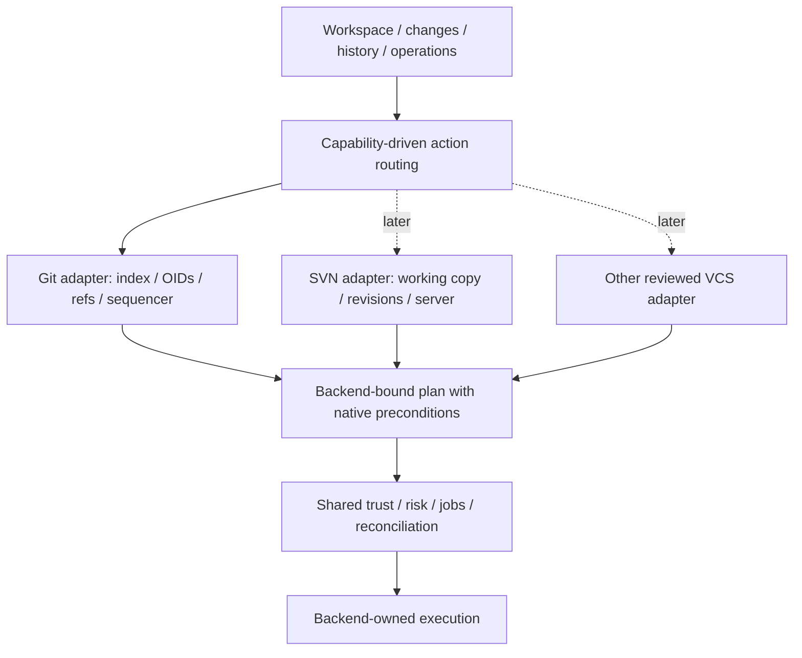

# 15 · VCS backend extension: Git first, SVN and others later

Parent: [PRD index](../PRD.md). Owns backend identity, capability dispatch, semantic isolation and the extension acceptance seam. Product delivery scope is owned by [01](PRD_01_product.md). Status: the Git adapter has read and selected local mutation implementations; the inert non-Git domain fixture is contract evidence only. End-to-end multi-backend persistence/UI/control acceptance remains incomplete. No SVN or other production VCS adapter is delivered.

## Outcome tree

```text
Outcome: ship focused Git workflows without blocking future source-control backends
├── Identity — backend kind, repository identity and working-copy identity
├── Capabilities — supported, unsupported, unavailable and constrained actions
├── Semantics — common envelopes with backend-owned detail and operation plans
└── Proof — Git adapter plus minimal non-Git contract fixture, no SVN runtime yet
```



## Scope and semantic boundary

M0–M3 implement Git only. They must establish a small built-in backend seam, without shipping an SVN client, probing/installing unused executables, loading plugins or adding a backend selector to every screen. Future SVN and other systems are additional adapters with their own requirements, not promises of automatic parity. Unknown or unsupported working copies receive a precise explanation; they must never be initialized or mutated as Git as a fallback.

Shared product concepts are working context, file changes, revision/history summaries, comparison requests, job/progress states, risk/confirmation, trust, diagnostics and durable UI context. Actual revisions, branch semantics, staging, locks, remote publication, conflict resolution and recovery stay backend-owned. Git-specific modules 04–09 remain normative for the Git adapter; they are not a universal VCS protocol.

SVN is the first design check because its working-copy and centralized revision/update/commit model differs from Git's local commit/index and separate push model. A working copy may carry mixed revisions; locks and versioned properties need native representation. Do not model SVN Update as an unlabeled Git Pull or require SVN to manufacture a Git index, commit DAG, stash or worktree family. This semantic distinction is grounded in the [Subversion working-copy model](https://svnbook.red-bean.com/en/1.8/svn.basic.in-action.html); concrete future SVN command/trust/recovery behavior requires its own reviewed specification.

## VCS versus remote transport

Backend kind describes source-control semantics: Git now, potentially SVN or another VCS later. A Git repository whose remote is stored in S3 remains Git, with the same index, OIDs, refs and local actions. Do not create a new VCS kind, duplicate local repository state or make generic VCS identities depend on an object-storage vendor.

Git remote-helper identity, transport capabilities and storage-format compatibility belong to [07](PRD_07_remotes.md#candidate-object-storage-remotes); executable and credential authority belongs to [11](PRD_11_security.md). An unavailable helper disables the affected remote operation, not local Git inspection/commit. This candidate introduces no dynamic plugin runtime or initialization for inactive providers.

## Minimal backend contract

| Contract area | Required envelope | Backend responsibility |
|---|---|---|
| Identity | `backend_id`, opaque `repository_id`, `working_copy_id`, backend schema version | Resolve/deduplicate real identity; retain original native paths/URLs; Git common-dir is a Git-specific coordination key |
| Revision | Backend-tagged opaque revision token plus display label | Git object format/OID; future SVN repository identity + revision/path context; no universal fixed hash or integer conversion |
| Discovery | Bounded result with supported/unsupported/ambiguous reason | No executable scans for inactive adapters; nested/mixed VCS roots require explicit target choice |
| Capabilities | Feature ID, available/unsupported/unavailable/restricted state, reason and constraints | Expose actual semantics, prerequisites and effects; no inferred operation based on a matching display name |
| Read model | Generation-tagged paged change/history/diff envelopes with optional backend detail | Preserve index stages, properties, server state, lock info or topology only where meaningful |
| Mutations | Typed action, exact backend-native targets/preconditions, risk and reconciliation method | Generate/execute native plan; shared gate must not translate a generic verb into a guessed native operation |
| Trust/auth | Required execution/network capabilities and credential interaction type | Future backend-specific config/helper/credential policy; Git quarantine is not automatically an SVN sandbox |
| Recovery | Actual interruption state, supported next actions and recovery limits | No generic rollback guarantee or Git reflog assumption |

The action model uses namespaced backend verbs where semantics differ (`git.stage`, `git.push`; future `svn.update`/`svn.commit`) while the UI can share familiar view labels. Capabilities, not a broad `if backend == git` spread across all views, decide which controls render. Git-only staging lanes and graph lanes are adapter-specific components. In an actual multi-backend release, an unavailable applicable action shows a reason; fundamentally inapplicable concepts are absent. Never display dummy staging/branch controls for SVN.

## Storage, safety and resource implications

Persist backend tags from the first schema, including bookmarks, drafts, revision tokens, trust grants, recovery records and queued plans. A Git record cannot be opened through an SVN adapter even if a path is reused. Control schemas announce backend kind/capabilities; incompatible major versions fail safely. The first plan format includes backend identity and capability generation in its binding; a backend switch invalidates all old plans.

Keep shared scheduling, bounded streams, progress, cancellation and privacy mechanisms reusable, but let each backend declare the true writer scope and authoritative post-state probes. Git common-dir serialization remains owned by 02; future SVN working-copy/server constraints must not weaken it. Dispatch is in process with statically registered adapters; no service, dynamic plugin host, duplicate state daemon or idle worker per hypothetical backend. Only installed/selected enabled adapters are initialized. Reserving extensibility must not increase idle polling or load SVN libraries into the Git-only build.

## Current acceptance and future activation

By M0, exercise the real domain contract with a minimal inert non-Git fixture: opaque non-OID revision IDs, no staging or push capability, optional property-change data and unavailable remote state. This fixture is a contract check, not an SVN implementation or a second product engine. M0 covers capability routing, snapshot serialization, minimal persisted identity round-trip and plan rejection without requiring GUI/control transport. M1 extends it through the real view/action bindings and profile reload; M2 extends it through the public control schema. Unknown extension fields are preserved or rejected by the versioned schema, never coerced to Git fields. Git behavior tests still require actual Git fixtures under 14.

Before activating a real SVN adapter, add its command/trust matrix, local versus server mutation semantics, properties/locks/externals, authentication, conflict/recovery cases, clean installation prerequisites and native qualification. Other VCS follow the same admission process. No delivery date or backend parity claim is implied.

## Delivery contracts

| ID / leaf | Invariant | Observable evidence | Safe failure | Dependencies | Non-goal |
|---|---|---|---|---|---|
| VCS-01 · semantic separation | Shared workflows require no fake Git index/OID/ref model | QA-J14 non-Git capability/read-model fixture and Git regression | Explicit unsupported/inapplicable behavior | 02, 10 | Implement SVN in Git milestones |
| VCS-02 · durable identity | Backend-tagged state and plans cannot cross backend identity/generation | QA-J14 profile round-trip, reused path and stale-plan rejection | Reject without dispatch or mutation | 08, 13 | Silently reinterpret old records |
| VCS-03 · bounded extension | Inactive future backends add no runtime process, polling or credential probes | QA-J14 disabled-adapter instrumentation plus QA-J12 resource measurements | Keep adapter inactive; no fallback initialization | 11, 14 | Dynamic plugin framework |
